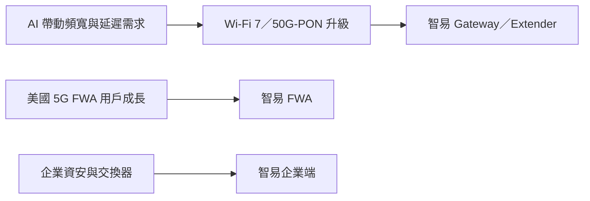

# 3596_智易（市）

## 基本資料

智易是寬頻與無線網通設備 ODM，產品涵蓋寬頻固網 Gateway、5G FWA、Wi-Fi Extender、交換器與企業資安設備。3Q26 營收 146.42 億元（季增 5%、年增 6%）、毛利率 14.9%、營業淨利率 6.9%、EPS 3.46 元；1–3Q26 EPS 9.96 元，單季與前三季皆創新高。3Q26 產品比重：行動通訊 42%、智慧家庭 29%、寬頻固網 27%；地區別美洲 60%、歐洲 28%、亞洲及其他 12%（來源：[[活動_智易3596_國泰CallMemo_20261110]]）。

## 核心技術／競爭優勢

- 北美 Tier 1 電信商與 MSO 客戶基礎，2027 年新增多家北美 Tier 1 客戶重要機種。
- 記憶體策略性備料：3Q26 存貨 393.78 億元中近 200 億元為記憶體，備料至 2027 年底，支撐記憶體漲價下的毛利率；代價是短期借款增至 86.88 億元。

## 產品與應用

| 產品 | 展望（國泰 call memo） |
|---|---|
| 寬頻（Wi-Fi 6→Wi-Fi 7；Wi-Fi 8、50G-PON 已開案，可能 2028 年出貨） | 2027 年兩位數以上成長 |
| 5G FWA | 美國電信商搶市占，2027–2028 年穩定成長 |
| 企業端資安設備 | 客戶為美國上市公司，2027 年案子增加 |
| Switch | 今年底至明年 3–4 個新客戶出貨 |

## 圖片 / 架構圖

圖說：智易 2027 年成長來自寬頻規格升級、北美新客戶與企業端資安／交換器。

## 時間軸

| 時間 | 事件 | 類型 | 重要性 |
|---|---|---|---|
| 2026-11-10 | 法說：2027 年展望由「審慎樂觀」改為「樂觀審慎」 | 法說 | ⭐⭐ |
| 2028 | Wi-Fi 8、50G-PON 可能出貨 | 規格升級 | ⭐ |

## 供應鏈位置

- 下游：北美大型電信商、MSO；歐洲電信商。
- 上游：網通晶片與記憶體（晶片漲價壓縮毛利）。

## 相關公司

原文未揭露具名客戶或供應商，`related_companies` 暫留空。

## 來源

- [[活動_智易3596_國泰CallMemo_20261110]]（國泰證期 call memo，2026-11-10 法說）
