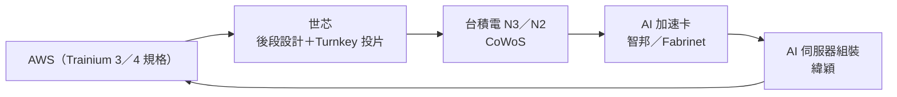

# 3661_世芯-KY（市）

## 基本資料

世芯電子（3661 TT，Alchip Technologies，-KY 代表開曼群島設立）是台灣最重要的 ASIC 設計服務公司之一，目前最大驅動力為 Amazon Trainium 3（Trn3）AI 訓練芯片的設計與量產，下一世代 Trainium 4（Trn4）亦已在規畫中。

成長驅動：Amazon Trainium 3 進入大量出貨（2026E 180 萬套、2027E 280 萬套），CoWoS 封裝需求快速拉升；AI 雲端基礎架構廠商（Hyperscaler）偏向自研 ASIC 以降低依賴 Nvidia 高成本 GPU 的結構性趨勢。

FY2026E EPS 約 NT$154（+123% YoY）；FY2027E 約 NT$212（+38%）。（依 UBS P/E 倒推，UBS 未提供明確 EPS 數字）

資料來源：[[報告_UBS_雲端AI_20260701]]（2026-07-01，UBS，Sunny Lin / Randy Abrams）

### 2026-10-21 中信投顧 ASIC 產業近況

- 3Q26 連續 3 個月營收創新高，單季 262 億元；2Q26 營收 76 億元（YoY -16.5%、QoQ +82.5%），Trainium3 6 月開始量產，2H26 持續放量。
- Trainium4 採 Chiplet、需多次 Tape-out，已進入最後階段，預計 2026 年底完成全部 Tape-out、2027 年底量產；世芯為獨家設計夥伴，負責 Compute die、I/O die 與 2.5D／3D 封裝整合，2nm 使 ASP 與毛利率較 3nm Trainium3 仍有成長空間。
- 車用：理想汽車 ADAS 第一代晶片 1Q26 出貨、搭載 5 月交付的新一代 L9，已拿下接下來兩代，第一款預計 3Q26 末或 4Q26 初 Tape-out，車用為 2026 年第二大營收來源。
- 來源：[[報告_中信_ASIC產業近況_20261021]]（中信投顧，2026-10-21），信心中。

### 2026-11-06 3Q26 法說（國泰 call memo）

- **3Q26 財務（fact／高）：** 營收 US$819.3mn（QoQ +238.9%、YoY +267.4%）；營業利益 US$114.0mn；稅後淨利 US$102.0mn；EPS 37.7 元，營收、淨利、EPS 均創單季新高。毛利 US$147.5mn、毛利率約 18%（QoQ 明顯下降），因量產營收占比升高、部分高毛利專案受供應限制、部分 NRE 認列遞延。
- **結構：** HPC 占 87%（2Q26 50%）；北美占 84%（2Q26 51%）；3nm／2nm 占 80%。CPU、Gaming、Consumer 合計仍逾 US$100mn；若無晶圓、載板、封裝供應限制，3Q26 原可多約 US$100mn。
- **N3 accelerator：** 已大量生產、良率符合預期，為最大營收來源，現世代生產約兩年；4Q26 營收略高於 3Q26，2027 年 N3 本身與公司整體皆三位數 YoY 成長，主因取得更多 allocation（GDR 後資金限制改善）。本 memo 未點名客戶，wiki 既有資料對應北美 CSP Trainium3。
- **N2 accelerator：** GAA＋chiplet、2.5D 封裝；4Q26 開始一系列 Tape-out，4Q27 prototype 與低量生產，2028 年放量；世芯負責所有 die（含 IO die）的 physical design 與整合，為唯一 physical design 供應商，量產由客戶與世芯直接向 [[2330_台積電（市）]] 下單，管理層認為 N2 規模不低於 N3。
- **新大型 design win：** 美國新直接客戶（非中國），billion-dollar 規模，2Q27 起貢獻並延續至 3Q、4Q，2027 年成第二大客戶，視為新合作模式起點。
- **毛利率與其他：** 4Q26 毛利率與 3Q26 相近，2026 全年混合毛利率目標 20% 以上；長期營利率目標高十位數百分比。AI 需求未轉弱，瓶頸在載板、封裝、測試產能；CPU／Networking 單一專案年營收 US$100–200mn。大型先進製程專案尖峰仍需約 150 名工程師，AI 僅能降低中段工程資源。

> [!warning] 與既有券商說法對照
> 中信 2026-10-21 寫 Trainium4「2026 年底完成全部 Tape-out、2027 年底量產」；本次公司說法為 N2「4Q26 開始一系列 Tape-out、4Q27 prototype 與低量生產、年底起量產營收」，時程大致一致但定義（量產 vs 低量生產）不同，並列保留。

來源：[[活動_世芯3661_國泰CallMemo_20261106]]（國泰證期，2026-11-06；公司說法 fact／高，展望為 guidance）。選後美國資料中心審批風險見 [[分析_美國資料中心產能延誤澄清]]。

### 2026-11-06～09 3Q26 法說後券商更新（Citi Buy TP NT$6,000／MS OW PT NT$5,888／中信買進 TP 5,175 元）

- **3Q26：** 淨利 NT$3.3bn（QoQ +98%、YoY +145%），優於 Citi 預估但低於市場；毛利率／營益率 18%／13.9% 為主要落差（Citi）。中信記營收 260.5 億元（YoY +297%、QoQ +241%）、毛利 47 億元、營業利益 36.3 億元、EPS 37.7 元；毛利率下滑因量產營收比重提高與高毛利 NRE 認列遞延；若無晶圓、ABF 載板與封裝產能限制，營收可再多約 US$1 億。MS 2026 EPS 下修 20%（營收認列遞延至 2027、毛利率略低於公司 20% 目標）。
- **4Q26（guidance／estimate）：** Trainium3 出貨擴大，營收再創單季新高，毛利率與 3Q26 相當、接近 20%，2026 年毛利率目標 20% 以上；MS 估 2026 年營收約 US$2.3～2.4bn。
- **N3／N2 主力客戶（AWS）：** 3nm Trainium3 取得更多晶圓分配，2027 年營收成長逾 100%；2nm Trainium4 即將 Tape-out（中信：4Q26 Tape-out、4Q27 小規模試產、2028 年放量），世芯為唯一實體（physical）設計服務商，負責 compute 與 I/O die；客戶表示 N2 只有客戶與世芯兩方向 [[2330_台積電（市）]] 投片，可避開次級晶圓分流，強化產能分配與議價地位，但商務條件尚未完全定案（Citi）。N2 涉及 GAA、chiplet 與先進封裝，工程價值高於 N3。
- **第二大客戶：** 已完成簽約並啟動，為美國大型業者（MS 判斷為美國主要 CSP），2Q27 起貢獻量產收入而非僅 NRE，公司稱為長期合作開端，後續有更多專案。MS 估 2027 年約 US$1bn、2028 年再增 20%；MS 先前認為世芯是 Google TPU KGD 後段設計的主要候選者，此判斷不變。
- **2027～2028 營收：** 管理層認為 MS 的 2027 年 US$4.5～5.0bn（較 2026 年倍增）合理；中信估 2027 年 US$40～50 億、三位數成長；MS 認為 2028 年可再倍增（Trainium4 量產、第二與第三家美國 CSP）。
- **限制與毛利：** 公司表示客戶端未見放緩，瓶頸在 PCB、載板、被動元件與先進製程產能，大型 AI 專案優先取得配置；Citi 指 2028 年限制可能由需求轉為世芯支應晶圓採購承諾的資金能力（營運資金、客戶付款條件、潛在增資）。長期營益率目標接近 20%；MS 認為新客戶專案毛利率具稀釋性，並調降非美系 CSP 客戶貢獻（產能優先給 CSP）。
- **券商觀點：** Citi 維持 Buy，TP 由 NT$6,800 降至 NT$6,000（27x 2027E EPS，前次 35x，反映總經與 AI 政策不確定），2027/2028 EPS 上修 14%／13% 至 NT$220.79／334.60。MS 維持 Overweight，PT NT$5,888 不變，2027/28 EPS 變動 <1%。中信維持買進，TP 由 5,640 元降至 5,175 元（2027 EPS 207 元 × 25 倍）。

> [!warning] 數字與口徑差異
> - 中信原文寫 3Q26 營收「2.42 億美元（YoY +267%、QoQ +239%）」，與同文台幣 260.5 億元及國泰 call memo 的 US$819.3mn 換算不一致，美元數字疑為誤植；以台幣與國泰數字為準，原文照錄。
> - 第二大客戶規模：MS 估 2027 年約 US$1bn（公司稱可達 US$1bn），中信寫「每年數十億美元等級」，並列保留。

來源：[[報告_Citi_世芯3661_20261106]]（Citi，2026-11-06）、[[報告_MorganStanley_世芯3661_20261108]]（Morgan Stanley，2026-11-08）、[[報告_中信_世芯3661_20261109]]（中信投顧，2026-11-09）；財報 fact，客戶與營收規模為 guidance／estimate，信心中高。

## 核心技術／競爭優勢

- **ASIC 設計服務龍頭**：深度整合 TSMC N3 製程，具備超大尺寸 die（1,600mm²）設計能力
- **Amazon 深度合作**：Trainium 1/2 已量產，Trn3 進入 N3 量產，Trn4 接續規畫
- **CoWoS 封裝深度配合**：Trn3 採 CoWoS 封裝，世芯直接受惠 TSMC CoWoS 擴產
- **競爭壁壘**：Amazon 自研 ASIC 長期合作模式，切換成本高，一旦進入量產週期盈利能見度高

## AI ASIC 供應鏈數據

### CoWoS 需求（Amazon Trainium via Alchip）

| 年度 | CoWoS 封裝需求（k wafers） | YoY |
|------|--------------------------|-----|
| 2024 | 26 | — |
| 2025 | 5 | -81%（Trn2 換代空窗） |
| 2026E | 72 | +1,340% |
| 2027E | 132 | +83% |

### Chip 出貨單位

| 年度 | Amazon Trainium-Alchip 出貨（k chips） |
|------|--------------------------------------|
| 2024 | 1,000 |
| 2025 | 176 |
| 2026E | 1,800 |
| 2027E | 3,100（UBS 由 2,300 上調） |

## 圖片 / 架構圖

![[報告_Macquarie_世芯_20260918_002.png]]

圖說：麥格理整理的世芯營收應用別結構。HPC（含 CPU 與 AI）在 2022–2024 年多數季度占營收八成以上，2025 年 Trainium 換代空窗後降至約五到六成，網通與消費性比重上升；3nm AI ASIC 自 2026 年 6 月出貨後，HPC 占比能否回升，是判斷營收成長是否來自主力 CSP 專案的直接指標。（來源：[[報告_Macquarie_世芯_20260918]]，2026-09-18）

圖說：依麥格理 Figure 3 AI ASIC 專案表整理，世芯在 AWS Trainium 3（3nm）與 Trainium 4（2nm，估 2027 量產）負責後段設計；加速卡由智邦／Fabrinet、伺服器由緯穎組裝。後續世代分工仍屬券商整理，信心中。

## EPS 預估

| 年度 | EPS（NT$，估算） | P/E | 評等 |
|------|---------------|-----|------|
| 2026E | ~154 | 27.1x | Buy |
| 2027E | ~212 | 19.7x | Buy |

（基準股價 NT$4,180，2026-06-30；P/E 倒推計算）

## 目標價與評等

| 券商 | 報告日 | 評等 | 目標價 | 評價基礎 | 來源 |
|------|-------|------|--------|----------|------|
| UBS | 2026-07-01 | Buy | NT$6,000 | — | [[報告_UBS_雲端AI_20260701]] |
| 麥格理 | 2026-09-18 | Outperform | NT$6,784（前次 NT$6,542） | 26x 2028E PER（前次 30x） | [[報告_Macquarie_世芯_20260918]] |
| Citi | 2026-11-06 | Buy | NT$6,000（前次 NT$6,800） | 27x 2027E EPS | [[報告_Citi_世芯3661_20261106]] |
| Morgan Stanley | 2026-11-08 | Overweight | NT$5,888（不變） | RI 模型（隱含 26x 2027e EPS） | [[報告_MorganStanley_世芯3661_20261108]] |
| 中信投顧 | 2026-11-09 | 買進 | NT$5,175（前次 NT$5,640） | 25x 2027F EPS 207 元 | [[報告_中信_世芯3661_20261109]] |
| 國泰證期 | 2026-11-12 | 買進 | NT$4,670（原 NT$4,700） | 22x FY27E EPS | [[報告_國泰_世芯3661_20261112]] |

（基準股價 NT$4,180，2026-06-30；市值 USD 10,670m；上漲空間 +43.5%）

### 目標價歷史

| 日期 | 評等 | TP |
|------|------|-----|
| 2026-07-01 | Buy | NT$6,000 |
| 2026-09-18 | Outperform（麥格理） | NT$6,784 |

## 供應鏈位置

- **設計製程**：[[2330_台積電（市）]] N3（die 1,600mm²）
- **封裝**：[[2330_台積電（市）]] CoWoS（主）、[[3711_日月光投控（市）]]（增量）
- **終端客戶**：Amazon（Trainium 3 / 4 AI 訓練芯片）
- **競爭對手**：Marvell（Amazon Trainium 2.5 → 逐漸淡出）

> [!warning] 風險
> - Amazon Trainium 需求低於預期（2025 出貨僅 176k 大幅低於 2024 年 1,000k，顯示換代空窗風險）
> - 客戶集中度高（Amazon 佔絕大部分收入）
> - TSMC N3 / CoWoS 供給制約
> - 地緣政治風險（美中科技出口管制）

## 時間軸

| 日期 | 事件 |
|------|------|
| 2025 | Trainium 2.5 → 3 換代，出貨量大幅下滑（176k chips） |
| 2026Q2 | Trn3 量產開始（TSMC N3，CoWoS 封裝） |
| 2026E | Trn3 出貨 1,800k chips；CoWoS 需求 72k wafers |
| 2027E | Trn3 出貨擴大至 3,100k chips；Trn4 規畫明朗化 |
| 2026 年底前 | 主力客戶下一世代 AI ASIC tape-out（公司表示有信心年底前完成；麥格理 2026-09-18） |
| 2027 | Trainium 4（2nm）估量產；網通相關 ASIC 專案開始貢獻（麥格理 estimate） |
| 2026-11-06 | 3Q26 法說：營收 US$819.3mn（QoQ +238.9%）、EPS 37.7 元創高；4Q26 營收再創高（[[活動_世芯3661_國泰CallMemo_20261106]]） |
| 4Q26 | N2 accelerator 開始一系列 Tape-out（公司說法） |
| 2Q27 | 新美國直接客戶 billion-dollar 專案開始貢獻，2027 年成第二大客戶（公司說法） |
| 4Q27 | N2 prototype 與低量生產，年底起有量產營收；2028 年放量（公司說法） |

| 2026 年底 | Trainium4 完成全部 Tape-out | 技術下線 | ⭐⭐⭐ | [[報告_中信_ASIC產業近況_20261021]] |
| 2027 年底 | Trainium4 量產 | 量產 | ⭐⭐⭐ | [[報告_中信_ASIC產業近況_20261021]] |## 來源

- [[20260623_1351_GREATER_20260622_1746]]（2026-06-22）
- [[260813_ms_alchip]]（2026-08-13）
- [[260824_3443_3661_2454_ms_AI-supply-chain]]（2026-08-24）
- [[世芯-KY(3661,B_買進)-CTBC260817]]（2026-08-17）
- [[報告_BofA_世芯-KY_20260814]]（2026-08-14）
- [[報告_Citi_世芯-KY_20260814]]（2026-08-14）
- [[報告_MorganStanley_世芯-KY_20260814]]（2026-08-14）
- [[報告_UBS_雲端AI_20260701]]（2026-07-01）
- [[月營收評析-ASIC與PMIC產業-CTBC260914]]（2026-09-14）
- [[報告_Macquarie_世芯_20260918]]（2026-09-18，麥格理；3nm ramp、下一世代 tape-out、TP NT$6,784）

## 本次 ingest 更新（2026-08-14 報告）

- Citi 維持 Buy，目標價由 NT$6,200 上調至 NT$6,800；Citi 估 3nm AI 加速器 2H26 持續放量，2nm 後繼產品預計 2027 年底前後生產，屬券商 estimate／公司展望。
- BofA 維持 Buy、PO NT$6,100，估 Trainium3 2026／2027 年對世芯營收約 US$1.3bn／US$2.2bn；Trainium4 2nm 目標 4Q26 tape-out、4Q27 生產，屬券商 estimate。
- Morgan Stanley 維持 Overweight；2nm TAM 與大客戶 allocation 仍在研究，報告明確指出未獲公司確認，不能視為已確認訂單。

新增來源：[[報告_Citi_世芯-KY_20260814]]、[[報告_BofA_世芯-KY_20260814]]、[[報告_MorganStanley_世芯-KY_20260814]]。

## Morgan Stanley 2026-08-13 更新

- MS 維持目標價 NT$5,088，2026E／2027E／2028E EPS 為 NT$162.51／181.22／218.27，屬券商 estimate。
- 3nm 出貨於 2026 年 6–7 月加速，ADAS 晶片已向理想汽車出貨；Amazon 與另一家美系 AI 公司擴大合作為報告轉述，信心中。
- 主要驗證點為 N3 量產爬坡、超大尺寸 ASIC 良率與雲端客戶拉貨節奏。

來源：[[260813_ms_alchip]]（Morgan Stanley，2026-08-13）。

- [[報告_UBS_雲端AI_20260701]]（2026-07-01，UBS，Sunny Lin / Randy Abrams）

## 相關頁面

- [[分析_緯創緯穎專家紀要_AWS集中度與ODM訂單機制_20261028]]
- [[分析_2026-10-15_台積電3Q26法說與AI硬體券商更新]]
- [[分析_2026-08_AI網通與硬體報告更新]]
- [[時程_2026Q3Q4_AI網通與硬體催化劑]]
- [[時程_2026記憶體與AI催化劑]]
- [[分析_聯發科AI_ASIC]]
- [[3443_創意電子（市）]]
- [[2454_聯發科（市）]]
- [[技術_AI推論與ASIC平台]]（2026-10-27 批次新增引用）
- [[時程_2026-2028十月券商催化劑]]（2026-10-27 批次新增引用）

## 本次 ingest 更新（2026-08-17）

- 中信報告指出 Trainium3 已於 2026 年 5 月底開始量產，後續季度逐步放量；Trainium4 按原計畫推進，屬券商 estimate／公司展望，信心中。
- 2026Q2 營收季增 82.6%，報告給予目標價 NT$5,640，較前次 NT$7,000 下修；下修反映評價與獲利假設變化，與既有 Citi、BofA、MS 估計並列，不抹平差異。
- 相關來源：[[世芯-KY(3661,B_買進)-CTBC260817]]。

## 麥格理 2026-09-18 更新

- 麥格理維持 Outperform，目標價由 NT$6,542 上調至 NT$6,784；評價倍數由 30x 降至 26x 2028E PER，理由是回到歷史平均並反映客戶集中度（基準股價 NT$3,540，2026-09-18）。
- 2026E／2027E／2028E EPS 上調 9%／27%／20% 至 NT$141.6／209.9／260.9；營收估 NT$668 億／1,260 億／1,570 億（2026E +116%、2027E +89%），2027–28E 毛利率假設降至 20%，反映 Turnkey 投片占比提高。均屬券商 estimate，信心中。
- 季度模型：3Q26E 營收 NT$250 億（QoQ +227%）、4Q26E NT$300 億；1Q27E 起維持每季約 NT$300–330 億平台，EPS 3Q26E NT$47.03、4Q26E NT$56.99。
- 公司於 2Q26 法說重申營收成長「至少與 AI ASIC 產業同步至 2029 年」，並有信心年底前完成下一世代 AI ASIC tape-out；另「高度有信心」再取得一家大型 CSP 客戶，但麥格理未納入預估（公司展望，信心中低）。
- 其他成長來源：網通相關 ASIC 專案支撐 2027 年後成長，首個大型 ADAS 專案已於 1Q26 放量。麥格理不擔心主力客戶與其他半導體同業簽約，並指出最大客戶曾兩度入股世芯。
- 風險：專案放量延遲、主要客戶砍單（含美國半導體管制影響）、未取得下一世代專案。

> [!warning] 券商估值口徑差異
> 麥格理 2026E EPS NT$141.6 低於 Morgan Stanley 2026-08-13 的 NT$162.51；目標價 NT$6,784 介於中信 NT$5,640 與 Citi NT$6,800 之間。各券商對 Turnkey 營收占比與毛利率稀釋假設不同，並列保留。

來源：[[報告_Macquarie_世芯_20260918]]（麥格理，2026-09-18）。

## 2026-11-10 凱基更新

- 3Q26 EPS 創新高；新取得 10 億美元等級設計案（首次合作的美系企業 HPC 晶片），2Q27 起貢獻量產營收，2027 年即成為第二大營收來源。[[報告_凱基_世芯3661_20261110]]
- 美系 CSP 3nm AI 加速器已大量生產，客戶提高 allocation，2027 年此案營收年增三位數；3nm 量產約兩年，延續至 2028 年。
- 2nm（chiplet＋GAA）4Q26 起 tape-out、4Q27 小量、2028 年初大量量產；世芯負責含 I/O die 的全部 physical design 與整合，客戶承諾 2nm 晶圓只由客戶與世芯下單；2nm ASP 估為 3nm 兩倍以上；A14 NRE 2027 年起貢獻。美系 CSP turnkey 營收估占 2027 年 68–70%。
- 凱基維持增加持股，TP NT$6,600（原 6,180）；完成 5.1 億美元 GDS 募資。

## 2026-11-12 中信 10 月營收

- 10 月營收 102.6 億元（年增 515.8%）；Trainium3 自 4Q26 每月維持百億元以上，Trainium4 4Q26 tape-out、2028 年量產；第二大美系客戶 2Q27 起每年貢獻數十億美元；毛利率近 20%。買進，TP 5,175 元；EPS 2026／2027 年 119.29／207.08 元。（[[報告_中信_ASIC與PMIC10月營收_20261112]]）

## 2026-11-12 國泰個股報告

- 國泰：買進，TP NT$4,700 → NT$4,670（22x FY27E EPS；收盤 NT$3,650）。預估 2026 年營收 739 億元（年增 138.8%）、2027 年 1,495 億元（年增 102%），EPS 122.29／207.84 元（estimate）。
- 3nm CSP AI ASIC 大量出貨，已確保所需產能；下一代 2nm 世芯為主要合作夥伴，4Q26 tape-out，首批量產推估 4Q27，單價與毛利率高於 3nm；N2 改採 Chiplet（Compute Die、I/O Die 實體設計與整合），研究部推估 N2 出貨約 250 萬顆。3nm AI ASIC 2026 年貢獻約 US$18 億。
- 第二家北美客戶取得 design win，預估 2Q27 開始貢獻、為全年第二大客戶；直接與客戶合作（Co-owned Model），規模達十億美元級別。
- 車用（大陸客戶）為 2026 年第二大營收來源，每車平均約 2 顆晶片、高端 4 顆。部分高毛利業務受晶圓、載板、封裝產能限制，部分 NRE 遞延；供應鏈瓶頸（先進製程、封裝、載板、PCB、測試）比終端需求不足更明顯。
- 來源：[[報告_國泰_世芯3661_20261112]]。

## 來源

- [[報告_國泰_世芯3661_20261112]] — 國泰證期，2026-11-12；買進、TP NT$4,670。
- [[報告_中信_ASIC與PMIC10月營收_20261112]] — 中信投顧，2026-11-12；10 月營收、Trainium3／4、第二大客戶
- [[活動_世芯3661_國泰CallMemo_20261106]] — 國泰證期 call memo，2026-11-06；3Q26 法說、N2 Tape-out、新美國客戶
- [[報告_中信_ASIC產業近況_20261021]] — 中信投顧 ASIC 產業近況，2026-10-21

- [[報告_華南投顧_第四季總經股市產業展望_20261102]]（2026-11-02）

- [[報告_Citi_世芯3661_20261106]]（2026-11-06）
- [[報告_MorganStanley_世芯3661_20261108]]（2026-11-08）
- [[報告_中信_世芯3661_20261109]]（2026-11-09）

- [[報告_凱基_ASIC設計服務聯發科創意世芯_20261110]]（2026-11-10）
- [[報告_凱基_世芯3661_20261110]]（2026-11-10）
