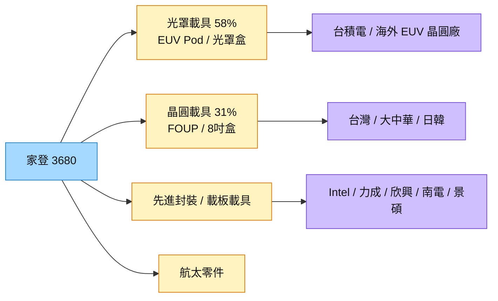

# 3680_家登（櫃）

## 基本資料

家登精密提供光罩與晶圓保護載具：通過 ASML 認證的 EUV 光罩盒（EUV Pod）、一般黃光光罩盒、12 吋 FOUP 與 8 吋晶圓盒，並延伸至先進封裝載具、載板載具與航太精密零件。子公司家碩提供光罩清洗、交換機與自動化設備。

- **營運：** 2Q26 營收 41.80 億元（YoY +22%）、毛利率 43%、EPS 8.09 元；2026 年 1–7 月集團營收 50.5 億元（YoY +29%），產能持續滿載。2Q26 產品組合：光罩載具 58%、晶圓載具 31%、其他 11%；大中華營收占比 29%。
- **EUV Pod：** 管理層稱市場近乎獨占、約領先競爭對手 1–1.5 個世代；1–7 月 EUV Pod 營收已達 2025 全年 82%（海外達 150%），2026 年 EUV Pod YoY +50% 以上可期。
- **先進封裝載具：** 1–7 月營收已達 2025 全年 244%；600×600mm 面板級封裝載具已有客戶使用，510×515mm 載具已交貨 Intel、力成；與欣興、南電、景碩開發高潔淨度載板載具。2H26 小量出貨，2027 年為較明確量產時點。
- **航太：** 過去兩年約以 60% 速度成長；美國亞利桑那州零件加工廠 2026 年 9 月開始產地驗證、4Q26 pilot run。

資料來源：[[活動_家登3680_法說與SEMICON_Memo_20260827]]（法說 Callmemo 2026-08-27；國泰 SEMICON Memo 2026-09-03）

## 核心技術／競爭優勢

- **EUV Pod 近乎獨占：** 主要對手為國外廠商；家登以在地交期、服務速度與和大客戶共同開發次世代產品取勝。
- **驗證門檻高：** 載具須與晶圓廠上千台設備的機械手臂、取放高度相容，並長期確認不釋出影響製程的氣體；驗證期 1–5 年，進入後不易被替換。
- **耗材屬性：** 載具依使用年限與開關次數汰換，提供持續續單；製程每推進一個世代，光罩需求量約增一倍（產品需求邏輯，非財測）。
- **材料與射出能力：** 50–3,000 噸射出成型設備、數百項專利，低釋氣、低微粒、靜電消散設計。

## 產品與應用

| 產品 / 服務 | 應用 | 相關客戶 / 下游 |
|-------------|------|-----------------|
| EUV Pod（pellicle／non-pellicle） | 先進製程 EUV 曝光 | [[2330_台積電（市）]]、海外晶圓廠；[[ASML.NL(asml)]] 認證 |
| 12 吋 FOUP、8 吋晶圓盒 | 成熟／先進製程晶圓傳送 | 台灣、大中華、日韓晶圓廠 |
| 先進封裝載具（510×515、600×600 面板級） | FOPLP、CoPoS、OSAT | [[INTC.US(intel)]]、[[6239_力成（市）]] |
| 載板高潔淨度載具 | ABF／玻璃／CCL 新世代材料 | [[3037_欣興（市）]]、南電、景碩 |
| 光罩清洗／交換機（子公司家碩） | 光罩廠、晶圓廠 | 晶圓廠 |
| 航太精密零件 | 液壓、飛控、引擎、燃油系統 | 美國航太客戶 |

## 圖片 / 架構圖

圖說：家登營收以 EUV Pod 為核心獲利來源，先進封裝與面板級載具是 2027 年後的第二成長曲線。

## EPS 記錄

| 季度 | EPS (元) | 備註 |
|------|---------|------|
| 2Q26 | 8.09 | 毛利率 43%，業外金融評價與匯兌利益挹注 |
| 3Q26 | 4.46 | 營收 27.05 億元（QoQ +17%、YoY +63%），毛利率 46.0%、營益率 22.3%（[[報告_富邦_家登3680_20261119]]） |

## 富邦 2026-11-19：多重客戶降低不確定性

- 評等：買進，TP 由 NT$730 下修至 NT$500（目標本益比 28x→19x，FY27 EPS；股價 NT$357.50）；富邦估 FY26／FY27 EPS 17.47／25.76 元（Bloomberg 共識 16.32／23 元）（estimate／中）。
- **3Q26（fact）**：營收 27 億元、達富邦前估 102%；毛利率 46% 優於富邦預期 44.7%；EPS 4.46 元。10 月營收 MoM −18% 為工作天數較少造成遞延，富邦預估 4Q26 仍可季增。
- **EUV Pod**：上游設備供給若放緩對家登影響較大且有遞延性，月營收時程可能受牽動；但 [[ASML.NL(asml)]] 法說表示以預付款、FY29／FY30 訂單分配等方式確保客戶需求，並預估 FY28 供給端再增加 30%。邏輯廠貢獻將優於記憶體廠；FY27 訂單分配大致確定，先進製程稼動率難鬆動，EUV Pod 出貨帶動整體毛利率上升（thesis／中）。
- **FOUP**：韓系記憶體廠小批量出貨中，為確保爬坡順利，大量出貨略有遞延，不影響富邦財務預估；台灣 N2 新設計載具已通過客戶驗證，FY27 放量可提升單價與毛利率。Terafab 處早期接洽、需求未定；光罩載具進度較快，Super FOUP 等新概念載具仍在更前期討論。
- **先進封裝載具**：含子公司碩頂，約占 FY26 合併營收 8%；510 相關載具認列於家登。1–9 月家登先進封裝載具營收為 2025 年全年的 387%；更大規格載具單價較高、已接獲韓系 FY27 訂單，成長率將大幅高於公司平均。
- 評價下修理由：基礎建設放緩不確定性、設備商受影響可能性較大；本益比調至過去 5 年 20–45 倍區間下緣。

來源：[[報告_富邦_家登3680_20261119]]（富邦投顧公司速報，2026-11-19）。

## UBS 2026-11-19：3Q26 全面優於預期，2027 營收估 +31%

- 評等：Buy，TP 由 NT$710 下修至 NT$610（26x 2027–28E PE，原 30x；股價 NT$329）；UBS 上修 2026／27 EPS 14%／2% 至 16.49／19.57 元（estimate／中）。下修評價理由：族群評價下修、長期獲利 CAGR 由 29% 降至 26%。
- **3Q26（fact）**：營收高於 Visible Alpha 共識 5%、EPS 高於 16%，營收、毛利率與費用槓桿皆優於預期。UBS 估 4Q26 毛利率維持約 46%（EUV 光罩盒毛利率較佳），2026 全年營收 +34%（前估 +29%）。
- **2027 展望（estimate／中）**：營收 +31%、以量為主；毛利率 46%、費用率由 25% 降至 24%。若 FOUP 產能能再擴充則有上檔。
- **EUV 光罩盒**：2026 年銷售 +43%、2027 年 +30%，動能來自 [[2330_台積電（市）]] 先進製程擴產與 [[INTC.US(intel)]] 份額提升；UBS 估 2026 年出貨給 Intel 的 EUV Pod 接近年增 3 倍。DUV 光罩盒 2027 年 +15–20%，由中國邏輯客戶支撐。
- **中國 FOUP**：客戶由過去依賴 SMIC 等一線邏輯廠，擴展到邏輯與記憶體多元客戶；全球同業供給吃緊，UBS 估 2027 年 FOUP 營收 +40%。台積電端 N2 導入升級版 diffuser wafer FOUP，ASP 與毛利率較高。
- **先進封裝**：營收由 2026 年約 NT$0.3bn 增至 2027 年 NT$0.85bn，主要為載板廠用大尺寸面板 FOUP，另有 CoWoS 相關 FOUP。
- 公司概況（UBS 引述公司）：光罩載具全球市占約 70%、EUV Pod 市占約 85%，FOUP 為大中華區逾 50% 客戶的基準供應商。

來源：[[報告_UBS_家登3680_20261119]]（UBS，2026-11-19）。

## 時間軸

| 時間 | 事件 | 類型 | 重要性 | 備註 |
|------|------|------|--------|------|
| 2026-09 | 亞利桑那州航太零件廠產地驗證 | 擴產 | ⭐ | 4Q26 pilot run |
| 2H26 | 先進封裝載具小量出貨；日韓 FOUP 小量出貨 | 放量 | ⭐⭐ | 日韓 FOUP 最快下一季 |
| 2026 全年 | EUV Pod YoY +50% 以上 | 放量 | ⭐⭐⭐ | 管理層「應該可以期待」 |
| 2027 | 先進封裝／面板級載具較明確量產 | 放量 | ⭐⭐⭐ | [[活動_家登3680_法說與SEMICON_Memo_20260827]] |
| FY27 | 台灣 N2 新設計 FOUP 放量；韓系先進封裝載具 FY27 訂單出貨 | 放量 | ⭐⭐⭐ | [[報告_富邦_家登3680_20261119]] estimate／中；同步 [[時程_2026Q3Q4_AI網通與硬體催化劑]] |

→ 跨公司時程詳見 [[時程_2026-2027高速互連與分散式算力]]

## 供應鏈位置

- 下游：晶圓廠（EUV／黃光製程）、OSAT 與面板級封裝、載板廠
- 平行：子公司家碩（光罩清洗設備）、德鑫半導體聯盟（自動搬運、倉儲整合方案）
- 所屬供應鏈：[[供應鏈_先進封裝載板]]（載板與面板級載具）
- 技術背景：[[技術_FOPLP]]

## 相關公司

| 公司 | 關係 | 說明 |
|------|------|------|
| [[2330_台積電（市）]] | 客戶 | EUV Pod 與 FOUP 主要客戶 |
| [[ASML.NL(asml)]] | 設備認證 | EUV Pod 須通過 ASML 曝光機介面認證 |
| [[INTC.US(intel)]] | 客戶 | 510×515mm 先進封裝載具已交貨 |
| [[6239_力成（市）]] | 客戶 | 510×515mm 面板級封裝載具 |
| [[3037_欣興（市）]] | 共同開發 | 高潔淨度載板載具 |

## 風險與注意事項

> [!warning] 風險與注意事項
> - **費用上升：** 新廠折舊、海外人事、FOUP 驗證與先進封裝送樣費用增加。
> - **FOUP 驗證漫長：** 日韓 FOUP 仍在擴大 burn-in 階段，量產時點受客戶機台相容性驗證影響。
> - **先進封裝載具量能小：** 目前占營收比重仍小，2027 年量產時程取決於客戶面板級封裝進度。
> - **業外波動：** 2Q26 獲利含金融資產評價與匯兌利益。

## 來源

- [[報告_UBS_家登3680_20261119]] — UBS，2026-11-19；3Q26 營收／EPS 優於共識 5%／16%，2027 營收估 +31%，Buy／TP NT$610（原 710）。
- [[報告_富邦_家登3680_20261119]] — 富邦投顧，2026-11-19；3Q26 毛利率 46% 優於預期、N2 FOUP 通過驗證，買進／TP NT$500（原 730）。
- [[活動_家登3680_法說與SEMICON_Memo_20260827]] — 法說 Callmemo（2026-08-27）、國泰 SEMICON Memo（2026-09-03）
