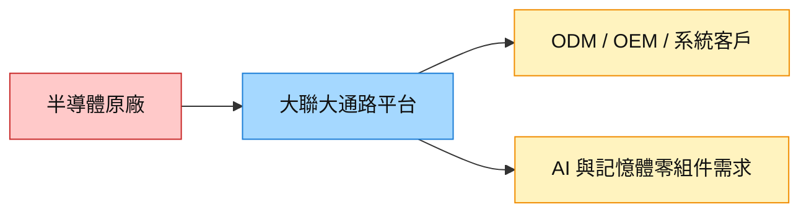

# 3702_大聯大（市）

## 基本資料

大聯大是台灣半導體與電子零組件通路商，透過代理、庫存與技術支援連接原廠與下游客戶。WPG 2026-08-18 報告重點為記憶體需求、AI 相關零組件與通路營運彈性；具體客戶與供應商關係仍以公司公告為準。

## 圖片 / 架構圖

圖說：大聯大位於原廠與電子製造／系統客戶之間，透過庫存與物流承接終端需求波動。

## 供應鏈位置

- 上游：多家半導體與電子零組件原廠。
- 下游：ODM、OEM、工控、網通與 AI 伺服器相關客戶；本批來源未提供可公開核實的單一客戶關係。
- 競爭：台灣主要同業為 [[3036_文曄（市）]]（群益 2026-11-18）。

## Morgan Stanley 2026-08-18 更新

- 2Q26 獲利受記憶體營收成長與 AI 需求支撐，但 3Q 展望含拉貨提前與記憶體業務季節性放緩因素。
- EPS、評價與庫存週轉均屬券商 estimate；來源：[[260818_ms_wpg]]（Morgan Stanley，2026-08-18），信心水準：中。

## 2026-08-18 法說補充（國泰 Call Memo）

- **2Q26：** 營收 4,562.11 億元（QoQ +44.1%、YoY +82.2%）、毛利率 4.43%、營業利益率 2.62%、稅後淨利 86.20 億元、EPS 5.12 元，營收與獲利超越財測並創高；1H26 EPS 8.42 元、年化 ROE 38.5%。
- **組合：** 元件中記憶體占比由 23% 升至 46%、核心元件降至 18%；應用以運算含伺服器 45%、通訊 15%、汽車 8%（車用 QoQ +53.3%）；交貨地中國大陸及香港由 70% 降至 63%、東南亞升至 19%；外商客戶占比由 13% 升至 23%。
- **3Q26 財測：** 營收 4,600–5,000 億元、毛利率 4.35–4.55%、EPS 5.45–6.15 元（匯率 32.2）；2Q 因客戶預期漲價與缺貨提前拉貨，3Q 僅個位數季增，但 2H 仍高於 1H。
- **產業看法：** AI 資料中心排擠功率元件、MOSFET、IGBT、SiC、GaN 等成熟製程產能；先進製程、先進封裝與記憶體擴產至 2027 年仍恐難完全滿足需求，記憶體需求強勢延續至 1H27；記憶體透過原廠 allocation 分配、公司稱不存在重複下單；伺服器量預估年增 8.8%。
- **資金：** 董事會決議發行上限 150 億元 CB4 支應營運資金；LaaS 約占集團 GMV 3.7%、每年雙位數成長。
- 來源：[[活動_大聯大3702_CallMemo_20260818]]（國泰證期，2026-08-18），公司財測與說法，信心中高。

## 2026-11-17 3Q26 法說：營收與 EPS 連兩季新高、記憶體占 58%

- **3Q26（fact）：** 營收 5,099.96 億元（QoQ +11.8%、YoY +108.6%），超越財測高標 5,000 億元；毛利率 4.42%；營業利益 144.96 億元（QoQ +21.3%、YoY +171%），營益率 2.84%；稅後 103.9 億元（QoQ +20.5%、YoY +226.9%），EPS 5.96 元。1–3Q26 營收 1 兆 2,827 億元（YoY +72.5%）、EPS 14.42 元，已超過 2025 全年。首度提供調節表：扣除交換債一次性處分利益後 3Q26 EPS 約 5.29 元（2Q26 4.83 元）。
- **組合：** 記憶體占 58%（過往約 25%），核心元件 20%（中信）／25%（國泰）；應用以運算含伺服器 52%、通訊 11%、消費 9%、車用 7%、工業 5%；交貨地中國 62%、東南亞 18%、台灣 12%（金額翻倍）、其他（北美為主）8%；跨國客戶（OEM／ODM／CSP）由 14% 升至 23%，台商由 35% 降至 20%。CSP 客戶僅服務一家且屬後段，延伸空間大。
- **記憶體風險：** 除一家原廠外涵蓋全球主要記憶體品牌（HBM 未著墨），採 ship & debit／back-to-back，公司稱無庫存跌價風險；毛利率可能隨原廠 margin 調整小幅下降。公司引研調：2026 年半導體 US$1.68–1.7trn（YoY +108%），記憶體 YoY 約 +324%、占 55.4%；2027 年記憶體成長收斂至 44%、仍占 57.4%。伺服器出貨 2026／2027 年 +12.9%／+14.3%。
- **4Q26 財測（匯率 32.5）：** 營收 4,800–5,300 億元、毛利率 4.35%–4.55%、營益率 3.04%–3.12%（首次有機會站上 3%）、EPS 5.13–5.81 元。
- **LaaS：** 1–3Q26 GMV US$42.612bn（YoY +75.6%）、LaaS 營收 US$44.6mn（YoY +15.5%）；滲透率僅 3.4%（分母只計半導體），由台灣延伸至東南亞、北美，並擴及 AI 系統整合與資安。
- **財務：** Working capital 3,292 億元，營業現金流近兩季淨流出；財務費用占營收約 0.79%，借款約三分之二為美元；已發行 150 億元 CB4；股本 175.47 億元。
- **券商：** 台新維持買進、TP 130→105 元（5.5x 2027 PER；2026／27F EPS 19.11／19.02 元，預估 2027 年利息費用 YoY +56%），4Q26E EPS 5.09 元；中信推估 2026 全年 EPS 19.55–20.23 元、看法正向。
- 對 NVIDIA 事件：AI 趨勢不變，全球約 90% AI 伺服器整機／整櫃由台廠製造。
- 來源：[[活動_大聯大3702_國泰CallMemo_20261117]]（國泰證期，2026-11-17）；[[報告_台新_大聯大3702_20261118]]；[[報告_中信_大聯大3702_20261118]]。

### 2026-11-18 兆豐投顧：調降至逢低買進，TP 150→100 元

- 3Q26 營收優於財測（QoQ +0.4%~+9.1%）；排除可交換公司債評價及交換標的處分損益後 Non-GAAP EPS 5.29 元；業外 -16.8 億元（淨利息支出 40.3 億元，部分由投資收益 24.4 億元抵銷）。
- 兆豐預估 4Q26 營收 5,167 億元（QoQ +1.3%、YoY +102.3%）、毛利率 4.44%、EPS 5.70 元；2026／2027 年營收 17,994／20,909 億元（YoY +80.1%／+16.2%）、EPS 19.72／24.26 元（estimate）。
- 2026 年度配息預估 14.8 元（2027 年發放），殖利率約 18%；股價約 3x 2027F PER，位於近五年 3–23x 區間低位。考量殖利率支撐與 AI 需求，但代理商產業估值下修，評等由買進調為逢低買進，TP 100 元（4x 2027F PER）。
- 來源：[[報告_兆豐_大聯大3702_20261118]]。

### 2026-11-18 群益（Trading Buy，TP 90 元）與富邦（未評等）

- 群益：AI 伺服器與資料中心建置帶動記憶體、電源管理與網通元件拉貨；記憶體營收占比由 2Q26 54% 升至 3Q26 58%，大聯大代理記憶體晶片、模組與 SSD，尚未經營 HBM。管理層預期 2027 年全球記憶體市場仍成長但增速較 2026 趨緩；群益預期 AI 伺服器支撐 1Q27–3Q27 營收逐季成長，記憶體報價若回落短期對記憶體營收形成壓力，但可帶動手機與 PC 回暖及電源管理 IC、類比 IC、連接元件拉貨。LaaS 客戶由 OEM／ODM 延伸至 CSP，林口倉容量已滿，評估在桃園至新竹製造聚落增設據點、將倉儲延伸至客戶工廠附近，品項可能由半導體元件延伸至半成品與其他零組件；預估 2027 年營收 19,670.06 億元（YoY +11.49%）、營益率 3.07%、EPS 23.88 元（estimate／中）。考量 AI 投資疑慮升溫，給予 Trading Buy。
- 富邦（未評等）：管理層 11-17 稱業績成長來自地理擴至全球（北美、東南亞）、LaaS 加值服務、新增一家 CSP 客戶、記憶體代理原廠與品項完整；通路商不承擔晶片價格風險，記憶體價格若下跌庫存跌價損失有限，且記憶體大漲壓抑的終端需求可回補其他元件出貨。2027 年管理層預期半導體成長放緩但仍正成長，成長轉向常態化擴張、核心支撐為伺服器與資料中心；富邦估 FY26／27 EPS 19.73／20.94 元，較法說前 CMoney 共識高 15%／11%（estimate／中）；股價約 FY26 4.1x PER，位於歷史 4–22x 下緣。
- 來源：[[報告_群益_大聯大3702_20261118]]、[[報告_富邦_大聯大3702_20261118]]。

### 2026-11-20 Morgan Stanley：降評至 Equal-weight，TP NT$160→NT$79

- MS 與 [[3036_文曄（市）]] 同步降評：近期記憶體出貨量具韌性，但資料中心建置遞延（約 5GW 美國容量由 2028 移至 2029 年）、記憶體週期後段、高記憶體價格壓抑消費終端、Fed 升息使美元融資成本偏高（thesis／中）。
- MS 引述 3Q26（fact）：營收 NT$510bn（QoQ +11.8%、YoY +108.6%）、毛利率 4.42%、淨利 NT$10.39bn（QoQ +20.5%、YoY +226.9%）；記憶體占營收 58%（歷史約 25%），運算（AI 與伺服器）52%、通訊／手機 11%、消費 9%。管理層稱 ship-and-debit 模式降低存貨跌價風險；LaaS GMV YoY +75.6%（營收 +15.5%）。4Q26 指引：營收中值 NT$505bn（QoQ −1.0%）、毛利率中值 4.40%、EPS 中值 NT$5.47；財務成本約占營收 0.8%（三分之二為美元）。
- MS 2026／27／28 EPS 調整 +46%／+10%／−25% 至 NT$18.77／13.71／9.87（2027–28 年下修業外投資收益）；負債權益比 5.85x（3Q26）。MS 認為大聯大 AI GPU（多為直銷）與 AI ASIC 曝險有限、AI 運算曝險佳，消費市場營收曝險仍高（estimate／中）。
- 來源：[[報告_MorganStanley_半導體通路大聯大文曄_20261120]]。

## 來源

- [[報告_MorganStanley_半導體通路大聯大文曄_20261120]] — Morgan Stanley，2026-11-20；降評 EW、TP NT$79（原 160）。
- [[260818_ms_wpg]] — Morgan Stanley，2026-08-18
- [[活動_大聯大3702_CallMemo_20260818]] — 國泰證期法說 Call Memo，2026-08-18

- [[報告_中信_大聯大3702_20261118]]（2026-11-18）
- [[報告_兆豐_大聯大3702_20261118]]（2026-11-18，兆豐投顧；逢低買進 TP 100 元）
- [[報告_台新_大聯大3702_20261118]]（2026-11-18）
- [[報告_群益_大聯大3702_20261118]]（2026-11-18，群益投顧；Trading Buy TP 90 元）
- [[報告_富邦_大聯大3702_20261118]]（2026-11-18，富邦投顧；未評等）
- [[活動_大聯大3702_國泰CallMemo_20261117]]（2026-11-17）

## 相關頁面

- [[供應鏈_AI光互聯]]
