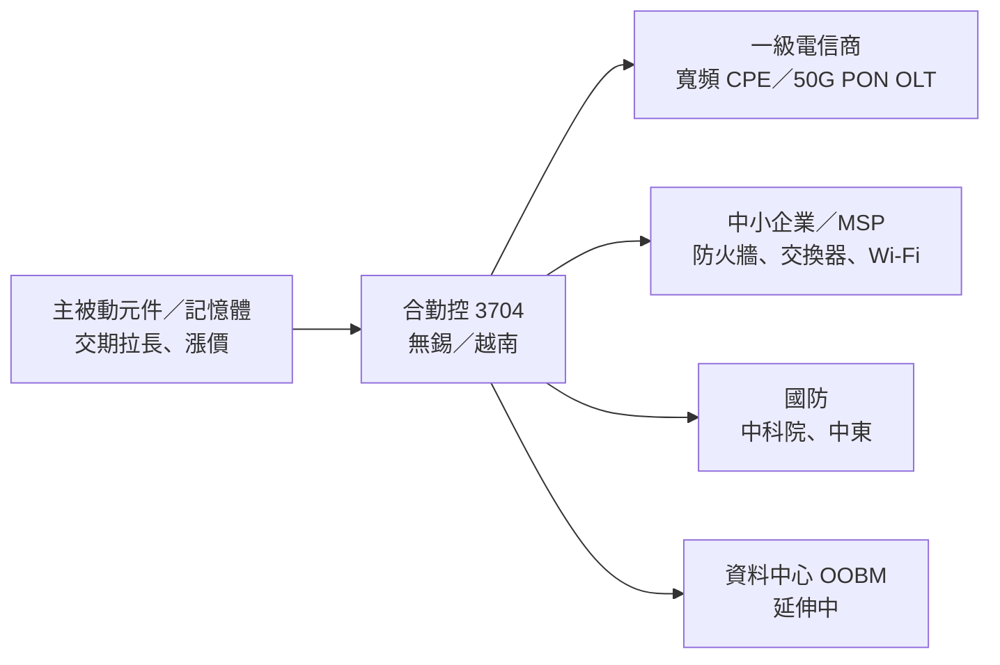

# 3704_合勤控（市）

## 基本資料

合勤控為網通設備控股公司，業務分為寬頻設備（電信商 CPE、PON 局端 OLT）、企業網通（防火牆、交換器、無線 AP 與雲端管理）與其他產品（以國防為主）。3Q26 營收 77.53 億元，寬頻 74%、企業網通 14%、其他 12%（[[活動_合勤控3704_國泰CallMemo_20261103]]，2026-11-03）。

- 主要產品：寬頻 CPE（prpl、RDK-B 開放架構）、50G PON OLT、防火牆／UTM、交換器、Wi-Fi AP、雲端管理平台、無人機通訊模組、國防通訊／雷達／電子戰產品。
- 應用：電信商寬頻、中小企業骨幹網路、MSP 代管、國防、資料中心頻外管理（OOBM，延伸中）。
- 供應鏈位置：電信商與企業客戶的網通設備供應商；主要生產基地中國無錫，越南基地試產中、2027 正式加入。

## 核心技術／競爭優勢

- 自研防火牆、有線交換器、無線基地台整合方案，2016 年起投入自主雲端管理平台，訂閱制軟體授權每年高雙位數成長。
- 已進入大型電信商 Wi-Fi 8 專案短名單；50G PON OLT 混合模式完成開發，歐洲客戶指定合作開發。
- 國防：通訊、雷達、電子戰技術投入約二十年，中科院為最大客戶。

## 產品與應用

| 業務 | 3Q26 營收 | 占比 | 年增／季增 |
|---|---|---|---|
| 寬頻設備 | 57.15 億元 | 74% | YoY +15%、QoQ -20% |
| 企業網通 | 11.08 億元 | 14% | YoY +26%、QoQ -1% |
| 其他產品（國防為主） | 9.30 億元 | 12% | YoY +62%、QoQ +83% |

## 圖片 / 架構圖

圖說：依 2026-11-03 國泰 call memo 整理的業務與客戶結構（Mermaid 補位，來源無圖）。

## 財務重點

| 指標 | 3Q26 | 1~3Q26 | 來源 |
|---|---|---|---|
| 營收 | 77.53 億元（QoQ -11.4%、YoY +20.8%） | 228.15 億元（YoY +16.2%） | [[活動_合勤控3704_國泰CallMemo_20261103]] |
| 毛利率 | 25.5%（QoQ +1.8ppt、YoY -4.4ppt） | 24.4% | 同上 |
| 營業費用 | 14.06 億元 | 41.73 億元 | 同上 |
| 稅後淨利 | 4.82 億元 | 11.28 億元 | 同上 |
| EPS | 1.15 元 | 2.71 元 | 同上 |

- 區域：3Q26 歐洲 47%、美洲 14%、新興市場及亞太 39%（YoY +65%）。
- 策略性備料使存貨增至 113.00 億元（QoQ +24.24 億元）；應收帳款收現天數 121 天。

## 時間軸

| 時間 | 事件 | 類型 | 重要性 | 備註 |
|---|---|---|---|---|
| 3Q26 | 部分大型電信商因記憶體漲價重新考慮資本支出、放緩拉貨 | 需求 | ⭐⭐ | 二、三級電信商需求仍增 |
| 4Q26 | 營收有季增機會，國防標案可望入帳 | 營運 | ⭐⭐ | 公司看法 |
| 2027 | Wi-Fi 8 有機會出貨；發表企業網通 Wi-Fi 8 產品 | 產品 | ⭐⭐ | 電信商短名單 |
| 2027 | 越南基地正式加入生產 | 產能 | ⭐⭐ | 降低地緣風險 |

## 供應鏈位置

- 上游：主動、被動元件與記憶體，AI 需求排擠下幾乎所有零組件漲價、交期拉長。
- 下游：歐洲一級電信商、南亞／南美／東南亞／紐澳電信商、中小企業與 MSP、中科院等國防單位。

## 相關公司

- 目前來源未揭露具名上市客戶或供應商，`related_companies` 暫留空。

## 近期營運與研究更新

### 2026-11-03 3Q26 法說（國泰 call memo）

- 3Q26 EPS 1.15 元，毛利率季升；4Q26 營收有季增機會、國防案可望入帳；Wi-Fi 8 2027 年有望出貨；越南廠 2027 加入生產。
- 記憶體漲幅超出製造商與客戶預期，必須協商漲價；每季費用約 14 億元。
- 新增邊緣 AI 運算產品線，目標未來一年與電信商討論智慧家庭部署；50G PON OLT 技術延伸至資料中心 OOBM。
- 範圍註記：網通設備，屬 AI 相關「網通與交換器」範圍；寬頻與國防比重高。
- 來源：[[活動_合勤控3704_國泰CallMemo_20261103]]。

## 來源

- [[活動_合勤控3704_國泰CallMemo_20261103]] — 國泰證期，2026-11-03 法說 call memo。

## 相關頁面

- [[時程_2026Q3Q4_AI網通與硬體催化劑]]
