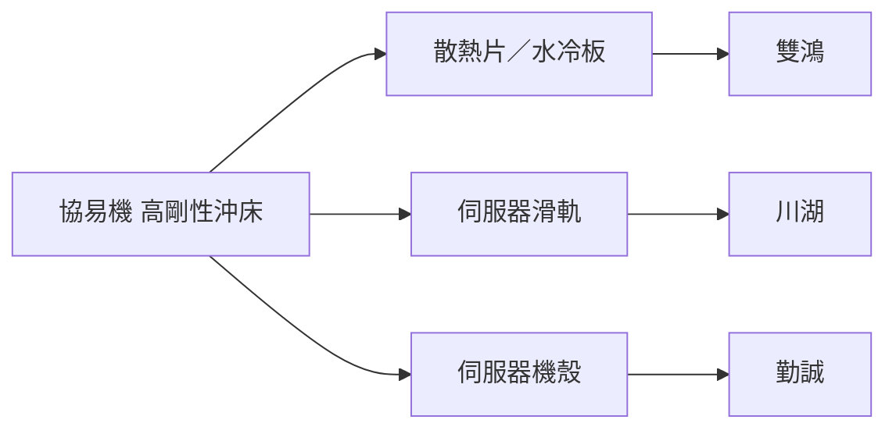

# 4533_協易機（市）

> [!note] 範圍待確認：本業為沖壓設備（工具機類），因 AI 伺服器機構件與散熱片客戶占比跳升而收錄。

## 基本資料

協易機為沖壓機（沖床）製造商。2025 年營業額約 US$129mn（約新台幣 40 億元）；2025 年集團人均產值約 570 萬元。

- **客戶產業**：過去最大為汽車（約 45%），近兩年汽車下滑；高階電子含伺服器占比由 2025 年約 15% 跳升至 2026 年 35%；高階家電約 30%；航太、醫療、農業等約 10%。
- **區域**：亞太區 37% 最多；美國受通膨、歐洲受戰爭、中國受內卷影響，僅東南亞表現佳。
- **1–3Q26（fact）**：營業額合計約 30 億元；外銷出貨集中於 4Q26（原訂 8、9 月延至 11、12 月）；油價、原物料與路權等成本侵蝕近兩年 EPS。截至 3Q26 資產總計 72 億元、權益 30 億元。

資料來源：[[活動_協易機4533_國泰CallMemo_20261123]]（國泰證期 call memo，2026-11-23）。

## 核心技術／競爭優勢

- 2027 年 1 月推出高剛性新機種：業界標準沖床變形量約 0.1–0.12mm，新機種僅 0.03mm，可在 0.1–0.2mm 厚度材料進行高複雜度成型，拉伸變形較傳統結構減少 40%，減少後段整形與折彎工程；此類規格過去由德、日壟斷，為台灣首次國產（公司說法）。
- 未來朝 0.01mm 以下精度、半導體設備精度發展。

## 產品與應用

| 應用 | 說明 | 觀察 |
|------|------|------|
| AI 伺服器散熱片、滑軌、機殼 | 客戶含勤誠、川湖、雙鴻 | 機櫃 24U→48U；滑軌需在 80–90% 懸空時承重 100 公斤；水冷板同體積散熱面積需二至四倍以上 |
| 汽車 B 柱、鈑金、電子散熱 | 全球車市 2026 年較 2025 年下滑約 15–28%，電動車最重 | 選擇客戶與應用 |
| 氫能燃料電池雙極板 | 卡車、貨車、巴士 | 持續推進 |
| 無人機 | 沖壓產值不高 | 持續承接 |

## 圖片 / 架構圖

## 營運展望

- AI 伺服器功耗由 Blackwell 1,000–1,200 瓦、Rubin 約 2,300 瓦到新產品 5,000 瓦以上，散熱片、滑軌、機殼需求只會更多（公司說法）。
- 若中東局勢、油價與散裝航線不造成困擾，4Q26 營運優於前幾季，2026 年營收較 2025 年微幅成長，部分出貨遞延至 2027 年 1 月；原物料漲勢趨緩、在手訂單佳，謹慎樂觀看 2027 年營收與獲利優於 2026 年，人均產值目標突破 600 萬元。
- 策略：產品高值化（台灣高值、中國普及量產，不盲目擴產）、分散市場（高階家電與 AI 伺服器）、生產智慧化。

## 時間軸

| 日期 | 事件 | 來源 |
|------|------|------|
| 2027-01（1Q27） | 高精度新機種發表 | [[活動_協易機4533_國泰CallMemo_20261123]] |

## 供應鏈位置

沖壓設備供應商，位於 AI 伺服器機構件（散熱、滑軌、機殼）製造商上游。

## 相關公司

| 公司 | 關係 | 來源 |
|------|------|------|
| [[8210_勤誠（市）]] | 客戶（機殼） | [[活動_協易機4533_國泰CallMemo_20261123]] |
| [[2059_川湖（市）]] | 客戶（滑軌） | [[活動_協易機4533_國泰CallMemo_20261123]] |
| [[3324_雙鴻（市）]] | 客戶（散熱） | [[活動_協易機4533_國泰CallMemo_20261123]] |

## 來源

- [[活動_協易機4533_國泰CallMemo_20261123]]（國泰證期 call memo，2026-11-23）

## 相關頁面

- [[8210_勤誠（市）]]
- [[2059_川湖（市）]]
- [[3324_雙鴻（市）]]
