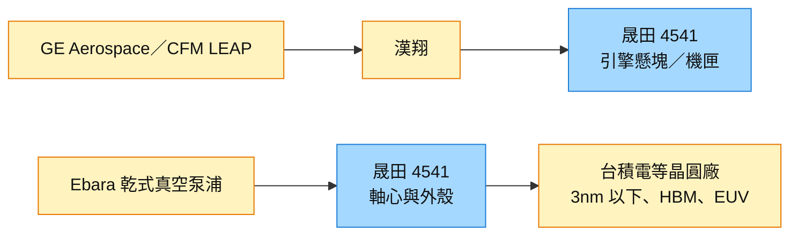

# 4541_晟田（櫃）

## 基本資料

晟田以航太與半導體零件加工為主，兩者合計占營收 9 成以上（航太約 7 成），定位為少量多樣的專業代工，目標朝 ODM 發展。產品分四類：航太客供料（主要客戶漢翔，最終交貨 GE Aerospace／CFM）、航太自購料、半導體設備零組件、其他精密零元件。

- 營運：1–3Q26 營收 15.60 億元（YoY +32.4%，創新高），毛利率約 24%；占比客供料 48%、自購料 25%、半導體 23%、其他 4%。客供料 7.50 億元（YoY +29.2%）、自購料 3.91 億元（+70.5%，客戶提前補庫存）、半導體 3.60 億元（+26.1%）、其他 0.59 億元（-28.6%，日幣弱勢下選擇守毛利率）。
- 展望：2026 年營收約 20 億元、毛利率約 24%；2027 年營收年增約 +20%（引擎懸塊新增 1.5 億元、半導體新增 7,000–8,000 萬元），毛利率 24%–25%；2027 年占比客供料 53%、自購料 22%、半導體 22%、其他 3%。
- 資料來源：[[活動_晟田4541_國泰CallMemo_20261022]]（國泰證期）、[[活動_統一投顧_晟田4541_20261022]]（統一投顧，初判正向），皆為 2026-10-22 法說。

## 核心技術／競爭優勢

- 航太引擎懸塊與機匣：客供料中 60% 為引擎懸塊與機匣，其中 70% 屬 CFM LEAP 引擎；零件無副廠件，新機與維修需求對供應商無差別。
- 半導體乾式真空泵浦（Roots 式）軸心與外殼：主要客戶日商 Ebara（E 社，占半導體營收 90%–95%），用於 3nm 以下邏輯、HBM、EUV、蝕刻、CVD；晟田為其海外唯一軸心與外殼供應商。其他客戶含 ASML、均華、均豪。
- 特殊製程：鍍鋅鎳（取代鍍鎘，用於民航機起落架）與高溫熱噴塗 HVOF（軍機起落架維修），2027 年 1 月（國泰稱 1Q27）進行 Nadcap 稽核，通過後可接單。
- 毛利率結構：客供料約 26%、自購料約 5%、半導體 35%–40%、其他 15%–20%；自購料材料由客戶指定、漲跌可轉嫁。

## 產品與應用

| 產品 / 服務 | 應用 | 相關客戶 / 下游 |
|---|---|---|
| 航太客供料（引擎懸塊、機匣） | CFM LEAP-1A／1B 引擎 | 漢翔 → GE Aerospace／CFM |
| 航太自購料（鈦合金、鎳基合金鍛造件） | 航太結構件 | 漢翔等 |
| 半導體真空泵浦軸心與外殼 | 先進製程、HBM、EUV 設備 | Ebara、ASML、均華、均豪；終端連動 [[2330_台積電（市）]] 資本支出 |
| 起落架維修、特殊製程 | 軍用與民航維修 | 亞航、漢翔 |
| 其他精密零元件 | 日本客戶等 | — |

## 圖片 / 架構圖

圖說：晟田兩大業務分別位於航太引擎（經漢翔供應 CFM LEAP）與半導體真空泵浦（Ebara 外包軸心與外殼）供應鏈。

## 時間軸

| 時間 | 事件 | 類型 | 重要性 | 備註 |
|---|---|---|---|---|
| 2027-01（1Q27） | 鍍鋅鎳、HVOF Nadcap 稽核 | 認證 | ⭐⭐ | 兩份 memo |
| 2027-04／05 | 路科新廠主體結構完工、機電進駐 | 擴產 | ⭐⭐ | — |
| 2027-05～06 | 引擎懸塊產線分 3–4 批搬遷至新廠，不停工 | 擴產 | ⭐ | 1H27 營收年增較平 |
| 2027-07 | 新廠引擎懸塊產能全面開出；舊廠空間轉半導體，Ebara 委外量產 | 放量 | ⭐⭐⭐ | [[活動_統一投顧_晟田4541_20261022]] |
| 2027-11 | 董事會討論 2027 預算 | 公司事件 | ⭐ | 國泰 memo |

→ 跨公司時程詳見 [[時程_2026-2028十月券商催化劑]]

## 供應鏈位置

- 上游：鈦合金、高強度鋼、鎳基合金鍛造件（客戶指定商源）。
- 本體：航太引擎與半導體設備精密零件加工。
- 下游：漢翔（GE／CFM）、Ebara、ASML、均華、均豪；終端為 Boeing 737 MAX、Airbus A320 與晶圓廠資本支出。
- 產業背景：Airbus A320 總裝線擴至 10 條，目標 2027 年底月產 70–75 架、2026 年交機 870 架；Boeing 737 MAX 4Q26 穩定在 47 架／月、1H27 52 架、2H27 57 架、長線 60–62 架；GE 航太商用 2Q 營收 YoY +27%，CFM 全年交付 2,100–2,150 具。
- 相關主題：[[供應鏈_半導體測試設備]]（半導體設備零組件）。

## 相關公司

| 公司 | 關係 | 說明 |
|---|---|---|
| [[2330_台積電（市）]] | 終端需求 | 半導體營收動能與台積電等大廠資本支出連動 |
| 漢翔（2634 TT，lib 尚無頁） | 第一大客戶 | 客供料主要客戶，最終交貨 GE／CFM |
| Ebara（6361 JP，lib 尚無頁） | 半導體主要客戶 | 占半導體營收 90%–95% |

> [!warning] 風險與注意事項
> - 客戶集中：航太依賴漢翔、半導體依賴 Ebara。
> - 自購料毛利率僅約 5%，比重上升會稀釋毛利率；日幣弱勢壓抑其他精密零元件。
> - 新廠搬遷與 Nadcap 認證時程若延誤，影響 2027 年放量。

> [!warning] 兩份法說 memo 數字差異（未裁定）
> - 設備資本支出：國泰約 2.17 億元 vs 統一約 2.6–2.7 億元（總資本支出皆約 7 億多元）。
> - 2027 年 LEAP-1B 增量：國泰稱漢翔要求再增 40% vs 統一稱再增 30%。
> - 2027 毛利率：國泰「與今年相近」vs 統一 24%–25%（方向一致）。

## 來源

- [[活動_晟田4541_國泰CallMemo_20261022]] — 國泰證期 Call Memo，2026-10-22
- [[活動_統一投顧_晟田4541_20261022]] — 統一投顧 Call memo（研究員藍焌朋，初判正向），2026-10-22
