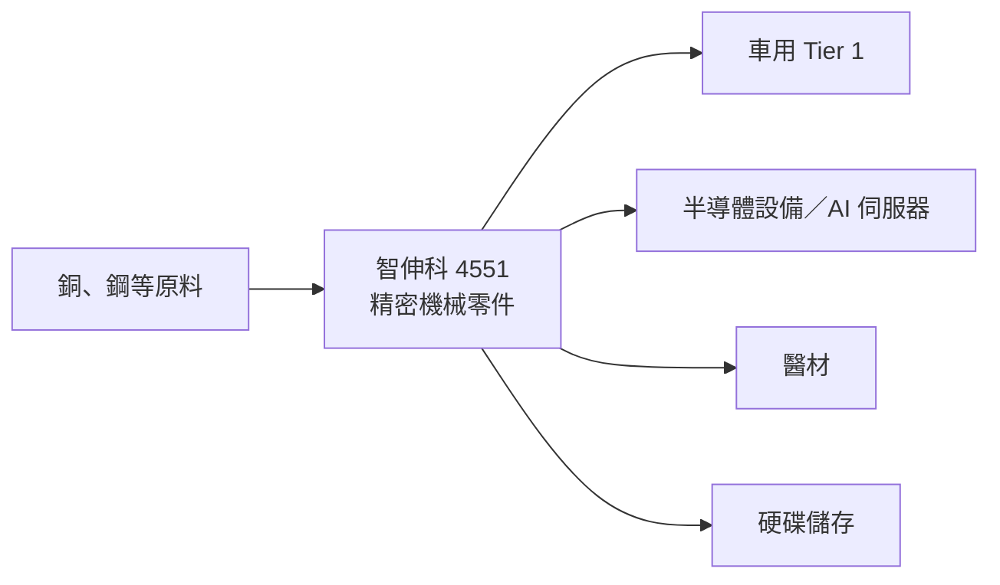

# 4551_智伸科（市）

## 基本資料

智伸科（Global PMX，4551 TT）成立於 1987 年，生產車用、醫療器材與儲存裝置的精密機械零件；車用客戶包括 Continental、Bosch、BorgWarner、ZF、Hilite 與 Tesla，其他主要客戶有 Seagate、Medtronic、Zimmer（Daiwa 公司簡介）。近年轉型重點為「半導體、AI 伺服器與其他」部門，越南新廠爬坡中。

> [!note] 範圍待確認
> 本業以車用零件為主（3Q26 占 49%），本批收錄依據是 Daiwa 論點聚焦半導體／AI 伺服器部門成長；是否持續列入每日 ingest 範圍待使用者確認。

## 產品與應用

| 部門 | 3Q26 營收占比 | 年增 | 2027 年公司展望 |
|---|---:|---:|---|
| 車用 | 49% | +13% | 持平 |
| 半導體、AI 伺服器與其他 | 20% | +66% | 年增 100% 以上 |
| 儲存裝置 | 13% | +25% | 年增 10% |
| 醫療 | 10% | +13% | 年增 50% 以上 |
| 運動 | 8% | +42% | 年減 5% |

## 圖片 / 架構圖

*本批 PDF 未擷取附圖，以 Mermaid 表示各應用部門。*

## 目標價與評等

| 券商 | 日期 | 評等 | 目標價 | 基礎 | 來源 |
|---|---|---|---:|---|---|
| Daiwa | 2026-11-09 | Buy (1) | NT$205（不變） | 17x 一年期遠期 EPS（原 18x；過去 3 年平均 15x） | [[報告_Daiwa_智伸科4551_20261109]] |

## 近期營運與研究更新

### 2026-11-09 Daiwa：3Q26 毛利率低於預期，半導體／AI 伺服器支撐成長（Buy，TP NT$205）

- 3Q26（fact）：營收 NT$2,417m（季增 5.9%、年增 24.6%），高於 Daiwa 8.5%、符合共識；毛利率 23.9%（2Q26 24.6%、3Q25 21.7%），低於 Daiwa 24.2% 與共識 25.1%，主因越南新廠爬坡一次性成本；營業利益 NT$340m（季增 10.0%、年增 54.4%）；匯損 NT$23m，淨利 NT$271m（季增 13.3%、年增 0.1%），低於 Daiwa 與共識 11.1%／10.2%；EPS NT$2.36。
- 10 月營收 NT$816m（月增 3.3%、年增 33.8%；前 10 月年增 22.0%），達 Daiwa 原估與共識 4Q26 營收的 35.6%／31.3%。
- 指引：2026 年營收年增 20–25% 不變，半導體、AI 伺服器與其他部門年增至少 100%；2027 年營收年增 20% 以上（各部門見上表）。
- Daiwa 下修 2026–28E EPS 0.3–8.5%，2026–27E EPS 低於 Bloomberg 共識 18–22%；股價 NT$135.50。主要股東林正盛（22.0%）。

## 時間軸

| 時間 | 事件 | 類型 | 重要性 | 備註 |
|---|---|---|---|---|
| 2026 | 半導體、AI 伺服器與其他部門年增 ≥100% | 放量 | ⭐⭐ | 公司指引 |
| 2027 | 營收年增 20%+，半導體／AI 伺服器部門年增 100%+ | 放量 | ⭐⭐ | 公司指引 |

## 供應鏈位置

精密機械零件供應商，原料以銅、鋼為主；半導體設備與 AI 伺服器零件的具體客戶與品項原文未揭露，因此 `related_companies` 暫留空。

> [!warning] 風險與注意事項
> - 全球車用、醫材與 AI 伺服器零件需求低於預期；毛利率不如預期（Daiwa）。
> - 越南新廠爬坡成本。

## 來源

- [[報告_Daiwa_智伸科4551_20261109]] — Daiwa，2026-11-09；3Q26 財報、法說指引、TP NT$205。

## 相關頁面

- [[時程_2026Q3Q4_AI網通與硬體催化劑]]
