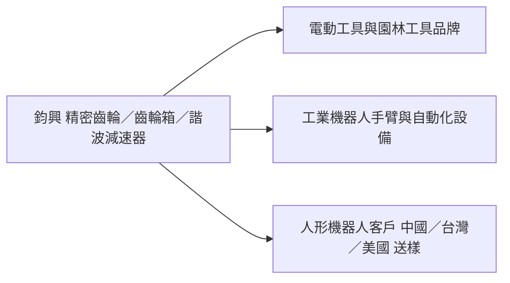

# 4571_鈞興-KY（市）

> [!note] 範圍待確認
> 營收八成以上為電動工具與園林工具齒輪，依每日 ingest 規則屬「範圍待確認」；收錄理由為智能傳動（工業機器人、諧波減速器）與人形機器人齒輪布局。

## 基本資料

鈞興-KY 以 KY 股在台上市，董事長高國興，股本 5.3 億元，2026-09 底集團員工 993 人。研發、製造及銷售電動工具、園林工具、自動化設備、工業縫紉機及機器人用齒輪、齒輪箱、減速器等精密零部件；研發中心在台中與珠海，生產基地為珠海與越南胡志明市（產能約 7：3，越南廠 2020 年設立、2022 年投產）。3Q26 應用別：電動工具 70.55%、園林工具 15.45%、智能傳動 10.33%、工業縫紉機 1.23%。成長驅動：電動工具新品量產、智能傳動比重提升與人形機器人送樣。資料來源：[[活動_鈞興-KY4571_國泰CallMemo_20261117]]、[[報告_中信_鈞興-KY4571_20261118]]。

## 核心技術／競爭優勢

- 齒輪製程完整：全鋼傘齒、全鋼直齒、粉末冶金齒輪、齒輪研磨、諧波減速器與精密五金件。
- 客製化與歐美品牌客戶：配合客戶每年新品開發新款齒輪與齒輪箱，並拓展尚未往來的歐美品牌大廠。
- 雙生產基地：珠海＋越南，因應客戶對中國以外產地需求。
- 嚴格存貨政策：半成品／成品逾兩個月提列 20%、逾半年 50%、逾一年 100%。

## 產品與應用

| 產品 | 應用 | 3Q26 營收占比 |
|---|---|---|
| 齒輪箱 | 電動工具、園林工具 | 26.81% |
| 精密五金件 | 電動工具 | 25.69% |
| 全鋼傘齒 | 電動工具 | 16.16% |
| 粉末冶金齒輪 | 電動工具 | 12.14% |
| 齒輪研磨、諧波及其他 | 工業機器人、自動化設備（智能傳動） | 10.63% |
| 全鋼直齒 | 電動工具 | 8.57% |

## 圖片 / 架構圖

圖說：鈞興以電動工具齒輪為基本盤，智能傳動與人形機器人為新成長方向。

## EPS 記錄

| 季度 | EPS | YoY | 備註 |
|---|---|---|---|
| 3Q26 | 2.98 元 | +17.2%（淨利） | 營收 9.38 億元（QoQ +28.9%、YoY +16.3%）創單季新高；毛利率 33.48%；營益率 19.80%；毛利率小降主因人民幣升值（成本以人民幣為主、營收約七成美元報價） |
| 1–3Q26 | 7.14 元 | −2.6% | 營收 24.50 億元（YoY +4.9%）；匯兌損失 2,944.4 萬元 |

## EPS 預估

| 年度 | 中信（2026-11-18） |
|---|---|
| 2026F | 9.69 元（營收 33.22 億元，YoY +8.4%） |
| 2027F | 11.27 元（營收 36.36 億元，YoY +9.4%） |

## 目標價與評等

| 來源 | 日期 | 評等 | 目標價 | 評價基礎 |
|---|---|---|---|---|
| 中信投顧 | 2026-11-18 | 買進（維持） | 203 元（原 219 元） | 2027F EPS × 18 倍；[[報告_中信_鈞興-KY4571_20261118]] |

## 時間軸

| 時間 | 事件 | 類型 | 重要性 | 備註 |
|---|---|---|---|---|
| 2026H2–2027-01 | 電動工具新專案量產，出貨延續至 1M27 | 放量 | ⭐⭐ | 公司說法 |
| 2026 年底 | 越南廠二期完工，2027 年投產 | 擴產 | ⭐⭐ | 公司說法 |
| 2027（預估） | 人形機器人部分客戶小量量產；2028 年後放量 | 新品 | ⭐⭐⭐ | 公司說法；見 [[時程_2026Q3Q4_AI網通與硬體催化劑]] |
| 2027（規劃） | 珠海新廠生產工業／人形機器人齒輪 | 擴產 | ⭐⭐ | 仍屬規劃 |

## 供應鏈位置

- 上游：鋼材與粉末冶金原料。
- 下游：歐美電動工具、園林工具品牌；工業機器人與自動化設備；人形機器人客戶。
- 技術與主題：[[技術_人形機器人]]；wiki 尚無機器人零組件供應鏈頁。

## 相關公司

| 公司 | 關係 | 說明 |
|---|---|---|
| — | — | 來源未揭露具名客戶或供應商 |

## 風險與注意事項

> [!warning]
> - 匯率：成本以人民幣為主、營收約七成美元報價，美元兌人民幣由近 7.3 貶至約 6.7 壓縮毛利率並產生匯損。
> - 終端需求：園林工具與美國房市、利率相關；歐洲電動工具需求取決於俄烏戰爭。
> - 人形機器人仍在送樣，量產時程與規模待驗證。

## 來源

- [[活動_鈞興-KY4571_國泰CallMemo_20261117]]（2026-11-17）— 國泰證期 call memo。
- [[報告_中信_鈞興-KY4571_20261118]]（2026-11-18）— 中信投顧；買進、TP 203 元。
