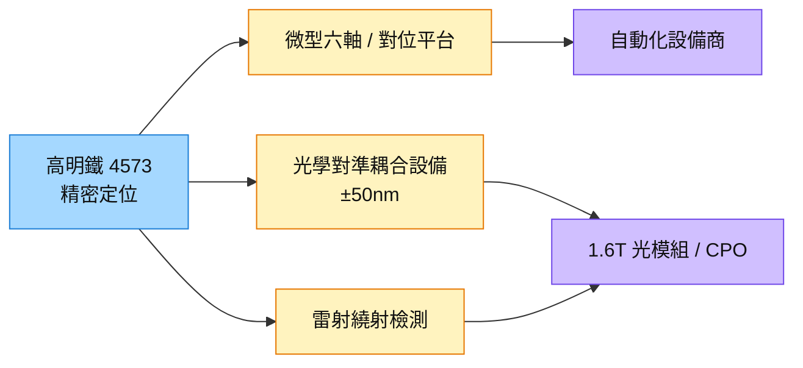

# 4573_高明鐵（櫃）

## 基本資料

高明鐵為精密定位平台、微型多軸位移平台與自動化次系統廠，近年將精密對位能力延伸至光通訊與 CPO 的光學對準、耦合與檢測設備。

- **群益投顧導覽／技術交流（2026-09-03）：** 展示一套光學對準與檢測設備，定位具 1.6T 等級能力、雙透鏡結構，光學耦合精度要求最高，整體精度可達約 ±50 奈米量級；操作為半自動（人工上料、系統自動對位，再依客戶參數做 UV 固化與封裝確認），並以雷射繞射／結構光檢測晶圓、光柵或光學結構，系統輸出分數或以指定波長檢查。設備方責任在確保雷射光源輸出符合標準，資料判讀由客戶決定。（導覽紀錄為口述整理，部分術語不清，信心中低）
- **產品延伸（群友轉述）：** 由零組件供應往上延伸至次系統模組與對位平台，微型六軸產品出貨產業多元，部分案件受保密協議限制。

資料來源：[[活動_高明鐵4573_導覽Memo_20260903]]（群益投顧導覽 Call memo，2026-09-03）

- **Goldman Sachs SEMICON 攤位參訪（2026-09-08）：** 高明鐵（GMT）展示四套已上市系統，涵蓋晶圓級光學檢測與測試，以及 1.6T 光模組光引擎主動對準；其中 Dual FA 主動對準設備可同時完成 Tx 與 Rx 耦合，較傳統設備節省約 50% 耦合時間。高盛將耦合自動化列為高速光連接的必要趨勢。（公司展示說法，中）來源：[[報告_GoldmanSachs_SEMICON台灣光子測試_20260908]]。

## 核心技術／競爭優勢

- **奈米級精密定位：** 對位與重對位可精準回到指定位置，支援光纖陣列與光學元件的主動對位。
- **次系統化：** 提供對位平台與次系統，讓設備商直接整合，提高單機價值。
- **光通訊延伸：** 速率提升要求設備更精密，CPO 與 1.6T 以上光模組的耦合需求為切入點。

## 產品與應用

| 產品 / 服務 | 應用 | 相關客戶 / 下游 |
|-------------|------|-----------------|
| 光學對準與耦合設備（1.6T 等級） | 光模組、CPO 光引擎 FAU 對位與固化 | 光通訊客戶（未揭露） |
| 雷射繞射／結構光檢測 | 晶圓、光柵與光學結構檢測 | 客戶指定波長 |
| 精密定位平台、微型六軸 | 自動化設備、半導體設備次系統 | 國內外自動化設備商 |

## 圖片 / 架構圖

![[報告_CPO耦光對位設備三強比較_萬潤高明鐵惠特_20260902_001.png]]
*圖（2026-09-02 三強比較報告，p4）：高明鐵在矽光子與 CPO 產線上的守備範圍集中於「晶圓級耦光量測」與「FAU／光引擎耦合」，與惠特（元件測試）及萬潤（封裝整線＋耦合）僅在耦合站點重疊。*

![[報告_CPO耦光對位設備三強比較_萬潤高明鐵惠特_20260902_002.png]]
*圖（2026-09-02 三強比較報告，p10）：高明鐵與萬潤耦光機的自製深度比較——高明鐵自製視覺定位與六軸對位核心，點膠（武藏）、固化（HOYA）與光學量測（Santec／Keysight）採業界標準件整合；萬潤則自取放、點膠、補償固化到插損驗證全自製。*

![[報告_CPO耦光對位設備三強比較_萬潤高明鐵惠特_20260902_003.png]]
*圖（2026-09-02 三強比較報告，p12）：依高明鐵官網週期時間換算之單機 24 小時理論日產出（未計換料與停機）——雙 FA 耦合機約 480 顆／日、多器件耦合機約 432 通道／日、Tx FAU Aligner 約 278 顆／日。*

圖說：高明鐵以精密定位為核心，往光模組與 CPO 的光學對位耦合設備延伸；2026–2028 年 CPO 仍以主動對位為主，對位設備被視為可能的瓶頸環節。

## 2026-09～10 設備比較、公開財務與市場觀點更新

- **產品定位（「對光的人」與機台型錄，fact／高）**：由滾珠螺桿、滑軌與電動缸等精密傳動零組件廠升級為光學對位工站整機商，官網列出 6 款整機——Tx FAU Bonder（被動）、Tx FAU Aligner（主動，<310 秒／顆含固化）、Rx FAU Aligner、Dual LD Lens Active Aligner、Multi-Device Active Aligner（雙 6 軸，<200 秒／通道）、全自動雙 FA 耦合機（雙 6 軸、6 支相機、自動插拔清潔多芯連接器，<180 秒／顆不含固化），另供應史都華平台與 12 軸耦光次系統模組（[[報告_CPO耦光對位設備三強比較_萬潤高明鐵惠特_20260902]]）。
- **規格定義與自製深度（fact／高）**：官網標示 X/Y/Z 軸解析度 10 nm、重複定位精度 ±50 nm（機構重現性，**不可**直接與 [[6187_萬潤（市）]] 端到端對位能力 ±2.5 µm 相除比較）；點膠採武藏（Musashi）、固化採 HOYA EXECURE-4000D（365 nm LED）、光源／光功率計採 Santec TSL-570A-P／MPM-220 與 Keysight E3646A、控制軟體為 LabVIEW。採用標準件有助加速驗收、降低開發風險，但固化後光軸偏移調校空間與大規模量產軟體框架可能受限。
- **單機產能推估與專利盤點（estimate／中；專利 fact）**：三家中唯一公開週期時間，依官網數字推算 24 小時理論日產出約 278–480 顆（實際稼動須打折）。Google Patents（2026-09-02）檢索約 187 件專利集中於滑軌、編碼器與步進馬達，尚未查見已公開光耦合專利（須留意 18 個月公開遞延）。
- **財務與區域結構（fact／高）**：機台主要裝設於光模組廠（800G／1.6T 產線）與矽光子封裝廠，對外稱客戶區域為中國大陸約 50%、美系約 40%、台灣約 10%。FY25 營收 6.03 億元、稅後淨損 1.17 億元、EPS −2.96 元；2026 年 7 月營收 2.00 億元（YoY +298.5%）、前 7 月累計 9.03 億元（YoY +168.2%），2026 年由虧轉盈；2026-06-25 完成現增 400 萬股、每股 NT$325，募資 13.0 億元（[[報告_CPO耦光對位設備三強比較_萬潤高明鐵惠特_20260902]]）。
- **智璞 CPO 測試版圖補充（2026-09-21）**：[[報告_永豐_智璞專家分享會_矽光子與CPO趨勢_20260921]]（p49）將高明鐵列入 Insertion 1 晶圓探針台，以及 Insertion 3 耦合設備與單顆雙面 CPO 測試機供應商版圖（產業整理／中）。
- **客戶結構觀點（2026-10-09，thesis／低信心）**：[[研究_大立光3008_上詮3363_FAU觀點_珩石Jason_20261009]] 稱 [[3363_上詮（櫃）]] 曾為高明鐵最大客戶之一，而 2026 年起高明鐵其他客戶已開始貢獻營收；屬單一買方觀點，客戶營收比重仍待公司揭露驗證。

## 時間軸

| 時間 | 事件 | 類型 | 重要性 | 備註 |
|------|------|------|--------|------|
| 2026-09-03 | 群益投顧導覽展示 1.6T 等級光學對準設備 | 技術展示 | ⭐ | [[活動_高明鐵4573_導覽Memo_20260903]] |
| 2026–2028 | CPO／NPO 以主動對位為主，對位設備需求延續 | 產業趨勢 | ⭐⭐ | 見 [[技術_CPO]] |

→ 跨公司時程詳見 [[時程_2026-2027高速互連與分散式算力]]

## 供應鏈位置

- 下游：光模組與 CPO 封裝廠、自動化設備商
- 所屬供應鏈：[[供應鏈_光測試設備]]、[[供應鏈_工業自動化]]
- 技術背景：[[技術_CPO]]、[[技術_FAU]]

## 相關公司

| 公司 | 關係 | 說明 |
|------|------|------|
| [[3363_上詮（櫃）]] | 客戶（市場觀點，待確認） | [[研究_大立光3008_上詮3363_FAU觀點_珩石Jason_20261009]] 稱上詮曾為高明鐵最大客戶之一，2026 年起其他客戶開始貢獻營收（低信心，未經公司揭露） |
| [[6187_萬潤（市）]] | 直接競爭（FAU／光引擎耦合） | 兩者均切入光纖陣列主動耦合站點；高明鐵偏光模組廠＋標準件整合，萬潤偏封測廠整線＋高自製率（[[報告_CPO耦光對位設備三強比較_萬潤高明鐵惠特_20260902]]） |
| [[6706_惠特（市）]] | 部分重疊競爭 | 惠特主力為元件級光電測試與代工，但 FAS Series 耦光貼合機與高明鐵在 FAU 耦合段重疊（[[報告_CPO耦光對位設備三強比較_萬潤高明鐵惠特_20260902]]） |

## 風險與注意事項

> [!warning] 風險與注意事項
> - **資訊稀薄：** 導覽紀錄為口述整理，未揭露個別客戶營收占比與在手訂單；單月營收基期低、波動大。
> - **標準件依賴與軟體框架：** 點膠（武藏）、UV 固化（HOYA）與光學量測（Santec／Keysight）仰賴外購標準件且以 LabVIEW 控制，量產放大時毛利與固化補償調校空間須追蹤。
> - **矽光子依賴度高與新進競爭：** 相較萬潤（先進封裝本業）與惠特（測試代工），高明鐵對矽光子設備依賴度最高，且東佑達（7942）等精密傳動廠相繼切入六軸對位，加上國際廠 ficonTEC 擴產與大立光等客戶自製設備，競爭壓力升溫。
> - **被動對位替代：** Glass Bridge 或微光學容差放寬方案若滲透，主動對位設備需求可能轉弱。

## 來源

- [[報告_CPO耦光對位設備三強比較_萬潤高明鐵惠特_20260902]] — 獨立設備供應鏈比較研究，2026-09-02（官網機台型錄、規格對照、專利盤點與 2025–2026 公開財務／現增資料）
- [[報告_永豐_智璞專家分享會_矽光子與CPO趨勢_20260921]] — 永豐證券／智璞產業趨勢研究所，2026-09-21（CPO 四道測試工序設備版圖，Insertion 1／3）
- [[研究_大立光3008_上詮3363_FAU觀點_珩石Jason_20261009]] — 珩石資本 Jason，2026-10-09（上詮客戶關係與其他客戶營收貢獻觀點，低信心）
- [[活動_高明鐵4573_導覽Memo_20260903]] — 群益投顧導覽 Call memo，2026-09-03
- [[260908_gs_GMT]] — Goldman Sachs，2026-09-08（GMT 4573.TWO SEMICON 攤位專文，Not Covered）
- [[報告_GoldmanSachs_SEMICON台灣光子測試_20260908]] — Goldman Sachs，2026-09-08（GS 未評等，SEMICON 攤位參訪）

- [[報告_中信_自動化產業景氣與成長展望_20261119]]（2026-11-19）

## 相關頁面

- [[供應鏈_CPO]]
- [[分析_2026Q3法說季_AI供應鏈瓶頸與擴產節奏_LINE彙整]]
