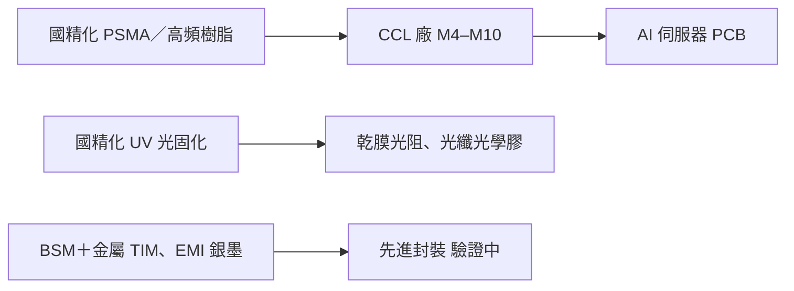

# 4722_國精化（市）

> [!note] 範圍待確認
> 機能性樹脂與 UV 光固化材料屬傳統化工；收錄理由為高頻高速 CCL 樹脂（PSMA，M4–M10）與先進封裝散熱材料，電子化學材料目標占營收 50% 以上。

## 基本資料

國精化為台灣特用化學廠，三大事業群為電子化學材料、UV 光固化材料與機能性樹脂。1–3Q26 營收占比：UV 光固化 44.8%（14.15 億元）、機能性樹脂 31.6%（10.02 億元）、電子化學材料 23.6%（7.45 億元，YoY +52.9%，去年同期占 17%）。成長驅動為高頻高速 CCL 樹脂放量與產能擴充；公司目標 2027 年電子材料占 40%、未來數年突破 50%。台灣永安廠轉型電子化學材料基地，大宗規格品移至廣東江門廠或委外。資料來源：[[報告_群益_國精化4722_20261118]]（群益產業速報，2026-11-18）。

## 核心技術／競爭優勢

- CCL 樹脂世代覆蓋：自有 PSMA 樹脂主攻 M4–M6，M6–M8 已完成技術儲備，M8–M10 與國際夥伴合作量產，M10 材料已通過客戶驗證。
- 國際合作研發：與 JSR 合作顯示器光阻間隙劑、保護層與 PI 配向膜回收技術（共建實驗室 2027 年中運作，縮短 CCL 樣品驗證週期）；與杜邦、默克合作先進封裝背面散熱材料（BSM＋金屬 TIM）與常壓噴塗 EMI 銀墨，已進入驗證，三方聯合實驗室 1Q27 建置。
- UV 光固化延伸：拓展乾膜光阻、太陽能電池板封裝、光纖模組封裝光學膠。

## 產品與應用

| 產品 | 應用 | 相關客戶／下游 |
|---|---|---|
| PSMA 等高頻高速樹脂 | CCL（M4–M10） | CCL 廠，如 [[2383_台光電（市）]]、[[6274_台燿（市）]]、[[6213_聯茂（市）]]（來源未具名，僅列產業對應） |
| UV 光固化材料 | 塗料、乾膜光阻、光纖模組光學膠 | — |
| 機能性樹脂 | 高規格特殊樹脂 | — |
| 先進封裝 BSM／EMI 銀墨（驗證中） | 先進封裝散熱與電磁遮蔽 | — |

## 圖片 / 架構圖

圖說：國精化以 CCL 樹脂切入 AI 伺服器材料鏈，並延伸至先進封裝材料。

## EPS 記錄

| 季度 | EPS | 備註 |
|---|---|---|
| 3Q26 | 1.06 元 | 營收 12.34 億元（YoY +27.3%）；毛利率 18.24%；營益率 8.95%；高毛利電子化學材料比重提升 |

## 時間軸

| 時間 | 事件 | 類型 | 重要性 | 備註 |
|---|---|---|---|---|
| 2026-10 | 月營收降至 2.97 億元：永安廠 UV 產能移往台南安南新廠、下游缺玻纖布／銅箔／主晶片 | 營運 | ⭐ | 群益預估 11 月回升至 3.56 億元（MoM +19.9%） |
| 1Q27 | 安南新廠（一期年產能 5 萬噸）正式量產；2027 年稼動率目標 68% 以上、2028 年挑戰八成 | 擴產 | ⭐⭐ | 公司說法 |
| 1Q27 末 | 3,000 噸 PSMA 新產能投入，2H27 正式量產；2027 年增設兩條 M8 以上高頻高速材料產線 | 擴產 | ⭐⭐⭐ | 見 [[時程_2026Q3Q4_AI網通與硬體催化劑]] |

## 供應鏈位置

- 上游：石化原料。
- 下游：CCL 廠與 PCB 供應鏈；面板、先進封裝客戶。
- 供應鏈主軸：[[供應鏈_AI伺服器PCB]]（CCL 樹脂環節）。

## 相關公司

| 公司 | 關係 | 說明 |
|---|---|---|
| [[2383_台光電（市）]] | 產業下游 | 高階 CCL 廠；國精化客戶未具名 |
| [[6274_台燿（市）]] | 產業下游 | 同上 |
| [[6213_聯茂（市）]] | 產業下游 | 同上 |

## 風險與注意事項

> [!warning]
> - 新廠轉移期間生產斷續，4Q26 營收受影響；1H27 擴產研發與推廣費用先行。
> - 下游缺料（玻纖布、銅箔、主晶片）影響拉貨節奏；機能性樹脂受油價波動影響。
> - M8–M10 依賴國際夥伴合作量產，客戶與分潤結構未揭露。

## 2026-11-18 統一投顧新聞評析：M8／M9 樹脂放量

- 11-17 法說：董事長預計 2027 年底電子化學材料占比提升至 40–45%，長期目標 50%；樹脂是 CCL 製程第一站，決定 CCL 電性上限（經濟日報轉述）。
- 與 JSR 半導體事業部合作的 5G 高頻基板材料（HC 材）產能 750 噸／年，2027 年可望達 3,000 噸／年、2028 年 4,500 噸／年；電子材料占比由目前 23.6% 提升至 2028 年 50% 以上。
- 統一預估 2026／2027 年 EPS 2.86 元（原估 3.37 元）／6.4 元（YoY +47.2%／+123.6%），本益比約 17.5 倍，看法正向（estimate）。
- 來源：[[報告_統一_國精化4722_20261118]]。

## 來源

- [[報告_統一_國精化4722_20261118]]（統一投顧，2026-11-18；新聞評析）

- [[報告_群益_國精化4722_20261118]]（2026-11-18）— 群益產業速報；法說展望正面（未給評等）。
