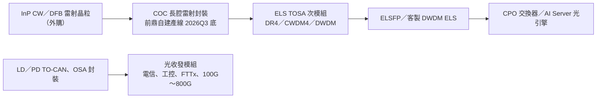

# 4908_前鼎（櫃）

## 基本資料

前鼎光電（APAC Opto Electronics）1998 年成立，2002 年上櫃，總部在新竹湖口，員工約 270 人，實收資本額約 7.82 億元。公司設計、生產雷射二極體與受光二極體封裝（TO-CAN／OSA 次模組），並組裝光收發模組，應用涵蓋 AI／資料中心（100G～800G）、行動通訊基地台（10G～50G BIDI）、工控耐高溫模組與 FTTx PON。

2025 年營收 8.15 億元、毛利率 47%、EPS 1.98 元；營收衰退主因客戶庫存調整，淨利率另受美元匯損壓抑。2026 年起，日本電信與工控客戶恢復拉貨，Q1 營收季增 45%；1～9 月累計營收 8.01 億元，年增 26.78%。新成長軸是 **CPO 外置光源（ELS／ELSFP）**：20dBm 產品已小量出貨，23dBm UHP ELSFP 規劃 2026Q3 完成客戶驗證。公司另自建 COC 產線，2026Q3 底完工，做高功率 CW 雷射 Chip on Carrier。目前營收仍以電信、工控為主，資料中心占比偏低。來源為 [[報告_前鼎_2026法說簡報_20260417]] 與 [[research_前鼎ELS與月營收動態_2026-10-28]]。

## 核心技術／競爭優勢

- **雷射／受光二極體封裝能力**：主業是 TO-CAN、OSA 次模組與光收發模組組裝。元大與 DIGITIMES 都把前鼎和 [[3450_聯鈞（市）]]、[[4979_華星光（櫃）]] 歸在台灣光電元件封裝／TRX 模組廠（[[報告_元大_光通訊產業_20260723]]、[[矽光子晶片業者的競合策略 - DIGITIMES]]）。
- **ELS 產品線較早布局**：公司稱約兩年前開始開發，2026 年已有 OIF 標準 8ch ELSFP 與 16 波長 DWDM 客製化 ELS，兩者都過客戶樣品驗證、少量出貨，並可提供 ELS TOSA OEM／ODM。
- **非紅供應鏈定位**：法說稱美、日、中競爭者多數仍在樣品或初期驗證階段，前鼎是台灣製造的非中國供應商，有助切入北美客戶。這是公司說法，屬 thesis／中信心。
- **向上補 COC 段**：自建 2.0～3.0mm 長腔高功率 CW Laser COC 產線，購置 Chip Tester、AOI、Die／Wire bonder 與 COC Burn-In 設備，可自用於 ELS，也可對外代工。COC 製程見 [[技術_COC光模組封裝]]。
- **毛利結構**：公司稱毛利率區間維持在 45% 以上，2025 年為 47%，產品以中小量、多規格的電信與工控模組為主。

## 產品與應用

| 產品 / 服務 | 應用 | 相關客戶 / 下游 |
|---|---|---|
| CPO 外置光源 ELSFP（20dBm 8ch VHP；23dBm 8ch UHP） | CPO 交換器（OIF 標準可插拔外部雷射） | 客戶未揭露；同類主供為 [[LITE.US(lumentum)]] |
| 16ch DWDM 客製化 ELS | Micro-ring Modulator CPO、AI Server 光互連 | 客戶未揭露；簡報引用 Lightmatter 架構示意 |
| ELS TOSA 次模組（DR4／CWDM4／DWDM，20／23dBm） | 外置光源次模組，可 OEM／ODM | 光模組／ELS 廠 |
| 資料中心光收發模組（100G、400G、800G SR8/DR8） | AI／資料中心 | 未揭露 |
| 行動通訊 BIDI SFP（10G／25G／50G） | 基地台前傳 | 電信客戶（日本需求回升） |
| 工控模組（1x9、2x5、Mini-SFF、耐高溫 TRX） | 工控、自走搬運機器人 | 工控客戶 |
| FTTx PON 模組（GPON～25G S-PON） | 光纖到府 | 電信／系統商 |
| 光纖影像傳送模組、FPGA SFP | 光纖無人機、可編程模組 | 新產品 |
| COC 代工（2.0～3.0mm CW high power laser） | 自用 ELS、對外代工 | 2026Q3 底產線完工 |

## 圖片 / 架構圖

![[報告_前鼎_2026法說簡報_20260417_005.png]]

*圖（前鼎法說簡報，2026-04-17，第 12 頁）：左邊是前鼎客製 16 波長 DWDM ELS，用於 Micro-ring Modulator CPO 的 AI Server 架構；右邊是 OIF 標準 ELSFP，插在 CPO 交換器面板，供光引擎外部光源。圖說明前鼎的 ELS 同時有標準品與客製兩條路線。*

![[報告_前鼎_2026法說簡報_20260417_006.png]]

*圖（同簡報第 13 頁）：ELS 產品規格與業務現況。20dBm（100mW）兩款已驗證、少量出貨；23dBm（200mW）UHP ELSFP 原訂 2026 年 5 月送樣、Q3 完成驗證及量產，是下一個追蹤節點。*

*圖說：前鼎的兩條業務線。下方是既有 TO-CAN／OSA 與光收發模組，上方是 COC → ELS TOSA → ELSFP 的 CPO 外置光源新路線；雷射晶粒來源未揭露。*

## EPS 記錄

| 季度 | EPS (元) | YoY | 備註 |
|---|---|---|---|
| 2026Q2 | 0.66 | +371% | 季減 13%；[[research_前鼎ELS與月營收動態_2026-10-28]]（Win 投資，2026-10-14） |
| 2026Q1 | 約 0.76 | — | 由 H1 EPS 1.42 元減 Q2 推算，非公司直接揭露 |
| 2025 全年 | 1.98 | — | 法說簡報；匯損壓低淨利率至 19% |

| 期間 | 營收 | YoY | 備註 |
|---|---|---|---|
| 2026 年 9 月 | 0.84 億元 | +15.26% | 月減 13.15% |
| 2026 年 8 月 | 約 0.97 億元（推算） | +28.93% | 月減 1.48% |
| 2026 年 7 月 | 約 0.99 億元（推算） | +51.63% | 月增 8.2% |
| 2026Q3 | 約 2.80 億元（推算） | — | 由 9 月營收及 7、8 月月增率反推，fact 需以公告確認 |
| 2026Q1 | 2.65 億元 | +25% | 季增 45.1%；1Q-25 為 2.12 億元 |
| 2026 1～9 月 | 8.01 億元 | +26.78% | 已接近 2025 全年 8.15 億元 |

> [!warning] 資訊衝突：2026Q1 營收年增率
> 富果備忘錄寫 Q1 年增 22%；MoneyDJ 寫第一季累計年增 25.04%，法說簡報 1Q-25 營收 212 百萬元、1Q-26 265 百萬元，換算約 +25%。本頁採簡報數字。

## EPS 預估

| 年度 | 未具名機構 EPS（CMoney 轉述：2026-10-02） | 備註 |
|---|---|---|
| 2026E | 2.94 | 年增約 48%；以 10 月股價計約 69～79 倍前瞻本益比；機構名稱未揭露，estimate／低信心 |

## 時間軸

| 時間 | 事件 | 類型 | 重要性 | 備註 |
|---|---|---|---|---|
| 2026-04-17 | 法說會：ELSFP 小量出貨、COC 產線計畫 | 法說 | ⭐⭐ | [[報告_前鼎_2026法說簡報_20260417]] |
| 2026-05（規劃） | 23dBm 8ch UHP ELSFP 送樣 | 驗證 | ⭐⭐ | 公司規劃；是否如期送樣未見公告 |
| 2026Q3（規劃） | 23dBm UHP ELSFP 完成客戶端驗證及量產 | 驗證 | ⭐⭐⭐ | company outlook／中信心；截至 2026-10-28 未查到完成公告 |
| 2026Q3 底（規劃） | COC 產線建置完成 | 擴產 | ⭐⭐ | 產能與資本支出未揭露 |
| 2026-10-02、10-07 | 股價兩度漲停（224.5、254 元） | 股價 | ⭐ | CPO 外置光源題材；10-21 回到約 216 元，法人偏賣 |
| 2027（展望） | ELSP 有機會逐步放量 | 放量 | ⭐⭐⭐ | 取決於客戶導入，company outlook／中低信心 |

→ 跨公司比較詳見 [[時程_2026-2027高速互連與分散式算力]]

## 供應鏈位置

- 角色：光電元件封裝（TO-CAN／OSA）→ 光收發模組 → CPO 外置光源 ELS
- 上游：InP CW／DFB 雷射晶粒、PD 晶粒（供應商未揭露）；COC 設備（Die／Wire bonder、Burn-In）
- 下游：電信與工控客戶、資料中心模組客戶、CPO 交換器／AI Server 系統（ELS 客戶未具名）
- 所屬供應鏈：[[供應鏈_CPO]]（外部雷射源 ELS）、[[供應鏈_AI光互聯]]
- 技術背景：[[技術_CPO]]、[[技術_光模塊]]、[[技術_COC光模組封裝]]

## 相關公司

| 公司 | 關係 | 說明 |
|---|---|---|
| [[3450_聯鈞（市）]] | 同業／競爭 | 台灣 TO-CAN／OSA 與 CoS 封裝同業，也切入 ELS 相關封裝 |
| [[4979_華星光（櫃）]] | 同業／競爭 | 台灣光模組廠，具 InP CW Laser 與 COC，為 CPO 光源同題材競爭者 |
| [[LITE.US(lumentum)]] | 競爭 | NVIDIA 初批 CPO ELS 預期主供，前鼎 ELSFP 的主要對手 |
| [[COHR.US(coherent)]] | 競爭 | 預期 2026H2 成為 CPO ELS 第二供應商 |

其他同業（未建頁）：訊芯-KY（6451）、眾達-KY（4977）、波若威（3163）。

> [!warning] 風險與注意事項
> - ELS 放量時點不確定：公司自己說 2026 年營收貢獻有限，2027 年才有機會放量；23dBm 驗證若延後，題材與基本面落差會擴大。
> - 客戶未揭露：ELS 與資料中心客戶都未具名，無法確認是否進入 NVIDIA／Broadcom 等主流 CPO 平台；主流 CPO ELS 目前仍由 Lumentum、Coherent 主導。
> - 規格門檻上升：[[技術_CPO]] 引述 Lumentum 稱 NVIDIA CPO 採約 400mW UHP laser，前鼎目前最高規格為 23dBm（200mW），需追蹤更高功率產品能力。
> - 營收結構仍偏電信與工控：日本電信拉貨與工控需求為 2026 年主要動能，9 月年增率已降到 15%，需求延續性需觀察。
> - 匯率：2025 年美元匯損使淨利率低於營業利益率。
> - 評價偏高：以未具名機構 2026E EPS 2.94 元計，10 月股價約 69～79 倍本益比，股價受題材驅動，法人 9 月下旬起偏賣。

## 來源

- [[報告_前鼎_2026法說簡報_20260417]]（公司法說簡報，2026-04-17）
- [[research_前鼎ELS與月營收動態_2026-10-28]]（富果、MoneyDJ、CMoney、Win 投資彙整，2026-10-28 擷取）
- [[報告_元大_光通訊產業_20260723]]（元大，2026-07-23；列為 TO-CAN、OSA 封測廠）
- [[矽光子晶片業者的競合策略 - DIGITIMES]]（DIGITIMES，2026-08-22；列為光電元件封裝與 TRX 光模組廠）
- [[2026-08-04-AI 時代光纖到晶片的新賽局-群益證劵-83]]（群益，2026-08-04；列入光通訊相關公司名單）
