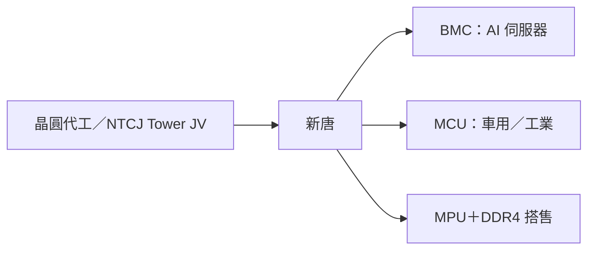

# 4919_新唐（市）

## 基本資料

新唐為華邦電集團旗下 IC 公司，產品涵蓋 MCU、搭售記憶體的 MPU、伺服器 BMC 與車用／工業 IC，並透過日本子公司（Nuvoton Technology Corporation Japan，NTCJ，與 Tower 合資晶圓廠）經營日本業務。3Q26 營收 NT$7.86bn、毛利率 37.4%，每股虧損 NT$1.24；日本業務為主要虧損來源（[[報告_MorganStanley_新唐4919_20261101]]，2026-11-01）。

- 主要產品：MCU、MPU（搭售華邦 DDR4）、BMC／BMIC、車用與工業 IC。
- 成長驅動：AI 伺服器 BMC 新客戶（含一家 CSP）、MPU 市占、日本業務重整。
- 供應鏈位置：伺服器管理晶片與工控／車用 MCU 的 IC 設計與製造。

## 核心技術／競爭優勢

- BMC：既有客戶加多家新客戶，2027 年 BMC 營收年增幅有機會超過 2026 年。
- MPU 搭售記憶體：可與華邦 DDR4 綁售擴大市占，記憶體漲價已轉嫁。
- 產能：2027 年多數產能已被客戶預訂。

## 產品與應用

| 產品 | 應用 | 客戶／下游 |
|---|---|---|
| BMC／BMIC | AI 與一般伺服器管理 | 既有客戶與多家新客戶（含一家 CSP） |
| MCU | 車用、工業、消費 | 依晶圓代工與封測成本調價 |
| MPU（搭售記憶體） | 工控、消費 | 部分客戶 4Q26 起縮單 |

## 圖片 / 架構圖

圖說：依 MS 2026-11-01 報告整理的產品結構（Mermaid 補位）。

## 目標價與評等

| 券商 | 日期 | 評等 | 目標價 | 評價基礎 | 來源 |
|---|---|---|---|---|---|
| Morgan Stanley | 2026-11-01 | Underweight | NT$95（bull NT$143／bear NT$48） | RI 模型 | [[報告_MorganStanley_新唐4919_20261101]] |

## 時間軸

| 時間 | 事件 | 類型 | 重要性 | 備註 |
|---|---|---|---|---|
| 4Q26 | 部分 MPU 客戶縮單 | 需求 | ⭐⭐ | MS 2026-11-01 |
| 2027-03 底 | Tower JV（日本）重整完成目標 | 重整 | ⭐⭐⭐ | 管理層目標 |
| 2H27 | 下一代 BMC 小量出貨 | 新品 | ⭐⭐ | MS 2026-11-01，見 [[時程_2026-2028十月券商催化劑]] |

## 供應鏈位置

- 上游：晶圓代工（含日本 Tower JV 產能）、後段封測（3Q26 供應受限）。
- 下游：伺服器 ODM 與 CSP（BMC）、車用與工業客戶（MCU）。
- 供應鏈頁：尚無 BMC 專屬供應鏈頁，暫連 [[供應鏈_工業自動化]]（MCU 工控應用）。

## 相關公司

| 公司 | 關係 | 說明 |
|---|---|---|
| 華邦電 | 母集團 | MPU 搭售 DDR4（wiki 尚無公司頁） |

## 近期營運與研究更新

### 2026-11-01 Morgan Stanley：虧損擴大，BMC 與日本重整為關鍵

- 3Q26 營收 NT$7.86bn（QoQ −1%、YoY +8%），毛利率 37.4%（QoQ −0.6ppt），每股虧損 NT$1.24；後段供應受限與 AI 研發大增使進度落後計畫約一季。
- 車用止穩未回升；PC 2H26 明顯弱於 1H26；記憶體成本已轉嫁至 MPU 但部分客戶 4Q26 起縮單。
- 2027 年 BMC 年增幅有機會超過 2026 年，新客戶需 1–2 年放大；下一代 2H27 小量。
- 來源：[[報告_MorganStanley_新唐4919_20261101]]。

## 風險與注意事項

> [!warning]
> - 日本業務持續虧損，Tower JV 重整時程若延後將拖累獲利回復。
> - PC 與車用需求疲弱，成本轉嫁不代表毛利率擴張（MS）。
> - BMC 新客戶貢獻需 1–2 年，且 Marvell 等競爭者切入伺服器管理晶片（富邦認為 Marvell 較可能做 IMC）。

## 來源

- [[報告_MorganStanley_新唐4919_20261101]]（Morgan Stanley，2026-11-01）

## 相關頁面

- [[時程_2026-2028十月券商催化劑]]
