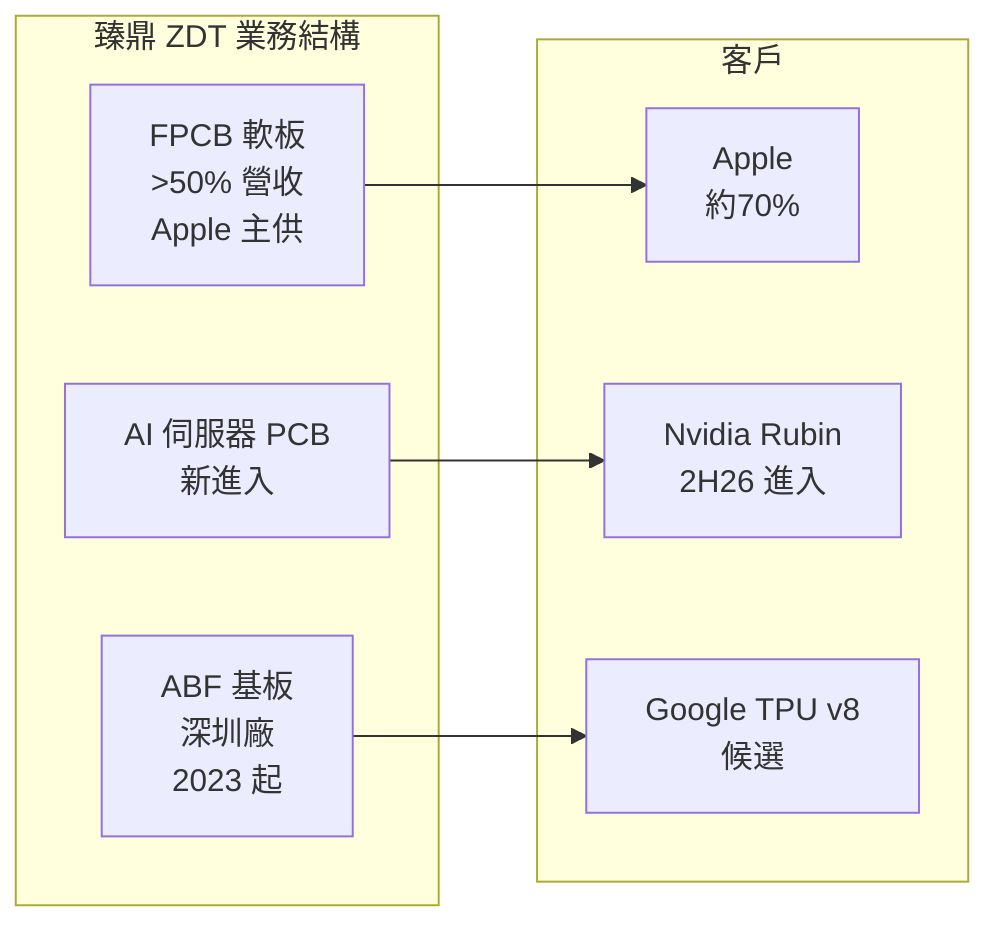

# 4958_臻鼎（市）

## 基本資料

臻鼎科技（Zhen Ding Technology，ZDT），全球 PCB 市占第一（7-10%），總部深圳，生產基地全部在中國（深圳、秦皇島、營口、淮安）。產品線橫跨 FPCB（軟板，50%+ 營收）、HDI、傳統 PCB 及 ABF 基板（2023 年起）。高消費電子曝險（Apple 約 70% 營收）是 Citi Sell 的核心論點；GS 則看好其 ABF 基板布局與 Rubin 進入時程。

主要資料來源：[[報告_Citi_PCB_CCL_20260422]]（Citi，2026-04-22）、[[報告_GS_台灣CCL_PCB_20260418]]（Goldman Sachs，2026-04-18）、[[報告_GS_CCL_PCB_20260320]]（Goldman Sachs，2026-03-20）。

## 核心技術／競爭優勢

- **全球 PCB 市占第一**：7-10% 市占，規模效益顯著
- **FPCB 技術龍頭**：Apple FPCB 長期主供，折疊機滲透率提升帶動 FPC TAM
- **ABF 基板新兵**：2023 年起於深圳建立 ABF 基板產能，GS 預估 2027E ABF 市占在中國達 40%+
- **Rubin Compute Tray 進入**：GS 預期 ZDT 從 2H26 開始供應 Rubin 計算板（10%+ 市占），是重要催化劑
- **Google TPU v8 ABF 基板候選**：GS 認為 ZDT 可能是 Google TPU v8（MediaTek 設計）的 ABF 基板主供（ZDT 為聯發科長期 BT 基板合作夥伴）

## 產品與應用

| 產品 / 服務 | 比重（2025E） | 應用 | 主要客戶 |
|-------------|-------------|------|---------|
| FPCB 軟板 | >50% | 智慧型手機、折疊機 | Apple（約 70%） |
| HDI | ~20% | 手機、消費電子 | Apple 等 |
| AI 伺服器 PCB | ~5%（2026E） | GPU/ASIC 計算板 | Nvidia（Rubin）、Google |
| ABF 基板 | 小額（2026E） | AI 晶片封裝 | Google TPU v8（候選） |
| BT 基板 | 小額 | 手機 AP | 聯發科（長期合作） |

## 圖片 / 架構圖

![[報告_國泰_臻鼎_20260924_營收與毛利.png]]
圖說：國泰 2026-09-24 的月營收與季度 EPS／毛利率圖，展示 8 月營收增長與 2026Q2 獲利改善；左圖橫軸實為月份。

來源圖為營運趨勢，自製圖為業務結構示意；產品與產能實拍仍待後續來源補強。

## EPS 記錄

| 年度 | EPS (元) | YoY | 備註 |
|------|----------|-----|------|
| 2023A | NT$（原始數值待核對）.52 | — | — |
| 2024A | NT$（原始數值待核對）.04 | +100% | — |
| 2025E | NT$（原始數值待核對）.68 | -15% | Citi 估；消費電子需求偏弱 |
| 1Q26E（Citi） | NT$（原始數值待核對）.89 | +35% YoY | 季節性低點；4Q25 實績 NT$（原始數值待核對）.82 |

## EPS 預估

### 國泰兩份來源並列

| 年度 | 國泰 EPS（報告日：2026-09-22） | 國泰單頁 EPS（報告日：2026-09-24） |
|---|---:|---:|
| 2026E | 14.05 | 13.81 |
| 2027E | 23.63 | 26.16 |

> [!warning] 預估口徑並存
> [[報告_國泰_臻鼎KY_20260922]] 與 [[報告_國泰_臻鼎_20260924]] 的 EPS 不同；後者沒有完整財測模型、目標價或評等，未據此撤換前者 NT$600 目標價。兩者均為 estimate／中信心。

| 年度 | Citi（2026-04-22） | GS 3/20（2026-03-20） | GS 4/18（2026-04-18） | 備註 |
|------|------------------|----------------------|----------------------|------|
| 2026E | NT$（原始數值待核對）.97 | NT$（原始數值待核對）.34 | NT$（原始數值待核對）.45 | GS 因 ABF/PCB 漲價上修；Citi 下修（CCL 缺料風險） |
| 2027E | NT$（原始數值待核對）.80 | NT$（原始數值待核對）.61 | NT$（原始數值待核對）.04 | 差異極大：GS 假設 ABF 基板貢獻大幅成長 |
| 2028E | NT$（原始數值待核對）.98 | NT$（原始數值待核對）.56 | NT$（原始數值待核對）.25 | — |

> [!warning] 臻鼎評等重大衝突：Citi Sell vs GS Buy
>
> **Citi（2026-04-22）Sell，TP NT$（原始數值待核對）**
> - 核心論點：消費電子曝險 80-90%（Apple）、激進資本支出（NT$（原始數值待核對）/500/500 億 for 2026/27/28）、CCL 缺料風險（Tier 2 PCB 廠優先順位低）
> - ZDT ABF 基板佔比約 4-5%，不足以抵銷消費電子下行壓力
> - 高折舊負擔（2026E 折舊 NT$（原始數值待核對） 億）壓縮毛利率
> - TP NT$（原始數值待核對） = 13x 2027E EPS NT$（原始數值待核對）.80
>
> **GS（2026-04-18）Buy，TP NT$（原始數值待核對）**
> - 核心論點：ABF 基板上升週期；ZDT 將從 2H26 進入 Rubin 計算板供應鏈（10%+ 市占）；Google TPU v8 ABF 基板高度可能
> - 中國 ABF 基板市場 CAGR 53%（2025-27E），ZDT 市占 2024 31%→2027E 40%+
> - ABF 基板 GM/OPM 可達 50-60%/35-45%（上行週期），貢獻 2027E OPI 15-20%
> - TP NT$（原始數值待核對） = SOTP（ABF+BT 基板 2.6x P/B + AI PCB 20x P/E + 消費電子 PCB 8x P/E）
>
> **分歧根源**：對 ZDT ABF 基板規模與 Rubin 進入時程的假設差異極大。GS 2027E EPS NT$（原始數值待核對）.04 是 Citi NT$（原始數值待核對）.80 的 2.2 倍。

## 目標價與評等

| 券商 | 報告日 | 評等 | 目標價 | 評價基礎 | 來源 |
|------|--------|------|--------|----------|------|
| Citi | 2026-04-22 | **Sell** | NT$（原始數值待核對） | 13x 2027E EPS NT$（原始數值待核對）.80（DCF based） | [[報告_Citi_PCB_CCL_20260422]] |
| Goldman Sachs | 2026-03-20 | **Buy** | NT$（原始數值待核對） | SOTP：ABF 2.6x P/B + AI PCB 20x P/E + 消費 8x P/E | [[報告_GS_CCL_PCB_20260320]] |
| Goldman Sachs | 2026-04-18 | **Buy** | NT$（原始數值待核對） | SOTP（同上，滾動期間調整+EPS 上修） | [[報告_GS_台灣CCL_PCB_20260418]] |
| Nomura | 2026-06-30 | **Buy**（維持） | NT$720（舊 NT$510） | 新興 AI PCB/HDI 廠；Nvidia/Google/AWS 滲透加速 2H26F | [[報告_Nomura_亞洲AI半導體_20260630]] |
| 國泰證期 | 2026-09-22 | **買進**（維持） | NT$600（原 NT$750） | 25x 修正後 2027E EPS 23.63（前次 30x） | [[報告_國泰_臻鼎KY_20260922]] |
| Goldman Sachs | 2026-09-07 | **Buy**（維持） | NT$925（2026-08-11 起不變） | SOTP：ABF／BT 3.5x 2028E P/B＋AI 伺服器／交換器 PCB 20x 2028E P/E＋消費 PCB 8x 2028E P/E；同期附表收盤價 NT$463 | [[報告_GoldmanSachs_台灣PCB_CCL_20260907]] |

## 時間軸

| 時間 | 事件 | 類型 | 重要性 | 備註 |
|---|---|---|---|---|
| 2026H2 起（依報告） | 深圳 AI 先進封裝載板基地建設，投資不低於人民幣 120 億元 | 擴產／驗證 | ⭐⭐⭐ | FCBGA／高階 IC 載板，未揭露投產日；國泰 2026-09-24 轉述／中信心；[[時程_2026Q3Q4_AI網通與硬體催化劑]] |
| 2026H2（觀察） | 1.6T 需求提升、3.2T 產品開發與打樣 | 規格升級／驗證 | ⭐⭐⭐ | 打樣不等於量產訂單；國泰轉述，信心中 |
| 2027 | 光模組 mSAP 產品比轉為 800G:1.6T＝3:7，目標成為最大光模組 HDI 供應商；新業務營收約 NT$1,000 億 | 規格升級／營收 | ⭐⭐⭐ | 管理層目標，Daiwa 2026-10-20 轉述；[[時程_2026Q3Q4_AI網通與硬體催化劑]] |

| 時間 | 事件 | 類型 | 重要性 | 備註 |
|------|------|------|--------|------|
| 2026-03-20 | GS 上調 TP NT$（原始數值待核對）→NT$（原始數值待核對） | 評等調整 | ⭐⭐ | ABF 基板利用率改善 |
| 2026-04-18 | GS 再上調 TP NT$（原始數值待核對）→NT$（原始數值待核對），+30% | 大幅上調 | ⭐⭐⭐ | Rubin 計算板進入、TPU v8 候選 |
| 2026-04-22 | Citi 維持 Sell，上調 TP NT$（原始數值待核對）→NT$（原始數值待核對） | 維持賣出 | ⭐⭐⭐ | 消費電子曝險+激進資本支出論點 |
| 2026-H2 | Rubin 計算板進入供應鏈（GS 預期） | 需求 | ⭐⭐⭐ | 若成真為重大 upside 催化劑 |
| 2026-H2 | ABF 基板深圳廠滿載（GS 預期） | 產能 | ⭐⭐⭐ | 首個 US 高端 ABF 基板訂單（Google TPU） |
| 2027 | ABF 基板貢獻 OPI 15-20%（GS 預期） | 獲利 | ⭐⭐⭐ | 是否實現決定 ZDT 評等走向 |
| 2026Q3 | 3Q26 營運估創歷史新高（國泰）：AI 伺服器新客戶小量試產 + 800G/1.6T 光模塊放量 | 放量 | ⭐⭐⭐ | 國泰估 3Q26 EPS 4.86、營收 679.38 億（+40.3% QoQ） |
| 2026 | ABF 稼動率升至 80%+、ABF 占載板比重估超越 BT | 產能 | ⭐⭐ | 國泰 estimate；原物料漲價轉嫁 |
| 2026–2027 | 資本支出規劃達 800 億，投入 AI 應用 PCB 產能 | 擴產 | ⭐⭐⭐ | 開啟 4–5 年高速成長周期；2H26 前期投入壓抑短期獲利 |

## 供應鏈位置

- **上游 CCL**：台光電（M8）、Doosan、生益科技（ZDT 為 Tier 2 PCB，CCL 優先順位低於 GCE 等 Tier 1——Citi 的 Sell 關鍵論點之一）
- **ABF 上游**：Ajinomoto ABF 膜；ZDT 深圳廠 ABF 基板，中國市場為主
- **下游客戶（PCB）**：Nvidia（Rubin，2H26 進入）、Google（TPU）、Apple（消費電子）
- **下游客戶（ABF 基板）**：Google TPU v8（候選）、中國 ASIC 廠
- **所屬供應鏈**：[[供應鏈_AI伺服器PCB]]、[[供應鏈_先進封裝載板]]

## 相關公司

| 公司 | 關係 | 說明 |
|------|------|------|
| [[2368_金像電（市）]] | 同業/競爭 | AI PCB Tier 1，Citi/GS 均 Buy；ZDT 在 AI PCB 仍是 Tier 2 |
| [[3044_健鼎（市）]]（未建頁） | 同業/競爭 | CPU/Memory PCB，Citi Buy |
| [[2383_台光電（市）]] | 上游 CCL | M8 CCL 供應商（ZDT 優先順位低於 Tier 1 PCB 廠） |
| [[NVDA.US(nvidia)]] | 潛在客戶 | Rubin 計算板，GS 預期 2H26 進入 |

## 近期營運與研究更新

### 2026-09-07 Goldman Sachs：光模組 mSAP 瓶頸受惠

- 高盛藉 [[2313_華通（市）]] 管理層會議做產業推論：mSAP 已成 1.6T 光模組供應鏈的關鍵瓶頸，產品價格年初至今上漲 30% 以上，1.6T 光模組 mSAP 毛利率普遍 40%–45% 以上（高盛調查與華通說法）。
- 高盛估 1.6T 以上光模組 mSAP TAM 由 2026 年 US$8 億增至 2028 年 US$29 億（CAGR 94%），認為臻鼎因 mSAP 擴產最積極（預估兩年內擴 5 倍）與 BT／mSAP 製程領先，最有機會擴大市占；mSAP 占臻鼎營收由 2026 年約 2% 升至 2027／28 年約 8%／10%+，且毛利率 40%–45%+ 遠高於臻鼎 1H26 約 22%。（estimate，中）
- 高盛同時看好高階 AI PCB 與 ABF 載板的毛利率擴張，維持 Buy、TP NT$925；下行風險為 iPhone 需求或規格升級放緩、新載板產能或良率爬坡延遲、中國 ABF 市場競爭加劇。
- 來源：[[報告_GoldmanSachs_台灣PCB_CCL_20260907]]（Goldman Sachs，2026-09-07）。

### 2026-09-24 國泰：高階載板與光模組板

報告轉述 2Q26 營收 484.31 億、毛利率 23.1%、歸母淨利 23.92 億、EPS 2.19，與 9 月 22 日來源一致；上半年伺服器／光模組／IC 載板營收年增 113%，8 月營收 206.66 億、年增 41.1%。深圳新基地投資不低於人民幣 120 億，聚焦 FCBGA 與高階載板；1.6T 需求與 3.2T 打樣為規格升級觀察。歷史數字為 fact 的券商轉述／中信心，擴產與未來貢獻為展望，未揭露新增客戶名單。

### 2026-09-15 UBS 台灣高峰會更新

- 光學／伺服器／IC 載板占比由 2025 年約 12% 持續提高，UBS 估 2026 年約 20% 以上、2030 年約 45%–50%；光學模組今年出貨逾 1 億、明年可能倍增，均屬券商 estimate。
- AI 伺服器板最高可達 28 層，材料由 M6 轉向 M8／M9、PKP／PTFE，並可能需要 2–3 次電鍍；泰國 K01 預計 1Q27 認證／量產，2026 年資本支出約 NT$800 億。

來源：[[報告_UBS_台灣高峰會Day1科技硬體_20260915]]（UBS，2026-09-15）。

### 2026-09-22 國泰：小遇逆風，行穩致臻

- 國泰維持買進、目標價由 NT$750 下調至 NT$600（25x 修正後 2027E EPS，本益比由 30x 降至近三年均值 25x），因 2H26 大規模擴產前期投入資金成本較高，短期獲利成長幅度受限。
- **2Q26 實績**：營收 484.31 億元（+18.9% QoQ）、毛利率 23.1%（優於原估 22.4%）、稅後淨利 23.92 億元（+67.8% QoQ）、EPS 2.19 元，同期新高；BT 稼動率維持 90%+、ABF 前季轉盈後升至 80%+。
- **展望（國泰 estimate）**：3Q26 EPS 4.86、營收 679.38 億元（+40.3% QoQ），受惠 AI 伺服器新客戶小量試產與 800G/1.6T 光模塊放量；2026/2027E EPS 14.05／23.63 元（+128.2%／+69.1% YoY），26/27 年載板 + 伺服器/光通訊兩大高階業務占比將突破 3 成。
- 資本支出規劃達 800 億元，主要投入 AI 應用 PCB 產能，開啟未來 4–5 年高速成長周期。來源：[[報告_國泰_臻鼎KY_20260922]]（國泰證期，2026-09-22；信心中）。

### 2026-10-27 中信投顧 TPCA 產評

- AI 主板展出 24 層 N+M 與 34 層厚板 HDI（M8／M8U 材料、板厚 3–5mm 以上、電鍍深寬比最高 42:1）；GPU 板 34 層 6 階 HDI、孔徑深寬比 25:1，混合材料設計，中間層為電源層。
- 另展 14 層低軌衛星 PCB、12 層 mSAP 摺疊手機板，以及 AI PC、ADAS、機器人、AI 眼鏡。
- 光通訊模組板：800G 10–12 層、1.6T 與 XPO 12–16 層、NPO 14–18 層，導入 mSAP、埋孔與 Cavity，最細線寬線距 25／30μm。
- 技術路線：CPO 主要由 NVIDIA 推動，終端客戶不希望集中單一供應商，NPO 成折衷方案並帶動 SLP 類載板需求；2026 年 CPO 主要用於 scale out，scale up 仍以可插拔為主，公司預期未來 scale up 用量達 scale out 的 10 倍以上。
- 來源：[[報告_中信_TPCA2026產評_20261027]]（中信投顧，2026-10-27，未評等），公司說法，信心中。

### 2026-10-25 Goldman Sachs TPCA 巡禮（Buy，TP NT$1,025）

- 展出 30 層 HDI 交換器板，認為光模組仍為 scale out 主流、電訊路徑較 CPO 長，交換器板將持續升級；scale up 採 CPO 時點不明，GS 認為 2030 年前不太可能。
- 光模組 mSAP（800G／1.6T／NPO／XPO）：GS 預期 2026–28E CAGR 87%，臻鼎兩年內 mSAP 產能擴至 5 倍，良率 90%+ 業界領先；mSAP 毛利率目前 40%–45%，漲價與良率改善後可達 50%+。光模組 mSAP 與 AI PCB 皆有客戶預訂產能。
- 唯一同時生產 ABF／BT／HDI／HLC／mSAP 的業者，新產品 2027 年毛利率 35%–50%+；GS 預期 2027 年中國 ABF 載板市占逾 40%（2024 年 31%）。
- 來源：[[報告_GoldmanSachs_台灣PCB_CCL_TPCA巡禮_20261025]]（Goldman Sachs，2026-10-25），信心中高。

## 2026-08-28 TPU 載板渠道補充

興森匿名訪談將臻鼎／ZDT 列在 Google TPU v8 載板供應名單，屬 rumor／中低信心；延續候選／渠道觀察，不升級為正式認證或已取得訂單。原文對 ZDT 與鵬鼎隸屬有混用，不據此更新股權或公司關係。

來源：[[memo_AceCamp_興森ABF與BT載板_20260828_70566407]]（2026-08-28）；訂單階段與反證見 [[分析_20260828-29專家紀要公司辨識與供給瓶頸]]。

## Goldman Sachs 2026-10-15：BT 載板漲價與光模組 mSAP

- GS 把臻鼎列為 BT 載板漲價的主要受惠者之一，重申 Buy，TP 由 NT$925 上調至 NT$1,025（SOTP：ABF＋BT 3.5x 2028E P/B、AI 伺服器／交換器 PCB 20x、消費 PCB 8x）；2026–29E EPS 上修 8–10%，2026–28E EPS 14.56／34.35／67.64（estimate／中）。
- BT：公司自 2H26 起擴充秦皇島一、二廠，BT 產能增加 20%，是台廠中唯一逆勢擴 BT 的業者；GS 估 BT 漲價 2026–28E 為 22%／26%／15%，BT 毛利率 27%／30%／31%；2026E BT 營收 50% 來自手機、30% 來自記憶體。
- 光模組 mSAP：GS 認為 mSAP 是 1.6T 光模組供應鏈最緊的零組件，年初至今已漲 20–30%，未來 12 個月再漲 10–20%；臻鼎兩年內 mSAP 產能擴 5 倍、良率 90%+，預期成為市占龍頭，mSAP 占營收 5%／11%／10%（2026–28E）（estimate／中）。
- GF 10 月版也把臻鼎列入偏好名單（Buy、TP NT$729），9 月營收月增 28%、年增 36%，動能來自 iPhone、1.6T mSAP 與 Rubin HDI（[[報告_GF_科技產業10月版_20261015]]）。兩家 TP 差異來自評價期間與方法，並列保留。
- 產業背景見 [[分析_2026-10-15_台積電3Q26法說與AI硬體券商更新]]、[[技術_mSAP]]。

## Daiwa 2026-10-20：轉型開始見效（未評等）

- **新業務占比**：AI 伺服器 PCB（HLC／iHDI）、光模組 PCB（mSAP）與 IC 載板（ABF／BT）占營收由 2025 年 11.7% 升到 1H26 21.6%。管理層目標 2026 年約 25%（約 NT$500 億，年增約 150%）、2027 年約 30%（NT$1,000 億，再翻倍），2030 年 45–50%；Daiwa 認為依目前進度 2028 年就可能達到 2030 年目標。（公司目標／estimate，信心：中）
- **產能**：22 座廠在建，另規劃 9 座，主要是 mSAP／HDI、HLC 與 ABF 載板。
- **光模組 mSAP**：800G／1.6T 產品比由 2026 年 5:5 轉為 2027 年 3:7（1.6T 為主），目標 2027 年成為最大的光模組 HDI 供應商。
- **AI 伺服器 HDI**：Daiwa 預期兩大 ASIC 業者下一代設計由純 HLC 轉向「厚 HDI」（HLC＋HDI），臻鼎可望受惠，2027 年這塊業務約成長 3 倍。（thesis，信心：中低）
- **毛利率結構**：1H26 毛利率 22.4%（1H25 16.5%）。管理層說光模組 HDI 毛利率最高（40% 以上），ABF 長期目標 50–60%、BT 約 30%，伺服器 HLC 約 20–30%，傳統業務約 20%。
- **評價**：Bloomberg 共識 2026／2027 年本益比 36x／19x，過去 3 年區間 10–30x；Daiwa 未給目標價，股價 NT$547（10/19）。
- 來源：[[報告_Daiwa_臻鼎4958_20261020]]（Daiwa，2026-10-20）。

![[報告_Daiwa_臻鼎4958_20261020_004.png]]
> Daiwa 附的公司資料：左上是 1 年前瞻本益比區間；右上是營收依產品別的組成，「伺服器／光模組／IC 載板及其他」由 2022 年 7% 升到 2025 年 12%；下方是 One ZDT 平台與終端應用組成（2025 年 vs 2030 年目標：伺服器／光模組／載板由 12% 升到 45–50%，手機由 61% 降到 35–40%）。

## 來源

- [[報告_Daiwa_臻鼎4958_20261020]] — Daiwa，2026-10-20；新業務占比、mSAP 產品比、厚 HDI、各業務毛利率（未評等）。
- [[261015_gs_BT-substrate]] — Goldman Sachs，2026-10-15；BT 載板產業模型、臻鼎 Buy／TP NT$1,025。

- [[報告_國泰_臻鼎_20260924]] — 國泰證期研究部，2026-09-24；營運、EPS 與載板建廠轉述。

- [[memo_AceCamp_興森ABF與BT載板_20260828_70566407]] — AceCamp Tech，2026-08-28，匿名專家紀要。

- [[報告_Citi_PCB_CCL_20260422]]（Citi，2026-04-22；Sell 論點、高消費曝險、激進資本支出）
- [[報告_GS_台灣CCL_PCB_20260418]]（Goldman Sachs，2026-04-18；Buy 論點、ABF 基板上行週期、Rubin 進入）
- [[報告_GS_CCL_PCB_20260320]]（Goldman Sachs，2026-03-20；ZDT ABF 基板 TPU v8 分析）

- [[1307387]]（2026-06-30）
- [[260812_gs_ZDT]]（2026-08-12）
- [[凱基-電子硬體產業-20260616]]（2026-06-16）
- [[報告_Nomura_亞洲AI半導體_20260630]]（2026-06-30）
- [[報告_UBS_台灣高峰會Day1科技硬體_20260915]]（2026-09-15）
- [[報告_呂紹旭_玻璃載板FOPLP_20260508]]（2026-05-08）
- [[報告_富邦_AIPCB鑽孔瓶頸_20260701]]（2026-07-01）
- [[報告_國泰_臻鼎KY_20260922]]（國泰證期，2026-09-22；2Q26 實績、3Q26/2026/2027 展望、目標價下調至 600）
- [[報告_福邦_2026Q4_PCB產業_20260921]]（福邦投顧，2026-09-21；PCB 產業首選關注個股之一，ABF 載板供不應求）

- [[報告_GoldmanSachs_台灣PCB_CCL_20260907]]（2026-09-07）

- [[261019_gs_iphone-duo]]（2026-10-19）

- [[memo_LINE_金像電定穎上游材料CCL_20261022]]（2026-10-22）
- [[報告_中信_TPCA2026產評_20261027]] — 中信投顧 TPCA 產評，2026-10-27
- [[報告_GoldmanSachs_台灣PCB_CCL_TPCA巡禮_20261025]] — Goldman Sachs TPCA 巡禮，2026-10-25（Buy，TP 1,025）

## 相關頁面

- [[8021_尖點（市）]]
- [[時程_2026Q3Q4_AI網通與硬體催化劑]]
- [[技術_PCB]]
- [[技術_正交背板]]
- [[技術_mSAP]]（2026-09-30 匿名 PCB 訪談把鵬鼎列為同時具 mSAP 與 SAP 能力、可受惠 CPO 轉向 ABF 載板的廠商；渠道觀點，低信心）
- [[AAPL.US(apple)]]
- [[6269_台郡（市）]]

### 2026-08-23 AI PCB 更新

- [[260812_gs_ZDT]]：AI HDI／多層 PCB 由 2H26 起放量，主流 AI PCB 層數約 20–30 層，新案可能提升至 30–50／70–80 層；泰國與淮安廠良率屬公司揭露，仍需持續驗證。
- Goldman Sachs 目標價 NT$925，長期擴產延伸至 2030 年；量產與市占屬 estimate，不視為已確認訂單。

### 2026-10-19 PCB 鑽孔設備供應商關係

- 中信 2026-10-19 指本公司為 [[3167_大量科技（市）]] 主要台系板廠客戶之一，2026 年資本支出約 逾 800 億；AI PCB 層數與孔數增加使機械鑽孔與背鑽設備需求倍增。來源：[[報告_中信_大量3167_20261019]]。

### 2026-10-22 產業交流筆記

- 筆記稱臻鼎具高階 HDI（8 壓）經驗、產能優先給 NVIDIA 與 Google，AWS 量不多；光模組板材料優先分配臻鼎與欣興；高多層能力較弱。
- 來源：[[memo_LINE_金像電定穎上游材料CCL_20261022]]（未具名產業交流筆記，2026-10-22；信心中）。
