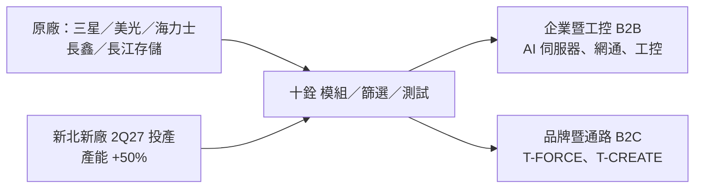

# 4967_十銓（市）

## 基本資料

十銓為記憶體模組廠，產品涵蓋 DRAM 模組與 SSD，品牌包括電競 T-FORCE 與創作者 T-CREATE。2026 年記憶體價格大漲，營收結構由消費性轉向 AI 伺服器、一般伺服器與企業級用戶：1~3Q26 B2B 營收占比 64.6%（1~3Q25 為 24.6%）；3Q26 營收 101.39 億元、毛利率 49.27%、EPS 37.19 元，1~3Q26 EPS 90.95 元（[[活動_十銓4967_國泰CallMemo_20261102]]，2026-11-02）。

- 主要產品：DDR5／DDR4 模組（1~3Q26 DRAM 占營收 83.63%，其中 DDR5 占 87.93%）、Flash／SSD（13.68%）、工控寬溫與防護產品、資安 SSD（PLP、TCG Opal、物理銷毀）。
- 應用：AI 伺服器、一般伺服器、網通、工控、車用、電競超頻、創作者工作站、軍用資料保存。
- 供應鏈位置：向三星、美光、海力士等原廠採購顆粒與晶圓，做模組、篩選、客製韌體與測試後供應 B2B 與通路。

## 核心技術／競爭優勢

- 與原廠交易近 30 年，簽 LTA 並有長期交易紀錄，缺貨期仍可取得貨源。
- 2020~2022 年即布局 DDR5 晶圓與高強度運算客戶。
- 工控寬溫、防水、防塵、防震與軍用技術，無人機資料外洩防護 security 產品已取得多項專利。
- 研發：訊號完整度、散熱設計、CAMM2、CXL 等新架構。

## 產品與應用

| 事業群 | 產品／市場 | 備註 |
|---|---|---|
| 企業暨工控應用（B2B） | 伺服器、網通、AI 長單、工控、車用 | 已收到半年至一年半 forecast |
| 品牌暨通路（B2C） | T-FORCE 電競、T-CREATE 創作者、高頻 CKD DDR5、Gen5 SSD | 高階電競與創作者模組占消費性銷售逾七成 |

## 圖片 / 架構圖

圖說：依 2026-11-02 國泰 call memo 整理的供應鏈位置與雙事業群架構（Mermaid 補位，來源無圖）。

## 財務重點

| 指標 | 3Q26 | 1~3Q26 | 來源 |
|---|---|---|---|
| 營收 | 101.39 億元（QoQ +33.61%） | 267.72 億元 | [[活動_十銓4967_國泰CallMemo_20261102]] |
| 毛利率 | 49.27%（QoQ +6.50ppt） | 43.62% | 同上 |
| 營益率 | 44.50% | 39.18% | 同上 |
| EPS | 37.19 元 | 90.95 元 | 同上 |

## 時間軸

| 時間 | 事件 | 類型 | 重要性 | 備註 |
|---|---|---|---|---|
| 2026-11 | 組織分為企業暨工控（B2B）與品牌暨通路（B2C）兩事業群 | 組織 | ⭐ | 陳慶文任執行長 |
| 4Q26–2Q27 | 公司判斷最缺貨期間，合約價每季漲 30~40% 延續至 1Q27 | 供需 | ⭐⭐⭐ | 見 [[時程_2026記憶體與AI催化劑]] |
| 1Q27 | 新北新廠（約千坪）裝修與設備進駐 | 產能 | ⭐⭐ | — |
| 2Q27 | 新廠完工投產，整體產能約增 50% | 產能 | ⭐⭐ | 全自動化 |
| 2H28 | 公司預估 DRAM 供需最快平衡 | 供需 | ⭐⭐⭐ | thesis |

## 供應鏈位置

- 上游：三星、美光、海力士（寡占）與長鑫、長江存儲；三大原廠中有一家明年將完全不生產 DDR4。
- 下游：伺服器、中小型雲端、網通與工控長約客戶、電競與創作者通路。
- 供應鏈頁：[[供應鏈_記憶體]]。

## 相關公司

| 公司 | 關係 | 說明 |
|---|---|---|
| 三星、美光、SK 海力士 | 顆粒供應商 | wiki 尚無對應頁連結，簽 LTA |
| [[3006_晶豪科（市）]] | 同屬受惠利基／舊規 DRAM 缺貨 | 非交易關係，僅產業比較 |

## 近期營運與研究更新

### 2026-11-02 國泰 call memo

- 價格：2025-10 至 2026-09，DDR5 16Gb 合約價 8.70→48.00 美元、DDR4 8Gb 7.00→26.00 美元、TLC 512Gb Wafer 5.12→26.43 美元、TLC 1Tb Wafer 8.12→33.48 美元；現貨價高於合約價至少 30~50%（fact，中高信心）。
- 供需：以三大原廠加長鑫、長江存儲 1~3 年擴產估算，供需平衡至少要到 2H28；最缺貨落在 4Q26 至 2Q27，看不到 2027 年價格下跌機會（thesis，公司觀點）。
- 終端 M 型化：AI 資料中心、企業伺服器與邊緣運算約占 DRAM 產出 70%；PC 與手機記憶體分配居劣勢，PC 廠持續降規。
- 工控與網通 70~80% 仍用 DDR4，十銓以長約與備貨支援；9/30 庫存 172 億元（DRAM 約 75%、NAND 約 25%）。
- 毛利率上升來自賣價上升與客戶結構轉向高毛利市場；公司未提供 4Q26 財測，但對毛利率有信心。
- 來源：[[活動_十銓4967_國泰CallMemo_20261102]]。

## 風險與注意事項

> [!warning]
> - 獲利高度依賴價格上漲與低價庫存；價格反轉時存貨跌價風險大（存貨約占資產 60%）。
> - 長鑫、長江存儲 2029 年低階 DDR3／DDR4 可能局部放量。
> - 2H27 新供給與 2H28 供需轉折時點為公司判斷，屬 thesis。

## 來源

- [[活動_十銓4967_國泰CallMemo_20261102]]（國泰證期研究部，2026-11-02）

## 相關頁面

- [[供應鏈_記憶體]]
- [[時程_2026記憶體與AI催化劑]]
- [[3006_晶豪科（市）]]
