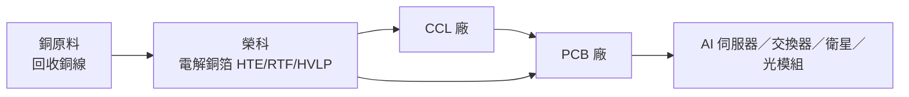

# 4989_榮科（市）

## 基本資料

- 李長榮科技成立於 1997 年、2018 年上市，生產基地位於高雄小港；專營電子電路用電解銅箔（ED Copper Foil），不生產壓延銅箔、鋰電池銅箔或 ABF 載體銅箔。
- 直接客戶為 CCL 與 PCB 廠；終端以 AI 伺服器為主要成長動能，低軌衛星與光模組小量出貨，另有手機、PC、車用。
- 2026 年完成現金增資，實收資本額約 17.28 億元，資金支應泰國建廠。
- 母公司李長榮化工持股多次出售（公開資訊）。
- 資料來源：[[活動_榮科4989_元大CallMemo_20261118]]（元大投顧，2026-11-18 法說）。

## 核心技術／競爭優勢

- 高階 RTF／HVLP 驗證：13 家客戶中，RTF-1／2／3 分別 10／7／2 家通過，RTF-4 有 3 家送樣；HVLP-1 有 4 家通過、HVLP-2 送樣或調整中、HVLP-3／4 有 1 家通過（2026-11-18 法說）。
- 高階品完成下游認證後加工費有較大溢價；驗證週期約 1–1.5 年，形成進入門檻。
- 智慧製造：AICCD 光學檢測結合 AI 辨識、AI 預測生產模型；銅原料取得 UL 2809 驗證（100% 工業回收銅線），部分客戶列為供應條件。

## 產品與應用

| 產品 | 應用 | 相關客戶／下游 |
|------|------|----------------|
| HTE 銅箔 | 手機、PC、車用 | 中、美系手機客戶（已升級至 RTF-2） |
| RTF-1～4 | AI 伺服器、低軌衛星（RTF-2 為主） | CCL 廠（[[2383_台光電（市）]]、[[6274_台燿（市）]]、[[6213_聯茂（市）]] 等為產業主要 CCL 廠，客戶名原文未揭露） |
| HVLP-1～4 | AI 伺服器、交換器、光模組 | 同上；HVLP-4 為目前市場最緊等級，HVLP-5 為未來型號 |

## 圖片 / 架構圖

圖說：榮科位於 PCB 上游材料，直接供應 CCL 與 PCB 廠。

## EPS 記錄

| 季度 | EPS | 備註 |
|------|-----|------|
| 1Q26 | 0.13 元 | |
| 2Q26 | -0.80 元 | 含現增員工認購一次性酬勞約 1.1 億元，排除後為獲利 |
| 3Q26 | 0.22 元 | 夏季電價較高仍獲利 |
| 1-3Q26 | -0.39 元 | 營收 31.84 億元（YoY +70.9%），毛利率約 3%（去年同期約 -19%） |

## 時間軸

| 時間 | 事件 | 類型 | 重要性 | 備註 |
|------|------|------|--------|------|
| 2026-10 | 單月營收約 4.97 億元創新高 | 營收 | ⭐⭐ | |
| 2026 年底 | 泰國大城府廠動工 | 擴產 | ⭐⭐ | 投資優惠待核准 |
| 1Q28 | 泰國首期量產，名目年產能約 1 萬噸 | 擴產 | ⭐⭐⭐ | 2028 台泰合計約 2 萬噸；用地可容納約 3 萬噸 |

相關時程：[[時程_2026Q3Q4_AI網通與硬體催化劑]]

## 供應鏈位置

- 上游：銅原料（回收銅線）
- 下游：CCL 廠、PCB 廠
- 同業：[[8358_金居（市）]]（高階 RTF／HVLP 同業）
- 所屬供應鏈：[[供應鏈_AI伺服器PCB]]；技術：[[技術_HVLP銅箔]]、[[技術_CCL]]

## 相關公司

| 公司 | 關係 | 說明 |
|------|------|------|
| [[8358_金居（市）]] | 同業／競爭 | 台灣高階銅箔同業 |
| [[2383_台光電（市）]] | 潛在下游 | 高階 CCL 廠（客戶名原文未揭露） |
| [[6274_台燿（市）]] | 潛在下游 | 高階 CCL 廠（客戶名原文未揭露） |
| [[6213_聯茂（市）]] | 潛在下游 | 高階 CCL 廠（客戶名原文未揭露） |

> [!warning] 風險與注意事項
> - 台灣廠名目年產能約 1 萬噸，切換高階 RTF／HVLP 後有效產量約原產能七至八成，規模仍小。
> - 獲利剛轉正，電價、銅價與加工費波動影響大；1-3Q26 仍虧損。
> - 泰國新廠投資優惠待核准、人力與學習曲線風險。

## 來源

- [[活動_榮科4989_元大CallMemo_20261118]]（元大投顧，2026-11-18 法說 call memo）
