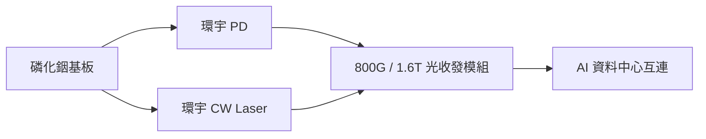

# 4991_環宇-KY（櫃）

## 基本資料

環宇是光通訊與射頻元件廠，產品涵蓋 AOC、PD、CW Laser 與 RF 元件。中信 2026-08-06 報告指出，2Q26 受磷化銦基板供應限制影響，產品組合轉向較低毛利 RF；基板供應逐步恢復後，200G PD 已小量量產，100G PD 訂單可望回補。

## 產品與應用

| 產品 | 應用 | 進度 |
|---|---|---|
| 200G / 100G PD | 800G / 1.6T 光收發模組 | 200G 已小量量產；100G 恢復出貨 |
| 70mW / 100mW CW Laser | 光模組與 AI 資料中心 | 70mW 小量量產；100mW 可靠度驗證 |
| RF 元件 | 射頻與通訊設備 | 基板受限時支撐營收，但毛利較低 |

## 供應鏈位置

- 上游：磷化銦基板，既有中國來源與非中系供應商並行。
- 下游：美系光收發模組與資料中心互連需求；特定客戶與禁令受惠仍屬券商情境，未寫為確定訂單。
- 後段代工：[[6706_惠特（市）]] 私訪稱環宇 2026 年約 100 片、2026-05 初後驗證 CW 代工，CW 確定放台灣、PD 目前在美國洛杉磯，2027 年自建後段廠；2026-07 私訪改稱環宇由測 CW 轉向測 PD、可能 Q4 進來，forecast 大於 AVGO、小於光環（[[活動_惠特私訪_20260422]]、[[活動_惠特私訪_20260701]]；惠特方說法、中信心）。

## 圖片 / 架構圖

![[報告_元大_光通訊產業_20260921_006.png]]
*圖（元大投顧引 MIC，2026-09-21）：光模組依傳輸距離選用不同光源——500m–2km 的 DR／FR 用 1310nm DML／EML／矽光（矽光需外接 CW Laser），更長距離轉向 EML 與相干。環宇的 100G／200G PD 用於接收端，CW Laser 則對應矽光 DR／FR 區段的發射光源，是其 70mW／100mW CW 驗證的市場位置。*

## 時間軸

| 日期 | 事件 | 類型 | 重要性 | 備註 |
|---|---|---|---|---|
| 2026Q2 | 200G PD 小量量產出貨 | 放量 | ⭐⭐⭐ | 中信 2026-08-06，來源報告 |
| 2026Q4 | 非中系磷化銦基板較大產能開出 | 供應 | ⭐⭐⭐ | 公司／券商展望，需驗證 |
| 2026Q4–2027Q1 | 100mW CW Laser 可靠度驗證與進展 | 驗證 | ⭐⭐⭐ | 量產時程尚未確定；2026-11-03 法說改稱 4Q26 起 qualification、3Q27 量產 |
| 2027Q2 | 200G PD 大批次出貨（驗證完成、等待第二家基板到位）；美國 clean room 擴張與補齊瓶頸機台完成 | 放量 | ⭐⭐⭐ | 公司說法，中（已遞延）；[[活動_環宇-KY4991_國泰CallMemo_20261103]]、[[活動_環宇-KY4991_珩石資本法說筆記_20261103]] |
| 2027Q3–Q4 | 100mW CW Laser 3Q27 小批次、4Q27 大批次 | 量產 | ⭐⭐⭐ | 公司說法，中（客戶規格調整而遞延）；同上 |

### 風險補充

- 磷化銦基板供應或出口管制再度收緊。
- CW Laser 驗證延遲，或光模組客戶需求低於估計。

## 近期營運與研究更新

### 2026-11-03 3Q26 法說：AOC 回升、200G PD 2Q27 放量、100mW CW 延至 3Q27（國泰 call memo／中信）

- 3Q26 營收 US$26.4mn（新台幣 8.44 億元，QoQ +9.7%、YoY +55%），毛利率 47%（QoQ +3.7ppt），營業費用 US$7.3mn，歸屬母公司淨利 1.59 億元，EPS 1.33 元；AOC 占比由 61% 升至 71%（InP 基板供應回穩、反映原料成本調漲售價）（fact）。
- 4Q26 指引：營收 US$30～34mn、毛利率 46～50%、營業費用 US$7.6～8.6mn（CW laser 4Q26 開始 qualification）；增資威力富擴充美國以外產能，美國 clean room 擴張與補齊瓶頸機台預計 2Q27 完成。
- 產品：100G PD 9 月起出貨回升；200G PD 驗證完成、一客戶開始上量，因原非中國基板供應商擴產不如預期，加一家基板來源，大批次在 2Q27；100mW CW laser 因客戶回饋調整，小批次 3Q27、4Q27 大批次；70mW 仍 sampling，主要由合作夥伴提供。
- 供應：稼動率逾 100%；2027 年基板經磊晶廠以長約與預付款鎖定，仍須依賴中國出口核准，非中國來源 2028 年後才有意義比例；訂單中有 double booking；Foundry 能見度到 2027 年 6 月。
- 觀點：Marvell 併 Lumentum 對產業正面；400G PD 仍以 InP 為主，矽光 PD 約做到 200G；美系 IDM 尋找 200G PD 外包不代表 PD 為 1.6T 瓶頸。GDR 目標 2026 年底前送件。
- 評等：中信 買進，TP 487 元（原 569 元），預估 2026／2027 EPS 5.37／9.74 元，因 200G PD 與 CW laser 驗證延遲下修本益比（estimate）。
- 第二份法說筆記（珩石資本 Jason）補充：200G PD 市占不及 100G PD 世代，但良率與效能較佳；200G PD 與 100G PD 共用相同 InP 基板、磊晶片設計不同，材料漲價會轉嫁但跟不上漲幅；Marvell／Lumentum 整合對光通訊供需無影響、價格或許有；SiGe（矽光）PD 公司不接觸，極限約 200G，長期仍以 InP 為主；客戶端「無庫存、有就賣」（fact／公司說法，信心中高；與國泰 call memo 口徑一致）。
- 來源：[[活動_環宇-KY4991_國泰CallMemo_20261103]]、[[活動_環宇-KY4991_珩石資本法說筆記_20261103]]、[[報告_中信_環宇4991_20261104]]。

> [!warning] 同場法說兩份筆記的口徑差異（並列保留）
> - 營業費用偏低原因：國泰記為「100mW CW laser 進度遞延」；珩石筆記記為「100G PD 延後」。4Q26 費用指引與 CW qualification 連動，國泰版本較一致。
> - 3Q26 業外：國泰記為業外**收入** 3,119 萬元（權益法投資利益 1,391 萬元、季減 28.7%）；珩石筆記記為「投資利益法認列導致業外虧損，本季已減少 28% 部位」，疑為將投資利益季減 28.7% 誤記為部位減少。
> - 1～3Q26 累計：國泰記營業費用 6.77 億元、營業成本 12.09 億元、毛利率 48%；珩石筆記記「營業費用 12 億、毛利率 48.1%」，12 億較接近營業成本。
> - 3Q26 淨利：珩石筆記「淨利 1.93 億、稅後 1.59 億」分別對應國泰的稅前淨利與歸屬母公司淨利（國泰另列稅後淨利 1.54 億元）。
> - 以上以公司財報為準；未核對前，數字優先採國泰 call memo 口徑。

### 2026-09-21 元大光通訊產業更新（買進，TP 600 元）

- 定位：元大稱環宇 100G PD 用於 800G（100G×8）光收發模組市占約 70%，訂單能見度至 1Q27；70mW CW Laser 已通過多位客戶認證、美國廠小量交貨（券商 claim，信心中）。
- 預估：2026／2027 年營收年增 48%／55%，EPS 5.60／15.10 元（YoY +3,549.9%／+169.6%），動能來自 AOC 與 CW Laser（estimate）。
- 時序提醒：此報告早於 2026-11-03 法說；法說後中信已將 TP 由 569 調至 487 元，100mW CW 延至 3Q27 小批次、70mW 仍主要 sampling，元大 9 月對 CW 貢獻的假設應以法說後口徑校正。
- 產業脈絡：元大將 2 公里以上傳輸需 EML、2 公里以內可用 CW Laser 列為光晶片分工，環宇與聯亞、全新同列受惠（詳 [[技術_光模塊]]）。
- 來源：[[報告_元大_光通訊產業_20260921]]（元大投顧，2026-09-21）。

## 來源

- [[活動_環宇-KY4991_國泰CallMemo_20261103]] — 國泰證期，2026-11-03 法說 call memo。
- [[活動_環宇-KY4991_珩石資本法說筆記_20261103]] — 珩石資本 Jason，2026-11-03 法說筆記（同場次第二份紀錄）。
- [[報告_中信_環宇4991_20261104]] — 中信投顧，2026-11-04；買進 TP 487 元。
- [[報告_元大_光通訊產業_20260921]] — 元大投顧，2026-09-21；光通訊產業更新，買進 TP 600 元。
- [[環宇(4991,B_買進)-CTBC260806]]（中信投顧，2026-08-06）
- [[4991 環宇 260826 Macquarie]]（Macquarie，2026-08-26；原始 PDF 已保存，文字層待補 OCR）

- [[元大投顧 - 光通訊產業 20250824]]（2025-08-24）

- [[活動_惠特私訪_20260422]]（2026-04-22）

## 相關頁面

- [[技術_InP磷化銦]]（元大 2026-09-21 光通訊產業報告引用）
- [[時程_2026記憶體與AI催化劑]]
- [[時程_2026Q3Q4_AI網通與硬體催化劑]]（2Q27 200G PD、3Q27／4Q27 100mW CW 節點）
- [[技術_光模塊]]
- [[供應鏈_AI光互聯]]
