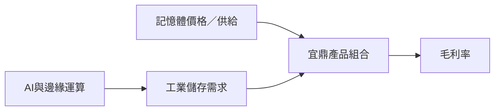

# 5289_宜鼎（櫃）

## 基本資料
宜鼎國際（Innodisk）是工業級記憶體與嵌入式儲存供應商，產品涵蓋 DRAM、SSD、模組與工業電腦儲存方案，應用於工業自動化、網通、邊緣 AI 與伺服器。TPEX 資料列示股票代號 5289。

## 核心技術／競爭優勢
- 工業級寬溫、長供貨週期與客製化模組能力。
- 記憶體價格上漲時，產品組合與庫存管理可放大毛利彈性。
- AI 應用、邊緣運算與伺服器儲存需求提供非消費性需求支撐。

## 產品與應用
| 產品 | 應用 | 相關下游 |
|---|---|---|
| 工業 DRAM／SSD | 工業電腦、網通 | IPC、設備商 |
| 嵌入式儲存模組 | 邊緣 AI、伺服器 | 系統整合商 |

## 圖片 / 架構圖

> 宜鼎的獲利彈性同時受記憶體價格、產品組合與 AI 應用需求影響。

## 目標價與評等
| 券商 | 報告日 | 評等 | 目標價 | 類型 | 來源 |
|---|---|---|---|---|---|
| 凱基 | 2026-10-28 | 增加持股 | NT$1,500（原 1,078.5） | estimate；隱含 2027 年 4x PE（群聯 7x） | [[memo_凱基投顧_宜鼎5289AI基礎建設布局_20261028]] |
| Daiwa | 2026-08-06 | Buy | NT$2,385 | estimate | [[260806_daiwa_Innodisk]] |

## 時間軸
| 時間 | 事件 | 類型 | 重要性 | 備註 |
|---|---|---|---|---|
| 2026Q2 | EPS NT$108.93、毛利率 65.0% | 獲利 | ⭐⭐⭐ | Daiwa 報告數據 |
| 2H26 | 記憶體漲價與 AI 訂單展望 | 放量 | ⭐⭐⭐ | 公司展望／券商 estimate |

## 供應鏈位置
- 上游：DRAM、NAND 與控制器供應商。
- 下游：工業電腦、網通、邊緣 AI 系統；相關主題見 [[供應鏈_記憶體]]。

## 近期營運與研究更新

### 2026-10-28 凱基：AI 基礎建設占比逾四成

- 3Q26 營收 258.8 億元（QoQ +15.3%，fact）；凱基推估 DRAM／NAND 位元出貨大致持平、ASP 季增 10–20%、安提貢獻 4–5 億元；記憶體報價漲幅收斂，估毛利率季減 4.5ppt 至 60.5%、EPS 117.1 元（estimate）。
- 客戶結構由工控／IPC 轉向 AI 基礎建設，估後者營收比重已超過 40%：客戶涵蓋 Switch 大廠、GPU 大廠及美系／中系 CSP，產品為 DDR4 顆粒、DDR5 RDIMM 與企業級儲存（TLC 為主）。NAND 由 SLC／MLC 與 BiCS3／5 小容量 TLC 轉向 BiCS8，多數客戶 2027 年完成驗證放量（boot drive、eSSD），2027 年 AI 基建占比可望超過 50%。
- 安提 2026–27 年營收估 21.9 億／30.4 億元（YoY +169.4%／+38.5%），動能為記憶體漲價推升整機 ASP 與兩大人型機器人客戶；占宜鼎營收已降至約 2%。
- 2027 年估 DRAM／NAND 位元 +4%／+35%、ASP +21%／+18%，營收 +38.5% 至 1,234.2 億元；報價漲幅趨緩，毛利率回落至 43.3%、EPS 375.1 元（YoY −5.4%）。台系廠商加入供應鏈有助穩定貨源。

來源：[[memo_凱基投顧_宜鼎5289AI基礎建設布局_20261028]]。

## 相關公司
目前本批來源未揭露需建立的明確客戶或供應商關係，`related_companies` 保持空白。

> [!warning] 風險與注意事項
> - 記憶體價格反轉或庫存跌價可能壓縮毛利。
> - AI 應用需求與高毛利產品組合若不如預期，券商估值可能下修。

## 2026-11-20 富邦：2027 記憶體展望，台股推薦之一（買進，TP 1,600 元）

- 富邦 2027 年展望（產業評等持平）：DRAM 2027 年續供給短缺（TrendForce 產值 US$1,153bn、YoY +68.7%，位元 +25.3%、ASP +40.0%，資本支出強度降至 13%），NAND 2027 年供需翻轉、消費應用領跌、2Q27 可能擴散至企業級 SSD；記憶體相關個股建議先停看聽，待 2027 年 1 月中旬新國會與州長 AI 政策明朗後再布局（thesis／中）。
- 宜鼎：四大 CSP 網通基建的 DRAM 模組、伺服器開機 SSD 等 AI 生態系營收比重達 6 成；長期耕耘 AI 推論與工業級邊緣運算，在高階 IPC 市場居領先地位。
- 富邦估 FY26／27／28 EPS 347.57／361.05／315.91 元（股價 706 元，2026-11-20）（estimate／中）。
- 來源：[[報告_富邦_2027記憶體與存儲產業展望_20261120]]。

## 來源
- [[報告_富邦_2027記憶體與存儲產業展望_20261120]] — 富邦投顧，2026-11-20；2027 記憶體與存儲展望，宜鼎買進／TP 1,600 元。
- [[260806_daiwa_Innodisk]]（Daiwa，2026-08-06）

- [[memo_凱基投顧_宜鼎5289AI基礎建設布局_20261028]]（2026-10-28）
- [[memo_永豐金證券_台股個股評等調整_20261029]]（2026-10-29）

## 相關頁面

- [[分析_2026-08記憶體_AI需求與液冷ASIC更新]]
- [[時程_2026記憶體與AI催化劑]]
