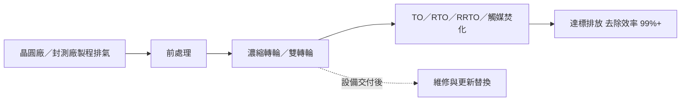

# 5292_華懋（櫃）

## 基本資料

華懋（5292 TT）提供半導體與高科技廠的揮發性有機物（VOCs）廢氣處理系統、特殊乾燥設備與溶劑回收設備，主要客戶為晶圓代工、記憶體與封測廠，光電面板占比逐年降低；台灣占比提高，美國與新加坡據點以安裝維修為主、尚無製造能力，設備仍由台灣出貨。近年新廠工程量高，工程收入維持高檔，設備交付後帶動後續維修收入。

3Q26 合併營收 7.62 億元（季增 16.77%、年增 3.86%），毛利率 30.27%（季增 6.72ppts、年增 8.98ppts）；9M26 營收年減 3.81%，毛利率年增 4.39ppts，獲利率與 EPS 改善。營收未同步訂單，主因客戶排程調整、缺工與環評／排放許可延誤造成設備吊裝交付推遲，非需求放緩。來源：[[活動_華懋5292_國泰CallMemo_20261116]]（國泰證期，2026-11-16）。

## 核心技術／競爭優勢

- **VOCs 處理產品線完整**：依排放成分與去除要求提供濃縮轉輪、TO 直燃、RTO 蓄熱、RRTO 旋轉蓄熱與觸媒焚化；現階段雙轉輪加 TO 需求最多，去除效率 99% 以上。
- **先進製程化合物多元化**：先進製程使用的化合物更多元，需增加前處理、轉輪或附屬配備，提高單套設備含金量；晶圓代工、記憶體與封裝客戶朝雙轉輪系統發展。
- **特殊乾燥與溶劑回收**：鋰電池超低露點乾燥房出風露點 -70°C 以下；NMP 回收以轉輪乾式回收為專長；中空纖維管膜用於油氣回收，降低活性炭吸附火災風險。
- **自動化**：自研設備、市售設備與 AI 工具整合，人力不增下提升產出；新設備 2026-12 或 2027-01 陸續完成。

## 產品與應用

| 產品 / 服務 | 應用 | 相關客戶 / 下游 |
|---|---|---|
| VOCs 濃縮轉輪＋TO／RTO／RRTO／觸媒焚化 | 晶圓廠、封測廠廢氣處理 | 晶圓代工、記憶體、封測客戶（未具名） |
| 特殊乾燥（超低露點乾燥房） | 鋰電池製程 | 電池廠 |
| 全熱交換設備 | 無污染排放區域廢熱回收 | 高科技廠 |
| NMP 回收（轉輪乾式、流體化床、蒸汽脫附） | 鋰電池塗布溶劑 | 電池廠 |
| 中空纖維管膜油氣回收 | 高低濃度油氣 | 石化／油氣 |
| AMC 化學濾網（研發中） | 室內污染控制、持續消耗 | 晶圓廠 |

## 圖片 / 架構圖

圖說：依 call memo 描述整理的華懋 VOCs 廢氣處理流程；先進製程化合物多元，前處理與轉輪配備增加是單套價值提升的來源。

## EPS 記錄

| 期間 | 營收 | 毛利率 | 備註 |
|---|---|---|---|
| 3Q26 | 7.62 億元（季增 16.77%、年增 3.86%） | 30.27% | EPS 原文未提及 |
| 9M26 | 年減 3.81% | 年增 4.39ppts | 獲利率與 EPS 改善 |

## 時間軸

| 時間 | 事件 | 類型 | 重要性 | 備註 |
|---|---|---|---|---|
| 2026-12～2027-01 | 自動化新設備陸續完成 | 產能 | ⭐⭐ | 公司說法 |
| 2027 | 遞延設備陸續吊裝交付，公司看好整體營運 | 營運 | ⭐⭐⭐ | 依客戶實際時程；[[時程_2026廠務與資料中心通路催化劑]] |
| 待定 | 桃園廠地目變更完成後推進；另一新廠辦理園區交地；屏東分公司籌備 | 擴產 | ⭐⭐ | 行政程序中 |

## 供應鏈位置

- **上游**：轉輪、熱交換、焚化爐零組件與鋼構（原文未具名）。
- **下游**：晶圓代工、記憶體、封測廠的新廠工程（設備在建廠最後階段進場）。
- 相鄰研究鏈：[[供應鏈_記憶體]]（記憶體擴廠帶動廢氣處理需求）、[[時程_2026廠務與資料中心通路催化劑]]。

## 相關公司

| 公司 | 關係 | 說明 |
|---|---|---|
| — | — | 本來源未具名客戶或競爭者，`related_companies` 留空 |

相關頁面：[[時程_2026廠務與資料中心通路催化劑]]。

## 風險與注意事項

> [!warning]
> - **交付遞延**：前序工程與人力不足、環評與排放許可延誤，已完成設備須外租 2 處倉庫存放，營收認列時點不確定。
> - **成本**：材料與人工成本上升，雖已透過調價反映，仍需追蹤毛利率。
> - **客戶集中**：主要客戶為少數半導體大廠，新廠時程變動直接影響營收。
> - **擴廠行政程序**：桃園廠地目變更審查中，時程已調整。

## 來源

- [[活動_華懋5292_國泰CallMemo_20261116]] — 國泰證期研究部 call memo，2026-11-16。
