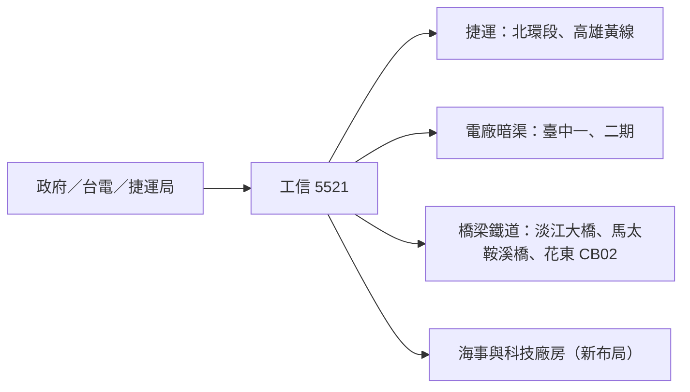

# 5521_工信（市）

## 基本資料

工信以承攬公共工程為主（捷運、橋梁、港埠、電廠暗渠、鐵道），布局海事工程與高科技廠房。2025 年合併營收 90.4 億元、稅後淨利 2.5 億元；1H26 營收 54.2 億元（YoY +12.86%），毛利率 8.5%（1H25 5.4%），營業利益 2.7 億元（YoY +307.89%），稅後淨利 2.8 億元，EPS 0.58 元（1H25 0.14 元）。

- 在手工程約 660 億元（2Q26 未履約約 667.3 億元）；淨值約 55 億元、可承攬約 1,100 億元，10/12 新得標臺中電廠第二期冷卻循環水系統進出水暗渠工程約 120.30 億元，之後仍可再承攬約 300 多億元。
- 2027 年營收與毛利率持樂觀向上看法：公共工程逐漸擺脫最低標低價；北捷 680A 與高雄捷運黃線今年管線障礙多、認列約 20 多億元低於預期，明年高雄各站施作、北捷開始潛盾，認列大增。
- 資料來源：[[活動_工信5521_國泰CallMemo_20261022]]（國泰證期 Call Memo，2026-10-22）。

## 核心技術／競爭優勢

- 大型公共工程履約紀錄：淡江大橋（124.94 億元，99.37%，5/12 通車）、臺北港南碼頭（約 34 億元，85.89%）。
- 獲公共工程金質獎與金安獎，依押標金保證金辦法可提升投標競爭力並降低履約成本。
- 財務穩健：短期借款由 7.2 億元降至 4.5 億元、長期借款全數清償；合約負債 41.3 億元。
- 布局方向：海事工程為重點、高科技廠房為下一目標（今年已承攬小型科技廠房）；不做預拌與預鑄。

## 產品與應用

| 工程 | 金額 | 進度（2026-09） |
|---|---|---|
| 環狀線北環段 Y20（680A 標） | 約 148.31 億元 | 13.29% |
| 高雄捷運黃線 YC02／YC03 | 167 億元／306.92 億元 | 5.34%／6.34% |
| 臺中電廠循環水抽水機房及暗渠 | 37.50 億元 | 93.73%（農曆年前完工） |
| 臺中電廠第二期進出水暗渠 | 約 120.30 億元 | 尚未開工（約 5 年） |
| 花東 CB02 鐵道（工信占 78.19%） | 69.10 億元 | 43.82% |
| 花蓮馬太鞍溪橋復建 | 25.30 億元 | 66.32% |
| 臺東空軍 H007 | 31.73 億元 | 43.68% |

## 圖片 / 架構圖

圖說：工信營收來自政府公共工程，未來成長來自捷運認列放大、臺中電廠二期與海事、科技廠房布局。

## 時間軸

| 時間 | 事件 | 類型 | 重要性 | 備註 |
|---|---|---|---|---|
| 2026-10-12 | 得標臺中電廠二期暗渠工程 120.30 億元 | 接單 | ⭐⭐⭐ | — |
| 2027 農曆年前 | 臺中電廠一期暗渠完工 | 完工 | ⭐ | — |
| 2027 | 高雄黃線各站施作、北捷 680A 開始潛盾，捷運認列大增 | 認列 | ⭐⭐ | — |

→ 跨公司時程詳見 [[時程_2026-2028十月券商催化劑]]

## 供應鏈位置

- 上游：鋼筋、混凝土、機具（物調款依各工地每月或每季認列）。
- 本體：土木與公共工程營造。
- 下游：中央與地方政府、台電、捷運局、國防部。
- 相關主題：[[供應鏈_離岸風電]]（海事工程布局）。

## 相關公司

目前來源未揭露可直接確認的上市公司關係（業主多為政府機關）。

> [!warning] 風險與注意事項
> - 公共工程認列受管線障礙、預算與施工進度影響，2026 年捷運認列已低於預期。
> - 原物料上漲雖有物調機制，但認列時點與工地不同。
> - 產業普遍缺工缺才，影響施工與擴張速度。

## 來源

- [[活動_工信5521_國泰CallMemo_20261022]] — 國泰證期 Call Memo，2026-10-22
