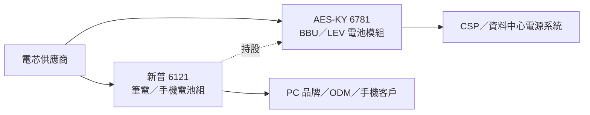

# 6121_新普（櫃）

## 基本資料

新普科技（Simplo Technology，6121 TT）成立於 1992 年，設計與生產筆電、平板與電動載具電池組，筆電與智慧型手機電池市占居前。主要客戶包括 PC 品牌 HP、Dell、Asus、Acer、Apple，以及筆電 ODM Quanta、Compal、Wistron、Inventec（Citi 2026-11-09 公司描述）。資料中心 BBU 業務透過子公司 [[6781_AES-KY（市）]] 經營，AES 原為新普非 IT 事業單位，2021 年分拆上市。

## 核心技術／競爭優勢

- 電池組設計與量產規模、成本優勢，持續擴大客戶基礎。
- 日系供應商轉向電動車電池組、降低筆電比重，新普取得更多訂單（Citi 投資策略）。
- 經 AES 取得 AIDC BBU 曝險；Citi 產業調查稱新普已通過全球 ISP 資料中心 BBU 認證。

## 產品與應用

| 產品 | 應用 | 下游 |
|---|---|---|
| 筆電／平板電池組 | IT 消費電子 | PC 品牌、筆電 ODM |
| 智慧型手機電池 | 手機 | 美系大客戶 |
| BBU 電池模組（AES） | AI 資料中心備援 | CSP、電源系統商 |
| 新非 IT 產品線 | 原文未具名 | 2028E 占營收 >5%，毛利率高於集團平均 |

## 圖片 / 架構圖

*本批 PDF 未擷取附圖，以 Mermaid 表示新普本業與 AES 子公司在電池模組鏈的位置。*

## EPS 預估

| 年度 | Citi EPS（2026-11-09） | 調整 |
|---|---:|---|
| 2026E | 28.82 | 原 35.90，−20% |
| 2027E | 34.10 | 原 41.83，−18% |
| 2028E | 38.68 | 原 46.53，−17% |

## 目標價與評等

| 券商 | 日期 | 評等 | 目標價 | 基礎 | 來源 |
|---|---|---|---:|---|---|
| Citi | 2026-11-09 | Buy | NT$400（原 NT$480） | 12x 2027E EPS（原 13x），反映 IT 復甦能見度下降 | [[報告_Citi_新普6121_20261109]] |

## 近期營運與研究更新

### 2026-11-09 Citi：3Q26 不如預期，IT 復甦延後、AES 支撐毛利率（Buy，TP NT$400）

- 3Q26（fact）：營收 NT$19.9bn（年減 2%、季減 5%），低於 Citi／BBG 13%／10%；淨利年減 17%、EPS NT$6.56，低於 Citi／BBG 35%／30%。筆電客戶因記憶體漲價把訂單提前到 1H26，美系大客戶新手機良率偏低限制出貨。
- 毛利：集團毛利率年增 0.7ppt 至 16.3%（AES 貢獻提高），本業毛利率年減 1.6ppt 至 9.2%（投入成本上升、量縮）；集團 OPM 年增 0.4ppt 至 9.7%，低於 Citi 12.2% 與 BBG 11.9%；稅負增加也壓抑 EPS。
- 2027 年 IT 展望平淡：零組件成本推高 PC 售價，管理層預期 1Q27 IT 需求溫和；本業營收 2027E 持平至小減，集團營收在 AES BBU 帶動下持平至小增。筆電品牌電池組庫存僅數週，鈷價回落可能使 2027E ASP 下降。新非 IT 產品線自小基期成長數倍，2028E 占比 >5%。
- Citi 下修 2026–28E 獲利 17–20%、營收 10–18%；看好筆電／手機電池市占與 AES 資料中心 BBU 曝險，AI PC 長期可推升電池組 ASP，殖利率約 6% 提供下檔保護。

## 時間軸

| 時間 | 事件 | 類型 | 重要性 | 備註 |
|---|---|---|---|---|
| 1Q27 | IT 需求溫和，零組件成本推高 PC 價格 | 需求 | ⭐⭐ | 管理層說法，Citi 2026-11-09 |
| 2027 | 集團營收持平至小增，AES BBU 為主要成長 | 營運 | ⭐⭐ | 同上 |
| 2028 | 新非 IT 產品線占營收 >5% | 新品 | ⭐⭐ | 同上 |

## 供應鏈位置

位於電池模組中游：上游為電芯與材料（鈷價影響 ASP），下游為 PC 品牌、筆電 ODM 與手機客戶；資料中心 BBU 由子公司 AES 供應，相關技術見 [[技術_BBU與CBU機櫃儲能]]。

## 相關公司

| 公司 | 關係 | 說明 |
|---|---|---|
| [[6781_AES-KY（市）]] | 子公司 | 原為新普非 IT 事業單位；BBU 貢獻推升集團毛利率 |
| [[3211_順達科技（櫃）]] | 同業 | 筆電電池組與 BBU 同業 |

> [!warning] 風險與注意事項
> - 終端產品銷售弱於預期、競爭加劇、筆電／平板／PC 成長不如預期（Citi 下行風險）。
> - 記憶體等零組件漲價可能延後 IT 復甦。

## 來源

- [[報告_Citi_新普6121_20261109]] — Citi，2026-11-09；3Q26 財報、2027 展望、TP NT$400。
- [[報告_Citi_AES-KY6781_20261108]] — Citi，2026-11-08；AES 原為新普非 IT 事業單位。

## 相關頁面

- [[6781_AES-KY（市）]]
- [[技術_BBU與CBU機櫃儲能]]
