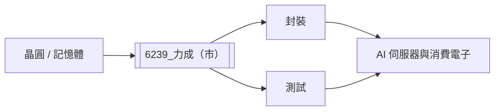

# 6239_力成（市）

## 基本資料

力成（Powertech Technology）是台灣半導體封裝與測試服務商，主要承接記憶體、邏輯與高效能運算晶片的封裝、測試及相關後段製程。2026 年券商報告指出，2Q26 營收約 231.2 億元，AI／記憶體需求與 TSV interconnection 試產為後續成長觀察點。

## 核心技術／競爭優勢

- 封裝與測試整合，能承接高複雜度記憶體與邏輯產品。
- TSV interconnection 開始試產，提供高頻寬記憶體與先進封裝的技術選擇權。
- 大規模產能與既有客戶認證形成切換成本；上述競爭優勢為券商分析，非公司逐項量化揭露。

## 產品與應用

| 產品 / 服務 | 應用 | 相關客戶 / 下游 |
|---|---|---|
| 記憶體封裝與測試 | AI 伺服器、PC、消費電子 | 記憶體供應鏈 |
| 邏輯封裝與測試 | ASIC、處理器 | IC 設計與系統廠 |
| TSV interconnection | 高頻寬記憶體與先進封裝 | 券商報告未具名 |

## 圖片 / 架構圖

## EPS 預估

| 年度 | CTBC EPS（報告日：2026-07-29） | 備註 |
|---|---:|---|
| 2026E | 12.6 元 | estimate |
| 2027E | 17.5 元 | estimate；TSV 試產與毛利率延續 |

## 目標價與評等

| 券商 | 報告發布日 | 評等 | 目標價 | 評價基礎 | 來源 |
|---|---|---|---:|---|---|
| 中信 | 2026-07-29 | 買進 | NT$400 | 23x 2027E EPS | [[力成(6239,B_買進)-CTBC260729]] |

## 時間軸

| 時間 | 事件 | 類型 | 重要性 | 備註 |
|---|---|---|---|---|
| 2026Q3 | TSV interconnection 開始試產 | 驗證 / 放量 | ⭐⭐⭐ | 券商整理，estimate |
| 2027 | 毛利率維持高檔的觀察期 | 獲利 | ⭐⭐ | 受 AI 與記憶體需求影響 |

## 供應鏈位置

- 上游：晶圓與封裝材料供應商。
- 下游：記憶體、AI 伺服器與高效能運算晶片供應鏈。
- 所屬環節：封裝、測試。

## 相關公司

目前本報告未具名揭露可確定建立 wikilink 的客戶或供應商，`related_companies` 維持空白。

> [!warning] 風險與注意事項
> - AI／記憶體需求若低於預期，產能利用率與毛利率可能回落。
> - TSV 試產到量產仍有驗證、良率與客戶導入風險。

## UBS 2Q26 更新：FOPLP 進度後移

- 2Q26 營收 NT$23.1bn（QoQ +8.5%）、毛利率 21.8%、EPS NT$3.00；UBS 預估 3Q26 營收約季增 5%、毛利率 22.1%。
- FOPLP 首波 2K 片／月安裝後，額外 4–5K 片／月產能改為 2027 年底前建置；相較先前 2026 年底 3K、2027H1 再 3K 的節奏後移。設備交期、安裝、NPI 與驗證均為瓶頸。
- AMD 首顆 AI FOPLP 晶片仍以 2027 年中前放量為目標；與 [[AVGO.US(broadcom)]] 的合作則包括 2026 年底前 micro-bump OE 試產、2027H2 switch 整合、AI 晶片整合目標至 2028 年底。時程均為公司／券商展望，信心中。

來源：[[報告_UBS_力成_20260728]]（2026-07-28）。

## UBS 台灣高峰會更新：FOPLP 產能與客戶路徑

- 力成表示台灣 FOPLP 基板產能為 2026 年 3K、2027 年再增 3K substrates／月，合計 6K，全面放量目標為 2028；面板尺寸為 510 × 515 mm。
- 台灣產能多配置予 [[AMD.US(amd)]]，先由遊戲機產品切入，後續瞄準伺服器 CPU。與 [[AVGO.US(broadcom)]] 的新加坡合資案待 2026Q4 核准，力成擬投資 US$400m 取得 30% 股權；合資廠預計 2028 量產、力成負責工廠營運。產能與時程均為管理層／券商展望，信心中。

來源：[[報告_UBS_力成_20260915]]（2026-09-15）。

## 2026-08-07 博通合資細節與庫藏股（群組轉傳）

- 群組轉傳 8/7 盤後重訊解讀：與博通成立之先進封裝合資公司資本額 56 億美元，力成僅出資 4 億美元即取得 30% 持股（與 UBS 所述 US$400m／30% 一致）；同日決議於 250–350 元區間實施庫藏股、上限 1 萬張。屬新聞轉述，以公司重訊為準。
- [[3680_家登（櫃）]] 法說稱其 510×515mm 面板級封裝載具已交貨力成。
- 來源：[[memo_LINE投資人超商_產業消息與群友討論彙整_20260725-20261004]]（I022）、[[活動_家登3680_法說與SEMICON_Memo_20260827]]。

## 2026-10-27 3Q26 法說：營收毛利率新高、FCBGA 78x88

- 3Q26 營收 NT$253.34 億（QoQ +9.6%、YoY +26.9%），毛利率 24.0%（QoQ +2.2ppt），營業利益 NT$44.72 億，歸屬母公司淨利 NT$26.12 億，EPS NT$3.55，營收與毛利率皆創新高；1-3Q26 EPS NT$9.05 已超越 2025 全年 NT$7.48。
- 營收結構：封裝 67%、測試 24%、SiP／模組 9%；Logic 43%、NAND 28%、DRAM 20%。QoQ 增加約 NT$22 億，記憶體（以 DRAM 為主）與邏輯各半。超豐簽 LTA、Tera Probe／TeraPower 營收高雙位數成長。
- 先進封裝（FCBGA、FOPLP、Bumping、2.5D／3D）已占集團營收三成以上；高階 FCBGA 3Q26 量產 1x reticle（75x78），4Q26 跨入 78x88，整合 SoC 與 DRAM，客戶為另一家 AI 公司（CSP 客戶之一），與 AMD 的 FOPLP 無關。
- FOPLP：510x515mm 面板，與台積電 CoPoS（310x310）同製程、面板較大成本較低但門檻較高；客戶驗證推進，2027 年量產目標不變，設備不影響 2027～2028 擴產時程。RDL 常見 3P3M、可做 5P5M。已具 EMIB-like 能力（bridge die 嵌入 polymer），但不對外提供。
- 價格與展望：封裝材料與載板成本大漲，漲價個位數至雙位數，客戶接受度高；封測稼動率皆逾 90%；4Q26 營收與毛利率可望在 3Q26 基礎上續增，有機會挑戰 2022 年營收新高 NT$834 億。UBS 估 4Q26 營收 QoQ +4%、毛利率 24.8%；富邦估 4Q26 營收約持平。
- 博通新加坡合資：共同開發 CPO 與 Optical Engine，驗證順利，經濟部投審中；富邦轉述合資總額 US$5.66bn、力成出資 US$400mn 取得 30%；4Q26 資金（含博通投資）已於 3Q26 季末備妥，評估聯貸、現增、公司債、CB／ECB、GDR。
- 評等：BofA Buy，TP NT$500（EPS 2026–2028E 13.13／17.00／21.15）；UBS Neutral，TP NT$260→NT$280（EPS 12.94／16.59／19.00）；富邦 看法正面。

> [!warning] FOPLP 產能數字來源不一致
> - UBS（2026-10-28 轉述）：台灣 FOPLP 產能由 2026 年每月 3,000 片基板提升至 2027 年中每月 6,000 片。
> - 富邦 Call Memo（2026-10-27）：設備交期延後，2027 年中約 2k，2028 年提高到 5k 供應 AMD（實際 6k，保留 1k 替 Broadcom 開發新產品）。
> - 兩者時程差異待公司後續說明確認，暫不裁定。

## 來源

- [[memo_LINE投資人超商_產業消息與群友討論彙整_20260725-20261004]]（LINE 群組轉傳，博通合資細節與庫藏股，2026-08-07）

- [[力成(6239,B_買進)-CTBC260729]]（中信，2026-07-29）
- [[報告_UBS_力成_20260915]]（UBS，2026-09-15）

- [[報告_UBS_力成_20260728]]（2026-07-28）
- [[活動_力成6239_國泰CallMemo_20261027]]
- [[活動_力成6239_富邦CallMemo_20261027]]
- [[報告_中信_力成6239_20261028]]
- [[memo_BofA_力成6239_3Q26財報_20261028]]
- [[memo_UBS_力成6239_3Q26財報_20261028]]
- [[memo_富邦_早會聯茂力成晶豪科_20261028]]
- [[memo_國泰_AI基建與半導體領漲_20261028]]

## 相關頁面

- [[時程_2026記憶體與AI催化劑]]
