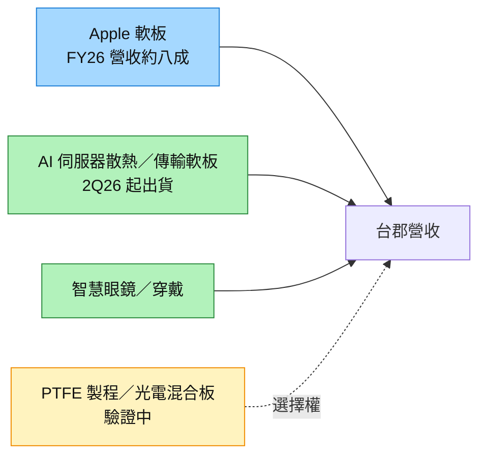

# 6269_台郡（市）

## 基本資料

台郡成立於 1997 年，是台灣前三大軟板（FPC）製造商，最大客戶為 Apple；富邦投顧 2026-09-08 估 FY26／FY27 來自 Apple 的營收占比約 80%／65%、來自 iPhone 約 35%／30%。主要應用為通訊（手機）、電腦與消費電子。

2025 年是公司近十年營運谷底，每股虧損 6.95 元（法說，2026-03-10）。公司正降低對單一美系客戶依賴，2026 年非主力客戶營收比重目標 20–30%，新動能包括：AI 伺服器散熱系統軟板（公司稱市占逾七成，2Q26 起出貨，AI 伺服器傳輸產品營收占比有望破 10%）、智慧眼鏡（占比由低個位數升至 10–20%），並布局車用、機器人與 CPO 光電混合板；2026 年資本支出約 NT$15–18 億（工商時報轉述法說，2026-03-11）。

在 AI 伺服器 PCB 的定位：NVIDIA 在 OCP 2026 展示 NVLink PTFE Board，台郡（Flexium）是 7 家夥伴之一。但各來源都認為其角色有限——MS 稱台郡可能只負責少數製程步驟，福邦稱台郡負責燒結部分且設備受限，宏遠則認為台郡鎖定晶片與 PCB 之間的光互連軟板模組。詳見 [[技術_PTFE]]。

## 核心技術／競爭優勢

- **Apple 高階軟板量產經驗**：長期為 iPhone 主要軟板供應商之一，具大量高精度軟板製造能力。
- **AI 伺服器散熱軟板**：公司稱散熱系統軟板市占逾七成（公司說法，未經第三方驗證）。
- **PTFE／燒結製程參與**：列名 NVIDIA PTFE Board 夥伴；福邦稱台郡負責燒結（銅漿燒結 Z 軸互連）部分（2026-09-21）。
- **光電整合方向**：整合軟板、光傳輸介面與光電轉換 IC，開發光電混合傳輸模組（宏遠 2026-10-19）；法說亦提及 CPO 光電混合板布局。

## 產品與應用

| 產品／服務 | 應用 | 相關客戶／下游 |
|---|---|---|
| 高階軟板 | iPhone、平板、筆電 | [[AAPL.US(apple)]] |
| AI 伺服器散熱／傳輸軟板 | 伺服器散熱系統、內部傳輸 | AI 伺服器供應鏈（客戶未揭露） |
| PTFE 板製程（燒結等） | NVLink PTFE switch board | [[NVDA.US(nvidia)]] 平台驗證；與板廠協作 |
| 光電混合模組／智慧眼鏡軟板 | CPO、穿戴裝置 | 開發中 |

## 圖片 / 架構圖

![[報告_GF_PTFE導入_20261015_001.png]]

圖說：NVIDIA OCP 2026 的 NVLink PTFE Board 展示，夥伴名單最右為 Flexium（台郡）。MS 認為台郡可能只參與少數製程、量產份額以深南、金像電、VGT 等板廠為主。（來源：OCP 2026，GF 2026-10-15 轉載）

圖說：台郡營收仍以 Apple 軟板為主，AI 伺服器與穿戴是 2026 年的成長來源，PTFE／光電混合板目前只是選擇權。

## EPS 記錄

| 年度 | EPS（元） | 備註 |
|---|---:|---|
| 2025 | −6.95 | 近十年營運谷底（法說，2026-03-10） |

月營收（GF／凱基彙整）：2026-07 NT$20.45 億、08 NT$19.97 億、09 NT$20.99 億（MoM +5.1%、YoY −2.7%）；凱基列 3Q26 營收 NT$61.41 億。

## 目標價與評等

| 券商 | 報告日 | 評等 | 目標價 | 評價基礎 | 來源 |
|---|---|---|---:|---|---|
| J.P. Morgan | 2026-06-14 | Neutral | NT$70 | 報告時股價 NT$69 | [[報告_JPM_亞洲被動元件PCB基板_20260614]] |
| 富邦投顧 | 2026-09-08 | 中立 | NT$61 | iPhone 18 供應鏈表 | [[事件分析_Apple iPhone 18 Preview_090826]] |

## 時間軸

| 時間 | 事件 | 類型 | 重要性 | 備註 |
|---|---|---|---|---|
| 2026-03-10 | 法說：2025 為谷底，2026 營運優於 2025 | 法說 | ⭐⭐ | 工商時報轉述 |
| 2Q26 | AI 伺服器散熱軟板開始出貨 | 放量 | ⭐⭐⭐ | 公司展望 |
| 2026-10（OCP） | 列入 NVIDIA NVLink PTFE Board 7 家夥伴 | 驗證 | ⭐⭐ | 實際角色有限，見風險 |
| 2026 全年 | 非主力客戶占比 20–30%、智慧眼鏡占比 10–20% | 營運目標 | ⭐⭐ | 公司目標 |

→ [[時程_2026Q3Q4_AI網通與硬體催化劑]]

## 供應鏈位置

- 上游：FCCL、保護膠片（如 [[8039_台虹（市）]] 這類軟板材料廠）。
- 中游：軟板製造；AI 伺服器 PTFE 板的部分製程。
- 下游：[[AAPL.US(apple)]]（手機、平板、筆電）、AI 伺服器供應鏈、[[NVDA.US(nvidia)]] 平台驗證。
- 所屬供應鏈：[[供應鏈_AI伺服器PCB]]；技術見 [[技術_PTFE]]。

## 相關公司

| 公司 | 關係 | 說明 |
|---|---|---|
| [[AAPL.US(apple)]] | 最大客戶 | 富邦估 FY26 Apple 營收占比約 80% |
| [[NVDA.US(nvidia)]] | 平台驗證 | OCP 2026 NVLink PTFE Board 夥伴 |
| [[4958_臻鼎（市）]] | 競爭 | 同為 Apple 軟板供應商 |
| [[8039_台虹（市）]] | 同列 PTFE 名單／軟板材料上游 | 兩家為 NVIDIA PTFE 名單中的台廠 |
| [[3037_欣興（市）]] | 協作 | 福邦稱欣興僅參與 PTFE RD 階段，台郡負責燒結部分 |

> [!warning] 風險與注意事項
> - **客戶集中**：Apple 營收占比約八成，主力客戶降價壓力直接影響毛利；2025 年虧損。
> - **PTFE 角色有限**：MS、福邦都認為台郡只負責少數製程或燒結、設備受限；列名 NVIDIA 名單不代表能取得量產營收。
> - **角色說法分歧**：福邦稱負責燒結製程，宏遠稱鎖定光互連軟板模組，兩者並列，待公司說明。
> - **零組件短缺**：法說提及記憶體與 IC 缺料可能影響客戶拉貨。
> - **資料品質**：法說內容來自工商時報轉述（未落 Raw），AI 散熱軟板市占逾七成為公司說法。

## 來源

- [[報告_JPM_亞洲PCB_CCL_載板_20260410]] — J.P. Morgan，2026-04-10；同業估值表
- [[報告_JPM_亞洲被動元件PCB基板_20260614]] — J.P. Morgan，2026-06-14；Neutral、TP NT$70
- [[凱基-電子硬體產業-20260616]] — 凱基投顧，2026-06-16；月營收追蹤
- [[事件分析_Apple iPhone 18 Preview_090826]] — 富邦投顧，2026-09-08；中立、TP NT$61、Apple 營收占比
- [[報告_福邦_2026Q4_PCB產業_20260921]] — 福邦投顧，2026-09-21；PTFE 燒結製程角色（依原始 PDF 讀取）
- [[報告_凱基_電子硬體RadarMonthly_20261015]] — 凱基投顧，2026-10-15；9 月與 3Q26 營收
- [[報告_GF_科技產業10月版_20261015]] — GF Securities (HK)，2026-10-15；月營收
- [[報告_GF_PTFE導入_20261015]] — GF Securities (HK)，2026-10-15；OCP PTFE 名單
- [[報告_宏遠_PTFE材料影響性_20261019]] — 宏遠投顧，2026-10-19；光互連應用
- [[261019_ms_OCP-MGX]] — Morgan Stanley，2026-10-19；Flexium 可能只負責少數製程
- 網路公開資料（2026-10-20 查詢，未落 Raw）：[工商時報 2026-03-11 台郡法說](https://www.ctee.com.tw/news/20260311700221-430502)；[CMoney 台郡蘋果占比](https://www.cmoney.tw/notes/note-detail.aspx?nid=545041)

- [[memo_LINE_金像電定穎上游材料CCL_20261022]]（2026-10-22）

## 相關頁面

- [[技術_PTFE]]
- [[供應鏈_AI伺服器PCB]]
- [[AAPL.US(apple)]]
- [[技術_CCL]]
- [[分析_2026-10-19_OCP後AI硬體與PCB設備券商更新]]
- [[2383_台光電（市）]]

### 2026-10-22 產業交流筆記

- 筆記稱台郡有 10 台高溫壓合機、與欣興合作 PTFE，但若欣興無法進量產就不會用；主要做小板與軟板，優勢不如陸系，PTFE 最終用於高頻正交大背板，台郡機台有生產限制。
- 來源：[[memo_LINE_金像電定穎上游材料CCL_20261022]]（未具名產業交流筆記，2026-10-22；信心中）。
