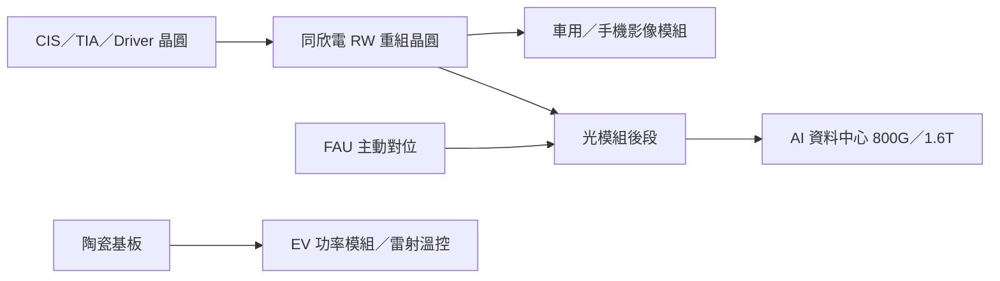

# 6271_同欣電（市）

## 基本資料

同欣電以車用與手機影像感測器（CIS）重組晶圓（RW）、陶瓷基板、混合模組（Hybrid）與 RF 模組為主要業務。2026 年起光通訊成為新成長動能：FAU 光學主動對位、光模組 TIA／Driver 的 RW 後段與 PCBA。3Q26 汽車相關占營收約 60%（去年 64%），長期毛利率目標由 25–30% 上修至 30–35%（[[活動_同欣電6271_法說彙整_20261030]]，2026-10-30 法說）。

- 主要產品：CIS RW 與封裝、陶瓷基板（含厚銅 AMB）、混合模組、RF 模組、光通訊 FAU 對位與 TIA／Driver 後段。
- 成長驅動：自駕滲透帶動車用 CIS 8MP 與鏡頭數增加；800G／1.6T 光模組帶動 FAU 與 TIA／Driver；800VDC 供電架構帶動 GaN／SiC 功率模組開發。
- 供應鏈位置：光模組與車用影像的後段封裝與模組代工。

## 核心技術／競爭優勢

- RW 重組晶圓產能：CIS 與光通訊 TIA／Driver 共用，3Q26 稼動率相當高，光通訊需求提高可改善毛利率。
- FAU 主動對位：2025 年 12 月開始量產，新自動化機台 2026 年 10 月底獲客戶認可，對位時間降到 15 分鐘以內。
- 陶瓷基板：光通訊熱電轉換器散熱基板打入大型雷射元件廠（原為日本供應商）；ABF 載板陶瓷 core 以 120×120mm 拼接成大板，250×250mm 試產線驗證中。
- 功率封裝：800V→48V 兩顆 650V GaN 串聯、48V→6V 100V GaN 認證中；SiC 車用小量出貨，開發 SST 用高壓 SiC 功率模組。

## 產品與應用

| 產品 | 應用 | 客戶／下游 |
|---|---|---|
| CIS RW 與封裝 | 車用與手機影像、手機不可見光感測 | 車用 Tier1、中國新客戶 |
| FAU 主動對位 | 800G 光模組光纖陣列對位 | 量產客戶 1 家，開發新客戶中 |
| TIA／Driver RW 後段、PCBA | 光收發模組 | 短距離模組封裝移往東南亞；長距離由同欣做完整模組 |
| 陶瓷基板（厚銅 AMB、散熱基板） | 電動車功率模組、雷射溫控 | 大型雷射元件廠 |
| GaN／SiC 功率模組 | 800VDC 資料中心供電、SST | 認證中 |

## 圖片 / 架構圖

圖說：依 2026-10-30 法說整理的同欣電業務結構（Mermaid 補位，來源無架構圖）。

## 目標價與評等

| 券商 | 日期 | 評等 | 目標價 | 評價基礎 | 來源 |
|---|---|---|---|---|---|
| 永豐投顧 | 2026-11-02 | 買進 | NT$258（原 NT$219） | 20x 2027F EPS | [[活動_同欣電6271_法說彙整_20261030]] |
| 富邦法人部 | 2026-11-02 | Buy | NT$255 | — | [[memo_富邦_早會光寶科健鼎聯發科同欣電Intel_20261102]] |

## 時間軸

| 時間 | 事件 | 類型 | 重要性 | 備註 |
|---|---|---|---|---|
| 2025-12 | FAU 主動對位開始量產 | 量產 | ⭐⭐ | 2026-10-30 法說 |
| 2026-10 底 | FAU 新自動化設備獲客戶認可 | 驗證 | ⭐⭐ | 對位時間 <15 分鐘 |
| 4Q26 | 厚銅 AMB 基板小量生產；FAU 新設備出貨（永豐） | 量產 | ⭐⭐ | 法說／永豐 2026-11-02 |
| 2027 | 光通訊大幅成長（FAU > TIA/Driver > PCBA） | 放量 | ⭐⭐⭐ | 公司展望，與 [[時程_2026-2027高速互連與分散式算力]] 同步 |
| 2H27 | ABF 陶瓷 core 壓合 ABF 完成可靠性實驗 | 驗證 | ⭐⭐ | 公司預期 |

## 供應鏈位置

- 上游：CIS／TIA／Driver 晶圓、陶瓷粉體與銅、GaN／SiC 晶片。
- 下游：車用影像模組、光收發模組廠、雷射元件廠、資料中心電源。
- 供應鏈頁：[[供應鏈_CPO]]、[[供應鏈_AI光互聯]]；技術頁：[[技術_FAU]]、[[技術_800VDC供電架構]]。

## 相關公司

| 公司 | 關係 | 說明 |
|---|---|---|
| [[LITE.US(lumentum)]] | 潛在客戶 | 雷射基板合作進度有限；公司稱大客戶若與 Lumentum 合併成功對公司有幫助（2026-10-30 法說） |

## 近期營運與研究更新

### 2026-10-30 法說（富邦 call memo／永豐／富邦早會）

- 3Q26 營收 34.92 億元（QoQ +10.8%、YoY +22.5%），毛利率 33.7%（QoQ +2.6ppt、YoY +6.5ppt），淨利 7.58 億元，EPS 3.62 元；CIS QoQ +16%、光通帶動 RF QoQ +12%（富邦）。
- 4Q26：傳統產品依季節性下修，AI 產品快速成長，營收溫和季增；富邦估 4Q26 營收 37.1 億元、毛利率 33.8%。
- 2027 年光通訊為成長重點；RF 營收占比 2026／27 年 20%／25%（富邦 estimate）。
- 來源：[[活動_同欣電6271_法說彙整_20261030]]、[[memo_富邦_早會光寶科健鼎聯發科同欣電Intel_20261102]]、[[memo_永豐金證券_台股個股評等調整_20261102]]。

## 風險與注意事項

> [!warning]
> - FAU 主動對位量產客戶目前僅一家，客戶集中且 1.6T EIC/PIC flip chip 仍未完成認證。
> - 車用占營收約 60%，車市復甦力道與中國客戶需求仍影響傳統業務。
> - 陶瓷 core、GaN／SiC、矽電容皆在認證階段，量產時程與規模未確定。

## 來源

- [[活動_同欣電6271_法說彙整_20261030]]（富邦 call memo＋永豐晨訊，2026-10-30 法說）
- [[memo_富邦_早會光寶科健鼎聯發科同欣電Intel_20261102]]（富邦法人部，2026-11-02）
- [[memo_永豐金證券_台股個股評等調整_20261102]]（永豐金證券，2026-11-02）

## 相關頁面

- [[技術_FAU]]
- [[供應鏈_CPO]]
- [[時程_2026-2027高速互連與分散式算力]]
