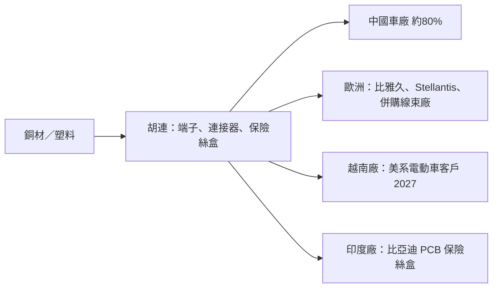

# 6279_胡連（櫃）

## 基本資料

胡連是台灣車用連接器與電子零組件廠，產品包括車用連接器、端子、保險絲盒與線束相關零件，主要市場在中國。3Q26 中國營收占比達 80%（年增 26%），玉山投顧預期隨歐洲與越南新客戶放量，中國占比將降至 70–75%。

2026–27 年成長動能：PCB 保險絲盒與高壓高頻連接器導入中系客戶（含比亞迪 PCB 保險絲盒專案在印度廠小量出貨）、歐洲比雅久與 Stellantis 帶動成長、越南廠 2027 年開始供應美系電動車客戶連接器（估年貢獻 NT$3–5 億），以及併購兩家歐洲線束公司（一家服務歐洲超跑品牌、2025 年營收約 1,590 萬歐元，另一家做特用車線束，合計可挹注 NT$8–12 億）。

資料來源：[[報告_玉山_胡連6279_20261015]]（玉山投顧，2026-10-15）。

## 核心技術／競爭優勢

- **中國車廠客戶基礎**：中國客戶拉貨支撐 2H26 營收；中國汽車出口年增 52.4%，抵銷內需年減 4.5%。
- **產品升級**：PCB 保險絲盒、高壓高頻連接器切入中系客戶，有助改善產品結構。
- **海外布局**：越南廠供美系電動車客戶；印度廠出貨比亞迪專案；併購歐洲線束公司取得當地客戶與高階車款能力。

## 產品與應用

| 產品／服務 | 應用 | 相關客戶／下游 |
|---|---|---|
| 車用連接器、端子 | 燃油車與電動車電子系統 | 中國車廠、比雅久、Stellantis |
| PCB 保險絲盒 | 電動車電源分配 | 比亞迪（印度廠小量出貨） |
| 高壓高頻連接器 | 電動車高壓系統、車載通訊 | 中系客戶導入中 |
| 線束（併購） | 超跑、特用車 | 歐洲客戶 |

## 圖片 / 架構圖

> 依玉山 2026-10-15 報告整理的客戶與據點結構；銅與塑料是主要成本，中國市場占比高。來源圖多為財務走勢圖，故以 Mermaid 表達供應鏈位置。

## EPS 記錄

| 季度 | EPS（元） | YoY | 備註 |
|---|---|---|---|
| 1Q26 | 1.60 | -44% | 原物料成本上升 |
| 2Q26 | 2.80 | +436% | |

## EPS 預估

| 年度 | 玉山投顧（報告日：2026-10-15） | 備註 |
|---|---:|---|
| 3Q26F | 2.70 | 毛利率 27.7% |
| 4Q26F | 3.30 | 毛利率 29% |
| 2026F | 10.40 | 營收 NT$109.8 億、毛利率 28.0% |
| 2027F | 10.82 | 營收 NT$126.7 億（年增 15.4%）、毛利率 30%、營益率 12.2%（費用率升至約 18%） |

## 目標價與評等

| 券商 | 報告日 | 評等 | 目標價 | 評價基礎 | 來源 |
|---|---|---|---:|---|---|
| 玉山投顧 | 2026-10-15 | 中立（維持） | NT$130 | 12x 2027F EPS；股價 NT$117，歷史 10–15x | [[報告_玉山_胡連6279_20261015]] |

## 時間軸

| 時間 | 事件 | 類型 | 重要性 | 備註 |
|---|---|---|---|---|
| 4Q26 | 傳統旺季與新專案導入，營收季增約 8% | 放量 | ⭐⭐ | 玉山 estimate |
| 2027 | 越南廠供美系電動車客戶，年貢獻 NT$3–5 億 | 放量 | ⭐⭐ | 玉山 estimate |
| 2027 | 歐洲兩家線束公司併入，合計 NT$8–12 億營收 | 併購 | ⭐⭐ | 超跑線束廠進度較快 |

## 供應鏈位置

- 上游：銅材、塑料（銅價由 4Q25 每噸 US$11,092 升至 US$14,104）。
- 下游：中國車廠、歐洲車廠、美系電動車客戶。
- 所屬主線：車用零組件，與 AI 主線無直接關係。

## 相關公司

目前報告未揭露可對應既有公司頁的客戶或供應商關係（比亞迪、Stellantis、比雅久皆無公司頁），`related_companies` 暫留空。

> [!warning] 風險與注意事項
> - 銅價與塑料持續上漲，毛利率已由過往 31–32% 降到約 28%。
> - 中國車市補貼政策調整後需求疲弱，中國營收占比仍高。
> - 歐洲併購公司費用率較高，可能拖累營益率。
> - 上市別（TPEX）依代號與既有資料推定，未以外部工具另行查證。

## 來源

- [[報告_玉山_胡連6279_20261015]] — 玉山投顧，2026-10-15；中立／TP NT$130、原物料壓力與歐洲併購。
