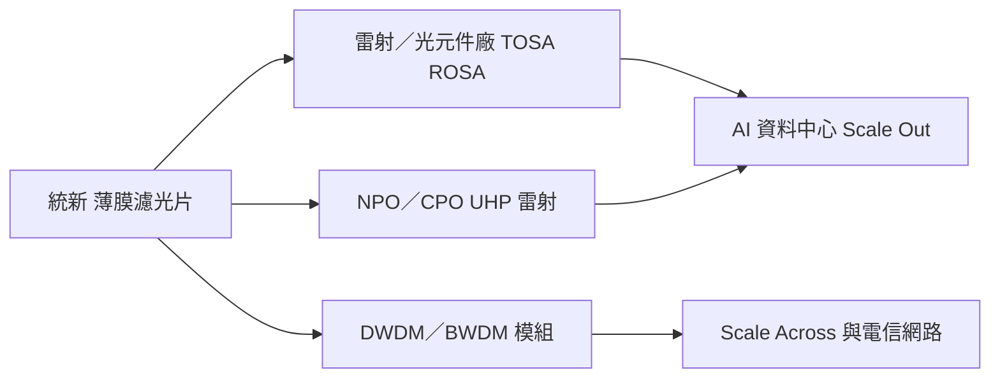

# 6426_統新（櫃）

## 基本資料

統新光訊成立於 2003 年 8 月，為台灣光通訊薄膜濾光片廠，製造光通訊主動與被動元件用薄膜濾光片與光學鍍膜，並承接光學 ODM 設計製造；應用涵蓋電信網路、5G 基站、資料中心與太空衛星光通訊。3Q26 營收組成為濾光片 100%。事業重心已由獲利較低的 Scale Up FA Coating（鍍膜代工）轉向多層數濾光片製造。成長驅動為 AI 資料中心（AIDC）的 Scale Out TOSA／ROSA 濾光片，以及 Scale Across 與電信網路的 WDM 濾光片。資料來源：[[報告_國票_統新6426_20261118]]（國票投顧法說更新，2026-11-18）。

## 核心技術／競爭優勢

- 多層薄膜濾光片：Scale Across 用 DWDM、BWDM 多層薄膜濾光片約 200–250 層，製程門檻高於一般鍍膜。
- 客戶結構：2027 年需求來自二大美系雷射客戶（客戶未具名）的 Scale Out TOSA／ROSA 濾光片，以及 NPO／CPO 超高功率（UHP）雷射用濾光片。
- 產能擴充：2027 年新增 10 條產線（1Q27／2Q27／3Q27 各 4／4／2 條），總產線由 23 條增至 33 條。

## 產品與應用

| 產品 | 應用 | 相關客戶／下游 |
|---|---|---|
| TOSA／ROSA 濾光片 | 可插拔光模組 Scale Out（800G→1.6T） | 美系雷射客戶（未具名） |
| UHP 雷射濾光片 | NPO／CPO 外部光源 | 美系雷射客戶（未具名） |
| DWDM／BWDM 濾光片 | Scale Across 叢集互連、電信 WDM | CSP 與電信設施 |

## 圖片 / 架構圖

圖說：統新位於光模組上游的被動光學元件環節，經雷射與光元件客戶進入 AI 資料中心與電信網路。

## EPS 記錄

| 季度 | EPS | YoY | 備註 |
|---|---|---|---|
| 3Q26 | 2.06 元 | — | 營收 2.2 億元（YoY +60.6%、QoQ +4%），連續 8 季新高；毛利率 52.1%（排除 2Q26 庫存去化與 3Q26 評價損失 300 萬元影響，2Q26／3Q26 為 49.1%／53.5%） |

## EPS 預估

| 年度 | 國票（2026-11-18） |
|---|---|
| 2026F | 6.85 元（營收 7.96 億元，YoY +63.4%，毛利率 50.8%，虧轉盈） |
| 2027F | 9.98 元（營收 11.65 億元，YoY +46.3%，毛利率 53%，稅率 20%） |
| 2028F | 13.38 元（營收 15.52 億元，YoY +33.2%，毛利率 53%） |

## 目標價與評等

| 來源 | 日期 | 評等 | 目標價 | 評價基礎 |
|---|---|---|---|---|
| 國票投顧 | 2026-11-18 | 區間操作（首次） | 268 元 | 2028F PE 20x；11-17 股價 245 元；[[報告_國票_統新6426_20261118]] |

## 時間軸

| 時間 | 事件 | 類型 | 重要性 | 備註 |
|---|---|---|---|---|
| 4Q26（預估） | AIDC 需求續強、產能滿載，營收持平 3Q26 | 營運 | ⭐⭐ | 國票 estimate |
| 1Q27–3Q27（預估） | 新增 10 條產線（4／4／2 條），總數 23→33 | 擴產 | ⭐⭐⭐ | 國票轉述公司規劃；見 [[時程_2026-2027高速互連與分散式算力]] |
| 2H27（預估） | Scale Out 濾光片主力規格由 800G 轉向 1.6T | 規格升級 | ⭐⭐⭐ | 國票 estimate |
| 2028（預估） | Scale Across 進入頻段細分與單通道疊加階段，BWDM／DWDM 需求放大 | 放量 | ⭐⭐ | 國票 thesis；C-band 為主力，L-band 隨雙波段擴充 |

## 供應鏈位置

- 上游：鍍膜設備與光學基板材料。
- 下游：雷射與光元件客戶（TOSA／ROSA、UHP 雷射）、WDM 模組與電信設施。
- 供應鏈主軸：[[供應鏈_AI光互聯]]；技術背景見 [[技術_光模塊]]。

## 相關公司

| 公司 | 關係 | 說明 |
|---|---|---|
| 美系雷射客戶（未具名） | 客戶 | 國票稱二大美系雷射客戶，報告未揭露名稱 |
| [[7772_耀穎光電（櫃）]] | 鍍膜同業（不同定位） | 耀穎法說稱統新（原文「總心」，推測）為專業鍍膜廠，以改裝蒸鍍機鍍到兩三百層、專做 WDM（約 250–300 層），無黃光與蝕刻；耀穎則以晶圓級黃光＋鍍膜＋蝕刻與 FAU 端面鍍膜區隔（同業說法、公司名待查證，信心低；[[活動_耀穎光電7772_法說會後交流Memo_20261016]]） |

## 風險與注意事項

> [!warning]
> - 客戶集中：需求來自少數美系雷射客戶，報告未揭露名稱與占比。
> - Scale Across 仍處主幹鋪設早期，BWDM／DWDM 需求尚未完全釋放，2028 年成長屬券商 thesis。
> - 2027 年起稅率 20%、不再有稅收返還利益；新產線折舊與良率影響毛利率。

## 來源

- [[報告_國票_統新6426_20261118]]（2026-11-18）— 國票投顧法說更新；區間操作、TP 268 元。

- [[報告_群益_AI應用有機會逐漸成為主流_20261117]]（2026-11-17）

- [[活動_耀穎光電7772_法說會後交流Memo_20261016]]（2026-10-16）
