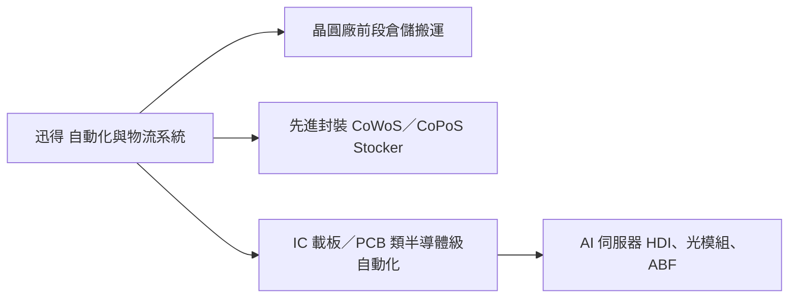

# 6438_迅得（市）

## 基本資料

迅得提供半導體智慧製造、物流與自動化系統解決方案，客戶涵蓋晶圓製造、封裝、IC 載板與 PCB。股本約 8.22 億元，員工約 1,200 人（台灣 800 多人、中國及泰國 400 多人）；總部桃園中壢，於中國東莞、淮安及泰國設轉投資，美國亞利桑那州 100% 子公司 Symtek Advanced Automation 為北美服務核心。

- **3Q26（fact）**：營收約 19.45 億元，歷史單季新高；毛利率約 29%，為近六季最高；營益率與淨利率自 3Q25 起逐季上升，獲利主要來自本業。
- **毛利率驅動**：中國業務金額與毛利率同步提升，中國毛利率 2025 年約 14–15%，1Q26–3Q26 依序約 20%、22%、24%；台灣聚焦大型客戶，毛利率穩定向上。
- **產業別（1Q26–3Q26）**：PCB 約 47%（去年同期約 40%），3Q26 單季超過一半（中國客戶投資 AI 伺服器產線）；晶圓製造由 11% 升至 16%（大客戶 2 奈米量產、多廠同步建置）。
- **地區別**：台灣過半；中國由 25% 升至 28%；其他海外由 10% 升至 13%（今年主要為越南）。
- **訂單指標**：存貨約 26 億元，9 成以上為在製品；合約負債約 8 億元（去年底 3.81 億元）；集團 BB Ratio 1Q26 0.77、2Q26 1.47、3Q26 2.76，交期約 6 個月。

資料來源：[[活動_迅得6438_國泰CallMemo_20261123]]（國泰證期 call memo，2026-11-23）。

## 核心技術／競爭優勢

- CoWoS 智慧倉儲及搬運自動化已穩定大量出貨給龍頭客戶。
- 針對方型基板（CoPoS／FOPLP）推出 CoPoS 專用 Stocker 系列；面板級封裝對載具規格、潔淨度與穩定性要求更高。
- 將半導體等級技術導入 PCB 與載板廠，推出「類半導體級」自動化設備，整合視覺與 AI 的 Robot Vision 系統，已在載板大廠驗證。

## 產品與應用

| 領域 | 產品／應用 | 觀察 |
|------|-----------|------|
| 先進封裝 | CoWoS 智慧倉儲、搬運；CoPoS Stocker | 測試段高階 AI 產品可能由抽檢改全檢，探針卡搬運需求增加，將開發相關產品 |
| 晶圓前段 | 智慧倉儲、搬運 | 新拓 IDM 與記憶體前段客戶，開發更高密度搬運方案 |
| IC 載板／PCB | 類半導體級自動化、Robot Vision | ABF 尺寸變大、層數增加、玻璃基板導入，搬運要求改變 |
| 海外 | 美國 PCB／載板／晶圓案、日本高階載板 repeat order 與 CIS 晶圓新客戶、新加坡美日合資載板廠 | 2027 年台、中、泰以外營收占比目標約 15% |

## 圖片 / 架構圖

## 營運展望

- 2027 年中國營收成長預期略高於台灣，動能來自 AI 伺服器板（HDI）、光模組與 IC 載板；依在手訂單，毛利率仍有向上趨勢（公司說法）。
- 產能：中國今年已擴充一倍以上仍不及需求；台灣新廠落成即滿載，未來以外協為主；今年投資友上科技（6998），南部兩個、北部一個生產基地，合計面積逾 5,000 坪。
- 營業費用率過去 15–17%，明年人力增加有限，營收成長下費用率將下降。
- 公司引述：Yole 預估先進封裝市場由 2025 年 US$54bn 成長至 2031 年 US$109bn（CAGR 約 12.4%）；TPCA 與工研院資料 ABF 載板 2025 年產值約 US$7.72bn；自動化約占建廠資本支出 2–4%。
- 2027 年至少上半年營運展望正向。

## 時間軸

| 日期 | 事件 | 來源 |
|------|------|------|
| 2026-11-23 | 3Q26 法說：營收創高、BB Ratio 2.76 | [[活動_迅得6438_國泰CallMemo_20261123]] |
| 2027 | 海外營收（台中泰以外）占比目標約 15% | [[活動_迅得6438_國泰CallMemo_20261123]] |

## 供應鏈位置

半導體與 PCB 廠務自動化設備供應商，位於晶圓廠、OSAT、IC 載板與 PCB 廠的建廠資本支出環節。

## 相關公司

| 公司 | 關係 | 來源 |
|------|------|------|
| 友上科技（6998） | 今年投資對象，擴充生產基地 | [[活動_迅得6438_國泰CallMemo_20261123]] |

## 來源

- [[活動_迅得6438_國泰CallMemo_20261123]]（國泰證期 call memo，2026-11-23）

## 相關頁面

- [[技術_FOPLP]]
