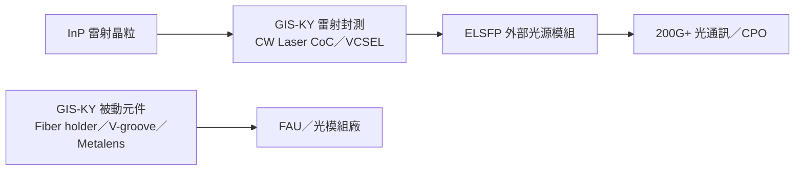

# 6456_GIS-KY（市）

## 基本資料

GIS-KY（業成，6456 TT）以平板、筆電觸控模組與指紋辨識模組為本業，正由傳統觸控模組轉型至半導體光學（Semi Optics）：光通訊雷射光源封測（CW Laser CoC、VCSEL）、AR／VR 波導光學元件、光通訊被動元件與 Micro OLED／Micro LED。3Q26 產品營收占比：平板 40%、筆電 28%、指紋辨識模組 13%、其他 19%（中信 2026-11-10）。與中國大客戶合作近 20 年。

## 核心技術／競爭優勢

- 雷射封裝：聚焦大於 300mW、400mW 的高功率雷射（不做傳統 100mW），主要用於 ELSFP 等 200G 以上高階應用，材料以磷化銦（InP）為主，同時開發 CW Laser 與 VCSEL 封裝。由 100mW 提升到 300／400mW 封裝流程基本相同，但測試項目與設備需大幅更新，為新資本支出重點。
- 優勢（公司說法）：長期與國際大廠合作累積的製造管理能力；現金流與財務實力足以支撐數十億元資本支出；背光模組與指紋辨識貼合累積的光學製程經驗。
- AR 光學：奈米壓印、蝕刻、鍍膜製程，用於 AR／VR 眼鏡、Waveguide 與 HUD；具 Metalens（超透鏡）自行設計與製造能力，製程與 AR 波導相近。

## 產品與應用

| 方向 | 產品 | 進度（公司說法） |
|---|---|---|
| 雷射封裝 | CW Laser CoC、未來 VCSEL VOD | 2Q26 起建線，11–12 月小量放量，2Q27 量產（1–2 家客戶），2Q27 季底至 3Q27 初產能全開 |
| 光通訊被動元件 | Fiber holder、V 型槽、透鏡陣列、超透鏡、波導 | 初期不做整套 FAU 模組，元件成熟後才考慮後段模組 |
| AR 光學 | 波導、AR projector 光機 | AR projector 4Q26 或 1Q27 可能小量出貨；AR／VR 需求 2027–2028 年才成熟 |
| Micro OLED／Micro LED | 顯示器、光通訊應用 | Micro LED／Micro VCSEL 光通訊應用樣品開發中 |
| 觸控模組 | 分離式觸控模組（非 In-cell） | 本業 |

## 圖片 / 架構圖

*本批 PDF 未擷取附圖，以 Mermaid 表示 GIS-KY 新事業在光通訊鏈的位置；ELSFP 與 CPO 外部光源見 [[技術_CPO]]。*

## 近期營運與研究更新

### 2026-11-10 中信投顧法說摘要：雷射封裝進展順利，2Q27 有望顯著放量

- 3Q26（fact）：營收 144 億元（季增 37.6%、年減 10.5%），受終端需求不振與客戶端記憶體缺貨影響；毛利率 4.02%（季增 0.68ppts、年減 2.46ppts）；營業費用 12.11 億元（前三季單季約 11.2 億元，轉型期研發投入較多）；營業利益 −6.3 億元，稅前淨利 −6.69 億元，稅後淨利 −7.25 億元。
- 10 月營收 130 億元：客戶委託手機關鍵零組件加工與精密對位貼合，屬長期專案、非一次性；營收跳升主要來自高單價材料，純加工費占比不高；材料占用營運資金但週期短，先前增資案用於長期營運資金與資本支出。
- 資本支出：今年已核准約 80 億元，雷射封裝約 40–50 億元（約三分之一在台灣、其餘在越南新廠），其餘用於 Micro LED、AR／VR 波導與大客戶新產品（中國與台灣）；明年資本支出年底或明年初較明確。測試設備（電流計、頻譜分析儀）交期較長，固晶機、打線機為泛用設備。
- 商業模式：雷射封裝以加工費為主，扣除材料後純加工毛利率遠高於觸控顯示本業；董事會要求資本支出在少數幾年內回收。公司接觸多位高功率客戶，建置產能僅占需求一部分。
- 大客戶比重將隨新事業發酵逐步下降；記憶體缺貨到 2027 年底前改善有限，業界預估可能延續到 2028 年。
- 集團關係：集團內訊芯-KY（6451 TT，wiki 尚無頁面）較接近光模組加工，各公司獨立營運；與富采（3714 TT，wiki 尚無頁面）可能為上下游關係（富采不做封裝，Micro LED 偏 TV 巨量轉移，GIS 聚焦 AR 投影光機）。

> [!warning] 3Q26 EPS 數字矛盾（同份報告內）
> 中信摘要第 1 頁同時列「單季 EPS −3.15 元」與「單季 EPS −2.17 元」，原文未說明差異，並列保留、不自行裁定。

## 時間軸

| 時間 | 事件 | 類型 | 重要性 | 備註 |
|---|---|---|---|---|
| 2026-11～12 | 雷射封裝由小量往上量產 | 放量 | ⭐⭐⭐ | 公司說法，中信 2026-11-10 |
| 4Q26／1Q27 | AR projector 小量出貨 | 新品 | ⭐⭐ | 同上 |
| 2Q27 | 雷射封裝量產，1–2 家客戶 | 量產 | ⭐⭐⭐ | 同上 |
| 2Q27 季底～3Q27 初 | 雷射封裝產能全開 | 產能 | ⭐⭐⭐ | 同上 |
| 2027–2028 | 新事業成為主要營收成長動能；AR／VR 需求成熟 | 放量 | ⭐⭐ | 同上 |

## 供應鏈位置

- 光通訊：InP 高功率雷射封測（CoC）供 ELSFP 外部光源，位於雷射晶粒與光模組之間；被動元件供 FAU／光模組廠。
- 觸控顯示：中國大客戶平板、筆電觸控模組與手機零組件加工。
- 相關技術：[[技術_CPO]]、[[技術_矽光子（SiPh）]]。

> [!warning] 風險與注意事項
> - 終端需求不振與記憶體缺貨壓抑本業；轉型期研發與資本支出侵蝕獲利。
> - 雷射封裝測試設備交期長，量產時程與客戶認證、信賴性測試（公司不評論時數）有不確定性。

## 來源

- [[報告_中信_GIS-KY6456_20261110]] — 中信投顧，2026-11-10；3Q26 法說／座談摘要與 Q&A。

## 相關頁面

- [[技術_CPO]]
- [[技術_矽光子（SiPh）]]
