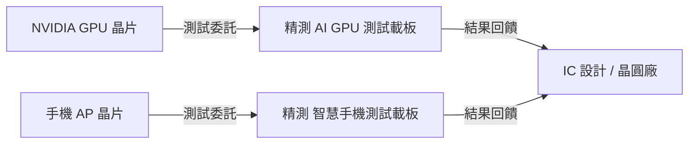

# 6510_精測（市）

## 基本資料

精測電子（6510 TT）是台灣測試介面（Test Interface）領域的重要廠商，主力產品為 IC 測試載板（Test Socket / Burn-in Board）與探針卡（Probe Card）。核心應用涵蓋 AI GPU 測試載板、智慧手機 AP、遊戲顯卡 GPU、PMIC、SSD Controller 等。

公司受惠 AI GPU 測試需求爆發：2025 年 AI GPU 與遊戲顯卡出貨帶動測試載板量增，FY2025 EPS 預估 27.63 元（YoY +77.8%）；FY2026 更多專案（次世代 AI GPU、AMD 遊戲顯卡、AI ASIC）同步發酵，EPS 上修至 37.71 元。

主要客戶：美系 GPU 大廠（NVIDIA）、台系 IC 設計客戶（智慧手機 AP）、美系通訊客戶、SSD/PMIC 廠商。

資料來源：[[報告_中信_精測6510_20250902]]（2025-09-02，中信投顧，郭珮儒）

### 2026-10-22 中信投顧半導體耗材論壇

- FT 段 Load Board 長年貢獻營收 70%–80%，探針卡（含 CP PCB）20%–30%，主要客戶 MediaTek、NVIDIA、Qualcomm。
- PCB 擴產：8M26 已開出較 2025 年底 1 倍產能，3M27 再增 50%，2H28 再增 1 倍（含租賃廠房與自建三廠）。
- 亮點：NVIDIA 認購聯發科 ECB 後可望掌握更多專案；探針卡供不應求，規劃 MEMS 探針卡翻倍擴產。
- 中信預估 2026／2027 年 EPS 66／125 元，2025–2027 年稅後淨利 CAGR 逾 100%。
- 來源：[[報告_中信_半導體耗材_20261022]]（中信投顧，2026-10-22），信心中高。

### 2026-10-26 JPMorgan 測試介面產業報告（OW，既有覆蓋）

- 探針卡 PCB 交期快速拉長：晶片設計數增加使客製 PCB 需求增加，先進封裝提高附加價值；JPM 視精測為全球領先測試 PCB 廠，並以此切入探針卡整體方案（內容價值為單賣 PCB 的 3–5 倍）。給予 30x 2028E 目標本益比（覆蓋中最高），認為複雜 PCB 已成探針卡供給的主要瓶頸，盈餘上修空間最大。
- 來源：[[報告_JPMorgan_台灣測試介面_20261026]]（JPMorgan，2026-10-26），信心中高。

## 核心技術／競爭優勢

- **AI GPU 測試載板市佔與客戶黏著**：與美系 GPU 大廠（NVIDIA）長期穩定合作，交期與技術服務受肯定，下一代平台市佔有望提升
- **多元產品組合**：HPC、APR（光學）、Gerber、PMIC、SSD Controller、Others，依季節/景氣分散集中風險
- **AI 智慧製造降費**：公司推動 AI 製造，費用控管超越原先假設，帶動 2026 EPS 顯著上修
- **探針卡佈局**：積極參與次世代 AI GPU 探針卡平台驗證，有望在 HPC 領域持續擴大份額

## 產品與應用

| 產品 / 服務 | 應用 | 相關客戶 / 下游 |
|-------------|------|-----------------|
| AI GPU 測試載板 | AI GPU / ASIC 測試 | [[NVDA.US(nvidia)]]、AMD |
| 遊戲顯卡 GPU 測試載板 | 遊戲 GPU 測試 | NVIDIA（GeForce 系列） |
| 智慧手機 AP 測試載板 | SoC 測試 | 台系 IC 設計廠 |
| 通訊 PCB 組裝板 | 美系通訊客戶組裝 | 美系通訊廠（新切入）|
| PMIC / SSD Controller 測試載板 | 電源/儲存 IC 測試 | 廣泛 IC 廠商 |

## 圖片 / 架構圖

![[citi 6510_001.png]]

> Citi 2026Q2 報告圖表，對應精測 AI／HPC 高毛利訂單占比提升與測試介面需求。

`[待補來源圖]` 需官方 IR 測試插座或燒機板產品實拍佐證；上方為自製測試流程示意圖。

> 測試載板為晶片出廠測試的關鍵工具，精測為 AI GPU 測試載板的主要供應商之一。

## EPS 記錄

| 季度 | EPS (元) | YoY | 備註 |
|------|---------|-----|------|
| 1Q25 | 6.74 | +1,480% | AI GPU 拉動 |
| 2Q25 | 6.57 | +221.9% | |
| 3Q25(F) | 7.36 | +126.2% | AI GPU + 手機旺季 |
| 4Q25(F) | 6.95 | -29.2% | 傳統淡季 |

## EPS 預估

| 年度 | 中信投顧 EPS（報告日：2025-09-02） | 備註 |
|------|-----------------------------------|------|
| 2025F | 27.63 | +77.8% YoY |
| 2026F | 37.71 | +36.5% YoY（費用控管上修） |

## 目標價與評等

| 券商 | 報告發布日 | 評等 | 目標價 | 評價基礎 | 來源 |
|------|------------|------|--------|----------|------|
| 中信 | 2026-10-29 | 買進 | 4,150（原 4,500） | 36x 2027 EPS 115 | [[報告_中信_精測6510_20261029]] |
| Citi | 2026-10-28 | Buy／High Risk | NT$4,000（原 4,350） | 35x 2027E EPS | [[報告_Citi_精測6510_20261028]] |
| Daiwa | 2026-10-28 | Buy (1) | TWD3,815 | 35x 2027E（原 45x） | [[報告_Daiwa_精測6510_20261028]] |
| 永豐 | 2026-10-29 | 買進 | 3,730（原 3,490） | 32x 2027 EPS 116.59 | [[memo_永豐投顧_精測6510獲利動能與目標價_20261029]] |
| 凱基 | 2026-10-28 | 增加持股 | 4,800（前次報告） | 40x 2027 EPS | [[活動_精測6510_凱基法說_20261028]] |
| 中信投顧 | 2025-09-02 | 增加持股 | 1,330 元 | 35x 2026F EPS | [[報告_中信_精測6510_20250902]] |

## 時間軸

| 時間 | 事件 | 類型 | 重要性 | 備註 |
|------|------|------|--------|------|
| 2026-11 | 主要 CSP CPU 探針卡工程樣品出貨，1Q27 驗證結果，2027 量產目標 | 送樣 | ⭐⭐⭐ | [[memo_富邦法人部_欣興台光電台燿聯電財報_20261029]]、[[報告_Citi_精測6510_20261028]] |
| 1Q27 | 下一代 TPU FT 測試載板工程出貨；BIB／SLT 板仍爭取中 | 送樣／量產 | ⭐⭐⭐ | 富邦、凱基；DIGITIMES 報導取得下一代 TPU 訂單 |
| 3M27 | 板子產能再擴 50%（以 4Q25 為基準達三倍）；2028 自建三廠再 +100% | 擴產 | ⭐⭐ | [[報告_中信_精測6510_20261029]] |
| 2H27 | 美國電動車廠（AI5）探針卡全方案專案貢獻 | 量產 | ⭐⭐ | [[報告_Citi_精測6510_20261028]] |
| 2026H1 | 次世代 AI GPU（B300 → Rubin）+ AI ASIC 進入量產 | 放量 | ⭐⭐⭐ | 測試載板出貨上行 |
| 2026H2 | 手機 AP 旺季 + 次世代遊戲顯卡 GPU 放量 | 放量 | ⭐⭐ | 多項專案同步發酵 |

| 3M27 | PCB 產能再增 50% | 擴產 | ⭐⭐ | [[報告_中信_半導體耗材_20261022]] |## 供應鏈位置

- 客戶：[[NVDA.US(nvidia)]]（AI GPU/ASIC 測試）、台系 IC 設計廠（手機 AP）
- 競爭對手：Enplas、Sensata 等日韓測試介面廠
- 所屬供應鏈：[[供應鏈_半導體測試設備]]

## 近期營運與研究更新

### 2026-10-27 3Q26 財報與法說（Citi／Daiwa／中信／凱基／富邦／永豐）

- **3Q26（fact）：** 營收 19.05 億元（QoQ +16.2%、YoY +53.4%），毛利率 57.3%（QoQ −0.3ppt，高於共識 55.4%），營益率 35.2%，淨利 5.51 億元（QoQ +11.6%），EPS 16.75 元（略低共識 17.47 元，費用率、業外與稅率較高）。AI／HPC 占營收 65.9%（3Q25 約 31.2%）；探針卡營收近 4 億元、占 21%（QoQ >5%、YoY +39%），其中 HPC 占探針卡 44.9%，首度超越行動處理器（富邦）。
- **4Q26：** 公司指引營收雙位數季增，2026 年營收年增約 50%；毛利率因 SLT 板、BIB（burn-in board）放量回到 50–55%（凱基）。券商估：Citi 營收 +22% QoQ、GPM 53.5%、OPM 33.0%；Daiwa GM 53.8%；中信高雙位數季增、GM 55.9%、單季 EPS 有機會破 20 元，全年 EPS 63 元。
- **2027 展望：** 營收維持 50% 以上成長、費用率 20–25%，整組探針卡營收占比目標 30%（凱基、Daiwa；Daiwa 稱「最多 30%」）。產能：以 4Q25 為基準，2026-08 翻倍、1Q27 三倍（3M27 板子產能再 +50%），新增產能約需 1 季轉為營收；2028 年自建三廠後再擴 100%；MEMS 探針月產能約 100 萬 pin，預期再擴 50%（中信）。
- **專案：** 已取得美國 CSP 次世代 AI ASIC（下一代 TPU）FT load board，仍為 FT 主要供應商，SLT 與 BIB 爭取中；CPU 探針卡仍在驗證，主要 CSP CPU 專案 2026-11 送工程樣品、1Q27 有結果；美國電動車廠 AI5 探針卡專案驗證接近完成，2H27 貢獻；RF 業務與日本夥伴合作、取得新美系衛星客戶；BIB 另有北美／韓國 AI 客戶洽詢。AI ASIC 工程用探針卡已開始出貨（Citi）。
- **TPU 相關市場消息：** 路透引述 The Information，OpenAI 計劃直接購買 Google AI 晶片，數量、世代、時程皆未確認；DIGITIMES 報導精測取得下一代 Google TPU 測試介面訂單（rumor／媒體，信心中低；公司僅確認 FT 載板）。來源：[[memo_外資_OAI採用TPU與精測下一代TPU訂單_20261029]]。
- **預估調整：** Citi 下修 2027 獲利 8%、上修 2028 8%（opex 假設提高）；Daiwa 下修 2027–28E EPS 8–10%，目標 PER 45x→35x（年底驗證風險，需看到驗證里程碑）；中信因探針卡放量延後，2026／27 EPS 63／115；永豐 2026／27 EPS 62.30／116.59。Nomura 3,000→4,000（[[memo_永豐金證券_台股個股評等調整_20261029]]）。

來源：[[報告_Citi_精測6510_20261028]]、[[報告_Daiwa_精測6510_20261028]]、[[報告_中信_精測6510_20261029]]、[[活動_精測6510_凱基法說_20261028]]、[[memo_富邦法人部_欣興台光電台燿聯電財報_20261029]]、[[memo_永豐投顧_精測6510獲利動能與目標價_20261029]]。

## 相關公司

| 公司 | 關係 | 說明 |
|------|------|------|
| [[NVDA.US(nvidia)]] | 主要客戶 | AI GPU / ASIC 測試載板最大需求來源 |

> [!warning] 風險與注意事項
> - **市場份額流失風險**：AI GPU 測試載板競爭加劇，次世代平台認證失利將影響市佔
> - **需求集中**：NVIDIA GPU 為最大需求來源，AI 需求轉弱直接衝擊
> - **匯率影響**：台幣升值壓縮以美元計算的測試費用收益
> - **終端需求放緩**：消費電子（手機、遊戲）景氣若走弱影響非 AI 段動能

## 2026-10-28 3Q26 財報（Citi）

- 3Q26 營收 NT$19.05 億（YoY +53.4%），淨利 NT$5.51 億（QoQ +12%、YoY +100%），EPS NT$16.75；前三季淨利 NT$13.87 億、EPS NT$42.2，連三季創高。毛利率 57.3%（QoQ -0.3ppt），新產品放量稀釋低於擔憂；營業費用 NT$4.2 億高於預期（產能擴充），營業利益率 35.2%。
- Citi Buy，TP NT$4,350；10-28 法說關注 AI GPU 與 ASIC 測試板放量、毛利率、探針卡整體方案與擴產時程。

## 來源

### CTBC 2Q26 更新（2026-07-30）

- 2Q26 單季 EPS 15.02 元；2026E／2027E EPS 65.7／125.1 元，因市場氣氛轉保守將目標價調至 NT$4,500，維持買進。以上為券商 estimate。
- 來源：[[精測(6510,B_買進)-CTBC260730]]

- [[NVIDIA Computex 2025 Keynote評析_CTBC250520]]（2025-05-20）
- [[SEMICON參展評析-260904]]（2026-09-04）
- [[citi 6510]]（2026-07-28）
- [[事件分析_Semicon 2026_083126]]（2026-08-31）
- [[報告_CTBC_穎崴6515_20260701]]（2026-07-01）
- [[報告_Daiwa_台灣半導體測試介面_20260909]]（2026-09-09）
- [[報告_中信_精測6510_20250902]]（2025-09-02）
- [[報告_中信_半導體耗材_20261022]] — 中信投顧半導體耗材論壇，2026-10-22
- [[報告_JPMorgan_台灣測試介面_20261026]] — JPMorgan 台灣測試介面，2026-10-26
- [[memo_Citi_精測6510_3Q26財報_20261028]]
- [[memo_國泰_AI基建與半導體領漲_20261028]]

- [[memo_外資_OAI採用TPU與精測下一代TPU訂單_20261029]]（2026-10-29）
- [[memo_富邦法人部_欣興台光電台燿聯電財報_20261029]]（2026-10-29）
- [[memo_永豐投顧_精測6510獲利動能與目標價_20261029]]（2026-10-29）
- [[memo_永豐金證券_台股個股評等調整_20261029]]（2026-10-29）
- [[報告_Citi_精測6510_20261028]]（2026-10-28）
- [[報告_Daiwa_精測6510_20261028]]（2026-10-28）
- [[報告_中信_精測6510_20261029]]（2026-10-29）
- [[活動_精測6510_凱基法說_20261028]]（2026-10-28）

## Citi 2Q26 更新（2026-07-28）

- 2Q26 淨利 NT$494mn，季增 44%、年增 129%；毛利率 57.5%，AI／HPC 訂單占比由 1Q26 的 45% 升至 56%。
- Citi 關注 AI GPU／ASIC 測試板 ramp、探針卡 total solution 與產能擴張；維持 Buy、目標價 NT$4,900。
- 目標價以 40 倍 2027E EPS 計算，反映 2nm／3nm 測試、高階 AI GPU／ASIC 專案與 All-in-House 垂直整合優勢；但屬高風險波動標的。

來源：[[報告_Citi_中華精測6510_2Q26_20260729]]。

- [[報告_中信_精測6510_20250902]]（2025-09-02，中信投顧，郭珮儒）

## 相關頁面

- [[6223_旺矽（櫃）]]
- [[供應鏈_AI伺服器散熱]]
- [[時程_2026記憶體與AI催化劑]]

- [[分析_SEMICON_Taiwan_2026矽光子量產瓶頸]]
- [[時程_2026Q3Q4_AI網通與硬體催化劑]]
