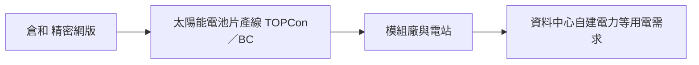

# 6538_倉和（櫃）

> [!note] 範圍待確認
> 核心為太陽能電池印刷網版，依每日 ingest 規則屬「範圍待確認」（能源設備，非直接 AI 用電）；法說提及資料中心自建電力與 Tesla 太陽能擴產需求。

## 基本資料

倉和 1994 年成立、2016 年上櫃，從事高精密網版研發、製造與銷售及網印耗材買賣，應用涵蓋太陽能電池、被動元件、PCB、光電觸控面板與生技醫療。3Q26 營收：太陽能電池印刷網版 91%、非太陽能網版 2%、網印耗材 7%。生產據點在台灣、中國蘇州與成都，印度廠興建中。2026-07 非中市場營收占比首度超過中國，3Q26 美國營收占比升至約 3 成、中國降至 4 成。成長驅動：美國太陽能電池在地化製造、印度擴產，以及 TOPCon、BC 高效電池對高階網版的需求。資料來源：[[報告_國票_倉和6538_20261118]]、[[活動_倉和6538_富邦CallMemo_20261117]]。

## 核心技術／競爭優勢

- 網版技術：PI 膜層、雷射雕刻、張網結構、3D 無網結；CF7 高網目網版（TOPCon，最高省銀漿約 30%，已全面導入 TOPCon 客戶）與 No Bridge 全開口網版（BC，最高省銀漿約 40%，BC 客戶全面導入、TOPCon 小量驗證）。
- 耐用度：派工程師駐客戶產線，美國客戶網版壽命由 2–3 萬次提升至近 10 萬次，墊高競爭門檻。
- 整合服務：電子印刷開發實驗室提供認證、技術轉移與代工印刷。

## 產品與應用

| 產品 | 應用 | 客戶／下游 |
|---|---|---|
| CF7／CF7 3D 高網目網版 | TOPCon 電池電極印刷 | 美國、印度、中國電池廠 |
| No Bridge（OF 系列）全開口網版 | BC 電池；未來延伸被動元件、半導體封裝 | BC 電池廠 |
| PI 網版（SF 系列） | 早期產品 | — |
| 非太陽能網版 | 被動元件、PCB、生醫檢測 | — |

## 圖片 / 架構圖

圖說：倉和位於太陽能電池製造的耗材環節，需求隨電池片產能建置與技術升級變動。

## EPS 記錄

| 季度 | EPS | 備註 |
|---|---|---|
| 3Q26 | 2.45 元 | 營收 5.00 億元（QoQ +30%、YoY +55.2%）；毛利率 49.45%（QoQ +8.33ppt）；營益率 24.37% |
| 1–3Q26 | 4.56 元 | 營收 11.93 億元（YoY +4.9%）；稅後淨利 1.70 億元 |

## EPS 預估

| 年度 | 國票（2026-11-18） |
|---|---|
| 4Q26F | 2.47 元（營收 4.76 億元，QoQ −4.9%） |
| 2026F | 7.02 元（營收 16.69 億元，毛利率 45.5%） |
| 2027F | 13.52 元（營收 20.76 億元，毛利率 54.8%） |

## 目標價與評等

| 來源 | 日期 | 評等 | 目標價 | 評價基礎 |
|---|---|---|---|---|
| 國票投顧 | 2026-11-18 | 買進（首次） | 300 元 | 2027F PE 22x；[[報告_國票_倉和6538_20261118]] |

## 時間軸

| 時間 | 事件 | 類型 | 重要性 | 備註 |
|---|---|---|---|---|
| 4Q26 | 美國客戶拉貨高峰已過、網版壽命延長，部分訂單遞延至 1Q27 | 營運 | ⭐⭐ | 公司說法 |
| 2Q27 | 林口二期新廠開出，新增月產能約 1.5 萬片；4Q27 台灣月產能可達 2.3 萬片 | 擴產 | ⭐⭐ | 既有月產能約 8,000 片 |
| 3Q27 | 印度廠投產（4Q26 啟動廠房改造），目標印度市占 30% | 擴產 | ⭐⭐ | 公司目標 |
| 3Q27–1Q28 | Tesla 美國太陽能產線供應狀況預期明朗 | 客戶驗證 | ⭐⭐ | 公司說法；Tesla 自建 100GW、預期倉和為前三供應商之一（rumor／中低）；見 [[時程_2026Q3Q4_AI網通與硬體催化劑]] |

## 供應鏈位置

- 上游：網紗、PI 膜與鋼版材料。
- 下游：太陽能電池片廠（美國大客戶、印度、中國）、被動元件與 PCB 廠。
- wiki 尚無太陽能供應鏈頁；資料中心電力脈絡可參考 [[技術_800VDC供電架構]]。

## 相關公司

| 公司 | 關係 | 說明 |
|---|---|---|
| Tesla（未建頁） | 潛在客戶 | 法說稱已準備供應，時程 3Q27–1Q28 明朗 |

## 風險與注意事項

> [!warning]
> - 客戶集中與政策：美國客戶拉貨節奏與美國能源政策影響需求；若改從中國直接採購電池將削弱在地化需求。
> - 網版壽命延長降低更換頻率，短期壓抑出貨。
> - 中國市場供給過剩與價格競爭。

## 來源

- [[報告_國票_倉和6538_20261118]]（2026-11-18）— 國票投顧法說更新；買進、TP 300 元。
- [[活動_倉和6538_富邦CallMemo_20261117]]（2026-11-17）— 富邦投顧 call memo。
