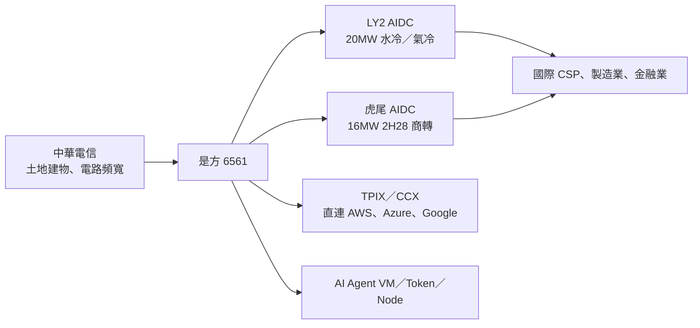

# 6561_是方（櫃）

## 基本資料

是方為中華電信子公司，台灣電信中立 IDC 領導業者，自 2000 年投入 IDC，LY2 為台灣第一座 AIDC。1~3Q26 營收占比 IDC 機房 44.7%、數據網路 37.2%、雲端應用 17.1%、語音通信 1.0%（[[活動_是方6561_國泰CallMemo_20261103]]，2026-11-03）。

- 主要產品：IDC 機房（含水冷 DLC 與氣冷 AI「拎包入住」機房）、TPIX 網路交換中心、CCX 公有雲直連、海纜連線、AI Agent VM／AI Token／AI Node 三大 AI 服務（3Q26 推出）。
- 應用：國際雲端服務商、大型製造業、金融業 AI 算力與異地備援。
- 供應鏈位置：AI 伺服器部署的機房與網路基礎設施；長期向母公司中華電信租用土地與建物，母公司電路、網路與頻寬資源納入是方 IDC 生態系。

## 核心技術／競爭優勢

- LY2：2024 年 6 月啟用，樓地板 5,000 坪、台電核准電力 20MW，單櫃 10～150KW、PUE 1.1～1.5、樓板載重 2,000 kg/m²、耐震七級。
- 2024 年起累積水冷機房建置與維運經驗；Vera Rubin 所需 800V HVDC 與常溫水冷設施已在研究。
- 2026 年與 Google 合作 Cloud CSI，為亞洲首家供應商，提供台灣至東京、新加坡 99.95% 高可用海纜連線；TPIX 2026 年 10 月會員逾 297 家，世界 IX 會員數排名第 35；是方為 AWS 在台服務夥伴。

## 產品與應用

| 據點 | 狀態 | 規格 | 備註 |
|---|---|---|---|
| LY2 | 2024-06 啟用 | 5,000 坪、20MW | 2026 年底使用率 8 成、2027 年逾 9 成 |
| 虎尾 AIDC（中科虎尾園區） | 2026-10-20 開工，2H28 商轉 | 地上 4 層、逾 6,500 坪、16MW、PUE ≤1.4、投資逾 30 億元 | 意向書逾 5 成，與 LY2 形成雙備援 |

## 圖片 / 架構圖

圖說：依 2026-11-03 國泰 call memo 整理的機房與服務架構（Mermaid 補位，來源無圖）。

## 財務重點

| 指標 | 3Q26 | 1~3Q26 | 2025 | 來源 |
|---|---|---|---|---|
| 營收 | 10.77 億元（QoQ +3.16%、YoY +14.94%） | 31.03 億元 | 39.44 億元 | [[活動_是方6561_國泰CallMemo_20261103]] |
| 毛利率 | 51.5% | 49.6% | 52.6% | 同上 |
| 稅後淨利 | — | 9.19 億元 | 12.30 億元 | 同上 |
| EPS | 4.31 元 | 11.87 元 | 15.75 元 | 同上 |

- 1~3Q26 EBITDA 15.88 億元、EBITDA margin 51.2%；月營收（不含一次性建置費）約 3.6 億元。
- 股利：全年以 9 成以上盈餘配發現金股利；1H26 配 6.8 元，2025 全年約 14.3 元。

## 時間軸

| 時間 | 事件 | 類型 | 重要性 | 備註 |
|---|---|---|---|---|
| 2026-10-20 | 虎尾 AIDC 開工 | 產能 | ⭐⭐ | 投資逾 30 億元 |
| 4Q26 | 預估為全年營收與獲利最佳季，2026 全年創高 | 營運 | ⭐⭐ | 營收年增 6～8%、毛利率 50% 以上 |
| 2026 年底 | LY2 使用率達 8 成 | 營運 | ⭐⭐ | — |
| 2027 | LY2 進駐率逾 9 成甚至滿載，營收獲利續創高 | 營運 | ⭐⭐⭐ | 毛利率維持 5 成以上 |
| 2H28 | 虎尾 AIDC 商轉 | 產能 | ⭐⭐ | 初期毛利率影響小於 LY2 |

## 供應鏈位置

- 上游：中華電信（土地建物、電路與頻寬）、台電電力、機電與水冷設備。
- 下游：國際雲端服務商（AWS 在台服務夥伴、Google Cloud CSI 合作）、大型製造業、金融業、AI server 客戶。

## 相關公司

| 公司 | 關係 | 說明 |
|---|---|---|
| [[GOOGL.US(alphabet)]] | 合作夥伴 | Google Cloud CSI 亞洲首家供應商 |
| [[AMZN.US(amazon)]] | 合作夥伴 | AWS 在台服務夥伴；CCX 直連 AWS |
| [[NVDA.US(nvidia)]] | 間接 | 客戶 AI server 型號與 GPU 迭代影響進駐時程；Vera Rubin 800V HVDC 準備 |

## 近期營運與研究更新

### 2026-11-03 3Q26 法說（國泰 call memo）

- LY2 年底使用率 8 成、2027 年逾 9 成；虎尾 AIDC 開工、意向書逾 5 成；4Q26 為全年最佳季，2027 營收獲利續創高。
- 7～9 月營收環比停滯源於客戶 AI server 型號、交貨期程、機房配合與 GPU 迭代速度，進駐率仍逐月提升。
- AIDC 投報：LY2 投資約 30 餘億元，滿載後每年 IDC 營收逾 10 億元，以營收計約 3 年回本；若需求更強將規劃下一階段投資。
- 2027 四項動能：LY2 進駐、IDC 客戶帶動其他產品線、Google Cloud CSI 海纜與三環網路、雲端及 AI 應用第二成長曲線。
- 來源：[[活動_是方6561_國泰CallMemo_20261103]]。

## 來源

- [[活動_是方6561_國泰CallMemo_20261103]] — 國泰證期，2026-11-03 法說 call memo。

## 相關頁面

- [[時程_2026Q3Q4_AI網通與硬體催化劑]]
