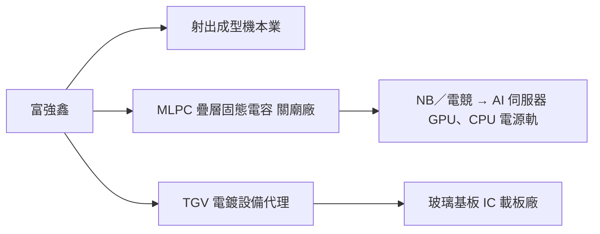

# 6603_富強鑫（市）

## 基本資料

富強鑫本業為射出成型機（多色機、單色機），搭配模具、智慧周邊與成型技術提供 turnkey solution；第二成長曲線為 MLPC 疊層固態電容與玻璃基板 TGV 電鍍設備代理。

- **2025 年（fact）**：營收 50.8 億元（年增 12.2%），毛利率 25.3%，營業利益 2.05 億元（年增 70.0%），EPS 0.61 元，研發投入約占營收 3%。
- **1–3Q26（fact）**：營收 34.2 億元（年減 5.8%），毛利率 25.0%，營業利益 0.70 億元（年減 48.0%），EPS 0.22 元。
- **營收結構（1–3Q26）**：應用別汽配 50.0%、ICT 半導體 23.4%、運動及民用精品 22.3%、基礎建設 3.2%；地區別中國 54.8%、台灣 18.4%、越南 10.9%、印度 1.1%、其他 14.8%；產品別多色機 60.2%、單色機 30.8%、其他 9.0%。
- 截至 2026 年 9 月底每股淨值 16.13 元，近五年平均配息率 72%。

資料來源：[[活動_富強鑫6603_國泰CallMemo_20261123]]（國泰證期 call memo，2026-11-23）。

## 核心技術／競爭優勢

- 多色機最多六色、鎖模力最大 3,500 噸，可結合軟硬材料；新能源車多色機市占 60% 以上，全球前八大車燈廠中六家為客戶，起草中國多色機裝備與能耗檢測兩項標準。
- MuCell 物理發泡系統（2025 年營收倍增至近 1 億元），iMF 4.0 軟體全球逾 1,000 台設備聯網，發展訂閱式收入。
- MLPC 採無引腳結構，電阻較低、電容較高，一般需四層才達到的容值三層即可（公司說法）。

## 產品與應用

| 產品 | 應用 | 觀察 |
|------|------|------|
| 多色／單色射出機 | 汽配、ICT 半導體、運動用品、基礎建設 | 訂單能見度到 2Q27；越南 2026 年營收突破 4 億元、有機會 5 億元 |
| MLPC 疊層固態電容 | AI 裝置、GPU、車用、工業電腦、5G；目前以 NB 為主 | 年需求 61 億顆、日系約 90%，主打進口替代；應用分布運算儲存 35%、汽車 20% |
| TGV 電鍍設備（中科先鋒台灣與東南亞獨家代理） | 玻璃基板 TGV 填孔、VP、VCP；SPP 板級電鍍 | 第四輪（最後一輪）驗證，3 家驗證客戶皆在中國；單台約 US$4mn、毛利率約五成 |

## 圖片 / 架構圖

## 營運展望

- MLPC：第一階段投資 2 億元，關廟廠外觀完成、內部隔間中；已取得台系電子五哥之一 vendor code，中國另有兩三家電競客戶。量產目標遞延至 2H27（約 3Q27）達月產 1,000 萬顆，GPU 應用驗證約 2H27 甚至 1Q28；遞延原因為客戶驗廠進度與設備交貨延遲（公司說法）。
- MLPC 規劃：2027 年（原規劃月產 1,000 萬顆、營收 6–7 億元、淨利 1.62 億元）將下修；1H28 維持 2,000 萬顆、2H28 看能否 2,500 萬顆；原規劃 2030 年 5,000 萬顆，希望提前至 2029 年；出貨 400 萬顆可損益兩平；毛利率 2027 年約 30%、2028 年約 33%；芯子 1H27 仍外購，後續朝自製。
- TGV：預估玻璃基板 TGV 設備需求 2028 年 240 億元、2029 年 525 億元、2030 年 840 億元，2028 年為量產關鍵期，明年應開始有商機；不排除在台設非紅供應鏈生產基地。
- 2027 年：對 AI 雜音審慎；若一切順利，營收有機會達 60 億元（公司說法）。

## 時間軸

| 日期 | 事件 | 來源 |
|------|------|------|
| 2026-11～12 | 墨西哥、印尼、深圳、土耳其 4 場展覽 | [[活動_富強鑫6603_國泰CallMemo_20261123]] |
| 2H27（約 3Q27） | MLPC 月產 1,000 萬顆（由原 2027 年遞延） | [[活動_富強鑫6603_國泰CallMemo_20261123]] |
| 2028 | 玻璃基板 TGV 量產關鍵期 | [[活動_富強鑫6603_國泰CallMemo_20261123]] |

## 供應鏈位置

塑膠射出設備供應商，延伸至 AI 被動元件（固態電容）與玻璃基板電鍍設備（代理）。

## 相關公司

| 公司 | 關係 | 來源 |
|------|------|------|
| 中科先鋒 | TGV 電鍍設備台灣與東南亞獨家代理（核心技術來自韓國、工廠在蘇州） | [[活動_富強鑫6603_國泰CallMemo_20261123]] |
| Unisol（日本上市代理商） | 北美市場代理 | [[活動_富強鑫6603_國泰CallMemo_20261123]] |
| 松下（Panasonic） | MLPC 競爭者（市占最高） | [[活動_富強鑫6603_國泰CallMemo_20261123]] |

## 來源

- [[活動_富強鑫6603_國泰CallMemo_20261123]]（國泰證期 call memo，2026-11-23）

## 相關頁面

- [[技術_玻璃基板]]
