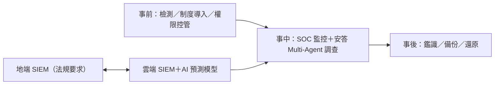

# 6690_安碁資訊（櫃）

## 基本資料

安碁資訊為宏碁集團旗下資安服務商，2019 年上櫃，員工逾 700 人。服務涵蓋事前（安全檢測、制度導入、權限控管）、事中（SOC 監控）與事後（鑑識分析、備份建置與資料還原）；2022 年併購宏碁雲架構後跨足算力機房與備份備援服務，旗下安碁學苑提供資安教育訓練。每年參與數發部資安署資安服務廠商評鑑，維持最高 5A 特優（SOC、資安健診、弱點掃描、滲透測試、社交工程皆 A 級），營收規模與客戶數居台灣市場領先。

- 3Q26（fact）：營收 6.8 億元（QoQ +3.1%、YoY +8.6%），毛利率 42.2%（QoQ +1.9ppts、YoY -0.7ppts），營業利益 1.1 億元（QoQ +10.0%、YoY +15.9%），稅後淨利 0.9 億元，EPS 3.04 元。
- 1–3Q26（fact）：營收 19.6 億元（YoY +12.9%），毛利率 40.1%（YoY -2.4ppts），營業利益 2.9 億元（YoY +16.0%），稅後淨利 2.4 億元，EPS 8.14 元（YoY +15.1%；去年同期 7.07 元）。1–10M26 營收年增 12.4%。
- 2025 年總合約量成長 35–40%，服務合約期間 1–3 年需逐年認列；2025 年全年 EPS 10.22 元，管理層認為 2026 年全年 EPS 有機會再創新高。

資料來源：[[活動_安碁資訊6690_元大CallMemo_20261124]]（元大投顧 call memo，2026-11-24）。

> [!note] 範圍待確認
> 本頁屬資安服務，不在每日 ingest 的半導體／AI／電力基建三類核心範圍內；因 AI 驅動攻擊與 Agentic AI 資安產品為主要論點，暫列「範圍待確認」保留。

## 核心技術／競爭優勢

- 自研 Agentic AI 系統「安答」（獲臺灣 AI 卓越獎優品認證）：Multi-Agent 協作調查，將傳統 SOC 單一事件處理時間由約 70 分鐘縮短至 5 分鐘以內。
- 自主研發 6 個 AI 預測模型，與 MITRE ATT&CK 架構對齊，辨識客戶所處攻擊階段或資料外洩環節。
- 雲地整合 SIEM：政府與金融客戶受法規限制須在地端儲存日誌，以雲端 SIEM 補地端算力，雲端模型約 3 天機器學習即可判斷異常行為，再將通報送回地端；公司稱為國內首家提出此架構的廠商。
- 連續數年為台灣微軟唯一資安合作夥伴（MSP），提供雲地混合監控與雲端資安健診。

## 產品與應用

| 服務 | 內容 | 觀察 |
|------|------|------|
| 檢測 | 弱點掃描、滲透測試（每 IP 約 5 萬元）、紅隊演練（300 萬元起） | 近年成長最大，擴充鑑識與檢測團隊 |
| AI 紅隊 | 提示詞、資料索引到 AI 代理工具等五層測試；依 OWASP Top 10 for LLM 檢測提示詞注入、資料外洩與模型輸出 | 費用高於傳統紅隊 |
| SOC／雲地 SIEM | 監控、告警通報、事件調查 | 安答加速事件處理 |
| 關鍵基礎設施 OT | 2025 年為台電 32 座變電站執行 OT 檢測與資安監控，導入單向閘道器 | 涵蓋交通、水利、能源、金融四領域；另提供紅色供應鏈與軟體物料清單管理 |
| 備份備援 | 宏碁雲架構的算力機房、異地備份 | 擴大防護範圍至雲端 |

## 圖片 / 架構圖

## 營運展望

- 併購策略以擴大客戶群與技術整合為主；2026 年 10 月策略投資雲智維（網路維運監控中心 NOC，中南部逾 200 家客戶），規劃由安碁主導營運，將網路監控升級為資安監控。
- 海外優先布局東南亞，以泰國為據點；2026 年為馬來西亞當地銀行 3 個據點完成 DDoS 應變演練測試。
- 安碁學苑約兩年前取得勞動部職訓中心執照，2027 年起擴大證照培訓，另辦理藍隊培訓。
- 內部建立 AI 治理機制（Token 用量管制、資料保護與去識別化），導入 AI 工具以擴大服務量能、降低人力負擔，效益仍需時間。
- 產業：AI 代理工具使攻擊者可在 1 秒內執行 3 個指令，攻擊頻率提高、週期縮短；台灣資安人才缺口約 2.5–3 萬人。

## 時間軸

| 日期 | 事件 | 來源 |
|------|------|------|
| 2026-10 | 策略投資雲智維，拓展中南部市場 | [[活動_安碁資訊6690_元大CallMemo_20261124]] |
| 2026-11-24 | 3Q26 法說：1–3Q26 EPS 8.14 元 | [[活動_安碁資訊6690_元大CallMemo_20261124]] |
| 2027 | 安碁學苑擴大證照培訓 | [[活動_安碁資訊6690_元大CallMemo_20261124]] |

## 供應鏈位置

企業與政府資安服務商，位於 AI 應用導入後的資安監控、檢測與鑑識環節；與集團內 [[6811_宏碁資訊（市）]] 分工（宏碁資訊負責雲端、AI 與 AI Agent 建置，安碁負責後續資安維運與監控）。

## 相關公司

| 公司 | 關係 | 來源 |
|------|------|------|
| [[6811_宏碁資訊（市）]] | 集團夥伴，合作十多年；宏碁資訊開發應用系統，安碁負責資安維運與監控 | [[活動_宏碁資訊6811_元大CallMemo_20261124]] |
| [[MSFT.US(microsoft)]] | 台灣微軟唯一資安合作夥伴（MSP） | [[活動_安碁資訊6690_元大CallMemo_20261124]] |
| 雲智維（未上市） | 2026-10 策略投資對象，NOC 業者 | [[活動_安碁資訊6690_元大CallMemo_20261124]] |

## 來源

- [[活動_安碁資訊6690_元大CallMemo_20261124]]（元大投顧 call memo，2026-11-24）
- [[活動_宏碁資訊6811_元大CallMemo_20261124]]（元大投顧，2026-11-24；宏碁資訊與安碁的分工）

## 相關頁面

- [[分析_群益2027科技投資主軸_20261117]]（群益點名安碁資訊為資安受惠股）
