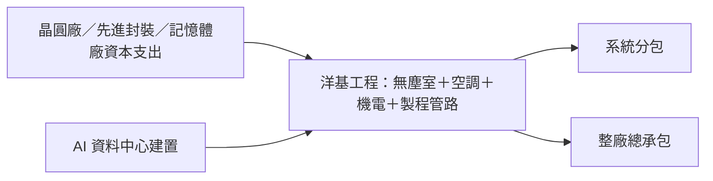

# 6691_洋基工程（市）

> [!note] 上市別待確認：本頁依既有資料暫列（市），建檔時未查證是否仍為上櫃，請使用者確認後再改檔名。

## 基本資料

洋基工程是半導體與高科技廠房的無塵室、空調、機電與製程系統工程商，近年由系統分包延伸到整廠總承包。3Q26 營收 146.46 億元（季增 31.54%、年增 163.93%），稅後淨利 17.45 億元、EPS 13.07 元；營收結構為半導體 65%、PCB 與光學 15%、AI 數據中心 12%、民生商辦 6%。3Q26 底在手未認列訂單 571 億元，加上 10 月新增約 61 億元，10 月底達 630 億元（來源：[[報告_宏遠_洋基工程6691_20261110]]，fact，高信心）。

## 核心技術／競爭優勢

- 無塵室、空調、機電、製程管路的整合能力，可承接晶圓廠、先進封裝廠與記憶體廠的大型工程。
- 由系統分包轉向整廠總承包，擴大單案規模（ASML 統包工程、美系記憶體廠統包案）。
- 海外據點：日本熊本晶圓廠二期，並洽談馬來西亞等新建廠案。

## 產品與應用

| 業務 | 應用 | 代表專案（宏遠 2026-11-10） |
|---|---|---|
| 半導體廠務工程 | 晶圓廠、先進封裝、記憶體廠 | 台積電先進封裝機電工程、熊本晶圓廠二期、美系記憶體廠統包案、ASML 統包工程 |
| AI 數據中心 | 資料中心新建廠房機電 | 數據中心新建廠房工程 |
| 民生商辦 | 大型開發案機電 | 富邦高雄凹子底開發案機電工程 |

## 圖片 / 架構圖

圖說：洋基工程的營收由半導體與 AI 資料中心建廠資本支出驅動，業務從系統分包擴大到整廠統包。

## EPS 預估

| 年度 | 宏遠 EPS（2026-11-10） | 類型 |
|---|---:|---|
| 2026E | 44.74 | estimate |
| 2027E | 66.93 | estimate |

## 時間軸

| 時間 | 事件 | 類型 | 重要性 | 備註 |
|---|---|---|---|---|
| 2026-10 | 在手未認列訂單 630 億元（3Q26 底 571 億元＋10 月新增約 61 億元） | 營運 | ⭐⭐⭐ | 宏遠法說紀要 |
| 2027 | 營收維持雙位數成長，訂單能見度至 2028 年 | 放量 | ⭐⭐ | 公司展望，estimate |

## 供應鏈位置

- 上游客戶：[[2330_台積電（市）]]、美系記憶體廠、ASML 等半導體建廠業主。
- 同業／可比：[[6903_巨漢（櫃）]]（廠務工程系統整合）。

## 相關公司

| 公司 | 關係 | 說明 |
|---|---|---|
| [[2330_台積電（市）]] | 客戶 | 先進封裝機電工程、熊本二期 |
| [[6903_巨漢（櫃）]] | 同業 | 廠務工程，半導體與 AI 占在手訂單 68.2% |

## 來源

- [[報告_宏遠_洋基工程6691_20261110]]（宏遠投顧，2026-11-10，法說紀要）

## 相關頁面

- [[時程_2026Q3Q4_AI網通與硬體催化劑]]
