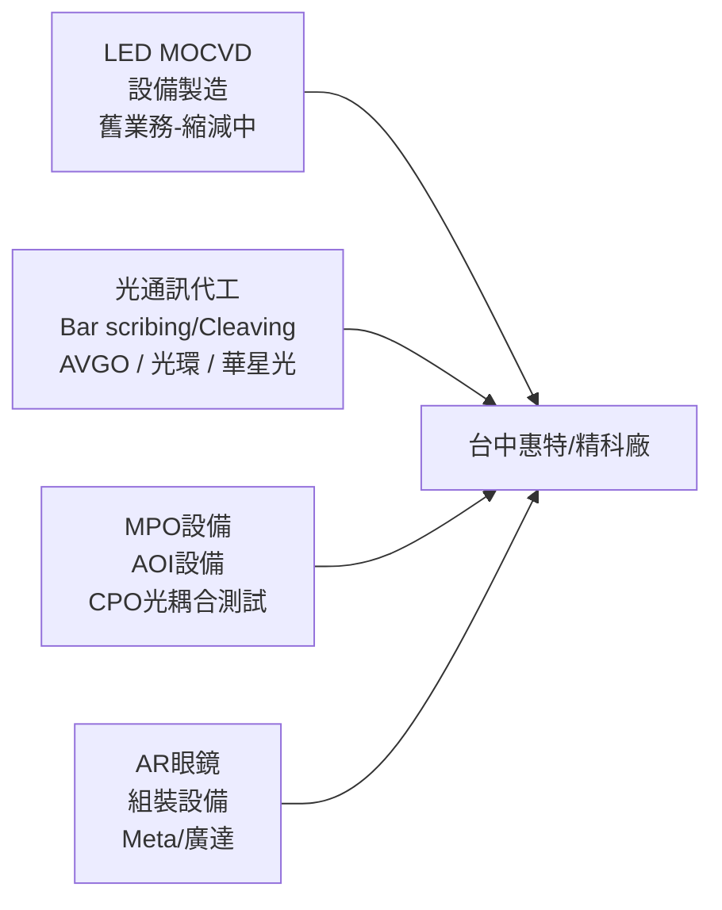

# 6706_惠特（市）

## 基本資料

惠特（6706，TWSE 上市）是台灣光電測試設備與代工廠，台中雙廠（總部+精科廠），主要業務：
1. **LED/MOCVD 設備製造**（歷史核心，現逐步縮減）：曾為三安光電等中國 LED 廠供應設備，遭遇 15 億款項糾紛（仲裁中）
2. **光通訊晶片代工**（成長業務）：對 EML/CW/PD 等光通訊雷射晶片進行 bar scribing（畫線）、cleaving（劈裂）代工服務，主要客戶 AVGO（博通）
3. **光通訊測試設備**：MPO 設備（200–500 萬/台），AOI 設備，CPO 相關光耦合測試
4. **AR 眼鏡組裝設備**：為 Meta/廣達供應 AR 眼鏡組裝自動化設備（200–1,500 萬/站，3–12 站/套）

**精科廠**：台中代工廠，面積 <2,000 坪，原為 LED 設備場地，逐步清空轉型光通訊代工。2026-04 私訪時精科廠租用 1、2、4 樓，主要在 2、4 樓生產；2 樓約 1/3–1/4 空間做光通，規劃整層放滿單一客戶。

**代工流程**（2026-04-22 私訪）：客戶（光環、華星光等）完成前段磊晶／濺鍍後，以 bar 條形式送來，惠特負責 bar test、劈裂（切成粒）與測試分 bin（依客戶需求分 6 個等級）。2 吋 wafer 約 4–5k 顆、3 吋約 6–8k 顆（2026-07 私訪改稱 3 吋可產出 12–13k 顆），代工單價約每顆新台幣 5 元。

**營收結構轉換**：代工：設備營收比 1H25 2:8（含萬潤代工設備出貨）→ 2H25 7:3 → 1Q26 5:5（2026-07 私訪稱 65:35，代工仍以 LED 為主）→ 2H26 目標 7:3（設備無明顯貢獻），公司重心由一次性設備轉向可持續的光通訊代工。

資料來源：[[活動_惠特私訪_20260422]]（私訪，2026-04-22）、[[活動_惠特私訪_20260701]]（私訪，2026-07-01）

## 核心技術／競爭優勢

- **Bar scribing & cleaving 高良率**：公司負責段良率 99.3%（客戶來料 Wafer 整體良率約 50%），AVGO 依出貨量收費
- **自製機台能力**：單台設備組裝期 2–3 週；240 台設備自製計畫（3.75 億 capex），生產效率優化後成本降至 3 億即達 8KK 月產能
- **交期優勢**：同業設備交期約 1 年，惠特對客戶喊 3 個月可備產能；設備接單到出貨市場約 3 個月，惠特目標壓到 2 個月內（2026-04-22 私訪）
- **代工無直接競爭對手**：光通訊後段代工需無塵室，目前公司認為沒有直接競爭者，客戶替代方案是自己買設備做（光環已有部分 EML 製程機台但專注前段，後段交惠特）
- **MPO 設備需求最明確**：CPO 前端矽光子需 MPO 多纖維連接，複雜度高（一對多），MPO 設備比 AOI 更強勁，預計率先進大量量產
- **AR 眼鏡設備高毛利**：客製化程度極高，GM 4–8 成，相較 LED 設備（GM 3 成）大幅提升
- **矽光子客戶關係**：與 [[3363_上詮（櫃）]] 經營層為學長學弟關係，上詮 CPO 耦光設備急單由惠特承接開發；與駿河精機（SURUGA）合作，SURUGA 是惠特手臂供應商，惠特也出整機耦光設備給 SURUGA

## 產品與應用

| 產品／服務 | 應用 | 相關客戶／下游 |
|-----------|------|---------------|
| 光通訊雷射晶片後段代工（bar test、劈裂、測試分 bin） | DFB／EML、CW 光源、PD | [[AVGO.US(broadcom)]]、[[3234_光環（櫃）]]、[[4979_華星光（櫃）]]、[[4991_環宇-KY（櫃）]]、[[3081_LandMark光電（市）]] |
| CPO／矽光子耦光對位設備 | PIC-FAU 貼合、FAU 排纖（32+4/6 共 40 芯） | [[3363_上詮（櫃）]] |
| MPO 設備 | 光纖連接器組裝 | [[6442_光聖（市）]] |
| 光模組雷射代工對位機台（6 軸） | 光模組雷射對位 | [[AAOI.US(applied optoelectronics)]] |
| AR 眼鏡組裝與測試設備（8→13 站） | AR 眼鏡組裝 | [[2382_廣達（市）]] → [[META.US(meta)]] |
| Probe Card 整卡清針設備 | 封測廠探針卡維護 | 矽品、日月光（送樣半年，尚無訂單） |
| LED 設備與 LED 代工（舊業務） | LED 分選、檢測 | 三安光電（款項糾紛中） |

## 客戶進度（截至 2026-07-01）

| 客戶 | 業務類型 | 狀態 | Forecast |
|------|----------|------|----------|
| 博通（AVGO） | 光通訊代工（EML/CW 晶片）| 量測試批，約 1KK+/月（受限基板） | 原估 3Q26 達 3KK/月；3Q26 營收貢獻約 2,000 萬/月 |
| 光環 | 光通訊代工 | 6月約 100 片（約 1.2KK），下半年上修 | 年底 forecast 6KK→口頭 10–12KK；3Q26 營收貢獻約 3,000 萬/月 |
| 華星光 | 代工（從設備轉） | 最快 Q3 進入 | — |
| 環宇 | 代工（CW→PD 轉向） | 可能 Q4 | forecast > 博通，< 光環 |
| Coherent | 代工（洽談中） | 送測樣本 | — |
| Lumentum | 代工（洽談中） | 送測樣本 | — |
| Meta（AR眼鏡） | 組裝設備（透過廣達） | 進行中 | — |

2026-07 私訪整體代工目標：年底單月代工營收 7,000–8,000 萬；後兩年需求「翻倍再翻倍」。

### 2026-04-22 私訪時的客戶狀態（較早版本）

| 客戶 | 業務 | 2026-04 狀態 | 說明 |
|------|------|-------------|------|
| [[AVGO.US(broadcom)]] | DFB／EML 代工 | 要求惠特準備產能，產品轉換中、來料顆數將增加 | 專機專用；AVGO 200G PD 約 5 美元／顆、5 顆一組捆售；AVGO 也把 PD 交鼎元（2426）做，鼎元再找惠特代工或買設備 |
| [[3234_光環（櫃）]] | 後段代工 | 每月 300→600 片 | 2026 年底 10mn 顆；光環自有部分 EML 機台但專注前段，後段給惠特 |
| [[3081_LandMark光電（市）]] | 代工 | 第四家客戶 | 3Q26 由 2 吋轉 3 吋；AVGO、聯亞給的 2027、2028 年需求皆為連續翻倍 |
| [[4991_環宇-KY（櫃）]] | CW 代工（驗證） | 今年約 100 片，2026-05 初後驗證 | CW 確定放台灣、PD 目前在美國洛杉磯，2027 年滿載後有機會放台灣；2028 年初上看 50mn 顆，展望大於既有兩大客戶；環宇 PD 單價約 0.5 美元 |
| [[4979_華星光（櫃）]] | 設備 | 以向惠特買設備為主 | 2026-07 私訪改為尋求代工（客戶不想承擔擴產風險） |
| [[3363_上詮（櫃）]] | CPO 耦光設備 | 急單、試產（PP）前段，設計定案中 | 可能滿足市場預期的 3Q26 量產，但今年僅小量，2027 年才較大量；2Q26 才開始建量產設備 |
| [[2382_廣達（市）]] | AR 眼鏡設備 | 8 站→13 站 | 先前 8 站報 5 站價約 2,000 萬；客戶稱 3Q26 量產，終端 Meta，Google 也與廣達合作；原則上廣達不再找其他供應商 |
| [[AAOI.US(applied optoelectronics)]] | 雷射代工對位機台 | 2025 年預算用於兩台 6 軸對位機台，2026-04 出貨 | 另一台研發機台；2026 年預算去向未知，規模不大 |
| [[3105_穩懋（櫃）]] | — | 2026-04 尚未接觸 | 2026-07 私訪稱高層關係不錯但無進一步消息 |

## 財務概況（截至 2026-07-01）

| 指標 | 數值 | 備註 |
|------|------|------|
| 合約負債 | 6.25 億 | 超過 3 億來自三安訂金 |
| 三安應收款 | 15 億 | 仲裁中，地方法院已扣款 |
| Q1 營收結構 | 代工 65% / 設備 35% | — |
| 設備 GM | 40%+ | LED 設備 GM 已降，光通設備 GM 40–80% |
| 代工 GM（Q1） | 9–13%（LED 主導） | LED 折舊提列完，後續改善 |
| 月度損益兩平 | 月營收 1 億 | Q3 2026 目標達標 |
| 月產能（2026年底目標） | 11–12KK | 從現在 8KK 擴至 |
| 營業費用 | 約固定 1.2 億／季 | 4Q25 降至 7,000 萬係單筆呆帳回沖 |
| 在手現金 | 約 10 億（2026-04） | 公司認為偏少；資金需求明確才考慮 CB，暫不考慮現增 |

### 代工營收目標（2026-04-22 私訪，estimate／中信心）

| 期間 | 代工單月營收目標 | 備註 |
|------|----------------|------|
| 2026-03 | 達成 50mn 目標的 70–80% | LED 佔 30–40% |
| 2026-04～05 | 約 50mn | 4/10 前來料不如預期，之後基板改善 |
| 3Q26 | 70–80mn | 原訂 2Q26 虧轉盈（不含三安回沖） |
| 2027 | 120mn（含環宇 150mn） | — |
| 2028 | >200mn | — |

毛利率路徑（2026-04-22 私訪）：1Q26 約 20%，代工滿載 GM 40–45%，3Q26 接近滿載，4Q26 有機會到 40%。LED 設備單台約 1mn、GM 由 35–38% 降至 30%；光通訊新設備單台 8–9mn、整線 20–30mn，GM 高於代工。萬潤耦光機約 40mn，惠特主打 CP 值。

> [!warning] 2026-04 與 2026-07 私訪說法差異（並列保留）
> - **損益兩平門檻**：[[活動_惠特私訪_20260422]] 稱折舊攤完後損平點由月營收 160–180mn 降至 80mn；[[活動_惠特私訪_20260701]] 稱單月營收 1 億損益兩平。
> - **虧轉盈時點**：04 私訪目標 2Q26 虧轉盈 → 07 私訪確認 Q2 落後、改為 Q3 有望達標（節奏延後 1 季）。
> - **三安回沖 EPS**：04 私訪稱 2025 年全部 15 億中，應收帳款回沖約 EPS 4 元、存貨約 3 元；07 私訪稱收足款項後回沖 EPS 5–6 元。
> - **營業費用**：04 私訪稱 4Q25 約 70mn、1Q26 相近且為固定金額；07 私訪稱約固定 1.2 億，4Q25 的 7,000 萬含單筆呆帳回沖。
> - **1Q26 營收結構**：04 私訪稱代工：設備 5:5；07 私訪稱 65:35。
> - **環宇業務**：04 私訪稱應是 CW 代工；07 私訪稱環宇由測 CW 轉向測 PD，可能 Q4 進來。

## 產能擴張計畫

- 2025 年底通過 3.75 億 capex（240 台自製設備），原規劃月產能 6KK
- 效率優化後：投入 3 億即達 8KK，Q3 2026 起顯現折舊（5 年攤提）
- 年底目標：11–12KK/月（視 Q3 投片結果決定是否加速擴）
- 精科廠 <2,000 坪為瓶頸，逐步清空二樓 LED 設備擴大光通空間
- 2026-04 私訪口徑：6mn 顆產能已備妥，2026 年底朝 10mn；3.75 億 capex 主要因應 AVGO 與光環，擴到 10mn 資金略有缺口；2026-03～04 月底大量進機，這批設備可做到 8–12KK，但 AVGO 專機專用，產能換算差異較大
- 設備生產的限制在配電人力（多被 [[7769_鴻勁精密（市）]] 拉走），生產空間足夠；設備需求過多時外包或找同業合作

## 其他設備業務

- **Probe Card 整卡清針**：由單針 Pogo Pin 清理延伸到整卡清針；整卡清理時間由 22 小時降至 14–16 小時，目標 6–8 小時；送矽品、日月光約半年，尚無訂單；競爭對手可能為 [[6207_雷科（櫃）]] 或創新服務（2026-04-22 私訪）。
- **耦光三種型態**：①32+4/6（共 40 芯）在 FAU 中排好；②FAU 與後段既有排好；③PIC 與 FAU 貼合，上詮使用 UV 膠，其他廠需要 socket 類治具。FAU 端 [[Sumitomo Electric（未）]] 很強，與 Senko、[[3363_上詮（櫃）]] 進入決選（2026-04-22 私訪，rumor／中信心）。詳見 [[技術_FAU]]。
- **MicroLED 光通訊**：富采喊 MicroLED 做光源，與新創銳利光合作，惠特有開發機台可能性；但公司認為 MicroLED 難贏中國產能，錼創一片約 4k 美元過貴；2026-07 私訪稱瑞利光、友達測試 MicroLED 短距傳輸，一兩年內難落地。

## 圖片 / 架構圖

圖說：惠特由 LED 設備商轉為「光通訊雷射晶片後段代工＋CPO／AR 自動化設備」雙引擎；代工端承接 AVGO、光環等 InP 雷射廠的 bar 條測試與劈裂，設備端切入上詮 CPO 耦光與廣達 AR 眼鏡組裝。

## 風險與注意事項

> [!warning]
> - **三安光電應收款 15 億風險**：仲裁結果不確定，若無法收回則有大額呆帳壓力
> - **基板供應瓶頸**：AVGO 訂單進展受限於基板不足，1KK/月遠低於預期 2KK/月
> - **缺工問題**：台中精科廠嚴重缺工，外包商 鴻勁 人數比惠特兩廠還多，影響產能爬坡速度
> - **設備驗收延遲**：R&D 設備規格頻繁變更，去年已出貨設備至今未驗收，認列時間不確定
> - **客戶集中與來料風險**：代工高度依賴 AVGO、光環，來料受基板與客戶前段製程良率牽動（2026-04 上旬來料即不如預期）
> - **CPO 量產時程不確定**：上詮與 AR 眼鏡設備雖已排程，公司自己也不確定客戶能否真的在 3Q26 量產

## 時間軸

| 時間 | 事件 | 類型 | 重要性 | 備註 |
|------|------|------|--------|------|
| 2026-04 | AAOI 6 軸對位機台出貨 | 設備出貨 | 低 | 2026-04-22 私訪；研發用途、量不多 |
| 2026-05 初 | 環宇 CW 代工開始驗證 | 客戶驗證 | 中 | 2026-07 私訪改稱轉向 PD、可能 Q4 進來 |
| 2026 Q2 | 原訂代工虧轉盈 | 財務里程碑 | 中 | 2026-07 私訪確認落後 |
| 2026 Q3 | 月損益兩平目標（月收 1 億） | 財務里程碑 | 高 | 代工放量 + 設備訂單進帳；4 月私訪口徑代工單月 70–80mn |
| 2026 Q3 | 華星光代工進入 | 客戶 | 中 | — |
| 2026 Q3 | 上詮 CPO、廣達 AR 眼鏡（終端 Meta）設備客戶量產目標 | 設備放量 | 中 | 上詮 2026 小量、2027 較大量 |
| 2026 Q3 | 聯亞由 2 吋轉 3 吋 | 客戶製程 | 低 | 2026-04-22 私訪 |
| 2026 Q4 | 環宇 PD 測試代工 | 客戶 | 中 | — |
| 2026 年底 | 月產能擴至 11–12KK | 產能 | 高 | 4 月私訪口徑 10mn |
| 2027 | 代工單月 120mn（含環宇 150mn） | 營收目標 | 中 | estimate，2026-04-22 私訪 |
| 2028 | 代工單月 >200mn；環宇 2028 年初 50mn 顆 | 營收目標 | 中 | estimate，2026-04-22 私訪 |
| 近期 | 三安仲裁判決確定 | 財務 | 高 | EPS 回沖 5–6 元（若勝訴） |

跨公司追蹤：[[時程_2026Q3Q4_AI網通與硬體催化劑]]

## 供應鏈位置

- 所屬供應鏈：→ [[供應鏈_CPO]]（光通訊晶片代工 + MPO 設備環節）、[[供應鏈_光測試設備]]（雷射晶片 bar test／分 bin 與耦光設備）
- 上游客戶來料：AVGO 送 EML/CW Wafer（已切條 Bar）；光環、華星光、聯亞、環宇送 InP 雷射／PD bar 條
- 下游出海口：馬來西亞封裝廠（AVGO 完成後送馬封）；華星光最終出海口為中際旭創
- 設備端客戶：上詮（CPO 耦光）、光聖（MPO）、合聖（檢測段機台）、廣達（AR 眼鏡）、AAOI（雷射對位）
- 上游零組件：駿河精機（SURUGA）精密手臂

## 相關公司

| 公司 | 關係 | 說明 |
|------|------|------|
| [[AVGO.US(broadcom)]] | 最大代工客戶 | 光通訊晶片 bar scribing/cleaving；DFB／EML，依出貨量計費 |
| [[3234_光環（櫃）]] | 代工客戶 | 前段自做、後段交惠特；年底 forecast 上看 10–12KK，3Q26 營收貢獻約 3,000 萬/月 |
| [[4979_華星光（櫃）]] | 設備→代工客戶 | 4 月以買設備為主，7 月改尋求代工、最快 Q3 |
| [[3081_LandMark光電（市）]] | 代工客戶 | 第四家代工客戶，2027–28 需求連續翻倍 |
| [[4991_環宇-KY（櫃）]] | 潛在代工客戶 | 4 月稱 CW 代工驗證，7 月稱轉向 PD、可能 Q4 |
| [[3363_上詮（櫃）]] | CPO 設備客戶 | 耦光對位設備急單，經營層為學長學弟關係 |
| [[2382_廣達（市）]] | AR 設備客戶 | AR 眼鏡組裝 8→13 站，終端 Meta |
| [[META.US(meta)]] | 終端客戶 | AR 眼鏡，2025 年曾至廣達看廠與惠特設備 |
| [[AAOI.US(applied optoelectronics)]] | 設備客戶 | 光模組雷射代工對位機台 |
| [[6442_光聖（市）]] | 設備客戶 | 下 MPO 設備訂單 |
| [[6187_萬潤（市）]] | 合作／競爭 | 2025 年萬潤拿耦光機；過去惠特出萬潤代工設備；萬潤耦光機約 40mn |
| [[7769_鴻勁精密（市）]] | 人力競爭 | 中部配電人力多被鴻勁拉走，鴻勁外包人力 800 人 |
| [[COHR.US(coherent)]]、[[LITE.US(lumentum)]] | 潛在代工客戶 | 接洽並送測樣本 |
| [[Sumitomo Electric（未）]] | 產業參考 | FAU 強者，與 Senko、上詮進入決選 |

## 來源

- [[活動_惠特私訪_20260422]]（私訪，2026-04-22）
- [[活動_惠特私訪_20260701]]（私訪，2026-07-01）
