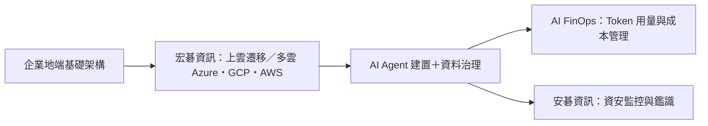

# 6811_宏碁資訊（市）

## 基本資料

宏碁資訊為宏碁集團旗下雲端、AI 與資料服務整合商，2022 年 IPO，員工由當時 200 多人增至約 330 人，業績與財務表現較 IPO 時翻倍。具備微軟 MSP、LSP 與 CSP 資格及 6 項 ASP 專精認證，正爭取微軟 Frontier Partner 資格（預期可望成為大中華區唯一）。約五成客戶為高科技業者，許多客戶合作逾十年、部分達二、三十年。

- 1–10M26（fact）：營收 109.4 億元（YoY +37.5%），已超越 2025 年全年 96.9 億元。
- 1–3Q26（fact）：營收 97.5 億元（YoY +30.8%），毛利率 11.4%（YoY -1.3ppts），營業利益 7.3 億元（YoY +22.8%），稅後淨利 5.9 億元（YoY +24.8%），EPS 14.17 元（YoY +25.8%），接近 2025 年全年 5.95 億元與 14.37 元。
- 2027 年以雙位數成長為目標，管理層審慎樂觀。

資料來源：[[活動_宏碁資訊6811_元大CallMemo_20261124]]（元大投顧 call memo，2026-11-24）。

## 核心技術／競爭優勢

- 從地端基礎架構到雲端的完整服務經驗：掌握客戶既有設備與運作狀況，協助地端移轉上雲、導入 AI 並管理後續 Token 成本（多數同業為純雲端夥伴）。
- 多雲能力：2026 年投資宏碁智雲補強 Google Cloud 與 AWS，與既有 Microsoft Azure 業務互補。
- SAP 整合：投資專精 SAP 的華致資訊，支援 Agentic AI 與高科技客戶既有 SAP 系統串接。
- 約兩、三年前開始以 AI 工具開發與優化內部流程，人力增幅低於業績與獲利增幅。

## 產品與應用

| 2027 發展方向 | 內容 |
|------|------|
| 雲端 | 建立 AI FinOps 雲端管理平台，因應 Token 用量變動並管理成本 |
| AI 與數據 | 資料合規性與正確性；平台協助企業管理 AI Agent，記錄日誌與行為軌跡，支援 AI 治理 |
| 資安 | 雲地協同資安防護（與 [[6690_安碁資訊（櫃）]] 合作） |
| 區域化 | 跟隨客戶布局中國、越南，持續拓展東南亞；台灣集中接單、當地團隊提供服務 |
| 併購投資 | 宏碁智雲（GCP／AWS）、華致資訊（SAP） |

## 圖片 / 架構圖

## 營運展望

- 台灣市場 AI 應用成熟度約 12%；公司協助客戶梳理地端與雲端資料、提高準確性與合規性以減少 AI 幻覺，資料架構健全後 AI 應用可望加速。
- 案例：一名客戶單月 Token 用量由約 50 萬增至 500 萬（研發 AI 模型期間大量調用），企業開始關注 AI 投資報酬率與 Token 成本管理。
- 越南據點設立一年多，2026 年成長良好；部分電子大廠在越南擴建九至十座廠房，有助擴大在地服務。
- 公司引述產業調查：2026 年約 89% 企業使用 AI，進入規模化階段比重提高 6ppt；約 61% 受調查企業有意於 2027 年增加 AI 投資。Gartner 預估 2026 年助理型 AI 支出約 US$250bn、代理人 AI 約 US$202bn，2027 年代理人 AI 增至 US$371bn、超越助理型 AI。
- 風險：管理層提醒須留意國際環境突發風險。

## 時間軸

| 日期 | 事件 | 來源 |
|------|------|------|
| 2026 | 投資宏碁智雲、華致資訊 | [[活動_宏碁資訊6811_元大CallMemo_20261124]] |
| 2026-11-24 | 3Q26 法說：1–10M26 營收已超越 2025 全年 | [[活動_宏碁資訊6811_元大CallMemo_20261124]] |
| 2027 | 雙位數成長目標；爭取微軟 Frontier Partner | [[活動_宏碁資訊6811_元大CallMemo_20261124]] |

## 供應鏈位置

企業 AI 導入的下游系統整合與雲端代管服務商，位於 CSP（Microsoft、Google、AWS）與企業客戶之間，承接 AI Agent 建置、資料治理與 Token 成本管理需求。

## 相關公司

| 公司 | 關係 | 來源 |
|------|------|------|
| [[6690_安碁資訊（櫃）]] | 合作十多年；宏碁資訊負責系統開發與 AI，安碁負責資安維運與監控 | [[活動_宏碁資訊6811_元大CallMemo_20261124]] |
| [[MSFT.US(microsoft)]] | MSP／LSP／CSP 夥伴，Azure 業務 | [[活動_宏碁資訊6811_元大CallMemo_20261124]] |
| [[GOOGL.US(alphabet)]]、[[AMZN.US(amazon)]] | 透過宏碁智雲補強 Google Cloud 與 AWS | [[活動_宏碁資訊6811_元大CallMemo_20261124]] |
| 宏碁智雲、華致資訊（未上市） | 2026 年投資對象 | [[活動_宏碁資訊6811_元大CallMemo_20261124]] |

## 來源

- [[活動_宏碁資訊6811_元大CallMemo_20261124]]（元大投顧 call memo，2026-11-24）
- [[活動_安碁資訊6690_元大CallMemo_20261124]]（元大投顧，2026-11-24；安碁法說提及雙方合作）

## 相關頁面

- [[分析_群益2027科技投資主軸_20261117]]（群益點名宏碁資訊）
