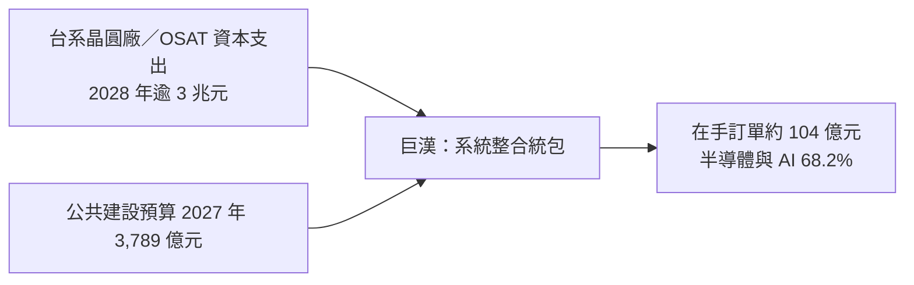

# 6903_巨漢（櫃）

> [!note] 上市別待確認：本頁暫列（櫃），建檔時未查證，請使用者確認後再改檔名。

## 基本資料

巨漢是高科技廠務工程的系統整合統包商，以 BIM 數位化與 AI 賦能的工程平台提升效率。3Q26 營收 20.4 億元（年增 127%）、毛利率 31.1%、EPS 6.78 元；9M26 營收 60.4 億元（年增 207%）、EPS 20.92 元。10 月底在手訂單約 104 億元（9 月底 108 億元），半導體與 AI 產業占 68.2%、公共工程 31.8%，能見度 2–3 年；預估 2026 年半導體相關營收占比超過 60%（來源：[[活動_巨漢6903_富邦CallMemo_20261110]]，fact，高信心）。

## 核心技術／競爭優勢

- BIM 數位化工程平台，37 年無重大工安事故、無壞帳、無工程訴訟。
- 可挑案承接，目標承接 50 億元以上專案；公共工程只接毛利率 25%–30% 的技術型案件。
- 承接後即下單鎖料、先確認協力人力，降低缺工與原料波動對毛利率的侵蝕。

## 產品與應用

| 執行中專案 | 業主 |
|---|---|
| P11B 5F/6F 無塵室新建 | [[6239_力成（市）]] |
| 新竹 P1 廠 FAB 無塵室 | [[6770_力積電（市）]] |
| 湖口新廠基礎機電 | [[6223_旺矽（櫃）]] |
| 空調及製程系統管路、P-3F 無塵室擴建空調 | [[3711_日月光投控（市）]] |
| 竹北 AI 園區機電 | [[3231_緯創（市）]] |
| 5A 廠建廠計畫 | [[2408_南亞科技（市）]] |
| 自貿園區 D 棟機電、空調、消防、中央監控 | 鴻佰 |
| 高雄七廠機電無塵室 | 瑞儀光電 |

## 圖片 / 架構圖

圖說：巨漢接單由台系晶圓廠與封測廠建廠潮（2025–2028 年 CAGR 26%）與公共工程預算支撐。

## 時間軸

| 時間 | 事件 | 類型 | 重要性 | 備註 |
|---|---|---|---|---|
| 2026-11-10 | 法說：10 月底在手訂單約 104 億元，2027 年營收展望樂觀 | 法說 | ⭐⭐ | 富邦 call memo |
| 2030 前 | 營收百億元目標 | 目標 | ⭐⭐ | 管理層目標，thesis |

## 供應鏈位置

- 下游業主：晶圓廠、封測、記憶體與 AI 伺服器廠的新建廠房。
- 同業／可比：[[6691_洋基工程（市）]]。
- 財務：發行 15 億元 CB 支應 50 億元以上大型專案，全數轉換股本增加 5.7%；現金股息發放率 75% 以上。

## 相關公司

| 公司 | 關係 | 說明 |
|---|---|---|
| [[6239_力成（市）]] | 客戶 | 無塵室新建 |
| [[6770_力積電（市）]] | 客戶 | FAB 無塵室 |
| [[6223_旺矽（櫃）]] | 客戶 | 新廠機電 |
| [[3711_日月光投控（市）]] | 客戶 | 空調與製程管路 |
| [[3231_緯創（市）]] | 客戶 | 竹北 AI 園區機電 |
| [[2408_南亞科技（市）]] | 客戶 | 5A 廠建廠 |
| [[6691_洋基工程（市）]] | 同業 | 廠務工程 |

## 來源

- [[活動_巨漢6903_富邦CallMemo_20261110]]（富邦投顧 call memo，2026-11-10 法說）

## 相關頁面

- [[時程_2026Q3Q4_AI網通與硬體催化劑]]
