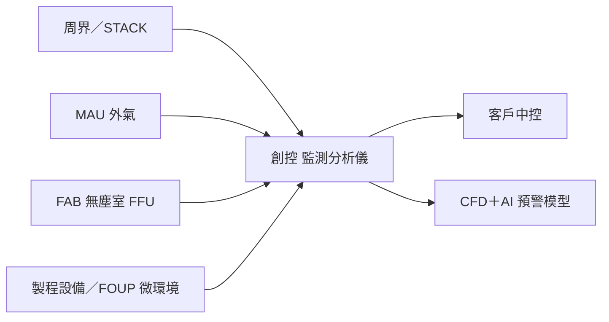

# 6909_創控（櫃）

## 基本資料

創控營收主要來自半導體廠務環境（外氣、循環氣、無塵室）監測設備與維護服務，以自有專利監測分析儀搭配客製化應用提供一條龍方案。延伸方向：上游由化學濾網應用延伸至濾網品管；核心由廠務環境延伸至微環境與設備環境（設備供氣、化學品供應、特氣）；應用由光電面板廠擴及廠外環境空氣監測。2026-10-20 納入「臺灣璞玉指數」成分股。資料來源：[[活動_創控6909_國泰CallMemo_20261117]]（國泰證期，2026-11-17）。

## 核心技術／競爭優勢

- 監測層級完整：周界、STACK（排氣煙囪、Penthouse 進氣）、MAU（外氣空調箱 inlet／outlet）、FAB（FFU、無塵室）、PROCESS（製程設備、FOUP 微環境），涵蓋曝光機等設備端，結合定點、移動巡檢與遠端監控。
- AI 預警：以 CFD 流場模擬由監測數值推算全廠污染分布，訓練 AI 模型預測 5／10／30 分鐘污染變化，由事件管理轉為預警管理；提供買斷（含維護升級）或訂閱制。
- 自有設備＋場域資料＋實測校正模型，客戶黏著度高；2017 年起隨客戶海外建廠布點。

## 產品與應用

| 產品／服務 | 應用 | 客戶／下游 |
|---|---|---|
| 監測分析儀與系統 | 晶圓廠無塵室、MAU、STACK、FOUP 微環境 | 半導體廠（未具名） |
| 維護服務 | 機台售後維護 | 同上 |
| AI 預警方案 | 污染擴散預測 | 同上 |

## 圖片 / 架構圖

圖說：創控在晶圓廠各層級布點監測，資料上傳客戶中控並供 AI 預警模型使用。

## EPS 記錄

| 季度 | EPS | 營收 | 備註 |
|---|---|---|---|
| 1Q26 | 0.07 元 | 1.02 億元 | — |
| 2Q26 | 0.10 元 | 1.02 億元 | — |
| 3Q26 | 0.59 元 | 1.86 億元 | QoQ +82.5%；毛利率 61.01%；營業利益 4,706 萬元（營益率 25.34%）；依驗收認列 |
| 1–3Q26 | 0.75 元 | 3.89 億元 | YoY +15.7%；設備收入 2.19 億元（+13.5%）、維護收入 1.70 億元（+18.9%）；營業利益 5,322 萬元（去年同期 1,245 萬元） |

## 時間軸

| 時間 | 事件 | 類型 | 重要性 | 備註 |
|---|---|---|---|---|
| 4Q26 | 配合客戶拉貨與驗收排程，過去三年第四季皆為全年最高單季 | 營運 | ⭐⭐ | 公司未提供財測；見 [[時程_2026Q3Q4_AI網通與硬體催化劑]] |

## 供應鏈位置

- 下游：晶圓廠與面板廠的廠務、製程環境管理。
- 同屬晶圓廠建置／廠務生態：[[2404_漢唐（市）]]、[[6139_亞翔（市）]]；wiki 尚無廠務監測供應鏈頁。

## 相關公司

| 公司 | 關係 | 說明 |
|---|---|---|
| [[2404_漢唐（市）]] | 同生態 | 晶圓廠廠務工程統包，與廠務監測同受建廠驅動 |
| [[6139_亞翔（市）]] | 同生態 | 廠務工程統包 |

## 風險與注意事項

> [!warning]
> - 營收依專案驗收認列，季度波動大；3Q26 是否為新常態公司未確認。
> - 客戶集中於半導體廠擴建週期；海外擴張費用與主力國家公司未具體說明。

## 來源

- [[活動_創控6909_國泰CallMemo_20261117]]（2026-11-17）— 國泰證期 call memo。
