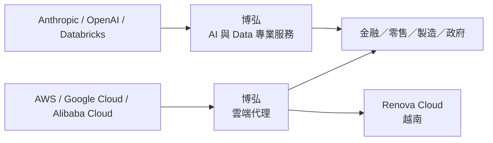

# 6997_博弘（櫃）

## 基本資料

- 雲端代理與 MSP（託管服務）業者，2024-12-16 上櫃（承銷價 101 元），母公司新世紀資通持股約 58%（公開資訊）。
- 營收以雲端代理為主（3Q26 約 95%），專業服務（託管維運、AI 與 Data）約 4–6%；地區別 3Q26 台灣 57%、中國及香港 28%、東南亞 15%（2Q26 起併入越南 Renova Cloud）。
- 深耕金融、零售、製造及政府公部門（3+1 產業）。
- 資料來源：[[活動_博弘6997_法說彙整_20261118]]（元大、富邦 call memo，2026-11-18 法說）。

## 核心技術／競爭優勢

- 三大 CSP 夥伴：Google Cloud Partner of the Year 2026（Taiwan）、Google Workspace 大中華區 2025 新簽約銷售冠軍；Renova Cloud 獲 AWS Partner of the Year 2026：Vietnam（第三度）；Alibaba Cloud 2026 最佳本地渠道夥伴。
- AI 原廠資格：Anthropic Authorized Reseller、OpenAI Select Partner、Databricks Silver Partner。
- MSSP 資安服務、ISO 27001；正將託管與 AI／Data 服務模組化，打造自有 AI 平台。

## 產品與應用

| 服務 | 應用 | 相關夥伴／客戶 |
|------|------|----------------|
| 雲端代理 | 公有雲資源轉售與帳務 | [[AMZN.US(amazon)]]（AWS）、[[GOOGL.US(alphabet)]]（Google Cloud）、Alibaba Cloud |
| 專業服務：Managed Services | 託管維運、24 小時監控 | 台灣、香港、越南客戶 |
| 專業服務：AI 與 Data | 資料治理、解決方案設計、應用開發、Lakehouse | [[Anthropic（未）]]、[[OpenAI（未）]]、Databricks、MongoDB、Tableau |
| MSSP | 資安託管 | 企業客戶 |

## 圖片 / 架構圖

圖說：雲端代理為營收主體，專業服務為毛利與成長重點。

## EPS 記錄

| 季度 | EPS | 備註 |
|------|-----|------|
| 3Q25 | 0.95 元 | |
| 2Q26 | 1.46 元 | |
| 3Q26 | 1.30 元 | 營收 14.50 億元（QoQ -8.2%、YoY +29.3%），毛利率 8.9% |
| 1-3Q26 | 0.44 元 | 營收 41.51 億元（YoY +29.4%）；累計營業利益、淨利轉正 |

## 時間軸

| 時間 | 事件 | 類型 | 重要性 | 備註 |
|------|------|------|--------|------|
| 4Q26 | 部分大型專案認列 | 營收 | ⭐⭐ | 公司對 4Q26 有信心 |
| 2026-12-08 | Next AI Day（博弘雲端日）發表自有 AI 平台 | 產品 | ⭐⭐ | |
| 2026 年底 | 越南 Renova Cloud 取得 AWS MSP 資格 | 認證 | ⭐ | 台灣 MSP 團隊輔導 |

相關時程：[[時程_2026Q3Q4_AI網通與硬體催化劑]]

## 供應鏈位置

- 上游：CSP（AWS、Google Cloud、Alibaba Cloud）、AI 模型與資料平台原廠（Anthropic、OpenAI、Databricks）
- 下游：台灣、中港、東南亞企業與公部門客戶
- 所屬供應鏈：AI 應用落地／雲端服務通路（尚無專屬供應鏈頁；相關：[[Anthropic（未）]]）

## 相關公司

| 公司 | 關係 | 說明 |
|------|------|------|
| [[AMZN.US(amazon)]] | 上游原廠 | AWS 代理與 MSP（Renova Cloud） |
| [[GOOGL.US(alphabet)]] | 上游原廠 | Google Cloud／Workspace 代理 |
| [[Anthropic（未）]] | AI 原廠 | Authorized Reseller |
| [[OpenAI（未）]] | AI 原廠 | Select Partner |

> [!warning] 風險與注意事項
> - 雲端代理價格透明、競爭加劇，代理毛利率可能持平或下滑；整體毛利率僅約 9%。
> - 1Q26 特殊逾期帳款目前僅收回約 15%；負債比約 75%（含應付收購價金）。
> - 越南原廠獎金與成本入帳時間差使季度毛利率波動。

## 來源

- [[活動_博弘6997_法說彙整_20261118]]（元大投顧、富邦投顧 call memo，2026-11-18 法說）
