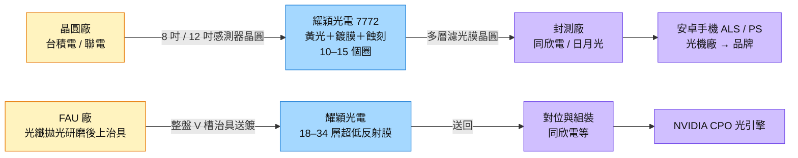

# 7772_耀穎光電（櫃）

## 基本資料

耀穎光電是「黃光＋精密光學鍍膜＋蝕刻」一站式的晶圓級光學薄膜代工廠，2003 年成立，實收資本額 2.65 億元。兩大產品線為**半導體光學**（在客戶的感測器晶圓上做多層光學濾光膜，約占營收 80–83%）與**精密光學鍍膜**（攝影機濾光片、衛星濾光片、台積電曝光機元件等）。

- **核心客戶與應用：** 安卓手機的環境光感測器（ALS）、近接感測器（PS）與多通道色溫感測器為主力，公司稱安卓手機 ALS 全球市占約 60% 以上、排名第一；晶圓由 [[2330_台積電（市）]]、聯電等提供，加工完交給 [[6271_同欣電（市）]]、日月光等封測廠。Apple 走 [[3374_精材（櫃）]]／采鈺的台積電體系，耀穎不做。
- **成長驅動：** OLED 面板讓 ALS 層數由 TFT 時代的 3–4 層增加到最多 14 層（最多 15 個圈），帶動 ASP 從 2023 年約 5,000 多元升到 7,000 多元；新事業為 CPO／FAU 光纖端面超低反射鍍膜、AI 眼鏡 LCoS 晶圓代工、人形機器人光學編碼器（光學齒）。
- **供應鏈位置：** CPO 這塊只做光纖端面鍍膜，不做 FAU 對位與組裝；目前做的是 [[NVDA.US(nvidia)]] 系統，與同欣電合作（[[供應鏈_CPO]]）。
- **掛牌：** 2025-06 登錄興櫃；依 2026-04～05 新聞的預定時程，2026-05-08 以每股 53 元上櫃（[聯合新聞網](https://udn.com/news/story/7254/9453228)，fact／中，實際掛牌日以櫃買公告為準）。

資料來源：[[活動_耀穎光電7772_法說會後交流Memo_20261016]]（法人座談會逐字稿＋會後交流錄音整理，日期以 PDF 產出日 2026-10-16 標記）。以下公司數字皆為法說口述，未經財報核對（fact／中，除另註）。

## 核心技術／競爭優勢

- **黃光＋鍍膜＋蝕刻整合在同一廠：** 一片晶圓要跑 10–15 個「圈」（上光阻定義 PD 區 → 鍍膜 → 去光阻／蝕刻去膜），每個圈留下一種濾光膜。沒有自有黃光與蝕刻的同業要在不同廠之間來回 15 次，交期、良率與報廢責任都難管；耀穎最慢兩週內交件。關鍵 know-how 是「膜在產品上不能脫，去膜時又要好去」。
- **以蒸鍍機為主的多層能力：** 蒸鍍機一天內可換三種顏色，濺鍍機開一次通常一週只能做一種；ALS 層數持續增加，蒸鍍機較有優勢。公司稱大陸兩家同業只能做約 3–5 層、只供陸系低階安卓。
- **設備成本遠低於采鈺：** 與采鈺（VisEra）工法相同，但采鈺做 CIS 像素級 RGB（約 0.6 µm），要用步進曝光機、設備成本約為耀穎的 100 倍；耀穎的 PD 尺寸約大 100 倍，只需 1:1 曝光機，通道數 2–12 道。
- **CPO 鍍膜的潔淨度管理：** 超低反射膜至少 18–34 層，製程中只要 particle 落在光點中央光就出不去；公司沿用晶圓廠規範、不混鍋，加上離客戶近（早上收貨中午送回），稱良率優於同業。

## 產品與應用

| 產品 / 服務 | 應用 | 相關客戶 / 下游 |
|-------------|------|-----------------|
| 晶圓級多層光學濾光膜（ALS、PS、多通道色溫感測器；以加工層數計價） | 手機、平板、穿戴、藍牙耳機、掃地機器人、筆電與無人機人臉辨識、血氧血糖監測 | 台灣光機廠（主要客戶為 [[005930.KR(samsung)]] 等安卓品牌）→ 封測廠 [[6271_同欣電（市）]] 等 |
| CPO／FAU 光纖端面超低反射鍍膜（1310／1380／1550 nm，18–34 層）；M-Lens 石英玻璃角度反射面鍍膜（約 64 層） | CPO 光引擎 FAU | [[NVDA.US(nvidia)]] 系統，經 [[6271_同欣電（市）]]；[[2330_台積電（市）]] 驗證案 |
| LCoS 反射式晶片光學膜與金屬膜（晶圓代工） | AI／AR 眼鏡成像 | 大陸一家晶片廠（未具名，官網 4 個 LCoS 案），預估 2027 年小量產 |
| 光學編碼器（光學齒，圓形與線性） | 人形機器人關節角度與位移感測 | 台灣兩家光學感測器廠（原文「頂晶／點晶」，待查證）；稱已有 Tesla 相關訂單 |
| 曝光機等照度均勻發散濾光片 | 台積電 8 吋曝光機元件（取代 Zeiss 的在地化） | [[2330_台積電（市）]]，公司稱為第一供應商 |
| 攝影機低通濾光片 | 好萊塢高階攝影機（抗摩爾紋、濾紅外與紫外） | RED |
| 線性濾光片、主鏡片、次鏡片 | 國家太空中心衛星（2023–2031 年每年一顆），每年營收約 2,000–3,000 萬元 | 國家太空中心（TASA），稱唯一供應商 |

## 圖片 / 架構圖

圖說：耀穎有兩條不同的製程鏈。手機感測器是在晶圓上做「黃光定義 PD 區 → 鍍膜 → 去膜」的多圈加工，按層數計價；CPO 則只用鍍膜機在已拋光的光纖端面鍍超低反射膜，按「一鍋多少錢、一鍋放幾個治具」計價，與黃光製程無關。原檔無來源圖，以 Mermaid 補位。

## 營運與財務（法說口述）

| 項目 | 數字 | 說明 |
|---|---|---|
| 2025 年毛利率 | 35.44% | 近四年持續上升 |
| ASP | 2023 約 5,000 多元 → 7,000 多元 | OLED 帶動層數增加 |
| 1H26 營收結構 | 半導體光學代工 83%；依產品：行動智慧裝置 81%、攝影機 9%、台積電曝光機元件 6%、其他約 4% | 無人機約 1%（2025 年幾乎沒有） |
| 產能 | 新竹一廠 8 吋兩條線；桃園塘新二廠 12 吋一條＋8 吋一條；蒸鍍機 16 台（日本機、國產機各 8 台，鍋徑 1.5 m）、濺鍍機 2 台 | 整體稼動率約六成；每月固定成本「幾千萬」 |
| 12 吋經濟性 | 1.5 m 鍋可放 12 片 8 吋或約 9 片 12 吋 | 12 吋單片價高、換算每顆裸晶較划算，難點在黃光與鍍膜均勻度 |

- **2Q26 毛利率下滑原因：** (1) 上市後員工認股費用約 1,000 多萬元，直接人員占多數，大部分落在成本；(2) 記憶體漲價壓抑低階手機，營收下滑而電費、薪資、折舊固定。
- **3Q26 營收持平：** 主因不是需求，而是 8 吋晶圓料源不足（晶圓廠資源轉向 12 吋）；公司預期 4Q 衝上來。
- **展望（公司指引／中）：** 連續五個月營收高於去年同期；全年營收不低於 2025 年，4Q26 YoY 成長，動能為高階手機與 CPO，AI 眼鏡可能貢獻。
- **CPO 營收：** 2026 年比 2025 年成長三倍但金額不大，仍以研發驗證為主（含不只一案的台積電驗證）；公司稱 2027 年可能是成長最大的一塊。被問到 2028 年市占目標時未給數字。

> [!note] 會後交流的「六層」指層數，不是毛利率
> 會後錄音「現在六層快六層」指平均加工層數：過去平均約 4 層、目前平均約 6 層，製程上已有 7 層能力（使用者 2026-11-26 確認）。原 memo 整理寫成「毛利率接近 60%」是誤讀，毛利率仍以法說會 2025 年 35.44% 為準（[[活動_耀穎光電7772_法說會後交流Memo_20261016]]）。平均層數由 4 升到 6 層，對應按層數計價下的單片 ASP 提升。

## CPO／FAU 鍍膜觀點

- **技術原理：** 光纖末端若未拋光鍍膜，內反射可能讓 100% 的光只剩約 5%。一般玻璃反射率約 4%、眼鏡 AR 膜降到約 1%；光纖要求 100 出去收到 99.9–99.95，反射率須低於 0.05% 或 0.02%。一般鍍膜 4–6 層，超低反射膜至少 18 層（1310 單波段），1310–1550 寬波段更多（詳 [[技術_FAU]]）。
- **流程：** 客戶把光纖拋光、架在 V 槽治具上整盤送來，耀穎直接鍍在垂直端面（不切斜面、不膠合），鍍完整盤送回做對位組裝。目前只做單通道，未來多通道與 DWDM 會讓層數與加工費提高。
- **良率：** 發言人稱「台積電到輝達的 CPO 整體良率還沒破三成，約兩成多」（rumor／低，未具名來源）；良率起不來就無法取代 NPO。
- **市場觀點（發言人個人／thesis）：** NPO 會先爆發、CPO 隨後；目前 NPO 主力 1.6T、2027 可能進 3.2T。會後交流更保守：CPO 短距離要與成熟便宜的 MPO 拼成本不易，台積電端規格與成本要求高；CPO／FA 供應鏈很亂，還沒形成固定「戰隊」。
- **對準方案與大立光：** 大立光、玉晶光今年加入做對準；耀穎不做對準。大立光自有鍍膜、沒有給耀穎鍍；發言人個人不認為大立光做得起來（「隔行如隔山」），稱其 FA 尚未真正量產、對焦問題未完全解決（競爭者觀點，信心低）。

## 時間軸

| 時間 | 事件 | 類型 | 重要性 | 備註 |
|------|------|------|--------|------|
| 2025-06 | 登錄興櫃 | 掛牌 | ⭐ | 新聞 |
| 2026-05-08 | 預定以每股 53 元上櫃 | 掛牌 | ⭐⭐ | 新聞預定時程 |
| 2026Q4 | 公司預期營收 YoY 成長，8 吋料源恢復 | 營運 | ⭐⭐ | [[活動_耀穎光電7772_法說會後交流Memo_20261016]] |
| 2027 | CPO 鍍膜可能是成長最大的業務；LCoS AI 眼鏡小量產 | 放量 | ⭐⭐ | 公司指引，未給金額 |
| 2023–2031 | 國家太空中心每年一顆衛星，耀穎為唯一濾光片供應商 | 訂單 | ⭐ | 每年約 2,000–3,000 萬元 |

→ 跨公司時程詳見 [[時程_2026-2027高速互連與分散式算力]]

## 供應鏈位置

- 上游：晶圓廠（[[2330_台積電（市）]]、聯電）、蒸鍍機（日本與國產）
- 下游：封測廠 [[6271_同欣電（市）]]、日月光；手機光機廠與安卓品牌；FAU 對位組裝廠
- 所屬供應鏈：[[供應鏈_CPO]]（FAU 光纖端面鍍膜）
- 技術背景：[[技術_FAU]]、[[技術_CPO]]

## 相關公司

| 公司 | 關係 | 說明 |
|------|------|------|
| [[6271_同欣電（市）]] | 下游封測／CPO 合作夥伴 | ALS 晶圓的封測廠之一；CPO FAU 鍍膜與同欣電合作。發言人曾任同欣電廠長，稱同欣電位於高雄楠梓、運送與 particle 控制使其良率不如耀穎（競爭說法，信心低） |
| [[2330_台積電（市）]] | 上游晶圓／客戶 | 提供感測器晶圓；曝光機等照度濾光片客戶（公司稱第一供應商）；CPO 鍍膜驗證案不只一案 |
| [[NVDA.US(nvidia)]] | 終端系統 | 耀穎 CPO 鍍膜做的是 NVIDIA 系統 |
| [[3008_大立光（市）]] | 同業／非客戶 | 大立光做 FAU 對準並想做整套 FAU，自有鍍膜，未委託耀穎 |
| [[3406_玉晶光（市）]] | 對準方案參與者 | 與大立光同為 2026 年加入 CPO 對準的手機鏡頭廠 |
| [[3363_上詮（櫃）]] | 受惠同業 | 發言人稱 CPO 後端光連接器與損耗元件也受惠，以上詮股價為例；上詮若在南部設光纖廠可縮短運送距離 |
| [[6426_統新（櫃）]] | 鍍膜同業 | 專業鍍膜廠（原文「總心」，推測為統新，待查證），改裝蒸鍍機可鍍兩三百層，偏 WDM 濾光片；無黃光與蝕刻 |
| [[3374_精材（櫃）]] | 不同體系 | Apple 感測器濾光走精材／采鈺的台積電體系，耀穎不做 |

## 風險與注意事項

> [!warning] 風險與注意事項
> - **手機景氣與料源：** 手機總量不成長，記憶體漲價壓抑低階機；8 吋晶圓料源不足已讓 3Q26 營收持平。
> - **高固定成本、稼動率約六成：** 營收一下滑毛利率就大幅下降（2Q26 已發生），營業槓桿是雙向的。
> - **CPO 貢獻仍小且看產業良率：** 2026 年 CPO 營收金額不大，量產取決於台積電／NVIDIA CPO 良率；會後交流講者自己對 CPO 短期偏保守。
> - **資料品質：** 逐字稿為語音轉文字，人名、公司名（統新、頂晶／點晶、台達電等）多處待查證；法說日期未載明。

## 來源

- [[活動_耀穎光電7772_法說會後交流Memo_20261016]] — 耀穎法人座談會逐字稿＋會後交流錄音整理 memo，2026-10-16（PDF 產出日；法說實際日期待查證）
- [聯合新聞網：耀穎 5 月 4 日公開抽籤、5 月 8 日以 53 元上櫃掛牌](https://udn.com/news/story/7254/9453228)（2026-05，上櫃預定時程）
