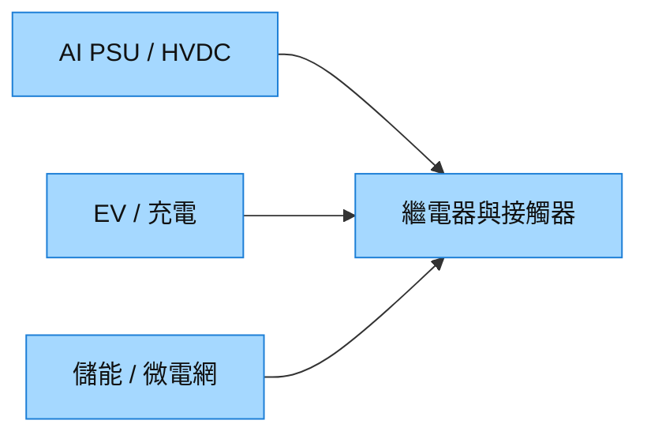

# 7788_松川精密（市）

## 基本資料
松川精密製造繼電器與接觸器，應用於電動車、充電、儲能及 AI 伺服器電力。國泰證期 Call Memo 指 1H26 AI POWER 占比 17%、新能源應用占比 55%，公司並以越南、墨西哥與嘉義擴產支援高功率產品。來源：[[memo_國泰證期_松川精密CallMemo_20260908]]。

### 2026-09-08 元大 Call Memo 補充

- **財務：** 2Q26 營收 22.60 億元（QoQ +21.7%、YoY +40.3%）、毛利率 31.0%、EPS 3.30 元（年轉盈）；1H26 營收 41.17 億元、毛利率 29.1%；1–7 月有 5 個月創單月新高，8 月營收受海運船期遞延月減 11%，遞延訂單 9 月認列。
- **組合（1H26）：** 電動車與充電 40%、汽車 20%、電源與控制（AI Power）17%（2025 年 12%，其中 AI 8%、工業 4%）、儲能／太陽能／微電網 15%、家電 7.8%、電磁鐵與電磁閥 0.2%；新能源占營收約 55%，加計 AI 高密度電源接近 70%，AI Power 目標 20% 以上。
- **AI 電源：** 主要出貨 AI 伺服器 Power Shelf 與 PSU（單一電源機箱 1–12 顆繼電器）；PSU 規格由 3.3–5.5kW 往 8–12kW、24kW，機櫃總功率向 330kW、1MW 推進，單櫃繼電器顆數可能整併減少，但耐壓耐流提升使單價與單櫃產值增加；±400V 與 800V HVDC 直流接觸器已進入備貨，並布局固態變壓器（SST）配套與微電網。
- **產業：** 繼電器由 30A 以下 Relay 跨入 30A–500A 以上 Contactor，系統電壓由 12V 推向 400V、800V 與儲能 1,500V；大型集團繼電器事業讓出份額，松川承接外溢訂單；2026 年 6 月併入台興電子。
- **產能：** 嘉義為 AI Power 擴產主力，墨西哥廠擴建一倍後爬坡，越南淘汰泛用產品轉做新能源。
- 來源：[[活動_松川精密7788_元大CallMemo_20260908]]（元大投顧，2026-09-08 法說），信心中高。

## 核心技術／競爭優勢
- 產品由 Relay 延伸至 Contactor，電壓規格朝 400V、800V、1,500V 演進。
- 全球製造據點可對應新能源客戶的區域供貨需求。
- AI POWER、儲能、車用三條高壓應用共用高電壓／高電流產品能力。

## 產品與應用
| 產品／服務 | 應用 | 下游 |
|---|---|---|
| 繼電器／接觸器 | AI PSU、HVDC、PDU、SST | AI 資料中心電力架構 |
| 高壓電控元件 | EV、充電、BMS、DC/DC | 車用與充電系統 |
| 電力控制元件 | 儲能、微電網、逆變器 | 能源系統 |

## 圖片 / 架構圖

圖說：同一高壓開關元件能力可覆蓋資料中心、車用與儲能。

## 時間軸（催化劑）
| 時間 | 事件 | 類型 | 重要性 | 備註 |
|---|---|---|---|---|
| 2026H2 | 高功率 AI POWER 產品陸續量產 | 放量 | ⭐⭐⭐ | 來源為公司展望 |
| 2026 | 越南、墨西哥、嘉義擴產 | 產能開出 | ⭐⭐ | 進度待追蹤 |
| 4Q26–2027 | ±400V／800V HVDC 直流接觸器出貨（已備貨） | 規格升級 | ⭐⭐⭐ | [[活動_松川精密7788_元大CallMemo_20260908]] |
| 4Q26 | 高價白銀庫存影響淡化，毛利率回升至 29.11%、EPS 3.33 元重返單季新高 | 財務 | ⭐⭐ | 國票 estimate；[[報告_國票_松川精密7788_20261117]] |
| 2027 | 225A／900V 直流接觸器由小量出貨轉為核心成長引擎；AI 伺服器繼電器／接觸器營收年增 50%–60%、占比 20.2% | 放量 | ⭐⭐⭐ | 國票 estimate；同步 [[時程_2026能源與AI電力設備]] |

## 2026-11-17 國票：3Q26 低於預期、評等調升強力買進

- **3Q26（fact／高）**：營收 27.35 億元（季增 21.04%、年增 78.84%），毛利率 27.97%（季減 2.98ppts），稅後淨利 2.26 億元（季減 14.23%、年增 103.23%），EPS 2.83 元低於國票預期。毛利率下滑兩因：完整認列台興營收（單季占 3.6%）且高毛利儲能、AI 繼電器占比下滑 1–2ppts；上半年白銀曾達每盎司 US$121.6，8–9 月出貨採用高價白銀原料。
- **4Q26**：10 月營收 8.49 億元（月減 3.19%、年增 53.62%，達成率 32%），部分出貨受船期遞延；白銀下半年每季平均跌 12%–14%、已回落至 US$50 以下，國票估 4Q26 毛利率 29.11%、稅後淨利 2.65 億元、EPS 3.33 元。
- **儲能**：BloombergNEF 10 月將 2026 年新增裝機上調至 188GW／535GWh，2027 年 209GW／638GWh（容量年增 19.3%）；美國民主黨 2026 期中選舉勝出有利綠能政策延續；美系客戶新一代儲能櫃由 3.9MWh 提升至 5MWh，工作電流增加帶動接觸器規格與單價上升，國票估 2027 年儲能、太陽能及微電網業務成長 10%–15%。
- **AI 高壓直流**：AI 伺服器 54V 升至 ±400V／800V，PDU 需高壓直流接觸器（單價為交流繼電器 20–30 倍、每櫃 12–28 顆），單櫃繼電器／接觸器產值由 7,000 元增至 20,900 元（年增 198%）；225A／900V 產品已率先小量出貨。
- **應用別（國票估）**：2027F 電動車與充電系統約 36.0%、儲能／太陽能／微電網 15.4%、電源與控制 20.2%、汽車 12% 上下、家電 7.5%（圖表讀數，以原檔為準）。
- **評等**：由買進調升至強力買進，目標價 348 元維持（2027F 23x PE）；國票估 2026／2027 年 EPS 11.68／15.58 元。來源：[[報告_國票_松川精密7788_20261117]]。

→ 跨公司時程詳見 [[時程_2026能源與AI電力設備]]

## 供應鏈位置
- 屬資料中心電力與車用高壓開關元件供應商；可連結 [[技術_800VDC供電架構]]，但特定平台導入尚未確認。

## 相關公司
| 公司 | 關係 | 說明 |
|---|---|---|
| — | — | 本次來源未具名揭露可連結的公司關係。 |

> [!warning] 風險與注意事項
> - AI POWER 占比與高功率產品量產均屬 Call Memo 口徑，仍須以公司公告驗證。
> - EV、儲能需求與原料、客戶拉貨節奏可能造成波動。

## 來源
- [[memo_國泰證期_松川精密CallMemo_20260908]] — 國泰證期研究部，2026-09-08
- [[活動_松川精密7788_元大CallMemo_20260908]] — 元大投顧法說 Call Memo，2026-09-08
- [[報告_國票_松川精密7788_20261117]] — 國票投顧，2026-11-17（強力買進，TP 348 元）

## 相關頁面

- [[分析_2026Q3法說季_AI供應鏈瓶頸與擴產節奏_LINE彙整]]
