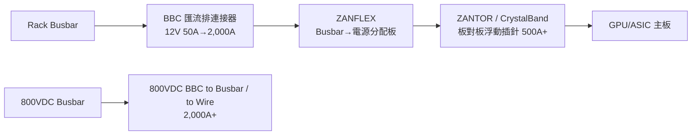

# 7861_貝爾威勒（市）

## 基本資料

貝爾威勒（7861 TT）成立於 2007-07-16，總部桃園，資本額 6.46 億元，以連接器設計製造為核心，產品含連接器、線束、Pogo Pin、軟板組裝（FPCA）、金屬射出成型（MIM）與匯流排（Busbar），應用涵蓋電腦、行動裝置、伺服器、工業控制、汽車、醫療、無人機。2026-11-16 舉行上市前業績發表會，承銷價 768 元；以過去四季 EPS 40.49 元計本益比約 19 倍，與連接器產業平均相當（凱基）。

大電流產品帶動 2025 年營收成長逾一倍，1Q–3Q26 營收 75.98 億元（年增 135%，已超過 2025 全年 49.09 億元）、毛利率 54.5%、EPS 34.61 元；主要成長來自 [[AMZN.US(amazon)]] Trainium 3 拉貨與 BBC Cable、HPSU／CRPS Connector、High Current BTB、Custom Busbar 等大電流產品。客戶累計 1,109 家，品牌端含 Acer、華碩、Amazon、NVIDIA、比亞迪，ODM 含富士康、廣達、英業達、緯創、緯穎、仁寶；外銷約 75%。

資料來源：[[活動_貝爾威勒7861_法說彙整_20261116]]（國泰證期、中信投顧 call memo）、[[報告_凱基_貝爾威勒7861_20261116]]（凱基投顧，未評等）。

## 核心技術／競爭優勢

- **專利世代連鎖**：截至 2026-07 累計 367 件專利（台灣 145、中國 133、美國 89），由防反插、2 倍電流的 Micro-Hi 到大電流與訊號二合一，每代都有對應專利，全球前三大連接器廠向公司取得授權。
- **12V PIC PWR 成為 OCP 標準**：整合電源與訊號，節省板面積與組裝費用，2023 年成為 OCP Reference Design，授權 9 家業者（7 家已付費、2 家待付費；凱基口徑為授權全球 7 家大廠），已廣泛用於伺服器客戶。
- **客戶前期設計切入**：針對防反插、板面積受限、電流 9A→12A→14A→16A 的痛點逐代開發，客製化程度高，可在改版時轉嫁銅價。
- **三地製造**：桃園平鎮（高階研發與生產、光通訊 NPI 產線）、中國昆山（高性價比零組件）、越南興安（2025 投產、2026 開幕），分散關稅與地緣風險；美國、德國、中國、泰國設服務據點。
- **研發投入**：研發費用維持營收 8%–10%。

## 產品與應用

| 產品 / 服務 | 應用 | 相關客戶 / 下游 |
|---|---|---|
| 12V BBC（Busbar Connector，50A→2,000A）、BBC Cable | AI 機櫃匯流排至電源分配 | [[AMZN.US(amazon)]] Trainium 3；四大 CSP 中數家採用 BBC＋Busbar |
| ZANFLEX（Busbar 至電源分配板）、ZANTOR（板對板）、CrystalBand Floating Plug（浮動插針） | Cable-less 大電流板對板，節省 60% 空間、支援 500A+ | Trainium 3，2H26 放量 |
| 800VDC BBC to Busbar／BBC to Wire | 800VDC 高壓機櫃，客製 2,000A 以上 | 送樣前期，規格未定；±400V 同步開發 |
| 12V PIC PWR、Micro-Hi | 伺服器電源與訊號二合一 | ODM：富士康、廣達、英業達、緯創、緯穎、仁寶 |
| MagicShark | 高震動、防摔、小空間大電流 | 平板、筆電、伺服器、機器人、汽車 |
| 光模組、AOC、EBO 擴束光跳線 | 光通訊 | EBO 取得 [[MMM.US(3m)]] 專利授權，定位取代 MPO；NPI 階段 |

## 圖片 / 架構圖

圖說：依法說內容整理的貝爾威勒 AI 機櫃大電流互連位置；48V ORV3 到 800VDC 升級時，BBC 與 Busbar 結合方案由機櫃匯流排延伸至電源分配板與主板。相關架構見 [[技術_800VDC供電架構]]。

## EPS 記錄

| 期間 | 營收 | 毛利率 | EPS（元） | 備註 |
|---|---|---|---|---|
| 2025 | 49.09 億元 | — | — | 大電流帶動營收成長逾一倍；每股現金股利 5.4 元（配發率約 30%） |
| 1Q26 | — | 57.17% | — | 含 NRE 收入 |
| 2Q26 | — | 51.25% | 12.07 | — |
| 3Q26 | 25.60 億元（季減 9.5%、年增 80%） | 55.9% | 11.77 | 營益率 38.08%；稅後淨利 7.6 億元（年增 96%）；客戶 PCB、DDR、GPU 缺料與平台交替使 7–9 月營收下滑 |
| 1Q–3Q26 | 75.98 億元（年增 135%） | 54.5% | 34.61 | 稅前淨利 29.22 億元（年增 203%）、稅後淨利 22.36 億元（年增 218%）；費用率 16.1% |

## 時間軸

| 時間 | 事件 | 類型 | 重要性 | 備註 |
|---|---|---|---|---|
| 2026-11-16 | 上市前業績發表會，承銷價 768 元 | 掛牌 | ⭐⭐⭐ | [[報告_凱基_貝爾威勒7861_20261116]] |
| 4Q26 | 管理層先前指引毛利率約 52%–54% | 財務 | ⭐⭐ | 國泰 call memo |
| 2H26–1Q27 | 新一代 AI 平台（Trainium 3）大電流產品導入，1Q27 起明顯放量、2027 持續增量 | 放量 | ⭐⭐⭐ | 中信口徑「2H26 開始放量、2027 逐步放量」；同步 [[時程_2026能源與AI電力設備]] |
| 2027 | 光通訊小量出貨，2H27 起放量；營收增速高於產業平均 | 放量 | ⭐⭐⭐ | 公司說法 |
| 2027 底 | 醫療產品量產 | 新應用 | ⭐ | 凱基 |
| 2028 | 光通訊營收貢獻轉明顯 | 放量 | ⭐⭐ | estimate／中 |

## 供應鏈位置

- **上游**：銅材（主要原料）、鍍金材料（受金價影響）；三地就近採購並建第二供應來源。
- **下游**：伺服器 ODM（富士康、廣達、英業達、緯創、緯穎、仁寶）與 CSP（[[AMZN.US(amazon)]] Trainium 3）。
- 所屬研究鏈：[[技術_800VDC供電架構]]（機櫃電源互連）、[[技術_EBO擴束連接器]]（光跳線）；相鄰 [[供應鏈_AI伺服器PCB]]。

## 相關公司

| 公司 | 關係 | 說明 |
|---|---|---|
| [[AMZN.US(amazon)]] | 終端客戶 | Trainium 3 大電流零組件主要供應商之一（Power、訊號 Pin、BBC Cable） |
| [[MMM.US(3m)]] | 專利授權方 | EBO 擴束光跳線取得 3M 專利授權 |
| [[2317_鴻海（市）]] | ODM 客戶 | 富士康列於 ODM 客戶 |

## 風險與注意事項

> [!warning]
> - **客戶缺料與平台交替**：3Q26 起受客戶 PCB、DDR、GPU 缺料及新舊平台交替影響，月營收 7–9 月連續下滑（9 月 7.86 億元、月減 10.5%）。
> - **能見度短**：伺服器產品能見度約 3–6 個月（ODM 約 3 個月、CSP 約 6 個月）。
> - **擴產折舊與學習曲線**：越南新廠分階段投入，折舊逐步增加；公司稱影響有限。
> - **匯率與原料**：外銷以美元交易、自然避險；銅價、金價影響成本。
> - **800VDC 與光通訊仍早期**：800VDC 方案送樣前期、規格未定；光通訊 NPI 階段。

## 來源

- [[活動_貝爾威勒7861_法說彙整_20261116]] — 國泰證期研究部、中信投顧上市前業績發表會 call memo，2026-11-16。
- [[報告_凱基_貝爾威勒7861_20261116]] — 凱基投顧上市前業績發表會重點摘要，2026-11-16（未評等）。
