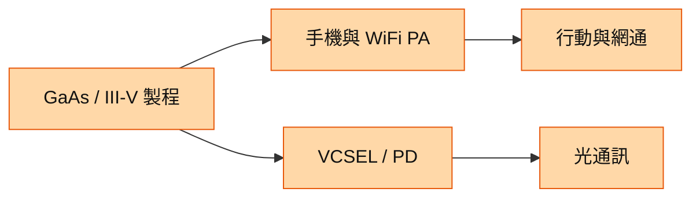

# 8086_宏捷科（櫃）

## 基本資料
宏捷科為 III-V 化合物半導體晶圓代工廠，營運基礎是手機與 WiFi PA，並以既有砷化鎵製程延伸 VCSEL Datacom、Photodiode 等光通訊元件。來源稱 1H26 營收 25.20 億元、年增 44.4%，2Q26 光通訊營收占比仍僅 2.8%。來源：[[memo_國泰證期_宏捷科CallMemo_20260909]]。

## 核心技術／競爭優勢
- 長期手機 PA 量產經驗，支撐良率、品質及服務能力。
- WiFi／無人機 PA 與手機 PA 形成規模基盤；來源稱無人機 PA 訂單 1H26 年增 194.6%。
- 部分 PD 與 VCSEL 可沿用既有砷化鎵設備，降低光通訊導入門檻。

## 產品與應用
| 產品／服務 | 應用 | 下游 |
|---|---|---|
| 手機 PA | 中高階手機射頻 | 手機設計客戶 |
| WiFi PA | Router、手機 WiFi 7、無人機 | 網通與無人機 |
| VCSEL／Photodiode | 資料通訊、光接收端 | 光通訊模組客戶 |

## 圖片 / 架構圖

圖說：公司以 III-V 平台支援既有 PA 及光通訊元件兩條產品路線。

![[報告_中信_宏捷科8086_20261022_營業比重.png]]
*圖：3Q26 營業比重，手機 75%、WiFi 20–25%、Non-RF 5–6%。來源：[[報告_中信_宏捷科8086_20261022]] p1。*

## EPS 與目標價

| 期間 | EPS（NT$） | 毛利率 | 來源 |
|---|---:|---:|---|
| 1Q26A | 1.51 | 34.63% | 中信整理 |
| 2Q26A | 1.42 | 29.98% | 中信整理 |
| 3Q26F | 1.07 | 26.14% | 中信預估（營收 12.62 億已公布）|
| 4Q26F | 1.17 | 27.83% | 中信預估 |
| 2026F | 5.17 | 29.61% | 中信預估，營收 50.46 億（+22.6%）|
| 2027F | 5.33 | 30.87% | 中信預估，營收 50.90 億（+0.9%）|

| 券商 | 日期 | 評等 | 目標價 | 評價基礎 | 來源 |
|---|---|---|---|---|---|
| 中信投顧 | 2026-10-22 | 買進（由增加持股調升） | NT$171（原 153；收盤 128.5） | 2027F EPS × 32x | [[報告_中信_宏捷科8086_20261022]] |

## 2026-10-22 中信更新：PD 成為第二成長動能

- **3Q26**：營收 12.62 億元（-2.8% QoQ、+13.0% YoY），略低於中信預期；上游磊晶與金價高檔使毛利率估降至 26.1%。稼動率 70–75%，4Q26 維持。公司已在 3Q26 與多數客戶談妥漲價，4Q26 生效，毛利率估回升至 27.8%。
- **手機與 WiFi**：韓系手機擴大採用中國供應商、陸系品牌拉貨穩定，客戶重心轉向中高階手機，降低記憶體漲價對低階機的衝擊；美系 IDM 退出中國市場也帶來份額。WiFi 7 帶動 PA，但 WiFi 5/6 部分被矽鍺取代；無人機 WiFi PA 客戶由 1–2 家增加到 4–5 家。
- **光通訊**：2026 年 8 月通過 28 億元資本支出擴建無塵室並建立 InP 製程，無塵室預計 2027 年底完工。除 Datacom VCSEL 外，GaAs PD 最快 2027 年底至 2028 年初量產，InP PD 晚約半年（2028 年中）。
- **評價**：中信估 2026／2027 EPS 5.17／5.33 元，TP 171 元，調升至買進；風險為手機需求不佳、非射頻營收不如預期。

## 時間軸（催化劑）
| 時間 | 事件 | 類型 | 重要性 | 備註 |
|---|---|---|---|---|
| 2026Q3 | 營收估與 2Q26 持平 | 營運 | ⭐ | 來源預估 |
| 2026 年底前 | Solar Cell 預計開始量產 | 技術下線 | ⭐⭐ | 公司展望 |
| 2027 | 部分光通訊新品驗證／小量導入 | 驗證 | ⭐⭐ | 量產貢獻待確認 |
| 2026Q4 | 產品漲價生效，毛利率估回升至 27.8% | 價格 | ⭐⭐ | 中信 2026-10-22 |
| 2027 年底 | InP 無塵室擴建完成（28 億元資本支出） | 產能 | ⭐⭐ | 中信 2026-10-22 |
| 2027 年底–2028 年初 | GaAs PD 量產（最快） | 技術下線 | ⭐⭐⭐ | 中信 estimate／中 |
| 2028 年中 | InP PD 量產 | 技術下線 | ⭐⭐ | 中信 estimate／中 |

## 供應鏈位置
- 為 [[技術_光互連]] 與 [[技術_InP磷化銦]] 的 III-V 光電元件潛在供應商，亦服務無線 PA 市場；來源未揭露特定光通訊客戶。

## 相關公司
| 公司 | 關係 | 說明 |
|---|---|---|
| — | — | 本次來源未具名揭露可連結的公司關係。 |

> [!warning] 風險與注意事項
> - Epi 材料與黃金成本上升，毛利率轉嫁仍有不確定性。
> - 光通訊占比低且多數新品仍在驗證，不能以題材外推短期營收。

## 來源
- [[報告_中信_宏捷科8086_20261022]] — 中信投顧，2026-10-22；調升買進、TP NT$171、PD 2028 量產時程
- [[memo_國泰證期_宏捷科CallMemo_20260909]] — 國泰證期研究部，2026-09-09
