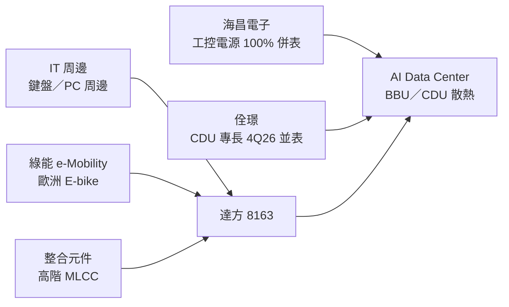

# 8163_達方（市）

## 基本資料

達方為明基友達集團電子零組件廠，三大事業群為 IT 周邊（智能，鍵盤等 PC／NB 周邊）、綠能產品（e-Mobility，電動自行車系統）與整合元件（MLCC 等被動元件）。3Q26 營收 70 億元，事業群占比 IT 周邊 41%、綠能 44%、整合元件 15%（[[報告_中信_達方8163_20261104]]，2026-11-04）。

- 主要產品：NB／PC 鍵盤與周邊、E-bike 電驅系統與電池、MLCC（高容、中高壓特規品）、工控電源（海昌電子）。
- 應用：PC／NB、歐洲 E-bike 售後市場、工控與資料中心測試設備電源、AI 伺服器 BBU 與 CDU 散熱（轉型中）。
- 供應鏈位置：PC 品牌與 ODM 的周邊零組件供應商；MLCC 受惠日系同業淘汰部分品項；透過併購海昌（電源）與佺璟（CDU）切入 AI 資料中心。

## 核心技術／競爭優勢

- 整合電源（海昌）、散熱機構（佺璟 CDU 專長）與既有電池技術，開拓 AI 伺服器 BBU 與機構散熱。
- MLCC 高階特規品（高容、中高壓）產能利用率高，日系同業策略性退出帶來缺貨延續至 2027 年。
- 產能結構精實：蘇州廠輕製造化、產線移往淮安與重慶，越南（自購）與泰國（租賃）廠區將調整成本。

## 產品與應用

| 事業群 | 3Q26 營收占比 | 1~3Q26 占比 | 現況 |
|---|---|---|---|
| IT 周邊（智能） | 41% | 約 44% | CPU、記憶體漲價使終端售價調漲 3～5 成，PC 需求大幅下修；部分客戶開始與中國 EMS 廠合作 |
| 綠能產品（e-Mobility） | 44% | 約 43% | 歐洲（德國 GROFA 通路）去庫存較快，2026 年底大致完成，2027 新案正向 |
| 整合元件（被動元件） | 15% | 約 13% | 3Q26 雙位數成長，高階 MLCC 缺貨延續至 2027 年 |

## 圖片 / 架構圖

圖說：依 2026-11-04 中信投顧法說摘要整理的事業結構與 AI 資料中心轉型路徑（Mermaid 補位，來源無圖）。

## 財務重點

| 指標 | 3Q26 | 1~3Q26 | 來源 |
|---|---|---|---|
| 營收 | 70 億元（QoQ -6.7%、YoY -7.8%） | 205 億元（YoY +8.8%） | [[報告_中信_達方8163_20261104]] |
| 毛利率 | 15.5%（QoQ -1.6ppt） | 16.5% | 同上 |
| 營業利益 | 3,400 萬元 | 2.61 億元（YoY +363%） | 同上 |
| 歸屬母公司淨利 | 8,500 萬元 | 2.28 億元（YoY +78%） | 同上 |
| EPS | 0.31 元 | 0.82 元 | 同上 |

- 3Q26 毛利下滑原因：PC 營收大幅下修使產品組合劣化、PCB／機構件／金屬漲價、人民幣兌美元升值逾 4%。
- 現金及有價證券約 83 億元（QoQ +18 億元）；流動比率 146.7%、負債比率約 63%。2026 資本支出預算約 10 億元。

## 時間軸

| 時間 | 事件 | 類型 | 重要性 | 備註 |
|---|---|---|---|---|
| 2026-02 | 海昌電子 100% 併表 | 併購 | ⭐⭐ | 工控電源、Data Center 測試設備電源 |
| 2H26 | 售價反映成本與工廠管理，目標毛利率回升至 18～20% | 獲利 | ⭐⭐ | 公司目標 |
| 4Q26 | 佺璟（CDU）開始並表；總公司正式並表 4Q27 | 併購 | ⭐⭐ | AI 資料中心第一步 |
| 2026 年底 | 歐洲 E-bike 通路庫存大致去化完畢 | 供需 | ⭐⭐ | — |
| 2027 | PC 產業個位數衰退，2Q27 後可能小幅反彈；MLCC 缺貨延續 | 供需 | ⭐⭐ | 公司看法 |

## 供應鏈位置

- 上游：PCB、機構件、金屬原料；MLCC 製程材料。
- 下游：PC／NB 品牌與 ODM、歐洲 E-bike 通路、被動元件通路與系統廠；轉型目標為 AI 伺服器 BBU 與 CDU 客戶。

## 相關公司

- 目前來源未揭露具名客戶或供應商，`related_companies` 暫留空。

## 近期營運與研究更新

### 2026-11-04 中信投顧法說摘要：IT 逆風拖累短期獲利，MLCC 與 AI 轉型蓄勢（Note，無評等）

- 3Q26 營收 70 億元、毛利率 15.5%、EPS 0.31 元；前三季累計獲利仍較去年大幅成長。
- IT 周邊逆風延續至 2H27；綠能去庫存年底告一段落；MLCC 高階品需求強、缺貨延續至 2027 年；加速轉型 AI Data Center（散熱、BBU）。中信中性看待。
- 4Q26 營收維持成長，全年營收成長目標不變。
- 來源：[[報告_中信_達方8163_20261104]]。

## 來源

- [[報告_中信_達方8163_20261104]] — 中信投顧，2026-11-04；3Q26 法說／座談摘要。

## 相關頁面

- [[時程_2026Q3Q4_AI網通與硬體催化劑]]
