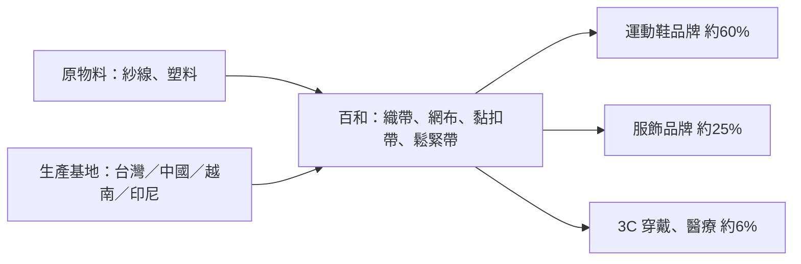

# 9938_百和（市）

## 基本資料

百和（PAIHO）1979 年成立，以三鈎牌黏扣帶起家，產品延伸到織帶、鞋帶、鬆緊帶、射出鈎、針織經編緹花網布等，客戶涵蓋全球前二十大運動鞋品牌。生產基地分布台灣、中國（無錫、東莞）、越南、印尼，北美設銷售與出貨中心，全球員工逾 11,000 人。子公司百和-KY 以經編網布為主要成長動能，越南廠是當地唯一的經編網布一貫廠。

3Q26 產品比重（元富）：織鞋帶 44.1%、針織經編提花網布 20.1%、鬆緊帶 13%、黏扣帶 12.3%、射出鈎 6.6%、其他 3.9%。前 9 月應用別：鞋類 60.4%、服飾 25.3%、3C 2.8%；3C 與醫療合計約 6%，3Q26 3C 年增 20%、醫療年增 31%，過去 3C 多為客戶指定材料，現約 80% 改用百和材料。

資料來源：[[報告_元富_百和9938公司拜訪_20261015]]、[[報告_華南_百和9938_20261015]]（2026-10-15）。

## 核心技術／競爭優勢

- **品牌客戶基礎**：前十大客戶占 65.5%；德國品牌（25.1%）為最大客戶，美系品牌 15.7%、瑞士品牌 6.1%、New Balance 4.4%；HOKA 前 9 月年增 58%、占 2.3%。
- **越南經編網布一貫廠**：在越南完成經編網布面料一貫作業，可避開洗產地疑慮；競爭者多在中國生產。百和-KY 為 Adidas、On、亞瑟士、HOKA、NB 的經編網布核心供應商（合計占 88%）。
- **材料研發**：持有 353 項各國專利（截至 2026-09-30）；與工研院開發的「複合再生韌帶」獲 2026 Edison Awards 金獎。
- **新應用**：特殊鬆緊帶用於 VR 與手錶穿戴裝置（客戶含亞馬遜、三星、華為、蘋果、Google）、軍工材料、外骨骼機器人。

## 產品與應用

| 產品／服務 | 應用 | 相關客戶／下游 |
|---|---|---|
| 織帶／鞋帶 | 運動鞋、服飾 | 全球運動品牌 |
| 針織經編緹花網布 | 跑鞋鞋面、成衣 | Adidas、On、亞瑟士、HOKA、NB |
| 鬆緊帶 | 服飾、穿戴裝置 | 品牌客戶、3C 客戶 |
| 黏扣帶、射出鈎 | 鞋類、醫療、工業 | 多元客戶 |

## 圖片 / 架構圖

> 依元富與華南 2026-10-15 報告整理的應用結構與生產基地；來源 PDF 圖片以財務走勢與營收圖為主，故以 Mermaid 表達產品到客戶的位置。

## EPS 記錄

| 季度 | EPS（元） | YoY | 備註 |
|---|---|---|---|
| 1Q26 | 0.87 | -43% | |
| 2Q26 | 0.36（元富）／0.49（華南表） | -47% | 兩家口徑不同，並列 |
| 3Q26 | 0.62（自結） | -47% | 網布毛利率低、業外利息費用 |

## EPS 預估

| 年度 | 元富（2026-10-15） | 華南（2026-10-15） | 備註 |
|---|---:|---:|---|
| 2026F | 2.48（原 3.18） | 2.58 | 元富營收 NT$161.25 億、毛利率 30.7% |
| 2027F | 3.23（原 4.13） | 3.31 | |

## 目標價與評等

| 券商 | 報告日 | 評等 | 目標價 | 評價基礎 | 來源 |
|---|---|---|---:|---|---|
| 元富投顧 | 2026-10-15 | 買進（維持） | NT$48（原 60） | 15x 2027 PER；股價約 NT$39.5，低於淨值 | [[報告_元富_百和9938公司拜訪_20261015]] |
| 華南投顧 | 2026-10-15 | 區間持有（原買進） | NT$43（原 52） | 本益比 10–13x；股價 NT$39.45 | [[報告_華南_百和9938_20261015]] |

## 時間軸

| 時間 | 事件 | 類型 | 重要性 | 備註 |
|---|---|---|---|---|
| 2026 | 印尼第四期廠完工，產能增約 25% | 擴產 | ⭐⭐ | 華南轉述 |
| 2027 起 | 越南二期新廠逐步放量，整體產能增逾五成 | 擴產 | ⭐⭐ | 初期高折舊壓抑獲利 |
| 2027 | 品牌庫存調整完成、下單回到正常模式 | 需求 | ⭐⭐ | 元富 thesis |

## 供應鏈位置

- 上游：紗線、塑料、化工原料（美伊衝突推升原物料成本）。
- 下游：運動鞋與服飾品牌、3C 穿戴與醫療客戶。
- 所屬主線：紡織輔料，與 AI 主線無直接關係。

## 相關公司

報告提及的品牌客戶（Adidas、On、亞瑟士、HOKA、New Balance 等）均無公司頁，`related_companies` 暫留空。

> [!warning] 風險與注意事項
> - 品牌客戶受庫存影響，下單轉向小量、短單；主要客戶新一代跑鞋主料改用梭織且非由百和-KY 供應，網布前 9 月營收年減 4.9%、毛利率僅 19.9%。
> - 原物料成本、關稅與美伊戰爭影響全球消費。
> - 新產能（越南、印尼）初期折舊高，壓抑獲利。
> - 華南報告首頁寫「預估 2026 年稅後 EPS 3.31 元」，但同份年度表 2026F 為 2.58、2027F 為 3.31，首頁應為 2027 年數字；本頁以年度表為準，並列記錄。
> - 上市別（TWSE）依代號與既有資料推定，未以外部工具另行查證。

## 來源

- [[報告_元富_百和9938公司拜訪_20261015]] — 元富投顧，2026-10-15；3Q26 自結、客戶結構、下修 EPS、買進／TP NT$48。
- [[報告_華南_百和9938_20261015]] — 華南投顧，2026-10-15；產能擴充、經編網布客戶、區間持有／TP NT$43。
