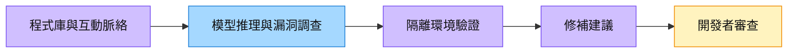

# OpenAI（未）

## 基本資料

OpenAI 為美國 AI 模型公司，開發並運營 ChatGPT、GPT-4o、o3 等大型語言模型，為全球最大 AI 模型消費方之一，也是 AI 算力基礎設施的主要採購驅動力。

- **主要產品**：GPT-4o、o3（reasoning）、DALL-E、Sora
- **算力採購**：Stargate 計畫（與 Microsoft、SoftBank）；向 Cerebras 採購推理算力
- **供應鏈地位**：AI 推理算力需求方，驅動 NVIDIA GPU、Cerebras WSE 等需求
- **資料來源**：報告_MS_Cerebras_CBRS_初始覆蓋_20260608（2026-06-08）；公開揭露

## Codex Security 的資安工作流（2026-09-29 券商轉述）

[[報告_EvercoreISI_OpenAIDevDay資安影響_20260929]]（Evercore ISI，2026-09-29）稱 Dev Day 介紹 Codex Security 的跨程式庫推理、漏洞調查、隔離環境驗證、開發者審查修補建議與排程掃描。它比較 LLM 對程式互動與上下文的推理，與傳統以已知特徵／規則掃描的差異。此為報告轉述／fact／中信心，未另作產品實測。

Evercore 認為近期直接競爭壓力集中在漏洞／安全態勢管理、程式碼安全與攻擊路徑分析；runtime 的遙測、偵測、政策執行與深度部署仍重要（thesis／中信心）。這不構成新具名客戶、收入或與 runtime 廠商的合作關係揭露。詳見 [[分析_DevSecOps_AI安全衝擊]]。

## 圖片 / 架構圖

圖說：依 Evercore ISI（2026-09-29）文字描述整理的 Codex Security 工作流；本份無產品架構來源圖，使用概念圖補位。修補建議仍由開發者審查，不解讀為可完全自主替代生產環境防護。

## 關鍵算力合約

| 供應商 | 合約規模 | 類型 | 說明 |
|--------|----------|------|------|
| [[CBRS.US(cerebras)]] | 750MW，~$30B | take-or-pay（3 期） | 低延遲推理容量；最長延至 5 年；+1.25GW 選擇權 |
| [[NVDA.US(nvidia)]] | 大規模 GPU 採購 | 硬體 | 訓練與主流推理基礎 |
| [[AVGO.US(broadcom)]] | 自研 ASIC | 客製晶片 | 富邦（2026-10-19）產業調查：OpenAI 近期將 2027 年 ASIC 需求由原假設 100 萬顆上修至 300 萬顆（estimate／中） |

## 相關公司

| 公司 | 關係 | 說明 |
|------|------|------|
| [[GOOGL.US(alphabet)]] | AI 模型／算力競爭 | 本筆記以自有基建與 TPU 比較建設限制曝險；相對市占提升僅為 thesis，未確認已發生 |
| [[CBRS.US(cerebras)]] | 主要算力供應商 | 750MW take-or-pay 推理算力合約 |
| [[NVDA.US(nvidia)]] | GPU 供應商 | 訓練叢集主力 |
| [[AVGO.US(broadcom)]] | ASIC 設計夥伴 | 2027 年需求據富邦調查上修至 300 萬顆 |

> [!warning] 風險與注意事項
> - 未上市，財務資訊不完整；客戶資訊來自供應商揭露
> - Stargate 計畫執行延遲風險；資本配置可能調整供應商組合

## 2026-11-10 台積電入股

- 台積電 11/10 董事會核准以不超過 5 億美元認購 OpenAI Group PBC 特別股（與 Anthropic 合計最高 10 億美元）。[[報告_群益_台積電投資Anthropic與OpenAI_20261111]]

## 2026-11 任務成本與組織採用

[[memo_Notion_AceCamp_OpenAI生產力與智能體經濟_70569156_20261112]]（2026-11-12）轉載Ronnie Chatterji訪談，重點在企業流程重設、組織採用與Agent經濟；是訪談觀點，不能由模型能力提升直接推估總體生產力或OpenAI收入。

[[memo_Notion_AceCamp_OpenAI任務成本與垂直資料壁壘_70569007_20261110]]（2026-11-10）認為製藥、晶片設計仍受私有資料與驗證流程限制，宜比較每個成功任務的工具、推理、人工覆核及重試成本。來源模型版本、token占比、收購與2027硬體策略均未外部核對，不寫成已發布產品或公司公告。判讀為expert thesis／中低信心，詳見[[技術_大模型推理經濟學]]及[[分析_Agent商業化的工作流資料與成交閉環_20261112]]。

## 時間軸

| 時間 | 事件 | 類型 | 重要性 | 備註 |
|---|---|---|---|---|
| 2027／2028（預估） | ASIC 出貨 70 萬顆後加速 | 放量驗證 | ⭐⭐⭐ | estimate／低；[[時程_2026-2029功率調價與AI平台驗證]] |

## 產業筆記補充（2026-11-14 收錄；原日期未提供）

[[memo_使用者_Analog載板資料中心與AI晶片_日期待確認_收錄20261114]]（使用者彙整，機構未具名；原日期未知，未外部查證）估 OpenAI ASIC 2027 小量出貨 70 萬顆、2028 加速（estimate／低）。未說明型號、出貨主體或設計供應商，不由此新增合作關係。

筆記認為 OpenAI 對機房建設限制曝險最高，[[GOOGL.US(alphabet)]] 最低；Google 若能以自有基建與 TPU 交付算力，可能提高市占（競爭情境 thesis／低）。這不是 OpenAI 已取消建設或已發生市占流失。

> [!warning] 2027 ASIC：需求 300 萬與出貨 70 萬並列
> [[報告_富邦_北京上海路演ASIC_20261019]]（2026-10-19）稱需求由 100 萬上修至 300 萬顆；本筆記日期不明，稱出貨 70 萬顆。需求／出貨、型號及供給口徑未一致，不能直接視為需求下修，也不覆蓋既有 AVGO 專案記錄。

完整口徑與反證：[[分析_功率漲價與AI晶片出貨部署落差_日期待確認_收錄20261114]]；跨公司時程：[[時程_2026-2029功率調價與AI平台驗證]]。

## 來源

- [[memo_使用者_Analog載板資料中心與AI晶片_日期待確認_收錄20261114]] — 使用者提供，原日期未提供，2026-11-14 收錄。

- [[memo_Notion_AceCamp_OpenAI生產力與智能體經濟_70569156_20261112]] — 2026-11-12日期欄，訪談轉載，原始發布日未核。
- [[memo_Notion_AceCamp_OpenAI任務成本與垂直資料壁壘_70569007_20261110]] — 2026-11-10日期欄，匿名專家。

- [[報告_EvercoreISI_OpenAIDevDay資安影響_20260929]] — Evercore ISI，2026-09-29。

- 報告_MS_Cerebras_CBRS_初始覆蓋_20260608（2026-06-08）

- [[AI_Coding_Agent_Buyi_856492_ndx]]（2026-09-02）
- [[AI_Vendor_Race_Cons_854892_ndx]]（2026-05-27）
- [[Avoid_AI_Budget_Blow_846413_ndx]]（2026-05-15）
- [[CEREBRAS_20260608_0419]]（2026-06-08）
- [[Market_Share_Analysi_854123_ndx]]（2026-05-20）
- [[Nvidia in Talks to Back OpenAI Lease of $500 Billion]]（2026-07-28）
- [[報告_Daiwa_MiniMax啟動覆蓋_20260811]]（2026-08-11）
- [[報告_Daiwa_中國基礎模型產業啟動覆蓋_20260811]]（2026-08-11）
- [[報告_JPM_GLM5.3與DeepSeek重新定價_20260816]]（2026-08-16）
- [[報告_Jefferies_中國AI_Token支出與模型效率_20260810]]（2026-08-10）

- [[報告_富邦_北京上海路演ASIC_20261019]]（2026-10-19）

- [[memo_FOMOSoc_CoreWeave與AI基建_20261020]]（2026-10-20）
- [[memo_大叔美股筆記_野村GlobalMemory_AI營收與記憶體_20261021]]（2026-10-21）

- [[memo_SemiAnalysis_GDPx前沿模型能力基準_20261101]]（2026-11-01）
- [[memo_艦長J快訊_CSP未上線硬體與AI債務_20261101]]（2026-11-01）

- [[memo_M報_AnthropicS1與Google微軟財報_20261103]]（2026-11-03）
- [[報告_富邦_AMD財報CallMemo_20261104]]（2026-11-04）
- [[活動_AMD_國泰CallMemo_20261104]]（2026-11-04）

- [[memo_FOMOSoc_AMD3Q26財報解剖_20261104]]（2026-11-04）

- [[memo_SemiAnalysis_GoogleTPUv7推論AgentX_20261105]]（2026-11-05）
- [[memo_SemiAnalysis_中國內蒙古Galaxy園區800VDC與SGLS_20261107]]（2026-11-07；Stargate Abilene 規模對照：Crusoe 2024 年中動工、租給 Oracle 供 OpenAI 使用，8 棟 1.2GW 電力約 820MW 關鍵 IT 容量，擴建後全場 1.5GW IT；信件版截斷，信心中）

- [[報告_群益_台積電投資Anthropic與OpenAI_20261111]]（2026-11-11）

## 相關頁面

- [[0100.HK(minimax)]]
- [[2513.HK(z.ai)]]
- [[分析_中國基礎模型_Token經濟與算力瓶頸_20260905]]
- [[技術_大模型推理經濟學]]
- [[分析_Anthropic與OpenAI_PreIPO_TokenEconomics算力ASIC估值]]
- [[分析_生成式AI商業化與TokenFinOps_20260906]]
- [[分析_Gartner生成式AI模型市場與Token效率_20260906]]
- [[AI_Vendor_Race_Cons_854892_ndx]]
- [[AI_Coding_Agent_Buyi_856492_ndx]]
- [[Avoid_AI_Budget_Blow_846413_ndx]]
- [[NBIS.US(nebius)]]

### 2026-10-21 野村：營收口徑

- OpenAI 9 月年化 run-rate 約 US$500 億，市場流傳的 US$680–700 億含合作夥伴總營收（為與 Anthropic 比較）；CNBC「Q3 成長 77%」是 run-rate 成長而非認列營收。市場預期 OpenAI 與 Anthropic 2026 全年合計約 US$1,000 億，需 4Q 季增 61%；若 9 月 run-rate 持平，全年約 US$860 億。作者推測年底可能出現「兩大實驗室營收不如預期」標題，年增率仍接近 3 倍。OpenAI 亦為 CoreWeave 長約客戶（[[memo_FOMOSoc_CoreWeave與AI基建_20261020]]（FOMOSoc，2026-10-20；信件版截斷，信心中））。來源：[[memo_大叔美股筆記_野村GlobalMemory_AI營收與記憶體_20261021]]（大叔美股筆記轉述 Nomura 2026-10-19 Global Memory 報告，2026-10-21；券商 estimate＋作者評論，信心中）
- [[時程_2026-2028十月券商催化劑]]
- [[CRWV.US(coreweave)]]
