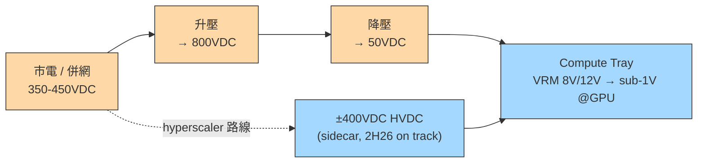
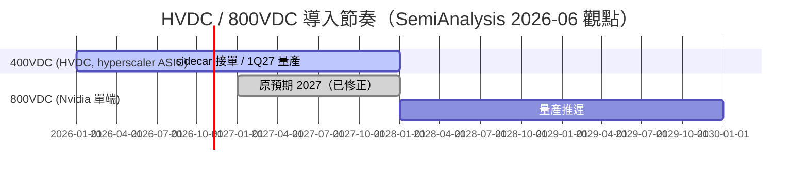

# 技術_800VDC供電架構

## 定義

800VDC 是 Nvidia 主導推動的 AI 機櫃供電架構：隨機櫃功率快速攀升，把電力集中以更高電壓輸送、盡量靠近 compute tray 才降壓，以減少轉換損耗與線路損耗。它與 hyperscaler 自行推動的 **±400VDC（HVDC）** 是**不同**的兩件事——後者是雲端廠為自家 ASIC 部署的高壓直流架構，目的同樣是集中供電、避開 UPS 的 AC-DC-AC 轉換損耗。

**機櫃功耗世代對應（公開資訊約值）**：

| 機櫃世代         | 規格                  | 單櫃功耗        | 800VDC 需求           |
| ------------ | ------------------- | ----------- | ------------------- |
| GB300 NVL72  | Blackwell Ultra     | ~130 kW     | 否（50VDC 供電）         |
| VR200 NVL72  | Vera Rubin（2026 量產） | ~200 kW+    | 否（Rubin 不需要）        |
| Kyber NVL576 | Rubin Ultra（2027+）  | **~600 kW** | **是**（800VDC 為必要條件） |

Kyber 世代（~600kW）是 800VDC 從「可選」變為「必要」的臨界點，原因是如此功率等級靠傳統低壓配電線損過大。OCP 陣營（Google/Meta/Microsoft）同步推進 **OCP Diablo 400**（Mount Diablo）規格，把電力轉換拆到獨立 sidecar 電力櫃，支撐 100 kW–1 MW 級機櫃。

> [!note] 800VDC ≠ 400VDC
> 400VDC（±400V HVDC）由 hyperscaler 推動、主要服務自家 ASIC，**2H26 照計畫進行**；800VDC（Nvidia 單端）量產則被推遲。兩者常被混為一談，但時程與推手不同。

## NVIDIA 產業對齊與執行框架（2026-08-20）

NVIDIA《800 VDC Architecture: Industry Alignment & Execution》把路線從概念驗證推進到部署與認證框架，提出三種並行選項：**Rack-level Power Rack**、**Cluster-level Power Center**、以及面向高密度資料廳的 **DC Power Block**。白皮書不是單一量產承諾，而是把電力轉換、保護分區、故障偵測、法規認證與端到端驗證列為產業共同執行項目。

| 部署選項 | 系統位置 | 白皮書重點 | 投資觀察 |
|---|---|---|---|
| Power Rack | 機櫃旁 | 以 800VDC 介面接入 compute rack，兼容既有 AC 基礎設施 | 最接近短期設備與電源驗證需求，但受機房 footprint 約束 |
| Power Center | Cluster 級 | 集中式整流、800VDC switchboard 與 1.6MW 級電力中心 | 觀察 SST、整流、配電與保護設備的共同驗證 |
| DC Power Block | Data hall 級 | 約 **4.8MW／block**、6000A 級 DC busduct 與模組化集群 | 長期高密度路線，法規、電弧與維運能力是瓶頸 |

> [!warning] 時程與資訊邊界
> 白皮書指出產業正由「技術可行」轉向「系統級執行」，但未等同於 NVIDIA 已承諾所有資料中心立即採用完整 800VDC。先前來源對 800VDC 大規模量產落在 2028+ 的判斷仍保留；本白皮書新增的是部署選項、保護架構與認證工作流，屬公司文件的 roadmap／execution framework。

## 圖解

![[活動_國泰_美國參訪訪談紀要_20260914-18_p069.png]]

圖說：國泰 p69：Navitas 四級電源架構與轉換位置；98.5% 是單級峰值而非整機效率。

![[nvidia-800-vdc-industry-alignment-white-paper_001.png]]
*圖（NVIDIA，2026-08-20）：既有 AC 架構與 Power Rack、Power Center、DC Power Block 三種 800VDC 部署層級；白皮書把 800VDC 從單一機櫃方案延伸為跨 rack／cluster／data hall 的執行框架。*

![[報告_Semianalysis_PCB_20250826_008.png]]
*圖（SemiAnalysis，2025-08）：Vera Rubin NVL72 主板架構——圖中 Power Distribution Inner Busbar（供電分配內部匯流排，黃色橫條）是 800VDC 在機柜內配電的關鍵結構。800VDC 市電入柜後先到 Busbar 匯流排，再分配至各 Rubin GPU compute tray 與 Vera CPU tray；Tray 內 VRM 逐級降壓（8V/12V → sub-1V @GPU 核心）。Busbar 替代傳統銅纜束線，降低壓降損耗並提升配電密度，是 800VDC 架構「高壓傳輸、近端降壓」邏輯的物理實現。*

![[報告_富邦_Kyber機櫃延後_20260721_005.png]]

*圖（台達電／富邦投顧，2026-07-21）：800VDC 列間電源系統把高壓直流轉換與配電集中在獨立 power rack，支援未來數百 kW 級 compute rack。*

以下 Mermaid 補充供電路徑架構：

hyperscaler 的質疑：把市電 350–450VDC 升到 800VDC 再降回 50VDC 餵 compute tray「效率不佳」，傾向用更高電壓直送、靠近 tray 再降壓。

## 技術原理

### 電壓、轉換層級與架構邊界（MS 2026-10-06）

| 模組 | 功能 | 觀察重點 |
|------|------|----------|
| AC/DC power rack | 在既有 415–480VAC 機房整流至高壓 DC | 局部 retrofit 與全面更換機房配電是不同部署 |
| 800VDC／±400VDC bus | 同樣可在兩條導體間形成 800V 差分電壓 | 單極／雙極的接地、平衡與保護設計不同，不能把單端 400VDC 當成 ±400VDC |
| HVDC-to-LVDC | 近負載降至 48／50／54V | 前端 HVDC 不代表 server 或 GPU 已直接接受 800V |
| 板級 VRM／PoL | 再降至 GPU 核心低電壓 | 功率級與控制器仍受大電流驅動；見 [[技術_垂直供電VPD]] |
| 保護與隔離 | 處理 DC 故障、預充電、熱插拔與維護 | 高壓器件、認證與現場維運是部署門檻 |

同功率下 I=P/V；54V 提高至 800V，電流約降至 1/14.8。只有在相同導體電阻下，理論 I²R 才相差約 219 倍；實際設計會改變銅量、並聯與散熱，**不能寫成全系統損耗下降 219 倍**。MS 引用的 100MW IT 負載例，由 93% 提升至 95% 系統效率可年省約 19,800MWh、US$160 萬（電價 US$0.08/kWh），屬特定方案情境。

來源：[[報告_MorganStanley_整合電源方案_20261006]]（2026-10-06，p39–45；來源轉述／情境估算，信心中）。

- **驅動力**：機櫃功率上升、集中式供電、降低轉換損耗（把降壓拉近 compute tray）。
- **何時非 800V 不可**：當 GPU compute tray 輸入要求 800VDC 時。Rubin 仍用 50VDC；Rubin Ultra / Feynman 才較可能必要——Rubin Ultra/Oberon 的 compute tray 預期超過 15kW TDP，原生 HVDC 分電在極高功率下才有說服力。
- **板級供電鏈不受影響**：VRM smart power stage 把 8V/12V 降到 GPU die 的 sub-1V，這段無論上游是 AC、400V 或 800V 都一樣。

## 關鍵參數 / 判斷指標

| 指標               | 意義              | 觀察重點                        |
| ---------------- | --------------- | --------------------------- |
| compute tray TDP | 決定是否需要原生 HVDC   | Rubin Ultra/Oberon >15kW    |
| 轉換級數與損耗          | 多一次升降壓即多一次損耗    | 800V 升降回 50V 的效率爭議          |
| WBG 含量           | 800V 才是寬能隙真正放量點 | SiC/GaN vs Si superjunction |

## 技術瓶頸 / 風險

- hyperscaler 對 Nvidia 單端 800VDC 有 pushback（Rubin 世代有多種供電選項，800V 非必要）。
- Rubin Ultra 設計今年稍晚才定案，導入存在不確定性。

> [!warning] 資訊衝突：800VDC 時程（機構自我修正）
> - SemiAnalysis 先前觀點：視 800VDC 為 **2027** 的故事。
> - [[報告_Semianalysis_CPOand800VDC_20260609]]（報告日：2026-06-09）：量產推遲到 **2028+**；2H26/2027 滲透率低（Vera Rubin 不需要）；原本要由 Rubin Ultra/Kyber 帶動的 sidecar 量移到 2028 視窗。
> - 狀態：屬技術導入推遲、非取消；400VDC sidecar 仍 2H26 接單、1Q27 量產。

> [!warning] 資訊衝突：2026–2028 滲透節奏
> - [[報告_富邦_Kyber機櫃延後_20260721]]（報告日：2026-07-21）：估 2H26 仍有低於 500 台的 800V power rack 出貨、VR200 HVDC 滲透率約 10%，2027 年 HVDC 採用率 10–20%，2028 年再擴張。
> - [[報告_Semianalysis_CPOand800VDC_20260609]]（報告日：2026-06-09）：認為 Kyber 原生 800VDC 帶動的主要 sidecar 量遞延至 2028+。
> - 狀態：設備 readiness／少量 power rack 與 Kyber compute tray 大規模採用是不同口徑；並列保留，信心中。
> - [[memo_AceCamp_Infineon_AI電源與800V_20260930]]（2026-09-30）：判讀為 Infineon 端的匿名功率專家稱 800V 在 AI 伺服器整體滲透率約 15%，2027 年可望升至 40%–50%，提升速度「比較快」。
> - 狀態：此口徑明顯高於富邦 2027 年 10%–20%，且未定義分母（出貨機櫃、功率或電源產品）；可能混入 400V／±400V HVDC 或電源產品出貨，不直接取代既有估計，信心低。

## 關鍵廠商

| 環節 | 廠商 | 角色（June note 讀法） |
|------|------|------|
| 電源機櫃 / sidecar | [[VRT.US(vertiv)]] | 中性偏正：800V 延後延長其大型 UPS 業務壽命 |
| 800VDC 供電+冷卻系統（JV）| [[6503.JP(mitsubishi electric)]] | 與 NVIDIA 共同開發 800VDC 供電暨冷卻系統，FY2028 商業化目標；CDU 已出貨 |
| 板級被動 / MLCC | [[2327_國巨（市）]] | MLCC 隨機櫃 TDP 線性成長 |

電源機櫃（未建頁）：台達電 2308.TW、光寶科 2301.TW（sidecar/power rack 轉型照走，延後視為中性）。Grey-space 電氣設備（未建頁，**轉正面**）：Fortrend/FPS、Legrand、Schneider、Hammond Power、ABB——800V 延後反而延長低壓變壓器/開關/busway 內容。板級 VRM / 功率半導體（未建頁，架構中立受惠）：Infineon（跨 Si/SiC/GaN，定位最佳）、MPS、Renesas、Vishay、TXN、ON。被動元件（未建頁）：Murata、三星電機、國巨 2327.TW、TDK。寬能隙純玩家（未建頁，**轉負面**）：Wolfspeed、Navitas——800V 是 WBG 含量真正起飛點，延後使其近期缺乏催化劑。

> [!info] 新增：三菱電機 × NVIDIA 800VDC JV（GF Japan Tour，~2026-06）
> 三菱電機已開始出貨 CDU（液冷分配機），並與 NVIDIA 共同開發 **800VDC 供電暨冷卻系統**，商業化目標 FY2028；另與 Zutacore 合作熱交換系統。FY2025 IT 冷卻業務 ¥320 億，目標 FY2031 ¥1,000 億+，FY2036 ¥3,000 億。（詳見 [[6503.JP(mitsubishi electric)]]）

## 技術演進時程

## 三階段部署框架（UBS，2026-07-07）

> 來源：報告_UBS_800VDC三階段架構_數據中心電力_20260707（UBS，Andre Kukhnin team，2026-07-07）

![[20260709_0823_800VDC_UBS_20260707_006.png]]
*圖（UBS，2026-07-07）：800VDC 三階段架構演進——Phase 1（ORV3，~150kW）→ Phase 2（Sidecar，~400kW）→ Phase 3（Full Solid-State，~1MW）。每階段電力轉換鏈與設備組成變化一目瞭然。*

| 階段 | 架構名稱 | 機櫃功率密度 | 核心改變 | 對設備廠商的衝擊 |
|------|---------|------------|---------|--------------|
| Phase 1 | ORV3 | ~150kW | 在既有 AC 配電架上增加 800V DC 匯流排；降壓在 rack 內完成 | 現有架構衝擊小；PDU/busway 廠商中性 |
| Phase 2 | Sidecar | ~400kW | 獨立 sidecar 機櫃將 400V AC → 800V DC；rack 內去除大量 AC 配電設備 | 對傳統 AC 配電（busbar/PDU）有替代壓力；sidecar 廠商受惠 |
| Phase 3 | Full Solid-State | ~1MW | MV UPS + 固態變壓器（SST）直接 11kV AC → 800V DC；原低壓開關設備/LV UPS 消失 | 顛覆性：LV 設備需求大幅萎縮；SST/MV UPS 廠商取而代之 |

**效益量化（UBS 專家電話，2026-07-07）**：
- 每少一次轉換步驟：效率提升 **1-3%**；全系統潛在電力節省約 **~5%**
- 減少銅線用量、簡化基礎設施（UPS/PDU 需求下降）
- 挑戰：高壓絕緣、EMI 管理、安全規範提升系統複雜度

**採用時程（Legrand 法說，2Q26）**：
- Sidecar hybrid 方案預計 **2027/28** 開始貢獻業績
- 預估 **2030 年** 達全球新增 IT 負載的 10-20%

## UBS 關鍵廠商立場（2026-07-07）

| 廠商 | 地區 | 評等 | 800VDC 策略 | UBS 觀點 |
|------|------|------|-----------|---------|
| Siemens | 歐洲 | Buy | 積極切入 DC 配電；電氣化部門 DC 電流斷路器已有產品 | 2026Q3 有機訂單成長預估 +30%；資料中心持續高增 |
| Schneider Electric | 歐洲 | Buy | 已推 sidecar 原型；Q2 毛利率受 800VDC 組合影響「持平至略降」 | 頂選之一；sidecar 量產在 2027/8 |
| Munters | 歐洲 | Buy | 數據中心冷卻+高功率空調 | 受惠 AI DC 密度攀升 |
| ABB | 歐洲 | Neutral | 不做 sidecar（視為過渡品類）；聚焦 SST + MV UPS | 已有 DC 斷路器（基於功率電子）；認為 MV UPS 是關鍵成長品類 |
| Legrand | 歐洲 | Neutral | 有 sidecar 原型，將於 CMD（Sep 2026）正式發布 | 80% 業務中性到正面；20% 有負面衝擊（LV PDU） |
| GE Vernova | 美國 | Buy | SST 由 hyperscaler 客戶聯合出資開發；Sep 2026 開始測試，商業化約 6 個月後 | 「最佳定位」之一，並列 Vertiv/Eaton |
| Vertiv | 美國 | — | 800VDC 延後延長大型 UPS 業務生命週期；sidecar 中性 | 中性偏正（延後反而護住現有業務） |
| Eaton | 美國 | — | 高壓電源系統；DC 配電組件 | UBS 列為「最佳定位」之一 |
| [[2308_台達電（市）]] | 亞洲 | — | sidecar / power rack 轉型照走 | UBS Asia 首選：「未來幾年定位良好」 |

> [!info] GEV 固態變壓器（SST）進度
> GE Vernova SST 由某 hyperscaler 客戶聯合出資，2026 年 9 月開始測試，商業化約在測試後 6 個月（約 1Q27）。若成功，是 Phase 3 架構最重要的單一設備里程碑。

## 應用場景

- AI 機櫃集中式高壓供電（Rubin Ultra / Kyber 等高功率機櫃）
- hyperscaler 自家 ASIC 的 ±400VDC sidecar 部署

## BBU 在 HVDC 架構中的位置

![[報告_Citi_順達AIDC_BBU成長週期_20260707_014.png]]

圖說：Citi（2026-07-07）以 HVDC power architecture 說明 BBU 從 rack 內低壓模組移向 sidecar／power rack 後，需同時升級高壓保護、BMS、DC/DC 與熱管理。

| 世代 / 功率 | BBU 形態 | 技術要求 | 投資觀察 |
|---|---|---|---|
| GB300 NVL72 | 約 5kW 模組、rack-level shelf | 快速 ride-through、5+1 冗餘 | Citi 估 content US$15–16k／rack |
| Rubin | 更高功率模組 | 較高放電率、系統通訊 | Citi 估 content US$17–18k／rack |
| Rubin Ultra／HVDC | 約 25kW 模組、sidecar／power rack | 400／800V 絕緣、安全、DC/DC、集中式 BMS | Citi 估 content US$33–34k／rack；仍屬 estimate |

[[3211_順達科技（櫃）]] 2025-07 電話會議表示已開發 400V／800V HVDC，技術可支援 20kW 以上產品，目標 2026–2027 量產。這與本頁「800VDC 系統整體可能延後至 2028+」不必然矛盾：模組完成開發／認證可早於完整資料中心架構大規模部署。

## 相關技術

- [[技術_BBU與CBU機櫃儲能]]：快速瞬態緩衝與較長時間備援，與高壓供電互補。
- [[技術_CPO]]（2026-06 同一份報告重設的兩大題材，定位呈鏡像翻轉）

> [!info] Computex 2026 確認（MS，2026-06-07）：NVIDIA 現場展示 800 VDC Equipment Readiness 路線圖：
> - **Q3 2026**：Option 1A - Power Rack（660 kW），Deployment Ready
> - **Q2 2027**：Option 1B - DC Power Center（1.6 MW）
> - **Q1 2028**：Option 1C - Power Block（4.8 MW+）
>
> MS 渠道確認 800V DC 獨立電源機櫃在 4Q26 出貨進度符合預期。注意：這是「電源機櫃」產品本身，與 Kyber compute tray 需要 800V 輸入是不同時程。
>
> ![[260607_ms_computex_019.png]]
> *圖（NVIDIA at Computex 2026，MS 拍攝）：800VDC Equipment Readiness 路線圖——3Q26 Power Rack（660 kW）→ 2Q27 DC Power Center（1.6 MW）→ 1Q28 Power Block（4.8 MW+）三階段部署時程。*

## AI 電源半導體市場規模（JPM，2026-06-24）

> 來源：報告_JPM_AI電源半導體_20260624（J.P. Morgan，Sandeep Deshpande team，2026-06-24）

| 年份 | AI 電源半導體市場 | 備註 |
|------|----------------|------|
| 2025E | ~$2.7bn | 基準 |
| 2028E | ~$16bn（upside $20bn+） | 3年 CAGR ~82% |

基礎假設：2028 年 AI 資料中心新增容量 ~80GW；65GW 基準情境 × $250/kW 半導體含量。

**半導體含量（$/kW）**：

| 材料 | 現今（2026） | 長期（目標） | 主要應用段 |
|------|------------|------------|---------|
| Silicon（Si） | $150/kW | $180/kW | Stage 2 VRM/PoL（主流、成本最低） |
| Silicon Carbide（SiC） | $30/kW | $60/kW | Stage -1/0：SST、SSCB、ESS、AC-DC 前端 |
| Gallium Nitride（GaN） | $3/kW | $46/kW | Stage 1：800V→48V/6V 中間匯流排轉換 |

> Infineon 指引：現今半導體含量 ~$175/kW，指引區間 $100-$250/kW；隨垂直供電模組及 WBG 採用，趨向指引上緣以上。

## 供電四段架構（JPM 定義）

| 段位 | 名稱 | 轉換 | 主要器件 | 主要廠商 |
|------|------|------|---------|---------|
| Stage -1 | 電網至設施 | MV AC → 400-480V AC | IGBT、SiC MOSFET（SST/SSCB）| Infineon、Wolfspeed、onsemi |
| Stage 0 | AC-DC 前端 PSU | 400V AC → 48V/12V DC | SiC MOSFET、GaN HEMT | Infineon、Wolfspeed、onsemi、STMicro、Navitas、TI |
| Stage 1 | 中間匯流排轉換 | 800V DC → 48V/12V/6V DC | GaN HEMT（650V） | Navitas、Infineon、Onsemi+GF、Innoscience、Vicor、MPS |
| Stage 2 | VRM / Point-of-Load | 48V/12V → sub-1V @ GPU | Si MOSFET（<100V） + 多相控制器 | Infineon、MPS、Renesas、ADI |

**VRM（Stage 2）補充**：VRM 是最大美元池；每 GPU 世代相數持續增加（更多電流 × 更嚴電壓精度）；垂直供電模組 ASP 為 discrete 的 3×+；GaN 已在 VRM 開始滲透。

## 電源半導體廠商定位（JPM，2026-06-24）

| 廠商 | 強項 | 在 Nvidia 供電鏈地位 |
|------|------|----------------|
| Infineon | Si/SiC/GaN 全覆蓋；Stage 1 & 2 最大供應商 | CoolSiC MOSFET、CoolGaN；Stage 2 多相控制器+智慧功率級 |
| MPS（Monolithic Power） | Stage 2 VRM 控制器+整合功率級 | 與 Infineon 並列 Nvidia 主要 VRM 供應商 |
| Renesas | Stage 2 VRM | 擴大 Nvidia VRM 份額中 |
| Navitas | GaN 專家；Stage 0 & 1 | 10kW all-GaN DC-DC（800V→50V）；800V→6V board（96.5% eff.） |
| Wolfspeed | 高壓 SiC（SST/SSCB/ESS） | 10kV+ SiC MOSFET；800V 延後是近期負面催化劑 |
| onsemi | Stage 0 SiC；與 GF 合作 650V GaN | H1 2026 取樣；EliteSiC |
| STMicro | Stage 0 SiC PSU | 多個 AI server PSU design win |
| TI | GaN FET；PFC/LLC 控制器；BMS IC | 電網側能源儲存 BMS 主要供應商 |
| ADI | Stage 2 VRM 擴大中 | — |
| Rohm | EcoGaN 650V HEMT | AI server PSU Stage 0 |
| Innoscience | GaN 規模製造（中國） | Stage 1 供應商 |

## 2026-09 國泰／高盛：轉換級與採用層級

Navitas 訪談區分四級：既有 50V PSU 功率提高；480VAC→800V→50V sidecar；800V 進 compute tray，再由 GaN 降到 50／12／6V；15kVAC→800V SST 更晚。SiC 常承接高壓前端，GaN 常承接高頻高密度 DC/DC，但實際拓撲需看電壓耐受、效率曲線、熱與可靠度，不是按材質自動分配市場。

10kW 800→50V 展示 98.5% 是峰值效率；整機需包含其他級、部分負載、冗餘與備援。sidecar FY27 訂單不代表原生 800V 已全面量產；原生送付費板、XPU 2027／28 導入及 SST 約 2030 是訪談預估。GS 亦指出 SST 的成熟度與成本使中壓 UPS 過渡方案可共存。

製程移轉增加一個獨立驗證閘門：Navitas／GlobalFoundries 200mm Gen5 GaN 2026Q4 樣品與 qualification、FY27 HVM；力積電中壓合作不能等同主力 650V 已認證。產品設計贏單、代工 HVM、整機認證與資料中心通電分開追蹤，見 [[時程_2026-2028十月券商催化劑]]。

## 來源

- [[research_產業合作技術發表_2026-10-24]] — 官方發表彙整，2026-10-21；Vantage × Heron Power 超過 1 GW SST 產能協議（中壓→800 VDC、效率目標 >98.5%）。
- [[research_產業合作技術發表_2026-10-23]] — 官方發表彙整，2026-10-22；美國 CHIPS 補助 Vertical Semiconductor 垂直式 GaN、2.5 MW 機櫃示範。
- [[research_產業合作技術發表_2026-10-22]] — GTC Berlin 官方發表彙整，2026-10-21；Infineon GaN HV IBC、DSX Flex、DSX POD、Schneider 預製參考設計。
- [[261018_ms_OCP-takeaways]] — Morgan Stanley，2026-10-18；OCP 2026 800VDC 參考設計、液冷 power shelf 與 SST 名單。
- [[活動_國泰_美國參訪訪談紀要_20260914-18]] — 國泰證期研究部，2026-09-18；原始研究／訪談全文，數字及時程依本批註記保留來源口徑。
- [[報告_高盛_BBU備援與峰值削減_20260924]] — Goldman Sachs，2026-09-24；原始研究／訪談全文，數字及時程依本批註記保留來源口徑。

- [[報告_MorganStanley_整合電源方案_20261006]] — Morgan Stanley，2026-10-06；p7–11、39–51，架構比較、部署、BOM 與 SST。
- [[報告_DIGITIMES_AI伺服器電源需求_HVDC800V供應鏈_20260822]] — DIGITIMES，下載日 2026-08-21；GaN 產能、SST 至 HVDC 800V 架構與功率元件供應鏈整理
- [[20260709_0823_800VDC_UBS_20260707]]（UBS，2026-07-07；800VDC 供電架構與 AI 資料中心電力路徑）
- 報告_MS_Computex2026_20260607（Computex 2026 Takeaways，2026-06-07；800VDC 電源機櫃 4Q26 出貨確認）
- [[報告_Semianalysis_CPOand800VDC_20260609]]（800VDC Pushout & CPO Delays，2026-06-09）
- [[報告_GF廣發_日本科技巡訪_202606]]（GF Securities HK，~2026-06；三菱電機 × NVIDIA 800VDC JV、CDU 出貨現況）
- [[研究導引_AI硬體架構資源總覽_202607]]（自研讀書導引，2026-07；VR200 ~200kW+、Kyber ~600kW 功耗、OCP Diablo 400 規格確認）
- 報告_UBS_800VDC三階段架構_數據中心電力_20260707（UBS，2026-07-07；三階段架構框架 Phase1/2/3、每階段功率密度 150kW/400kW/1MW、廠商立場：GEV SST 測試 Sep 2026、Legrand sidecar 2027/8、ABB 不做 sidecar、台達電亞洲首選）
- 報告_JPM_AI電源半導體_20260624（JPM First Principles，2026-06-24；AI 電源半導體市場 $2.7bn→$16bn（2025→2028E）；Si/SiC/GaN $/kW 分析；四段架構廠商定位；SST 2030 $1bn+、SSCB 2030 $800m+）
- [[報告_Citi_順達AIDC_BBU成長週期_20260707]]（Citi Research，2026-07-07；BBU 在 HVDC 的架構位置、content 與滲透率估算）
- [[活動_順達2Q25電話會議_20250725]]（順達電話會議，2025-07-25；400／800V BBU 開發與量產窗口）
- [[報告_富邦_Kyber機櫃延後_20260721]]（富邦投顧，2026-07-21；600kW Kyber、2H26 power rack 少量出貨與 HVDC 滲透率估算）
- [[memo_AceCamp_Infineon_AI電源與800V_20260930]]（AceCamp Tech，2026-09-30；Infineon 視角漲價、份額與 800V 滲透率，低信心）

## 相關頁面

- [[CDNS.US(cadence)]]
- [[分析_2026-10-19_OCP後AI硬體與PCB設備券商更新]]
- [[分析_GS亞洲科技2H26投資策略_AI硬體循環與選股框架_20260707]]（GS：±400V／800V power rack 2026 年底起導入、PSU 每瓦 BOM +43%）
- [[分析_國泰美國參訪_電力測試記憶體與太空驗證_20260914-18]]

- [[分析_BBU市場模型與電芯模組整合分工_20260924]]

- [[分析_2026Q3法說季_AI供應鏈瓶頸與擴產節奏_LINE彙整]]
- [[2481_強茂（市）]]
- [[7788_松川精密（市）]]
- [[分析_20260929-30專家紀要受訪公司辨識與供給驗證]]
- [[時程_2026-2027高速互連與分散式算力]]
- [[NVDA.US(nvidia)]]
- [[GOOGL.US(alphabet)]]

- [[8032_光菱（櫃）]]
- [[分析_光菱資料中心電源與電子通路升級_20260921]]
- [[6693_廣閎科（櫃）]]
- [[分析_廣閎科_2026Q2法說_AI電源與功率元件_20260821]]
- [[分析_貿聯-KY_2026Q2法說_AI基礎設施內容升級_20260821]]
- [[NVTS.US(navitas)]]
- [[ON.US(on_semiconductor)]]

- [[TXN.US(texas_instruments)]]
- [[分析_AI資料中心供電與電熱整合]]
- [[3211_順達科技（櫃）]]
- [[分析_MS_AI供應鏈_HBM降規與Kyber延遲_20260810]]
- [[技術_垂直供電VPD]]
- [[供應鏈_AI伺服器散熱]]
- [[供應鏈_被動元件]]
- [[技術_CoWoS與先進封裝]]
- [[技術_MLCC]]

## 2026-08 電熱整合與 onsite power 更新

- [[Sinopac_電力設備]]（永豐投顧，2026-08-23）將 AI 資料中心瓶頸由 IT 設備延伸至場址供電、散熱與 time-to-power；短期由模組化 onsite power 補電，中長期由 CCGT／大型燃氣輪機承接基載。
- 研究整理的 800VDC 路線是分階段演進：既有 AC 搭配 800VDC sidecar → 中壓 AC 集中整流 → SST 轉換至 800VDC bus；完整架構仍取決於客戶驗證與機櫃功率密度，屬產業 thesis，信心：中。
- 燃氣輪機上游瓶頸集中於熱端葉片、高溫鑄件與大型鍛件；此鏈條與 Vertiv 的資料中心電熱整合屬互補而非同一產品環節。

## Vertiv 實務觀點（大和，2026-08-10）

![[報告_大和_Vertiv電話會議摘要_20260810_002.png]]

*圖（Vertiv／大和，2026-08-10）：DC 高壓供電由 rack、pod 演進至 data hall；既有 AC、DC sidecar 與完整 800VDC 可能並存。*

- [[VRT.US(vertiv)]] 正與 NVIDIA 及 hyperscaler 協作；放量取決於次世代晶片功耗與機櫃密度。
- 完整 800VDC 可能拉動中伏 UPS、SST、BESS 與高壓維護服務，提高每 MW content。
- single-phase direct-to-chip 目前仍是液冷主流；熱通量超過其能力才會迫使 two-phase 加速，浸沒式仍屬小眾。

> [!note] Claim 類型與信心
> 以上為管理層技術路線觀點（thesis／guidance，2026-08-10，信心：中），不代表產業已確定單一時程。

- [[報告_大和_Vertiv電話會議摘要_20260810]] — 大和，2026-08-10

## 2026-09-06 法說補充

- [[活動_貿聯-KY_2026Q2法說_20260821]] 表示高電流／高電壓供電架構會依客戶與部署條件並存，貿聯不押單一規格；此支持 400V／800V 與既有架構並行的判斷，不能視為 800VDC 已全面量產。
- [[活動_廣閎科_2026Q2法說_20260821]] 提到 AI rack 功率由約 120kW 向 250–440kW、600kW–1MW 的產業情境，以及 BPU／SiC 高壓 MOS 方向；數字與時程為法說整理，低至中信心，需以正式資料驗證。

## 2026-09-15 UBS：400V／800V 與 HVDC 採用節奏

- 台達電管理層表示 HVDC 已開始生產與出貨，2027 年先小量，後續 1–2 年再加速；三家 hyperscaler 評估 400V，其中兩家先用於 NVIDIA 機櫃，後續可能收斂到 800V。這是管理層／券商展望，不等同全面量產。
- 旭隼 800VDC power shelf 預計 2026 年底送樣、2027H1 pilot run、2027H2 量產；此為產品驗證與製造節點，與完整資料中心 800VDC 架構大規模部署需分開追蹤。
- 上述資訊支持「400V HVDC 與 800VDC 並行、分階段導入」的判斷，亦與 Rubin 世代非必然需要完整 800V 的既有衝突資訊並列。

來源：[[報告_UBS_台達電_20260915]]、[[報告_UBS_旭隼_20260915]]（UBS，2026-09-15）。

## Citi 2026-09-20 更新：按機房條件分階段導入

- Citi 認為 800VDC 的系統價值明確，但不必然是 Rubin 或每一個 Rubin Ultra 部署的必要條件；新建資料中心與 neocloud 可從電力基礎設施一開始整合高壓直流，既有機房則可能延續替代架構。
- 因此短期應同時追蹤 sidecar power shelf、400V／800V 方案、power-management IC、電容與熱管理，而非只用單一 800VDC 滲透率判斷電源供應鏈景氣。

來源：[[報告_Citi_US市場回饋_AI硬體_20260920]]（Citi，2026-09-20；券商觀點／信心中）。

## 2026-08 專家訪談：功率元件分工與維諦 Power Center

- [[memo_AceCamp_SiC_GaN_AIDC專家訪談_20260827]] 將 SiC 放在 380V AC 升至 800VDC 的高壓大功率前端，將 GaN 放在 800V 降至 50V／48V 及更低電壓的高頻、高密度級。此為匿名專家路線判斷，實際設計會隨效率、可靠度、成本與認證而異。
- 同一來源認為 AIDC 電源可靠度與長時間老化／掛網驗證，使供應商認證週期成為主要瓶頸；訪談估計廣泛導入可能落在 2027–2028 年，SST 更晚。此與其他材料對 SST 局部試點時程的說法口徑不同，不能視作確定量產時程。
- [[memo_AceCamp_Vertiv北美液冷與800V專家訪談_20260828]] 稱維諦已取得約 600 套 800V Power Center 試製訂單，預計 2027H1 起發貨；Sidecar 後續單尚未下達，SST 訂單與 34.5kV 產品窗口仍不確定。匿名訪談數字與估計不等於公司正式指引。
- 該訪談另估 2.5MW UPS 價格約 US$380–390K、UPS 相關配電約 US$150–180K；此為特定北美產品組合的渠道估值，不可直接視為所有資料中心的每 MW 市場價值。

來源：[[memo_AceCamp_SiC_GaN_AIDC專家訪談_20260827]]（2026-08-27）、[[memo_AceCamp_Vertiv北美液冷與800V專家訪談_20260828]]（2026-08-28）。

## 2026-09-30 功率大廠訪談：Infineon 視角的漲價與 800V 滲透

依「當前財年第三季度」已公布、下一財年第一季跨年、9 月底至 10 月新價格生效，以及數據中心／電力基礎設施／汽車／工業功率控制／邊緣運算的業務組合，判讀討論主體為 Infineon（財年止於 9 月，中信心；未建公司頁）。

| 項目 | 訪談內容 | 類型／信心 |
|---|---|---|
| 業績 | FY26Q3 優於 Q2；在手訂單充足，AI 資料中心電源量價上調，GaN／SiC 控制晶片占比提升 | expert_memo／低 |
| 漲價 | 近期再調價約 10%，9 月底至 10 月執行，毛利率改善主要反映在下一財年 Q1 | expert_memo／低；公開報導另有 2026-04、07-01 兩輪漲價 |
| 2027 動能 | 資料中心為主要增量；電力基礎設施與工業功率控制小增、汽車持平、邊緣運算成長但低於 AIDC | estimate／低 |
| FY27Q1 | 跨年因素下季持平或小增 | estimate／低 |
| 份額 | NVIDIA 與 Google TPU 供應鏈份額穩定，明年可望增加 | expert_memo／低 |
| 800V | AI 伺服器滲透率約 15%，2027 年 40%–50% | estimate／低；與券商口徑衝突，見上方 warning |

投資含義：功率半導體的 AI 增量同時來自「量」與「價」；漲價若在 FY27Q1 毛利率兌現，可驗證 AI 電源需求已能轉嫁成本，但不能據此確認 800V 架構比券商預期提早落地。需追蹤 Infineon 財報的 AI power 收入、毛利率與 NVIDIA／Google 平台設計案。

來源：[[memo_AceCamp_Infineon_AI電源與800V_20260930]]（AceCamp Tech，2026-09-30；匿名專家訪談）；辨識見 [[分析_20260929-30專家紀要受訪公司辨識與供給驗證]]；漲價背景見 [TrendForce 2026-05-27](https://www.trendforce.com/news/2026/05/27/news-infineon-announces-second-2026-price-hike-effective-july-1-amid-rising-supply-chain-costs-strong-demand/)。

## 2026Q3 法說季：800VDC 台廠進度與遞延觀點（LINE 群組 Memo）

| 公司／來源 | 800VDC 相關進度 | 類型／信心 |
|---|---|---|
| [[2301_光寶科（市）]] 元大論壇 2026-09-09 | 800VDC power rack 1.5 MW 樣機；2H26 出貨 110 kW power shelf（18.3 kW PSU）給 VR 客戶 | 公司觀點／中 |
| [[7788_松川精密（市）]] 元大 Call 2026-09-08 | ±400V／800V HVDC 接觸器備貨中；PSU 由 3.3–5.5 kW 升至 8–12 kW、24 kW，機櫃由 330 kW 到 1 MW | 公司觀點／中 |
| [[2351_順德（市）]] 國泰論壇 2026-08-25 | AI 導線架（Power Stage／PSU／800V HVDC）占比 1H26 6%，3Q26 升至雙位數 | 公司觀點／中 |
| [[3013_晟銘電（市）]] 元大 2026-10-01 | 800V HVDC Power Rack、ORv3 HPR 機構件 | 公司觀點／中 |
| [[3529_力旺（市）]] 元大 2026-08-14 | HVDC 400／800V 帶動 OTP／MTP IP 需求 | 公司觀點／中 |
| 群組轉傳 NVIDIA 800V 白皮書 2.0 | 高密度電源架、100% 液冷、高壓 BBU＋SSCB 標配 | 媒體轉述／中低 |
| 群組基金經理交流 | 800VDC 遞延，400VDC 仍可用 | 買方觀點／低 |

> [!warning] 導入節奏仍有分歧
> 台廠多在樣機或備貨階段，基金經理認為 800VDC 遞延；與本頁上方 Infineon 專家「2027 年滲透 40–50%」口徑並列。另有群組傳聞台達 VR200 18.4 kW PSU 電容故障可能轉單光寶（[[2308_台達電（市）]] 頁已並列），屬未證實傳聞。

來源：[[活動_光寶科2301_元大論壇Memo_20260909]]、[[活動_松川精密7788_元大CallMemo_20260908]]、[[活動_順德2351_國泰論壇_20260825]]、[[活動_晟銘電3013_CallMemo_20261001]]、[[活動_力旺3529_CallMemo_20260814]]、[[memo_LINE投資人超商_產業消息與群友討論彙整_20260725-20261004]]（I037、I039–I042、I053）。

## MS 2026-10-06：內容值、部署層級與 SST

![[報告_MorganStanley_整合電源方案_20261006_HVDC內容值.png]]

圖說：MS p9 的完整 power rack BOM 約 PSU 50–55%、BBU 25–30%、其他 15–20%；4–5x US$/W 比較納入整櫃更多功能，不能直接解讀為單顆 PSU 漲價。

![[報告_MorganStanley_整合電源方案_20261006_HVDC時程.png]]

圖說：MS p8 引用 NVIDIA 設備 readiness 圖：3Q26 660kW power rack、2Q27 1.6MW power center、1Q28 4.8MW power block；readiness 與客戶量產／滲透率分開追蹤。

| 部署階段 | MS 描述／規格 | 時程口徑 | 投資觀察 |
|----------|---------------|----------|----------|
| 列級 power rack | 既有 AC→800VDC，保留機房主配電 | 2026Q4末起小量，2027 有限部署 | [[2308_台達電（市）]]、[[2301_光寶科（市）]] 驗證與交付 |
| 廳級 power center | 約 1.6–2MW、1250A DC busway | 2027 設備 readiness | 集中整流與配電內容；不等於全廳訂單 |
| 設施級 DC power block | 約 4.8MW、6000A DC busway | 2028 設備 readiness | 開關、保護、備援分區及現場工程整合 |
| 原生 HVDC compute rack | 長期 1MW 級機櫃直接接受 800V | 未給確定量產日 | 避免與前端 power rack 小量出貨混同 |
| SST | 中壓 AC 整流→中頻隔離→LV DC／AC 輸出 | 小量／試點已出現；MS 估廣泛採用不早於 2030 | 長期功率器件、熱管理與認證；不能提前計入全面替代 |

MS p8 的廣泛採用窗口為 2027年底–2028，與本頁既有 SemiAnalysis 2028+ 及富邦低滲透情境並列；不同平台、設備層級與分母不合併成單一採用率。完整對照見 [[時程_2026能源與AI電力設備]]、[[分析_AI資料中心供電與電熱整合]]。

### 單極與雙極：器件要求取決於拓樸

MS p45–46 認為 ±400V 路線較易使用 650–900V 功率器件，單極 800V 增加 1200V 級 SiC、驅動與隔離需求。這是券商概括比較，實際耐壓取決於開關承受電壓、串接／多電平拓樸與安全裕度，不能單由 DC bus 標稱電壓決定器件規格。兩路線對 PSU、儲能、磁性元件、連接器與熱管理皆有需求，但功率半導體及保護內容不完全中立。

### SST 原理與瓶頸

![[報告_MorganStanley_整合電源方案_20261006_SST架構.png]]

圖說：MS p47 引用 Infineon 的 SST 示意；中壓整流、中頻隔離與輸出轉換取代／增補傳統工頻變壓器，提高可控制性，但增加功率電子與故障處理複雜度。

| SST 模組 | 功能 | 觀察重點 |
|----------|------|----------|
| 中壓整流 | 把中壓 AC 轉為 DC link | 高壓功率元件、分模組控制、電網相容 |
| 隔離 DC/DC | DAB／LLC 搭配中頻變壓器降壓與電隔離 | 磁性體積、絕緣、效率與局部熱密度 |
| 輸出級 | 受控低壓 DC 或相容既有 AC | 是否真正減少後續轉換、儲能與微電網介面 |

- **成本：** SiC、控制器與保護器件增加前期 CAPEX；效率改善能否抵銷成本依場址而異。
- **長期可靠度：** 主動功率電子系統尚需驗證數十年基礎設施使用壽命及維修策略。
- **DC 故障與標準：** 無 AC 自然過零，SSCB、接地、電弧、busway 與互通認證仍是瓶頸。

> [!warning] 試點與廣泛商業化分開
> 舊買方 memo 記錄台達／NVIDIA SST 2028 大規模，UBS／GEV 另有 2026 測試與 2027 商業化估計；MS p49 認為廣泛採用不早於 2030。保留各方估計與試點口徑，待客戶訂單／部署證據確認。MS 所引 SST 效率改善 2–5 個百分點、空間／重量至少減少 30% 及 2030 市場 >US$10 億，均為供應商／券商情境，非保證規格。

本節來源：[[報告_MorganStanley_整合電源方案_20261006]]（2026-10-06，p8–11、39–51；estimate／thesis，信心中）。

## 2026-10-18 MS OCP 2026：800VDC 參考設計與液冷 power shelf

- Vera Rubin NVL72 已有機櫃內 power shelf 參考設計（每座 110kW、3+1 備援）；NVIDIA 本次再提出以一座 660kW 800VDC power rack 供電兩座 VR NVL72 的參考設計，另有數個 ±400VDC 設計。
- MS 與展場業者交流：HVDC 自 2026 年底小規模起步、延伸至 2027；因 VR 已有機櫃內 power shelf 方案，一拖二 power rack 初期採用率可能偏低。下一檢查點是 Vera Rubin Ultra：機櫃功耗續升、跨機櫃 scale-up 網路硬體占用更多空間；power shelf 由氣冷改液冷可縮小 1U（Megmeet 展示）。
- 台達與 NVIDIA 聯合演講路線圖：48V（早期）→ Blackwell 開始評估高壓 → 800VDC 收斂為大型 AI 部署的下一代標準。
- NVIDIA MGX 生態板首度出現 SST 供應商：台達、Heron、DG Matrax、Sungrow、SolarEdge、Megmeet、Luxshare 等；Infineon 估 SST 2030 年起初步採用，可取代 >150 億美元傳統變壓器市場的一部分，形成 >10 億美元商機。
- 投資觀點：MS 認為 [[2308_台達電（市）]]、[[2301_光寶科（市）]] 隨 AI 叢集功耗成長，但顯著上行取決於 HVDC power rack 滲透率（thesis，信心：中）。

![[261018_ms_OCP-takeaways_021.png]]
*台達 OCP 2026 簡報（MS 轉載）：Option A 邊緣推論升級，以一座 800VDC power rack 供電兩座 VR NVL72 運算櫃，列出 power rack 功能與安裝需求。*

來源：[[261018_ms_OCP-takeaways]]（Morgan Stanley，2026-10-18）。

## 2026-10-21 GTC Berlin：GaN HV IBC、DSX Flex 與貨櫃式 AI 工廠

- **Infineon × NVIDIA GaN HV IBC（fact／高；新聞稿全文未完整擷取）**：[[IFX.DE(infineon)]] 宣布與 NVIDIA 合作開發 800 VDC AI 資料中心的 GaN 電源轉換系統，聚焦高壓中間匯流排轉換器（HV IBC，800V→50V 一級），稱 GaN 正成為此級首選。延續雙方 2025-05 首度宣布、2025-10 深化的 800 VDC 合作；Infineon 2026-03 已發表 CoolGaN HV IBC 參考設計（800 VDC→50 V、滿載效率逾 98%）。對應本頁「供電四段架構」中 power rack 之後的機櫃內降壓級，GaN 在此與 SiC、Si superjunction 的分工趨於明確。
- **DSX Flex 與電網協同（NVIDIA 部落格，fact）**：DSX Flex 讓 AI 工廠負載配合電網條件與現地發電調節，Hitachi Energy 電池儲能通過 DSX Ready，Siemens Energy 開發對應 DSX Vera Rubin AI 工廠的電網感知供電參考設計；Phaidra 整合後稱同功率下多約 10% 算力（廠商宣稱）。這把 [[技術_BBU與CBU機櫃儲能]] 與廠級儲能納入 NVIDIA 參考架構。
- **DSX POD（fact）**：貨櫃式 Vera Rubin AI 工廠，機櫃級供電與液冷在工廠內預先整合；電源／基礎設施夥伴為 [[2308_台達電（市）]]、Eaton、[[SU.FR(schneider_electric)]]、[[VRT.US(vertiv)]]。新聞稿未揭露是否採 800 VDC 或功率等級。
- **Schneider 預製參考設計**：RapidScale Modular Data Center Reference Design 115 針對 Vera Rubin，預製模組減少 80% 現場安裝時間，定位 10–20 MW、液冷、Tier III。

來源：[[research_產業合作技術發表_2026-10-22]]（Infineon、NVIDIA、Schneider 官方發表，2026-10-20～21）。

## 2026-10-22 美國 CHIPS 補助：垂直式 GaN 與 2.5 MW 機櫃示範

- **內容（fact；意向書階段）**：美國商務部（NIST／CHIPS for America）與 4 家公司簽署合計最高 3.89 億美元研發補助意向書，主軸是能源與資料中心用功率半導體及材料；商務部取得各公司少數、非控制、無表決權股權。
- **與本頁直接相關**：Vertical Semiconductor 獲最高 7,300 萬美元，開發**垂直式氮化鎵（vertical GaN）**功率元件，並在 **2.5 MW 資料中心機櫃**上示範。本頁既有 GaN 討論多為橫向 GaN HEMT（650V 級，Stage 1 的 800V→50V）；垂直式 GaN 的電流沿晶片厚度方向流動，目標是更高耐壓與電流密度，可往 SiC 目前承接的高壓前端延伸。2.5 MW 單機櫃遠高於本頁 Kyber 世代約 600 kW、UBS Phase 3 約 1 MW 的口徑，也高於 NVIDIA 路線圖 2Q27 DC Power Center（1.6 MW），應視為示範目標而非量產規格。
- **其他三家**：Sibelco 最高 5,600 萬美元做長晶坩堝等用的超高純度石英；Helion（1.75 億美元）與 Commonwealth Fusion Systems（8,500 萬美元）是核融合用高壓功率元件與 RF 電子，與 AI 機櫃無直接關係。
- **觀察**：美國政府把資料中心高壓供電元件納入本土供應鏈補助範圍；對 [[2308_台達電（市）]]、[[2301_光寶科（市）]] 等電源廠而言，短期是元件來源的新選項而非競爭，垂直式 GaN 仍在研發與示範階段（thesis／低）。

來源：[[research_產業合作技術發表_2026-10-23]]（NIST 公告，2026-10-22）。

## 2026-10-21 Vantage × Heron Power：GW 級 SST 產能協議

- **內容（fact）**：資料中心開發商 Vantage 與 Heron Power Electronics（NVIDIA 800 VDC MGX 生態系成員，執行長為前 Tesla 高層 Drew Baglino）簽署策略性 GW 級製造產能協議，為旗下超大規模園區鎖定**超過 1 GW** 的 Heron Link 固態變壓器（SST）產能。
- **規格（fact；效率為廠商目標）**：Heron Link 把中壓電網電力直接轉成 800 VDC，取代傳統 480 VAC 架構；中壓到 800 VDC 目標效率 >98.5%；內建儲能緩衝 AI 負載的瞬間波動，針對 MW 級機櫃密度。單台功率、交期與部署園區未揭露（媒體稱 5 MW 模組、約 30 秒鋰電池，新聞稿未證實，不採用）。
- **在本頁框架的位置**：這是 UBS Phase 3（Full Solid-State：MV → 800VDC 直轉、低壓開關與 LV UPS 消失）的設備端，也是 NVIDIA 路線圖 Power Center／cluster 級整流的替代路徑。內建儲能代表 SST 可能同時吃掉部分 UPS／BBU 的角色，與 [[技術_BBU與CBU機櫃儲能]] 的機櫃級儲能是兩種不同位置的方案。
- **與既有時程對照**：GE Vernova SST 2026-09 開始測試、約 1Q27 商業化；MS（2026-10-06）認為 SST 廣泛採用不早於 2030。本案是第一個由資料中心業者以「GW 級產能保留」方式公開採購 SST 的官方案例，但未給交期，不足以推翻 2030 廣泛採用的判斷，只能視為導入意願提前（thesis／中）。
- **對台廠**：[[2308_台達電（市）]] 已列入 NVIDIA MGX 生態板 SST 供應商；本案顯示 SST 的競爭者包含美國新創，且買方是資料中心開發商而非伺服器廠，通路與台達既有 power rack 客戶不同。[[2301_光寶科（市）]] 目前未見 SST 具體揭露。

來源：[[research_產業合作技術發表_2026-10-24]]（Vantage／Heron Power Business Wire 新聞稿，2026-10-21）。
