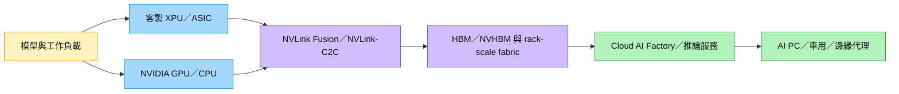

# 技術_AI推論與ASIC平台

## 定義

AI 推論是模型完成訓練後，在雲端、邊緣或終端執行預測、生成與代理任務的階段。DIGITIMES 2026-08-21 簡報估計，2027 年高階雲端 ASIC 出貨量約 1,526 萬顆、年增 110.9%，首次超過高階雲端 GPU 約 1,069 萬顆；此為簡報估計，非公司指引。

### 2026-10-21 中信投顧 ASIC 產業近況

- 市場：綜合研調（截至 2026 年中）預估未來 5–10 年 GPU 仍主導，但 AI ASIC CAGR 約 27%–35%，高於 GPU 的 14%–26%；CSP 以 GPU＋ASIC 雙線並進，ASIC 側重推論與邊緣運算。
- 收入模式：NRE（架構設計、物理設計、IP 整合、Tape-out）一次性分段認列、毛利率 50%–80% 以上，為 Turnkey 先行指標，3nm／2nm 單案 NRE 倍增；Turnkey 代客戶投片並安排封測，高階 AI 晶片可達數十億美元，但稀釋毛利率。
- 廠商分工：[[AVGO.US(broadcom)]] 市占約 60%–70%（TPU v7 Ghostfish、v8t Sunfish、Meta MTIA 300／400 Iris／450 Arke／500 Astrid、OpenAI Jalapeño、Anthropic、ByteDance N5）；[[MRVL.US(marvell)]] 市占由 2023 年不到 5% 升至 2026 年 25%（Trainium2／2.5／3 互聯、Maia 300、TPU 周邊、TPU v10 潛在設計廠之一），併 Celestial AI、Xconn 補強光互連。
- 台廠：[[2454_聯發科（市）]] 取得 TPU v8i Zebrafish（2H26 量產）與 v9x Humufish／Triggerfish（4Q27 量產、Intel EMIB-T），2026 年 ASIC 營收目標逾 US$2bn、2027 年 US$12–16bn，市占目標上調至 15%–20%；[[3443_創意電子（市）]]（Maia、Cobalt、Axion2／3、Tesla AI5／AI6）；[[3661_世芯-KY（市）]]（Trainium3 量產、Trainium4 獨家設計）；[[8227_巨有科技（櫃）]]（台積電 DCA 成員，轉向 28nm 以下）。
- 結論：中信認為台廠依 COT 模式提供整合服務，性價比高，ASIC 滲透率將逐步提高。
- 來源：[[報告_中信_ASIC產業近況_20261021]]（中信投顧，2026-10-21），信心中。

## 圖解

![[報告_Aletheia_2027AI加速器關鍵變化_20261001_p002.png]]

圖說：Aletheia p2：生產與功率模型。
![[報告_Aletheia_2027AI加速器關鍵變化_20261001_p010.png]]

圖說：Aletheia p10：TPU compute／I/O／封裝研究分工；配置及日期均待量產驗證。

![[報告_BofA_AgenticAI半導體市場_20260929_p08.png]]
圖說：BofA 2026-09-29 將傳統伺服器、AI head node 與 agent node 拆分；CPU 用於序列式任務、工具調用與資料存取，並與 GPU／XPU 平行運算共存，市場份額為券商模型。

圖說：NVLink Fusion 讓客製 XPU 不必與 GPU 生態完全分離，而可透過共同 scale-up／scale-out fabric、CPU 與 HBM 整合進 rack-scale AI factory。

## 技術原理

### COT 與 TK1／TK2／TK3：設計權與交付責任（2026-09-22）

Customer-Owned Tooling 使客戶保有晶片 architecture、演算法、RTL、驗證及主要 compute 設計，再把不同成熟度的成果交給服務商。[[3443_創意電子（市）]] 的 TK1／2／3 表示 **接手點**，不表示三代晶片、也不是每個專案都依序經過的階段；契約仍可加入 IP／子系統整合責任。[[2454_聯發科（市）]] 的 I/O 設計與創意後段服務在特定 Google 方案可能互補，實際得標範圍需按專案驗證。

| 接手模式 | 輸入／尚未完成 | 必要流程與驗證 | 主要限制 |
|---|---|---|---|
| TK1 Netlist-in | 已邏輯合成的閘級連線；尚無完整實體座標、金屬配線與電源網 | die估算／floorplan→macro與標準元件 placement→power-grid／bump-map→clock-tree synthesis→routing→DFT／STA→IR-drop、EM、SI分析→DRC／LVS／antenna→ECO／timing closure→GDSII→封裝、測試與量產 | PPA與時序／功耗／走線約束互相牽制；簽核、良率與EDA資源不能由前端RTL完成度替代 |
| TK2 GDS-in | 晶粒 physical design 已sign-off；封裝／資格／量產未必完成 | mask與foundry協調、wafer starts、基板／RDL／bump、中介層、SI／PI／thermal、probe／load board／socket、CP／FT、silicon debug、可靠度與yield ramp | 晶粒PPA優化空間小；重大設計問題需客戶改GDS甚至重新tape-out。CoWoS／HBM／chiplet工作仍可能很重 |
| TK3 Production transfer | 已有設計、mask、BOM、測試程式、golden samples與良率／品質規則 | test correlation→supplier qualification→良率／binning驗證→quality／change control→採購／產能／供應鏈與物流 | 前置NRE少不代表低風險；品質／供量與營運資金墊付仍決定交付能力 |

TK1 對應物理後端工程，而非從零發明所有晶片功能；TK3 不應簡化為單純「GDS-in」。先進製程、複雜封裝與高功率加速器會同時推高 PDN、訊號、散熱、測試與製造限制。來源 p11 的多倍 reticle 描述未清楚區分單一晶粒與多晶粒封裝尺度，本頁不把多倍光罩尺寸當單一 monolithic die 規格。

[[5274_信驊（市）]] 的 AST2600／2700 是本報告 TK1 服務模型案例；晶片品牌、架構與創意的實體實作／量產交付責任分開，專案 EPS 不代表信驊 EPS。

![[報告_Aletheia_創意電子首次覆蓋_20260922_p010.png]]
圖說：p10 圖13 的 Spec／Netlist／GDS／Mask／Logistics 與各 TK 覆蓋範圍；實際專案責任仍依契約。

判斷指標應按 **工程交付、商業組合、現金循環** 分開：PPA／時序簽核與CP／FT良率驗證能力；NRE→turnkey轉換、TK1／2／3專案毛利與mix；wafer／HBM／載板付款到客戶收款的天數及預付款／合約負債。營收放量可能拉低合併毛利率，營業槓桿可能提高營業利益率，兩者都不保證自由現金流為正。

來源：[[報告_Aletheia_創意電子首次覆蓋_20260922]]（2026-09-22，p10–14；服務定義轉述／中，商業結果thesis／中低）。封裝與IP原理見 [[技術_CoWoS與先進封裝]]；財務驗證見 [[分析_創意COT獲利與營運資金驗證_20260922]]。

### 代理工作負載與系統供給（2026-09-29）

| 功能／口徑 | 與模型推論的關係 | 投資觀察 |
|---|---|---|
| Agent orchestration／工具調用 | CPU 負責序列控制、外部 API、資料庫與記憶體 I/O；GPU／ASIC 負責平行模型推論 | [[INTC.US(intel)]]、[[AMD.US(amd)]] 及 [[NVDA.US(nvidia)]] 的 CPU 收入需分 head node／獨立 agent node，不能由固定 CPU:GPU 比直接推估 |
| 晶片顆數→die→rack→GW | ASIC／GPU 多 die 與密度提升使 rack 數不一定隨算力增加 | UBS 估 NVIDIA racks 2027／28 約 16.8／16.5 萬架，但 GPU 約 1,430／1,830 萬顆；兩組數字不矛盾 |
| IT compute power→facility powered shell | IT 負載乘 PUE 才是機房總用電；土地／殼體、電網、設備交期亦須同步 | UBS 2026–30 累計約 340GW IT、PUE 1.12 對應約 380GW 設施需求；不是今天已可用電力 |
| 晶片數→收入 | 每 GW 內容值、CPU／網路／HBM 組合及年度換代共同改變收入 | 單位占比、GW 占比與營收占比不可互換；ASIC 可有較高算力占比但較低美元份額 |

與單次模型呼叫相比，代理任務會反覆執行推論、規劃與工具操作；串行延遲、CPU 可用核心、記憶體容量與 I/O 可能成為端到端瓶頸。這使 CPU、DRAM／eSSD、網路與 XPU 的需求互補，但特定產品是否替代仍取決於實際 workload 與成本。

![[報告_UBS_AI算力與資料中心電力供給_20260929_p11.png]]
圖說：UBS 的 Blackwell／Rubin／Feynman 與 AMD 機架 TDP 情境；Rubin 200kW、Feynman 1,200kW、MI500 1,000kW 是模型配置，並非統一正式產品功耗。

來源：[[報告_BofA_AgenticAI半導體市場_20260929]]、[[報告_UBS_AI算力與資料中心電力供給_20260929]]（2026-09-29；estimate／中）。模型差異與來源內部單位疑義見 [[分析_AgenticAI需求到供電與材料獲利的驗證_20260929]]；驗證節點見 [[時程_2026-2028九月底AI材料與算力驗證]]。

推論平台的核心不只在加速器，也包括記憶體階層、互連、供電與散熱。ASIC 可針對固定模型或資料流最佳化能效與成本；GPU 則保有較高的軟體彈性。推論工作負載若由單一模型推理擴展至多代理、長上下文與多模態，會推高記憶體容量、互連頻寬與系統級協同需求。

NVLink Fusion 類平台改變的是系統邊界：客製 XPU 可用 NVLink-C2C 與 CPU／其他處理器互連，並透過 NVLink fabric 與 NVIDIA GPU、網路共同組成 rack-scale 系統。NVHBM 則把客製記憶體能力納入平台，讓設計服務商除晶片設計外，還需協調 HBM、ABF 載板、先進封裝與晶圓產能準備。

### MoE、NVLink 與 Dynamo 的系統關係

[[video_NVIDIA_GTC2026_AI平台與NVL576_202603]] 說明，Mixture of Experts（MoE）雖只啟用部分 experts，expert parallelism 仍會在 GPU 間產生大量 all-to-all 通訊；因此推論效能不能只看算力，還要看 scale-up fabric 是否能讓通訊與運算重疊。NVIDIA 在該場演講以 NVL72 的每 GPU 1,800 GB/s NVLink，對比其所稱當代 Ethernet 約 100 GB/s／GPU，主張約 18 倍通訊速度差；這些數字是公司簡報口徑，需以實際模型、訊息大小與拓撲驗證。

Dynamo 則位於軟體調度層，把 prefill、decode 與 KV cache routing 解耦，依 GPU 忙碌程度與 KV cache 位置調度請求。公司宣稱導入可帶來 7 倍改善，且 NVSwitch／Dynamo 等整體最佳化使 Hopper 到 GB300 的每瓦效能提升約 50 倍；兩者均為 NVIDIA 場景化 benchmark，不宜直接外推至所有模型與叢集。

## 關鍵參數 / 判斷指標

| 指標 | 意義 | 投資觀察 |
|---|---|---|
| ASIC 出貨量與雲端客戶採用 | 判斷客製化加速器是否持續替代部分 GPU | 需區分已量產客戶與第二／第三客戶 design win 的券商推測 |
| 記憶體容量與頻寬 | 長上下文、多模態與代理工作負載的瓶頸 | HBM／NVHBM 採購與 ABF 載板準備可能提前占用資金與產能 |
| 每瓦推論效能與總擁有成本 | 雲端服務商選擇 ASIC／GPU 的核心經濟性 | ASIC 的能效優勢需抵銷開發、軟體與量產風險 |
| 平台互通性 | XPU 能否接入既有 GPU／CPU／網路 fabric | NVLink Fusion 可降低客戶採用客製 XPU 的系統整合摩擦，但生態依賴上升 |
| Expert all-to-all 通訊 | MoE 的 token routing 是否被跨 GPU 通訊拖慢 | NVLink／NVSwitch 頻寬、拓撲與 collective software 決定 GPU 能否維持在 compute-bound |
| KV cache 調度 | 長上下文推論能否避免搬移與閒置 | Dynamo 類 disaggregated serving 需同時觀察 prefill／decode 配比、cache locality 與儲存層級 |

## 產業動能

- 2027 年 ASIC 出貨量估計年增 110.9%，反映雲端服務商擴大自研或客製化加速器。
- AI 運算架構同時需要高速互連、記憶體、儲存、供電與冷卻；因此推論成長會外溢至完整資料中心供應鏈。
- **平台型合作提高 design-win 選項**：[[NVDA.US(nvidia)]] 於 2026-08-31 投資 [[2454_聯發科（市）]] US$3.5bn 可轉債，雙方把合作擴至 NVLink Fusion、AI PC／本地運算與車用；[[GOOGL.US(alphabet)]] 亦參與 US$3.9bn CB。投資與合作公告屬 fact，第二／第三 CSP 勝率上升為 Citi／Morgan Stanley thesis（[[報告_Citi_聯發科_20260831]]、[[報告_MorganStanley_聯發科_20260831]]）。

## 概念股 / 族群

| 類型 | 廠商 | 角色 | 觀察點 |
|------|------|------|--------|
| 客製 ASIC 設計 | [[2454_聯發科（市）]] | Google TPU 與 NVLink Fusion 客製 XPU 路線 | 首顆 4Q26 量產、第二／第三 CSP design win、HBM／ABF 準備 |
| GPU／互連平台 | [[NVDA.US(nvidia)]] | NVLink Fusion、NVLink-C2C、NVHBM 與 rack-scale AI factory | 開放客製 XPU 是否擴大平台總量並維持生態控制力 |
| 雲端客戶／投資方 | [[GOOGL.US(alphabet)]] | TPU 客戶並參與聯發科 CB | TPU 專案節奏與策略投資的長期合作含義 |

> [!note] 信心水準
> 可轉債金額與合作範圍已有公告／券商轉述，信心高；第二或第三 CSP 客戶、材料準備收入與個別平台量產份額仍屬券商 thesis／estimate，信心中。

## 技術瓶頸 / 風險

- 出貨估計高度依賴雲端客戶專案進度與 ASIC 量產良率。
- ASIC 軟體生態與可程式化程度低於 GPU，若模型快速變化，導入風險上升。
- 推論需求成長不必然等比例轉化為單一晶片廠商營收，需追蹤客戶自研、外包與平台混用。
- NVLink 相容性降低整合門檻的同時，也提高客製 XPU 對 NVIDIA fabric、軟體與平台路線的依賴。

## 2026-10-01：功率限制與 ASIC 設計價值移轉

Aletheia 估 2027 生產 2,130 萬顆加速器，理論功率 52.6GW，含其他專案約 55GW；與新增設施 mid-40GW 有落差，但生產、出貨、安裝及通電可落後 2–3 季，IT／設施功率需再核對 PUE，不能直接判定某年全數需求消失。

在同一設施電力限制下，MaxQ／MaxLPS 降每顆功耗可放入更多 GPU；有效 tokens/s、延遲、互連負擔與每瓦效率才是方案比較門檻。Rubin Ultra 以更小 rack 加更大 pod 提升密度，跨 rack 光互連需求仍可能上升。具體路線 [[分析_2027加速器供電與ASIC價值移轉_20261001]]。

ASIC 前端 RTL／compute 設計的 AI 工具降低部分開發障礙，價值可能移向 I/O／SerDes、HBM base die、先進封裝與系統交付；這是券商 thesis，不能由 RTL 進度推定後段 qualification 完成。TPU v9 EMIB-T、v10 SoIC 皆將多晶粒良率、熱與通訊納入設計。

### 2026-10-19：Maia 300 與 ASIC 專案分配

- [[MSFT.US(microsoft)]] Maia 300 機櫃：96 顆加速器、167 kW、HBM 27.7 TB，2027 年量產部署並以多 GW 規模作為主要推論平台；公司稱每 MW token 數較領先 GPU 系統多 40%。這是 CSP 以自研 ASIC 改善推論經濟性的直接案例（[[261019_ms_OCP-MGX]]）。
- 富邦投顧產業調查：晶圓、先進封裝、基板與記憶體受限，CSP 須提前數年鎖產能，至 2029 年量產的主要 ASIC 專案分配已大致確定；OpenAI 2027 年需求上修至 300 萬顆、Anthropic 首個 AVGO ASIC 估 2H28 量產。富邦框架：ASIC 優於 GPU、互聯優於記憶體、CPU 優於高成本 XPU（thesis／中，[[報告_富邦_北京上海路演ASIC_20261019]]）。
- 中小型設計服務：[[8227_巨有科技（櫃）]] 2Q26 6–28nm 占營收 78%，4nm 專案估 1H27 Tape-out，轉單需求受台積電產能限制要到 2027 年兌現（[[報告_中信_巨有科技8227_20261020]]）。

國泰 GMI 訪談示範 prefill／decode 分離：prefill 偏運算、decode 偏記憶體頻寬；Dynamo 看 GPU 負載與 KV prefix 的位置調度，SSD warm cache 減少重做 prefill。32 GPU 場景稱速度 5.1x／吞吐 3.7x、成本降 30%，以及 cache 命中 3%→50%+，均為公司 benchmark，非通用保證。需同測 TTFT、TPOT、尾延遲、cache 命中率與 I/O；因資料搬移而增加的延遲可抵銷快取收益。

## 來源

- [[報告_Aletheia_創意電子首次覆蓋_20260922]] — Aletheia Capital，2026-09-22；COT、TK1–3、APR／簽核、量產與營運資金。

- [[報告_Aletheia_2027AI加速器關鍵變化_20261001]] — Aletheia Capital，2026-10-01；原始研究／訪談全文，數字及時程依本批註記保留來源口徑。
- [[活動_國泰_美國參訪訪談紀要_20260914-18]] — 國泰證期研究部，2026-09-18；原始研究／訪談全文，數字及時程依本批註記保留來源口徑。
- [[報告_BofA_AgenticAI半導體市場_20260929]] — BofA，2026-09-29；CPU head node／agent node、TAM 與 GW 模型
- [[報告_UBS_AI算力與資料中心電力供給_20260929]] — UBS，2026-09-29；晶片／die／rack／GW、PUE、電力條件

- [[報告_DIGITIMES_AI推論時代_2027雲端運算平台_20260822]] — DIGITIMES，下載日 2026-08-21
- [[報告_Citi_聯發科_20260831]] — Citi Research，2026-08-31；NVIDIA 投資與 NVLink Fusion 合作
- [[報告_MorganStanley_聯發科_20260831]] — Morgan Stanley，2026-08-31；NVIDIA／Alphabet 參與 CB 與供應鏈資金用途 thesis
- [[video_NVIDIA_GTC2026_AI平台與NVL576_202603]] — NVIDIA GTC 2026 Session S81911；MoE expert parallelism、NVLink／NVSwitch、Dynamo 與 NVL576 原型
- [[報告_中信_ASIC產業近況_20261021]] — 中信投顧 ASIC 產業近況分享，2026-10-21

## 相關頁面

- [[分析_緯創緯穎專家紀要_AWS集中度與ODM訂單機制_20261028]]
- [[分析_國泰美國參訪_電力測試記憶體與太空驗證_20260914-18]]

- [[0100.HK(minimax)]]
- [[2513.HK(z.ai)]]
- [[分析_中國基礎模型_Token經濟與算力瓶頸_20260905]]
- [[技術_大模型推理經濟學]]
- [[分析_Anthropic與OpenAI_PreIPO_TokenEconomics算力ASIC估值]]
- [[分析_2026-08_AI網通與硬體報告更新]]
- [[分析_Gartner生成式AI模型市場與Token效率_20260906]]
- [[報告_DIGITIMES_AI運算架構與演進趨勢_20260822]] — DIGITIMES／MediaTek 講座，2026-08-20

## 2026-09-15–18 推論與 ASIC 平台更新

- 永豐訪談指出，開源模型與蒸餾會壓低單 token 價格，但價格下降可能反過來擴大使用量；GPU 小時租金、利用率與 1–2 年回收期仍是雲端資本支出的核心驗證指標。來源：[[報告_永豐_AI產業趨勢對談_20260916]]。
- UBS 觀察 inference 需求、ASIC 與 rack-level 整合持續推進，Inventec 的 ASIC 出貨量已超過 AI GPU 伺服器；[[6533_晶心科（市）]]則以 Meta 多代 MTIA 專案、80 系列伺服器 CPU／加速器路線作為後續 royalty 與獲利驗證，均待實際出貨與認列確認。來源：[[報告_UBS_台灣高峰會Day1科技硬體_20260915]]、[[報告_CTBC_晶心科_20260918]]。

- [[分析_AgenticAI光互連與先進封裝瓶頸_20260916]]

## Citi 2026-09-20 更新

- Citi 將 AI 下一階段成長向量由 GPU 延伸至網路晶片、CPU 與客製 ASIC；ASIC 單位可由低基期快速成長，但 NVIDIA 仍可能保留較高的系統價值份額。
- Google TPU 案例顯示，MediaTek 可由 I/O／SerDes 延伸至部分 compute implementation，GUC 則承接 CPU 的 COT／backend-only service；EMIB-T 封裝良率與 OSAT／基板整合是早期量產的執行風險。

來源：[[報告_Citi_US市場回饋_AI硬體_20260920]]（Citi，2026-09-20；券商觀點／信心中）。

## SemiAnalysis 2026-09-07：TPU 推論外部化

- SemiAnalysis 的 InferenceX preview 以 Qwen3.5 397B FP8、聚合式 serving 比較 Ironwood TPUv7 與 B200／B300；在其建模的 20 tokens/s/user 點，TPUv7 約為 9,364 tokens/s/chip，並以較低 TCO 推得相對 B200／B300 的 tokens per dollar 優勢。這是第三方 benchmark 與 TCO 模型，不能直接視為所有模型或客戶的採購結論。
- 外部 TPU 軟體路線由 TorchAX／JAX 過渡至 PyTorch-native 的 TorchTPU；來源稱 private beta 預計約 2026 年 10 月開源。真正的驗證點是 disaggregated serving、speculative decoding、KV cache 與多輪 agentic workload 上線後的端到端延遲及成本，而非單點 throughput。

來源：[[報告_SemiAnalysis_TPU推論外部化_20260907]]（SemiAnalysis，2026-09-07；第三方 benchmark／研究觀點，信心中低）。

## 2026-09-22～23 TPU／CPU ASIC 供給更新

- UBS 將 Google TPU 與其 CPU 搭配關係視為 [[3443_創意電子（市）]] 2027 年成長主軸；Google CPU 由 2026E 130 萬套升至約 400 萬套、創意 2027E 營收占比 67% 均為券商模型，關鍵反證是晶圓配置與 TPU 系統出貨未如預期。
- 對 [[2454_聯發科（市）]]，UBS 預期 TPU v9 2026 年 11 月前 tape-out、2028 年以 EMIB-T 放量；CoWoS 補充方案與 SpaceX／Tesla 等新設計案仍未定案。ASIC 規模化的限制不只設計能力，也取決於先進製程、HBM、ABF／EMIB 與封裝協同供給。

來源：[[報告_UBS_創意電子CPU專案與CSP成長_20260922]]、[[報告_UBS_聯發科TPU與ASIC專案_20260923]]（UBS，2026-09-22～23；券商 estimate／中低信心）。

## 2026-10-22 SemiAnalysis：華為 Ascend 950PR 實測

- **晶片與分級**：950PR／DT 出現多種核心數、HBM 堆疊高度與快取容量的 SKU，華為同時對運算與記憶體分級，並把較弱記憶體配較弱運算（NVIDIA 只分級運算）；910B 亦有 910B1–4。實測樣品為 950PR_9579（28 個 cube core、128 GiB HBM），內含 Linx816 AArch64 AICPU（推測與 Kirin 9000S／9010 中核相同），此 SKU 7 顆配置、6 顆可見、5 顆執行。
- **效能**：950PR 主打 prefill 與推薦，記憶體頻寬與核心數低於 950DT。1,055 個 BF16 GEMM 形狀中，華為最佳 kernel 達上限 99.7%；ridge 以下形狀中位數達成率 41.5%（H100 為 46.8%）；功耗約 599–600W、時脈 1500–1550MHz（參考 1650MHz）。絕對效能介於 A100 與 MI300X 之間。HBM 有效頻寬在小訊息時超越 H100，大訊息時利用率接近 H100。
- **判斷**：硬體可能落後約 5 年（相對 A100），軟體已在前沿；中國電價便宜，perf/TCO 比 perf/watt 更適合比較。
- **擴展**：華為 supernode 由 910 CloudMatrix384 延伸到 950 SuperPod，支援 wide EP；950DT superpod 的 EP16 dispatch／combine 走 URMA，為 pre／URMA／post 三個運算子（GB300 為單一融合呼叫）。
- 來源：[[memo_SemiAnalysis_華為DeepSeek共生_Ascend950_20261022]]（SemiAnalysis，2026-10-22；實測與作者判斷，信心中；信件版截斷）

## 2026-10-23 SemiAnalysis：Trainium3 從推論走向訓練

- **推論 vs 訓練的軟體門檻**：推論只需前向、架構固定、少數熱點 kernel；訓練要求每個運算子都有反向傳播與廣泛 API，研究者頻繁改架構，因此過去 Trainium 適合推論、不適合研究訓練。
- **TorchNeuron**：[[AMZN.US(amazon)]] 由 PyTorch/XLA（lazy tensor、無原生 eager、不支援 torch.distributed／DTensor）轉向原生 PyTorch 後端，`.to("neuron")` 即可；先做 BF16，MXFP8 延後。做法與 Google TorchTPU 打入 vLLM／SGLang 生態的路線相同。
- **實測指標**：Qwen3-32B 於 16 顆 Trainium2 上 compiled MFU 30.47%；首步編譯 184.6–255.7 秒、gpt-oss 20B 編譯 27 分 17 秒為主要摩擦；FlexAttention 通過率 93%；MoE dispatch／combine（占通訊量 60–70%）尚未接上 TokenSwitch API。
- **判讀**：ASIC 平台要從推論擴大到研究訓練，關鍵在框架相容性、編譯時間與 CI 數值對齊，而非單看峰值算力。
- 來源：[[memo_SemiAnalysis_Trainium3訓練與TorchNeuron_20261024]]（SemiAnalysis，2026-10-23；第三方實測，信心中）。

## 2026-10-23 M報：Maia 300 量體與 MAI-Base-2

- [[MSFT.US(microsoft)]] Maia 300 採台積電 N2、目標至少 100 萬顆、每櫃 96 顆、原生 FP4；公司稱每單位電力推論效能比頂尖 GPU 高 40%。MAI-Base-2 為 2.8 兆參數 MoE（啟用約 800 億），約 16,000 張 GB200、38 天完成預訓練。量體口徑與富邦、Aletheia 不同，見 MSFT 頁。
- 來源：[[memo_M報_346_特斯拉Roadster與微軟Maia300_20261023]]（M報，2026-10-23；公司宣稱 fact，主持人推估低信心）。
