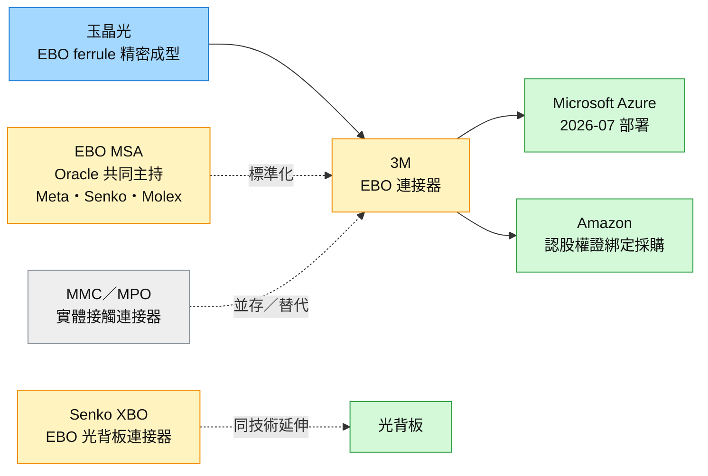

# 技術_EBO擴束連接器

## 定義

**EBO**（Expanded Beam Optical，擴束光學連接器）是一種非接觸式光纖連接器：ferrule 內建微透鏡或稜鏡，先把光纖出來的光準直、放大成較粗的光束，跨過一段小空氣間隙後，再由對端 ferrule 聚焦回光纖。它和 [[技術_MPO]] 頁的 MPO／MMC 最大的差別是兩端光纖端面不需物理接觸，所以對灰塵、端面刮傷與插拔磨損不敏感。

**為什麼現在重要**：AI 叢集的 scale-out 網路把光纖連接數量推到每顆 GPU 數個到十多個接頭，安裝與維修時的清潔、端面檢查與返工成了資料中心建置的人工瓶頸。3M 自 2019 年開發 EBO，2024 年底商業化，2026 年 7 月部署於 [[MSFT.US(microsoft)]] Azure，2026-10 再以認股權證綁定 [[AMZN.US(amazon)]] 的光連接採購；精密 ferrule 由 [[3406_玉晶光（市）]] 支援量產。EBO 從實驗室規格變成有具名超大規模業者採用的產品，也讓手機鏡頭廠的精密光學能力有了新的光通訊出口。

**主線位置**：屬於 [[供應鏈_AI光互聯]] 的被動光纖連接環節，與 [[技術_MPO]]（MPO／MMC 實體接觸連接器）互為替代或並存；在 CPO 端，同樣的擴束概念也出現在 [[技術_FAU]] 的 Senko MPC、Lightmatter vClick 與 [[Sumitomo Electric（未）]] 的準直鏡垂直耦合，見 [[技術_CPO]]、[[技術_光互連]]。

## 圖解

![[memo_SemiAnalysis_EBO擴束連接器_20261024_002.jpg]]
*圖（SemiAnalysis X 串文附圖，2026-10-23）：EBO 光路。光從左上光纖進入 ferrule，被全內反射（TIR）鏡面轉折並準直成擴束光；兩片 ferrule 之間的介面有 AR 抗反射鍍膜，降低損耗與回波；接收端 ferrule 再把光聚焦回右下光纖。下半部是多芯 EBO 連接頭外觀與局部放大。對接面是放大後的光斑，一粒灰塵只擋掉光斑的一小部分，這是 EBO 可以少清潔、少檢查的原因；多出兩次準直／聚焦介面，則是插入損耗高於 MMC 的來源。*

圖說：EBO 的已知供應鏈是玉晶光製造 ferrule、3M 品牌化並主導 MSA，下游為 Microsoft 與 Amazon；Senko 把同樣的擴束原理延伸到光背板，MMC／MPO 則是同一連接位置的實體接觸方案。

## 技術原理

| 模組 | 功能 | 觀察重點 |
|------|------|----------|
| 準直元件（微透鏡陣列／稜鏡／TIR 鏡） | 把光纖出光準直並放大成擴束光 | 成型精度、透鏡陣列一致性；UBS 描述為一排微透鏡的塑膠模造件，SemiAnalysis 附圖為 TIR 鏡面轉折 |
| AR 抗反射鍍膜 | 降低空氣介面的反射損耗與回波 | 鍍膜良率與耐久性，影響插入損耗與回損 |
| 空氣間隙對接 | 兩端 ferrule 不接觸，光在間隙中傳遞 | 灰塵敏感度低、插拔磨損小；對角度偏差比橫向偏移更敏感（一般擴束光學特性） |
| 接收端聚焦 | 把擴束光聚焦回接收光纖 | 與發射端成對設計；兩次光學轉換帶來額外損耗 |
| 機構外殼與低插拔力設計 | 固定對位、提供插拔介面 | 低插拔力讓面板可放更多連接器，提高密度 |

**與一般光纖連接器的差異**：MPO／MMC 靠插芯端面以彈簧加壓物理接觸，損耗低但每次插拔都要清潔、用顯微鏡檢查端面，一粒灰塵就可能讓鏈路失效。EBO 把對位精度要求從「光纖纖芯對纖芯」放寬到「擴束光斑對光斑」，換來可維修性，代價是插入損耗較高、ferrule 需要精密光學成型與鍍膜，製造門檻從機械研磨轉向光學模造。這也是 3M 找手機鏡頭廠玉晶光代工的原因。

## 關鍵參數 / 判斷指標

| 指標 | 意義 | 投資觀察 |
|------|------|----------|
| 插入損耗（vs MMC） | 決定能否進入光預算緊的鏈路 | 損耗差距縮小，EBO 才可能從維運密集位置擴大到一般 scale-out 佈線 |
| 單價（vs 標準連接器） | 目前 EBO 較貴 | 價差是否被維運人力與停機成本抵消，決定 CSP 採用深度 |
| 清潔與檢查時間節省 | UBS 引述可省 85% | 是 EBO 最主要的價值主張；需看 CSP 實際維運數據 |
| 每 GPU ferrule 數 | UBS 假設 4–12 個（2–3 段連接 × 每段 2–4 個插頭） | 直接決定玉晶光 ferrule 用量；scale-out 光纖化程度越高越有利 |
| ferrule 單價 | UBS 假設透鏡組件約 US$1 | 低單價代表需要大量出貨，量產良率與自動化比單價更關鍵 |
| 具名 CSP 數量 | 目前 Microsoft（已部署）、Amazon（認股權證綁定） | 第三家 CSP（如 Meta、Oracle 為 MSA 成員）導入是重要驗證點 |
| MSA 成員與多源供應 | 標準化降低單一供應商疑慮 | Senko、Molex 等連接器廠若推出相容產品，市場變大但 3M 份額可能被稀釋 |

## 產業動能

- **2026-05 EBO MSA 成立**：由 Oracle 共同主持，Meta、Senko、Molex 加入，目標是 scale-out 佈線標準化（[[261015_ubs_genius]]，UBS 2026-10-15 轉述）。
- **2026-07 Azure 部署**：3M EBO 部署於 [[MSFT.US(microsoft)]] Azure 資料中心（UBS 2026-10-15）。
- **2026-10-15／19 玉晶光入股與製造合作**：[[3406_玉晶光（市）]] 董事會通過私募 3M UK（NT$48 億、約 4.68%）；3M 新聞稿稱玉晶光支援 EBO ferrule、CPO 方案與相關光互連應用量產準備，2026Q4 交割（[[research_產業合作技術發表_2026-10-24]]，官方 fact）。
- **2026-10-19 Amazon 認股權證**：[[MMM.US(3m)]] 發給 [[AMZN.US(amazon)]] 子公司最多 3,162,015 股認股權證，85% 依 Amazon 購買光連接與其他資料中心產品的付款金額既得，累計 US$60 億全數既得（官方 fact；不是採購承諾，也不全是 EBO）。
- **2026-10-23 SemiAnalysis 定位**：EBO 最大價值在維運；插入損耗高於 MMC、目前較貴，兩者依密度、可維修性與光預算並存；佈線變快不一定讓 CSP 更早產生營收（[[memo_SemiAnalysis_EBO擴束連接器_20261024]]，分析機構 thesis／中）。
- **ECOC 2026 Senko XBO**：Senko 展示以 EBO 為基礎的 XBO 光背板連接器，可自動斷開與重新對接，指向維修時減少人工插拔（[[memo_SemiAnalysis_EBO擴束連接器_20261024]]，展會 fact；採用 thesis／低）。

## 應用場景

| 場景 | 為什麼適合 EBO | 狀態 |
|------|----------------|------|
| 資料中心 scale-out 機櫃間佈線 | 接頭多、安裝與維修頻繁，清潔檢查人力大 | Azure 已部署；Amazon 採購綁定 |
| 高密度配線面板 | 低插拔力有利於提高連接器密度 | SemiAnalysis 觀點 |
| 光背板 | 背板內部沒有清潔通道，非接觸是剛需 | Senko XBO 展示階段 |
| CPO 可拆式光纖介面 | 擴束可放寬 fiber-to-PIC 對位容差 | 屬 [[技術_FAU]] 範疇（Senko MPC、Lightmatter vClick），與 3M EBO 為不同產品 |

## 概念股 / 族群

| 類型 | 廠商 | 角色 | 觀察點 |
|------|------|------|--------|
| 連接器品牌／方案 | [[MMM.US(3m)]] | EBO 開發者、MSA 主導 | EBO 營收占 3M 整體仍小；CSP 擴大採用與 MSA 普及 |
| 精密光學 ferrule | [[3406_玉晶光（市）]] | 3M EBO ferrule 與 CPO 光學件製造夥伴；3M 持股約 4.7% | 2027 年營收貢獻是否兌現、ferrule 良率與出貨量 |
| 連接器廠（MSA 成員） | Senko（未建頁）、Molex（未建頁） | 相容產品、光背板延伸 | 是否推出量產相容品，影響 3M／玉晶光份額 |
| 超大規模使用者 | [[MSFT.US(microsoft)]]、[[AMZN.US(amazon)]] | 已部署／採購綁定 | 是否有第三家 CSP 導入 |
| 實體接觸替代方案 | [[GLW.US(corning)]] 等 MPO／MMC 供應商 | 同一連接位置的競爭與並存 | MMC 損耗與成本優勢能否守住光預算緊的鏈路 |

> [!note] 信心水準
> 3M 入股玉晶光、Amazon 認股權證條款為官方 fact（高）；Azure 部署、MSA 成員、85% 清潔時間節省為 UBS 轉述（中）；US$1 億 TAM 與玉晶光 2027 年營收貢獻為券商 estimate／thesis（中）；EBO 與 MMC 並存、光背板採用為 SemiAnalysis thesis（中／低）。3M 新聞稿未揭露插入損耗、產能與量產時程。

## 技術瓶頸 / 風險

- **插入損耗**：EBO 多兩次光學轉換，損耗高於 MMC；1.6T／3.2T 世代光預算變緊，可能限制 EBO 只用在維運密集位置。
- **成本**：目前單價高於標準連接器，CSP 需以維運人力與停機成本換算才划算；ferrule 單價低（約 US$1），玉晶光需靠量與良率賺錢。
- **營收時點不等於省工時點**：SemiAnalysis 指出機櫃分批到貨、上線調校仍需時間，佈線變快不一定讓算力提早產生營收，CSP 的採用誘因主要是長期維運。
- **標準化與份額**：MSA 讓 Senko、Molex 等加入，市場變大但 3M 與玉晶光的獨家地位可能被稀釋。
- **數字口徑**：US$60 億是認股權證全數既得門檻，不是採購承諾，且涵蓋其他資料中心產品；不能直接換算 EBO 營收。
- **架構演進**：CPO 普及後，部分機櫃內連接改走 FAU／GlassBridge 等 fiber-to-PIC 方案，EBO 的位置可能集中在面板與機櫃間。

## 相關技術

- [[技術_MPO]]（MPO／MMC 實體接觸連接器，EBO 的並存與替代對象）
- [[技術_FAU]]（CPO 端的擴束耦合方案：Senko MPC、Lightmatter vClick）
- [[技術_CPO]]（玉晶光與 3M 合作範圍也含 CPO 光學件）
- [[技術_光互連]]（光互連整體架構）
- [[供應鏈_AI光互聯]]（EBO 在 AI 光互連供應鏈的位置）

## 來源

- [[memo_SemiAnalysis_EBO擴束連接器_20261024]] — SemiAnalysis（X 串文），2026-10-23
- [[research_產業合作技術發表_2026-10-24]] — 3M 新聞稿與 Form 8-K，2026-10-19
- [[261015_ubs_genius]] — UBS，2026-10-15

## 相關頁面

- [[Sumitomo Electric（未）]]（ECTC 2026 準直鏡擴束垂直耦合，CPO 端同類原理）
- [[時程_2026Q3Q4_AI網通與硬體催化劑]]（3M 入股交割、玉晶光 EBO 營收貢獻節點）
