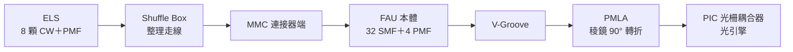

# 技術_FAU

## 定義

FAU（Fiber Attach Unit／Fiber Array Unit）是光模組與 CPO 光引擎中將單根或多根光纖精確對準光晶片端面的精密被動元件，負責光纖到光晶片之間的低損耗耦合。在普通可插拔光模組中，FAU 已是成熟器件；在 CPO 方案中，FAU 面對更高芯數、封裝相容性、插損與可維修性要求，成為量產良率的重要環節。

dFAU／DFAU 的官方全名是 **Detachable Fiber Array Unit（可拆卸式光纖陣列單元）**。它不是所有 CPO FAU 的統稱，而是能拆卸、重新插入的 FAU 介面；目的在於把光引擎驗證前移、改善組裝良率，並讓 CPO 具備現場維修性。固定式 FAU 與可拆卸式 dFAU 是兩種不同設計，不能用「CPO FAU 一律不可插拔」概括。

> [!warning] 名詞校正
> - 既有供應鏈訪談曾把 DFAU 展開為「Discrete FAU」，並把 CPO FAU 描述成固定式。
> - [[research_dFAU_Coherent_CPO_20260830]] 收錄的 Lightmatter 官方規格明確寫作 **Detachable fiber array unit (dFAU)**，且支援插拔與重新插入。
> - [[memo_Coherent毛利率_1.6T良率_OCS_DFAU專家觀點_日期不詳]] 又交替使用「DFU」與「DFAU」，只描述專案仍在投入、尚未產出，未提供結構或正式全名。
> - 因官方產品定義優先，本頁已校正全名；舊訪談中的「DFU／DFAU 良率」仍保留為原始 channel 用語，解讀時需確認其實際指固定式 FAU、可拆式 dFAU，或特定 MPC 方案。

## 圖解

![[報告_Semianalysis_CPO_20260102_010.png]]
*圖（SemiAnalysis，2026-01）：NPO（Near-Packaged Optics）架構剖面——FAU 標示於 PIC+EIC 光引擎（Optical Engine）與光纖陣列的對接界面。圖中呈現的是 FAU 的光學對準位置，不足以單憑剖面判定其為固定式或可拆式；dFAU 則是另以可重複插拔介面改善測試與維修性的設計。*

## 技術原理

### FAU 在光模組中的用量演進

| 速率 | FAU 方案 | 通道數 | 單只 FAU 價格 | 備註 |
|------|---------|--------|------------|------|
| 400G | 2 個 4ch FAU | 2×4 = 8ch | ~120–150 元 | 成熟方案 |
| 800G（DR8）| 3 個 FAU（2×4ch + 1×8ch）| 3×FAU | ~300 元（2025）→ ~200 元（2026E）| 主流 |
| 1.6T CPO | CPO 專用 FAU | 36ch（Spectrum X）| 300–400 元/個 | 有效供給緊缺 |
| 3.2T CPO | 下一代 DFAU | 高芯數 | 500–700 元/個 | 樣品驗證中 |

### CPO FAU 與 dFAU 方案

供應鏈訪談常把下列 CPO 光纖連接路線合稱為 DFAU；官方定義下，是否屬 dFAU 應以能否拆卸與重新插入判斷：

| 方案 | 廠商 | 特點 |
|------|------|------|
| MPC（Multi-Path Connector）| Senko（獨家）| 連接器本身整合凸面鏡，直接完成擴束；無中間橋接結構 |
| TeraMount | Molex（收購）| 金屬卡接件方案 |
| 玻璃載體方案 | 康寧（Corning）| 玻璃載體與晶片耦合，兩端金屬 PIN 對齊 |

Lightmatter vClick 是可明確核實的 dFAU 實例：採垂直擴束光介面、晶圓級被動對準，支援 mold-and-grind 封裝流程；官方規格為插損低於 1.5 dB、80 nm 以上頻寬及 50 次以上插拔循環，並整合 SENKO SEAT／MPC 連接技術。

NVIDIA Spectrum X：可插拔式 FAU，單個 OE 對應 36 芯 FAU；需 **32 個 FAU**/台機器。
NVIDIA Quantum X：固定式 FAU，對應 18 芯；僅幾千台規模（2025 計劃未交付）。

### 外置／內置光源的 FAU 辨識線索

[[memo_EML_InP_CW_ELS_NPO_CPO專家觀點_日期不詳]] 提供一組供應鏈辨識口徑：外置 ELS 配套多準備 36 芯 FAU，垂直耦合與邊緣耦合可用來區分不同 CPO／NPO 設計；另一種把 150／200mW CW 放在 NPO 光引擎內的方案則可能採 32 芯 FAU。這是 Coherent 相關專家對特定設計的描述，不是全產業統一規格，應與平台 BOM、耦合方式及 FAU 圖面交叉驗證。

| 光源形態 | 訪談中的 FAU 線索 | 光路含義 |
|----------|-------------------|----------|
| 外置 ELS | 36 芯、搭配保偏光纖；再依垂直／邊緣耦合區分平台 | 外部高功率 CW 經 PMF 傳至 PIC，光路較長、耦合損失較高 |
| 內置 NPO CW | 32 芯；150／200mW CW 直接放在 ASIC 鄰近光引擎 | 不需外置 ELS 的 PMF 路徑，成本與維修性取捨不同 |

### 光柵耦合 FA、邊緣耦合與 PMLA 的材料取捨

CPO 光纖陣列依 PIC 端的耦合方式分流：**光柵耦合（GC）** 讓光從晶片表面以近垂直角度進出，FA 需把多根光纖以固定 pitch 與角度對準表面光柵；**邊緣耦合（EC）** 則從晶片側邊經模斑轉換器進出，Corning GlassBridge 屬此類可拆連接方案。兩者對 FA 結構、對位公差與封裝流程要求不同，不能用同一份額或單價比較。

[[報告_Nomura_大立光CPO光纖陣列_20260709]] 轉述 [[3008_大立光（市）]] 觀點：GC 是主流設計路線，其 GC FA 不受 GlassBridge（EC）影響；已有 1 家客戶的單排 FA，2026-09 前 pilot run、最快 2027 年中量產。另一條光學路線是 PMLA（稜鏡／微透鏡陣列），用於光束轉向與準直：

| 材料／製法 | 優點 | 限制 |
|---|---|---|
| 模造玻璃（大立光） | 插損低於 metalens | 公司優先度低於 FA |
| Metalens（如亞光蝕刻式矽 metalens） | 可晶圓級製作、被動對位 | 大立光稱插損較高；屬競爭者觀點 |
| 石英玻璃稜鏡（半導體級製程，供應商未具名） | 成本結構較佳、無熱效應 | 來源未揭露廠商與規格 |

上述為單一券商轉述公司說法（信心中低），插損數值未揭露；需以客戶認證與實測插損驗證。

## 關鍵參數 / 判斷指標

| 指標 | 意義 | 2026 觀察重點 |
|------|------|-------------|
| 1.6T FAU 供需缺口 | 量產節奏觀察 | 需求 800 萬只 vs 有效供給 ~700 萬只，缺口 **15%+** |
| CPO FAU 認證進度 | NVIDIA/Google 雙驗線 | NVIDIA ORT 已通過（口頭通知）；Google 2026 年 6 月前 2/4 階段通過 |
| V 槽/鍍膜 零部件 | 瓶頸關注點 | 鍍膜外包仍是 2026 主模式；mini 鍍膜線 2027 才量產 |
| CPO FAU 單價 | 上行週期 | 可插拔光模組 FAU 十幾 USD → CPO FAU 150–200 USD |
| 32／36 芯與耦合方式 | 反推內置／外置光源及 NPO／CPO 架構 | 規格不是一對一標準，需用平台 BOM 與樣品共同驗證 |
| PMF 耦合效率 | 外置光源的功率預算 | Coherent 相關專家估約 60%～70%，低於內置透鏡／隔離器直接耦合的 90%+；信心低 |
| 可重複插拔與插損 | dFAU 的維修性與光功率預算 | Lightmatter vClick 規格為 <1.5 dB、50+ 次插拔；量產需追蹤多次插拔後的一致性 |
| Coherent 相關專案產出 | 驗證 channel claim 是否進入收入階段 | 專家估計 2026Q4～2027Q1 小批量出貨；需公司公告與產品規格確認 |

## 技術瓶頸 / 風險

- **零部件短缺**：隔離片和透鏡是整體整合光源供應最緊缺的兩個環節；FAU 自身的 V 槽蓋板與鍍膜製程是卡脖子。
- **固定式與可拆式分流**：固定式 FAU 一旦通道故障可能牽連整板維修；dFAU 以可拆卸介面改善服務性，但新增的連接界面也需承擔插損、污染與重複插拔可靠度驗證。
- **NVIDIA/Google 規格差異**：尺寸不同（製程和通道數一致），雙驗認證周期延長。
- **1.6T 供需缺口**：2026 年 1.6T FAU 供需缺口率至少 **15%**，極端情形下需求 1,000 萬只（缺口擴大至 30%+）。

## 競爭格局

### Finisar（Coherent）供應體系

| 排名 | 廠商 | 特點 |
|------|------|------|
| 第一 | **天孚通信**（未建頁，中國）| 早期布局、產業鏈最完整 |
| 第二 | **蘅東光**（未建頁，中國）| 海外客戶多年深耕；能生產高芯數 2D 排列 FAU，快速擴產 |
| 第三 | **光庫科技**（未建頁，中國）| 聚焦國內及華為體系 |

Coherent 供應鏈中：蘅東光占 **約 40%** 份額（第二大）。

> [!warning] CPO／NPO FAU 份額口徑（2026-10-05 收錄）
> - 既有：[[memo_光通信大厂调研_CPO出货量_FAU_MPC方案_acecamptech_20260529]] 等訪談稱蘅東光占 Coherent 供應鏈約 40%、天孚為 Finisar／Coherent 體系第一；[[技術_CPO]] 引 SemiAnalysis 稱 TFC Optical 為 NVIDIA X800-Q3450 FAU 主供。
> - 新增：[[memo_Coherent專家訪談_光模組量價_NPO_OCS_EML與獲利目標_日期不詳]]（日期不詳）稱 **HD Optics** 占 CPO DFAU 市場 45%–48%、NPO FAU 約 40%，TFC 為另一主要供應商。
> - 狀態：使用者 2026-10-05 確認 HD Optics **不是**蘅東光，兩者為不同供應商；HD Optics 中文名與實體仍待辨識，不建公司頁。45%–48% 是 DFAU 全市場或 Coherent 採購份額亦未說明。DFAU（可拆式）與 Q3450 固定式 FAU 可能是不同產品，兩種「主供」說法可並存。

整合後 FAU 業務：光庫科技（含收購加華微捷 + 蘇州安捷訊）FAU 市場規模將超天孚。安捷訊 2025 年營收接近 8 億元，淨利率 21–22%。

## 關鍵廠商

| 環節 | 廠商 | 角色 |
|------|------|------|
| FAU 供應（全球第一）| 天孚通信（未建頁）| Finisar/Coherent 供應鏈，最完整 |
| FAU 供應（Coherent 40%）| 蘅東光（未建頁）| 高芯數 2D-FAU，擴產快 |
| FAU + TFLN + OCS | 光庫科技（未建頁）| 四大業務，TFLN＋OCS＋FAU 整合廠 |
| MPC 方案（獨家）| Senko（未建頁）| DFAU 連接器方案獨家方案 |
| CPO Shuffle Box | [[COHR.US(coherent)]] | 北美 CPO Shuffle Box（$3,000–5,000）及 FAU 模組 |
| 台灣 FAU / 光纖被動件 | [[3363_上詮（櫃）]] | FAU 台系供應商 |
| CPO GC FA／PMLA（新進）| [[3008_大立光（市）]] | 手機鏡頭廠以自動化高精度對位切入；1 家客戶單排 FA，最快 2027 年中量產（Nomura 2026-07-09，estimate） |
| EC 可拆玻璃連接器 | [[GLW.US(corning)]] | GlassBridge 邊緣耦合方案，與 GC FA 為不同路線 |
| FA 耦合／對位設備（台灣）| [[4573_高明鐵（櫃）]] | 精密定位平台與光通訊對位設備 |
| FA 耦合設備（中國，併購新進）| 逸飛激光／興啟航（未建頁）| 2026-10 逸飛激光以 4 億人民幣收購興啟航，TO-CAN／COB／BOX／FA 耦合設備，延伸 CPO 與 1.6T+ |

## 相關技術

- [[技術_CPO]]（CPO 光引擎中 FAU 的角色）
- [[技術_光模塊]]（可插拔光模組 FAU 用量演進）
- [[技術_光互連]]（LPO/CPO/OCS 全景比較）
- [[供應鏈_CPO]]（CPO 光學元件與 FAU 供應商地圖）

## 來源

- [[報告_招商證券_FAU與MPO在ScaleUp時代的價值通脹_20261013]] — 招商證券（通信，羅嘉成），2026-10-13（FAU 通道數與用量、14 倍價值通脹、CPO FAU 市場規模、製程精度與海內外 FAU 廠商；券商 estimate，信心中）。
- [[memo_CPO無源器件_ELS_FAU_Shuffle專家觀點_日期不詳]] — 匿名專家訪談，日期不詳（2026-10-30 收錄；36 芯 DFAU 物料、Coherent／Corning 代工分工、良率與福州擴產，低至中低信心）。
- [[research_產業合作技術發表_2026-10-30]] — 逸飛激光（688646）巨潮公告，2026-10-27 晚公告／10-28 掛網；收購 FA 耦合設備商興啟航。
- [[research_產業合作技術發表_2026-10-22]] — APC 新聞稿，2026-10-20；4 芯 MCF 纜線／連接器／FAU 規格與 CPO 測試實務。
- [[報告_Nomura_大立光CPO光纖陣列_20260709]] — Nomura，2026-07-09（大立光 GC FA 客戶／試產／量產時點、GC vs EC、PMLA 材料取捨；券商轉述公司觀點，信心中低）。
- [[memo_AceCamp_亨通光電_光纖與MPO展望_20260930]] — AceCamp Tech，2026-09-30（PMF幾何精度、應力棒與有效供給；匿名渠道／低至中信心）。

- [[memo_无源光器件大厂调研_FAU_MMC_acecamptech_20260522]]（FAU 供需缺口、CPO FAU 認證、競爭格局、光纖供應）
- [[memo_光通信大厂调研_TFLN_CPO_OCS_acecamptech_20260417]]（DFAU 方案比較、Spectrum X/Quantum X FAU 規格、MPC/TeraMount/Corning 路線）
- [[memo_光通信大厂调研_CPO出货量_FAU_MPC方案_acecamptech_20260529]]（FAU 單價 150–200 USD、CPO FAU 架構、蘅東光地位）
- [[memo_AceCamp_OCS與FAU供應鏈_20260813]] — AceCamp Tech 匿名專家訪談，2026-08-13（OCS／高芯數 DFAU 的價格、份額、客戶與出貨時程均為低信心 estimate）
- [[memo_EML_InP_CW_ELS_NPO_CPO專家觀點_日期不詳]] — Coherent 相關專家訪談，日期不詳（2026-08-30 收錄；32／36 芯 FAU、內外置光源、PMF 與耦合效率，信心低）
- [[research_dFAU_Coherent_CPO_20260830]] — Lightmatter／Coherent 官方資料，2026-03-17、2026-08-30 擷取（dFAU 正式全名、規格與 Coherent CPO 技術堆疊）
- [[memo_Coherent毛利率_1.6T良率_OCS_DFAU專家觀點_日期不詳]] — Coherent 相關專家訪談，日期不詳（DFU／DFAU 投入與小批量時程，名詞仍待產品規格確認）
- [[memo_Coherent專家訪談_光模組量價_NPO_OCS_EML與獲利目標_日期不詳]] — Coherent 專家訪談整理稿，日期不詳（2026-10-05 收錄；HD Optics／TFC 的 CPO DFAU、NPO FAU 份額，低信心）

## 2026-09-30 PMF的製程與精度觀察

亨通光電相關匿名紀要說明，PMF的瓶頸不只是拉纖產能，而在預製棒、應力棒、幾何精度與客戶驗證。熊貓型結構的應力棒在纖芯周圍形成應力差以維持偏振；訪談稱其應力棒需要MCVD製造，預製棒另可用PCVD或MCVD。這是受訪者製程口徑，不等同所有PMF廠商的通用製造規範。

| 判斷指標 | 訪談說法 | 投資觀察 |
|---|---|---|
| 包層尺寸與真圓度 | 高精度包層偏差要求±0.2–0.3µm，另強調CPO微型V槽的真圓度 | 直徑公差與真圓度是不同指標；需圖面定義和量測分布，不能互換 |
| 設備轉產 | 海外基地逾30台MCVD、樂觀年底轉產逾10萬芯公里 | 名目設備不等於有效供給，仍需拉纖良率、型號與客戶認證；estimate／低信心 |
| 全球供需 | 2026H1供給不足20萬芯公里、2027需求40–60萬 | 不同期間與需求情境不能直接當同年度缺口；低信心模型 |
| 價格與成本 | 長協20多元／米、現貨約40元／米、高精度70元／米以上 | 品質等級及合格率未給，不能由成本約售價十分之一推導90%毛利率 |

來源：[[memo_AceCamp_亨通光電_光纖與MPO展望_20260930]]（AceCamp Tech，2026-09-30）。沒有對應中國公司頁，資料保存在本技術頁與分析頁，不新增公司頁。

## 2026-10-20 APC 規格：4 芯多芯光纖 FAU 與 CPO 測試實務

- **Advanced Photonics Coalition（APC）**（約 60 家會員組織，新聞稿未列名）於 2026-10-20 發布五份文件，其中與 FAU 直接相關的是「4-Core Multicore Fiber Cable, Connector and Fiber Array Unit Specification」，同時定義 4 芯多芯光纖（MCF）纜線、連接器與 FAU；另有 CPO 系統級架構、CPO 建議實務、CPO 用矽光子建議測試實務、矽光子製造規格（fact）。
- 意義：多芯光纖讓一根光纖帶多個通道，可降低 CPO 出光端的光纖數量與 FAU 尺寸；有共同規格後，FAU 廠可依同一介面開發，與上方 dFAU／MPC 等專有方案並存。APC 規格是否被 NVIDIA、Broadcom 等主要 CPO 平台採用，新聞稿未說明。
- 同日 NVIDIA 官方宣布矽品 CPO 光引擎產能 2027 年中擴 15 倍（[[供應鏈_CPO]]），FAU attach 屬光引擎封裝流程的一環，是需求面的平行訊號。
- 來源：[[research_產業合作技術發表_2026-10-22]]（APC 新聞稿，2026-10-20）。

## 2026-10-28 FA 耦合設備：中國設備廠以併購切入

- **事件（官方 fact）**：武漢逸飛激光（688646.SH，原主業鋰電池智能裝備）公告以 4 億人民幣現金收購深圳興啟航自動化設備 100% 股權；評估值 4.03 億元，對淨資產溢價約 532.56%，賣方承諾 2026–2028 年累計扣非淨利不低於 9,300 萬元。
- **標的技術**：光模組封測自動化耦合設備，涵蓋 TO-CAN、COB、BOX（Lens）與 **FA 光纖陣列耦合**，製程含雷射焊接、UV 與熱固化；控制系統、運動平台、耦合演算法自研，正延伸 CPO 封裝設備與 1.6T 以上高速耦合設備。2025 年營收約 5,417 萬元，規模仍小，客戶僅稱「多家頭部光模組客戶」。
- **意義**：FAU attach 與主動耦合是光模組／光引擎的瓶頸工序之一；中國設備廠透過併購取得耦合設備能力，中國光模組廠的耦合設備自製比例可能提高。台灣對位／耦合設備廠（如 [[4573_高明鐵（櫃）]]）在中國客戶的競爭可能加劇，但台系 CPO 生態（矽品、台積電 COUPE）以本地供應鏈為主，直接影響有限（判讀，未經公司驗證）。
- 來源：[[research_產業合作技術發表_2026-10-30]]（巨潮公告 PDF 未直接讀取，細節取自同花順轉載摘要，與公告標題日期交叉核對；信心中）。

## 2026-10-30 專家訪談：DFAU 物料、兩條代工鏈與良率瓶頸

[[memo_CPO無源器件_ELS_FAU_Shuffle專家觀點_日期不詳]]（匿名，日期不詳；原文「公司」判讀為 Coherent）補充 36 芯 DFAU 的結構與成本。以下皆為 channel estimate，信心低至中低。

**結構與數量**：第一代為不可插拔 18 芯，第二代為可插拔 36 芯（32 根單模＋4 根 PMF）。一端是 V-Groove，外加 PMLA 以稜鏡把光路轉 90°，垂直打進 PIC 上的光柵耦合器；另一端接 MMC。FAU 與光引擎一對一：1.6T 光引擎＝8 發 8 收＋2 顆 CW（2 根 PMF），3.2T＝16 發 16 收＋4 顆 CW（4 根 PMF，合計 36 芯）。因此 Quantum 每台 72 個 FAU、Spectrum 每台 32 個，與上方 Spectrum X 32 個 FAU 一致。Broadcom 方案為 40 芯、3.6T，與主流 36 芯不同。

圖說：依訪談重建的外置光源 CPO 光路；Shuffle Box 不含 FAU，MMC 只是連接頭，不能取代 V-Groove 端的耦合功能。

**DFAU 成本與價格**：

| 項目 | 數值 | 備註 |
|---|---|---|
| 目前售價 | 最高約 US$300 | 客戶目標 US$150–200，與上表「CPO FAU 150–200 USD」一致 |
| PMF | 4 根 × 0.8–1m × US$4／m ≈ US$16 | PMF 嚴重缺貨，價格可能先漲 |
| 36 芯 V-Groove | 量產後 US$5–6 | 炬光科技（未建頁）供 V-Groove，已傳鎖定部分產能 |
| 12 芯 MMC × 4 | 每個 US$6–7，合計 20 多美元 | US Conec 專利授權＋約 3 個月培訓 |
| MPO × 1 | US$5–6 | — |

主料合計約 US$50–70，未含良率損失與組裝；售價與 BOM 的差距反映良率與 PMF 處理能力。

**兩條代工鏈**：

| 體系 | PMLA | FAU／DFAU 供應商 | 交付形態 |
|---|---|---|---|
| [[COHR.US(coherent)]] | 自製 | 光庫科技、工業富聯、蘅東光（份額排序依序），Coherent 自留部分產能 | 供應商交 FAU，Coherent 組成 DFAU |
| [[GLW.US(corning)]] | 外購後交給代工廠 | 蘅東光、仕佳光子、工業富聯（[[2317_鴻海（市）]] 集團） | 供應商組成完整 DFAU；仕佳為來料加工，與 US Conec 綁定 |
| 天孚通信（未建頁） | — | 自製 | 保偏 FA 能力與良率被認為最好，第一代 FAU 主供 |

蘅東光同時供兩家，未來資源可能偏向 Corning。Senko 進度略慢、供應鏈不明；[[3008_大立光（市）]] 被視為 2027 年產能缺口的潛在新進者，但「首次送樣失敗後很難再進入」。

**良率與產能**：

- 良率普遍不高，瓶頸是半人工穿纖（36 芯難以長時間保持精準）與光纖微裂（裝機時斷裂）；後者主要靠作業員熟練度，難以用設備解決。熟練工需 3–4 個月培訓，產線甚至規範指甲長度。
- Coherent 福州 FAU 月產能目前數萬只，目標上百萬只，計畫新增逾萬名員工、廠房由 3 棟擴至近 10 棟，用於 CPO 一維 FAU 與 OCS 二維 FAU。
- OCS 用二維 FAU（384 埠 OCS 為 24×16 陣列）無法一次自動穿纖，仍需人工；光庫科技供二維 FA、炬光科技供二維 Lens Array。
- 下一代 72 芯以上 FAU 用於 3.2T／3.6T／6.4T NPO 與 CPO，VCSEL 版 3.2T／3.6T 可能用 100 芯；可能改為 2×36 或 4×18 二維排列，仍在預研。
- 2027 年光引擎約 2,000 萬個、對應 2,000 萬個 FAU（7.2 億芯），需多家供應商分擔。

> [!note] 與本頁既有口徑的關係
> - 32 芯（內置光源 NPO，無 PMF）／36 芯（外置光源 NPO 或 CPO）的辨識方式，與上方「外置／內置光源的 FAU 辨識線索」一致；本訪談補充 36 芯不能單獨判定是 CPO。
> - 既有「天孚為 Finisar／Coherent 體系第一、蘅東光約 40%」與本訪談「Coherent 鏈份額排序光庫 > 工業富聯 > 蘅東光」不同；前者可能指 FAU 整體或較早期產品，本訪談指第二代 DFAU 的未來分配，並列保留。

判讀見 [[分析_CPO無源器件ELS_FAU與Shuffle專家訪談_20261030]]。

## 2026-10-13 招商證券：FAU 是 NPO／CPO 的價值通脹環節

[[報告_招商證券_FAU與MPO在ScaleUp時代的價值通脹_20261013]]（招商證券通信團隊簡報，2026-10）把 FAU 列為光引擎物料中漲幅最大的被動件。以下用量與價格為券商 estimate（信心中）。

![[報告_招商證券_FAU與MPO在ScaleUp時代的價值通脹_20261013_p25.png]]
*圖（招商證券，2026-10）：1.6T 矽光模組到 6.4T NPO 光引擎的物料價值變化。FAU 從一套 MT-FA（2 個 8 通道 FAU，約 US$20）變成 2 個 36 通道 hybrid FAU 加 1 個 ELS 用 8 通道保偏 FAU（合計約 US$280），價值放大 14 倍，是表中倍數最高的一項；下方柱狀圖是券商估的 CPO 配套 FAU 與 Shuffle 市場規模。*

**通道數與用量（p24）**：

| 光互連類型 | 單通道 | 總通道 | FAU 用量 |
|---|---|---|---|
| 800G 可插拔 | 100G | 8 收 8 發 | 2 個 8 通道，或 2 個 4 通道＋1 個 8 通道 |
| 1.6T 可插拔 | 200G | 8 收 8 發 | 1 個 16 通道，或 2 個 8 通道，或 2×4＋1×8 通道 |
| 3.2T CPO 光引擎 | 200G | 16 收 16 發＋4 保偏 | 1 個 36 通道 hybrid FAU（32 常規＋4 保偏）＋0.5 個 ELS 用 8 通道保偏 FAU |
| 6.4T NPO 光引擎 | 200G | 32 收 32 發＋8 保偏 | 2 個 36 通道 hybrid FAU＋1 個 ELS 用 8 通道保偏 FAU |
| 102.4T CPO 交換器 | — | 32 個 3.2T 光引擎、16 個 ELS（每個 8 顆 CW） | 32 個 hybrid FAU＋16 個 ELS 保偏 FAU |
| 102.4T NPO 交換器 | — | 16 個 6.4T 光引擎 | 32 個 hybrid FAU＋16 個 ELS 保偏 FAU |

「36 通道＝32 常規＋4 保偏」與上方專家訪談的 36 芯 DFAU（32 SMF＋4 PMF）一致；102.4T CPO 需 32 個 hybrid FAU，也與 Spectrum 每台 32 個 FAU 的訪談口徑相符。招商另把 ELS 端的保偏 FAU 獨立計算，這是外置光源才有的增量。

**市場規模（p25，單位：億元人民幣，estimate／中低）**：

| 年度 | 2025 | 2026E | 2027E | 2028E | 2029E | 2030E |
|---|---|---|---|---|---|---|
| CPO 配套 FAU | 0 | 2 | 12 | 51 | 116 | 213 |
| CPO 配套 Shuffle | 1 | 3 | 10 | 32 | 77 | 160 |

> [!warning] FAU 單價口徑差異
> - 招商（2026-10-13）：6.4T NPO 光引擎 OE 端 FAU 合計 US$240（2 個 36 通道，折每個約 US$120）＋ELS 端 US$40。
> - 既有：[[memo_光通信大厂调研_CPO出货量_FAU_MPC方案_acecamptech_20260529]] 等稱 CPO FAU 150–200 USD；[[memo_CPO無源器件_ELS_FAU_Shuffle專家觀點_日期不詳]] 稱 36 芯 DFAU 目前最高約 US$300、客戶目標 US$150–200。
> - 判讀：招商的 US$120 可能是固定式 hybrid FAU 量產後價格，專家口徑則含可拆式 DFAU 與目前供不應求的報價；兩者並列，不取平均。

**製造門檻（p26–p28）**：FAU 製程分四步：基座台階研磨＋V 槽切割 → 光纖排入 V 槽 → 蓋板＋UV 膠固化 → 切割研磨端面。從 8 通道走到 36 通道 hybrid FAU，製造精度由 5 µm 收緊到 3 µm，每根光纖的落位誤差要到 0.1 µm 等級，一根不合格整支報廢；典型槽間距 250 µm，高密度產品低於 125 µm。V 槽基板多用機械切割（DISCO 開槽與劃片機），晶圓級加工可同步處理整片 V 槽、降低累計誤差。招商引炬光科技晶圓級規格：高精度版 V 槽光纖定位 X < 250 nm、Y < 350 nm，相鄰 pitch 精度 < 200 nm，通道數 8–128。高通道 FAU 的 MT 插芯也要升級為 MMC 並支援 36 通道（36F 為 3×12 排列，光纖孔定位 ≤ 0.5 µm、插損 ≤ 0.35 dB）。招商特別區分：把光纖排成 FAU 是一道工序，把 FAU 對到晶片上的有源耦合是另一道，兩者用不同設備。

**產品形態趨勢（p29）**：二維化（台積電 COUPE 的 2D FAU）、垂直耦合（COUPE 同時支援 GC 與 EC）、可拆卸（SENKO MPC）、被動對準（Corning GlassBridge）。

**供應商（p30–p31，券商整理，信心中）**：

| 區域 | 廠商 | 招商描述 |
|---|---|---|
| 海外 | [[GLW.US(corning)]] | NVIDIA CPO 矽光生態官方夥伴；FAU 可客製 V 槽、芯間距與通道，提供邊緣與垂直耦合；Ultra Compact FAU 單位寬度光纖密度提高 35%，90° FAU 高度低於 4 mm |
| 海外 | SENKO（未建頁） | NVIDIA CPO 夥伴；2026-03 與 Lightmatter 推出基於 MPC 與 SEAT 介面的可拆卸 FAU，用於 3D CPO |
| 台灣 | 波若威（3163，未建頁） | NVIDIA CPO 夥伴；十餘年 Fiber Array 經驗，FAU 可整合隔離器、透鏡陣列，支援 42° 研磨、PMF，CPO FAU 支援 40–80 根 SMF、127 µm pitch |
| 台灣 | [[3363_上詮（櫃）]]、連訊 AOPT（未建頁） | 從傳統 FAU 與被動光件切入 CPO／NPO 高通道客製 FAU；日本另有 Orbray |
| 中國 | 天孚通信 | NVIDIA CPO 官方夥伴，CPO 用 FAU 已定型並在交付 |
| 中國 | 光庫科技（加華微捷、擬收購安捷訊） | CPO／NPO 多通道 FAU 已進大客戶合格名單並擴產；OCS 用 M×N FAU；安捷訊為旭創 FAU 主要供應商 |
| 中國 | 蘅東光、長芯博創、太辰光、仕佳光子 | 由 MPO 跳線延伸到 FAU；長芯博創 OFC 2026 推 OCS 2D FAU 與 CPO 可拆卸／密封型 FA；仕佳 CPO 高通道 FAU 與 OCS 2D FA 小批量出貨 |
| 中國 | 致尚科技 | 配合 SENKO 開發 MPC，已過客戶認證，處 NPI，預計 2026Q4 投產、2027 年爬坡 |
| 中國 | 炬光科技、騰景科技、愛德泰、杰普特、億源通 | V 槽陣列與蓋板（炬光）、FA 組件（騰景，樣品階段）、多芯保偏 MT-FA（愛德泰）、MCF FAU 與 hybrid FAU（億源通） |

招商的投資邏輯是：MPO 跳線產業已由 Corning、SENKO 等方案商把製造外包給中國廠商，CPO FAU 也會走同樣路徑。這與專家訪談「組裝代工淨利率僅 3%–5%、價值留在 CW 與 PMF 上游」的判斷不同，兩種觀點的取捨整理在 [[分析_FAU與MPO在ScaleUp時代的價值通脹_招商證券_20261030]]。

## 相關頁面

- [[分析_FAU與MPO在ScaleUp時代的價值通脹_招商證券_20261030]]
- [[分析_CPO無源器件ELS_FAU與Shuffle專家訪談_20261030]]
- [[NVDA.US(nvidia)]] — CPO 交換器 FAU 需求來源；官方 CPO 矽光生態夥伴

- [[4573_高明鐵（櫃）]]
- [[分析_20260930專家紀要公司辨識與商業化驗證]]
- [[技術_COC光模組封裝]]
- [[技術_MPO]]
- [[技術_TFLN]]
- [[分析_CPO_NPO_XPO與409.6T光互連轉折]]
- [[分析_Coherent毛利率與1.6T良率爬坡]]
- [[分析_Coherent專家訪談_光模組量價NPO與OCS_20261005]]
- [[分析_20260908-18專家紀要受訪公司辨識與技術觀察]]
- [[技術_EBO擴束連接器]] — 連接器端的擴束光學（3M EBO）；與本頁 Senko MPC、Lightmatter vClick 的 CPO 端擴束耦合互為對照
